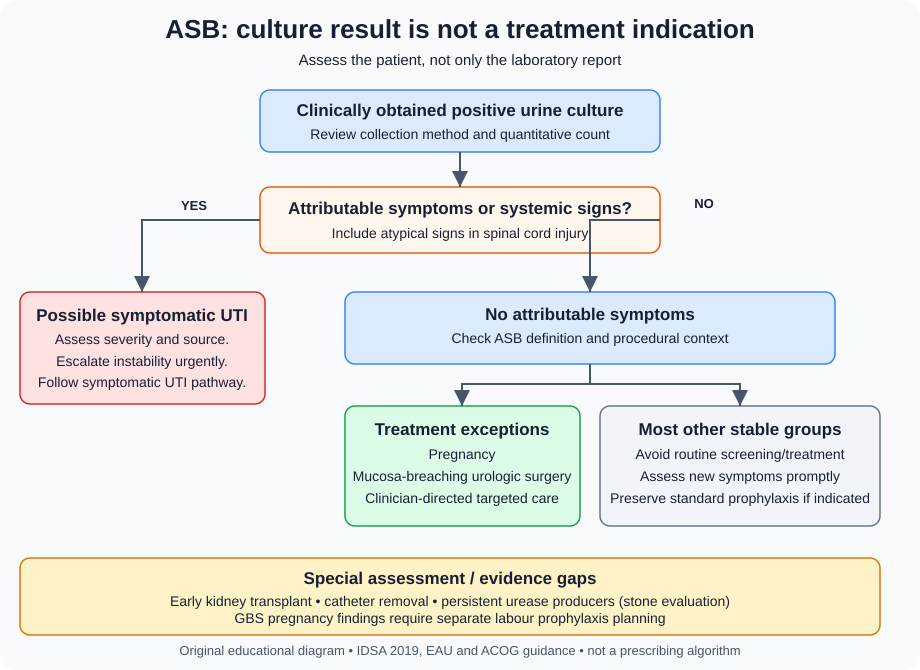

# Asymptomatic Bacteriuria — Nursing Concepts

**Study-ready, not yet studied.** Roman Hinglish revision for NORCET and all-India staff nurse examinations. Guideline-specific exceptions ko population aur clinical context ke saath samjho.

[Chapter](../README.md) · [30 original MCQs](../MCQs/Asymptomatic-Bacteriuria-30-MCQs.md) · [Evidence and practice](../Previous-Year-Questions/Asymptomatic-Bacteriuria-Reported-Evidence.md)

## 🟠 HIGH YIELD — Definition and interpretation

ASB ka meaning hai urine culture mein significant bacterial growth without signs or symptoms attributable to urinary infection. IDSA general voided sample definition mein 10⁵ CFU/mL ya usse zyada count use karta hai. Pyuria present ho sakti hai, lekin compulsory nahi hai. Positive culture aur antibiotic indication do separate decisions hain.

- Noncatheterized woman mein general diagnostic definition persistence ke liye two consecutive qualifying voided cultures, preferably within two weeks, use karti hai. Pregnancy ke recommended screening protocol ko separately follow karo.
- Man mein one qualifying voided specimen diagnostic criterion meet kar sakta hai.
- New catheter or intermittent catheter specimen mein lower counts true bacteriuria reflect kar sakte hain. Symptoms absent hon to lower-count growth ka clinical significance uncertain hai.
- Dipstick nitrites aur leukocyte esterase culture aur clinical assessment replace nahi karte. Pyuria alone symptomatic infection prove nahi karti.

## 🟠 HIGH YIELD — Recognize symptoms before labelling ASB

New dysuria, urgency, frequency, suprapubic pain, fever, rigors aur flank pain ka history assess karo. Vitals, hydration, medication history, recent instrumentation aur catheter status document karo. Haemodynamic instability ya systemic infection concern ho to urgent clinical escalation karo. Positive urine culture ko automatically infection ka source mat maan lo.

Spinal cord injury mein sensation altered ho sakti hai. New spasticity, autonomic dysreflexia, leakage ya malaise baseline se change ho to possible symptomatic UTI aur other triggers assess karo. Autonomic dysreflexia urgent assessment demand karti hai.

Older adult mein fall without urinary or systemic signs ka reason evaluate karo. Injury, orthostatic BP, medicines aur other causes check karo. Isolated delirium with bacteriuria without local urinary or systemic signs bhi other causes aur careful observation demand karta hai, rather than automatically antibiotics. Clinical deterioration par prompt reassessment important hai.

## 🔴 MOST IMPORTANT — Pregnancy

Early prenatal visit par urine culture screen recommended hai. Negative dipstick ke basis par indicated culture cancel mat karo. Significant ASB pregnancy mein treat ki jaati hai because subsequent pyelonephritis risk reduce karna important hai. Prescriber culture susceptibility, allergies, gestational age, renal function aur local resistance ke basis par pregnancy-appropriate agent choose kare.

| Source | Context |
|---|---|
| IDSA 2019 | Pregnancy ASB ke liye 4–7 days suggest karta hai, shortest effective agent-specific course. Initial negative screen ya treated ASB ke baad repeat screening par sufficient evidence nahi. |
| ACOG 2023 | Early prenatal culture aur significant ASB at 10⁵ CFU/mL or greater ke liye targeted 5–7-day treatment. Routine repeat screening after negative initial culture or appropriate treatment par evidence insufficient. |

GBS urine finding special hai. Asymptomatic low-count GBS below 10⁵ CFU/mL ke liye antepartum treatment solely on that count required nahi, lekin intrapartum GBS prophylaxis indication document karo. Significant GBS ASB at or above threshold mein treatment plus labour prophylaxis planning required hai. Planned prelabour caesarean with intact membranes jaise exceptions obstetric team assess karti hai. Symptoms hon to symptomatic infection protocol use hota hai.

## 🔴 MOST IMPORTANT — Urologic surgery exception

Mucosa-breaching endourologic procedures, jaise TURP, ke pehle ASB screen and treat karna recommended hai to reduce postoperative sepsis risk. IDSA preprocedure urine culture guided targeted therapy suggest karta hai, and short course of one or two doses initiated 30–60 minutes before procedure. Exact agent aur timing surgical team orders ke under follow karo.

Uncomplicated diagnostic cystoscopy without mucosal breach low-risk category hai. Actual procedural plan verify karo. Elective nonurologic surgery, including arthroplasty, mein routine ASB screening/treatment recommended nahi. Standard surgical prophylaxis separate decision hai.

## 🟡 Population-specific decisions

| Situation | Routine ASB screening/treatment principle |
|---|---|
| Healthy nonpregnant adult woman | No routine screening or treatment |
| Diabetes, older community or long-term care resident, postmenopausal woman | No routine treatment solely on this status |
| Infants and children | IDSA recommends against routine ASB screening/treatment |
| Kidney transplant beyond one month | IDSA recommends against routine screening/treatment |
| First month after kidney transplant | IDSA evidence insufficient, transplant-team assessment |
| Nonrenal solid-organ transplant | No routine screening/treatment under IDSA |
| Spinal cord injury | No routine ASB treatment, recognize atypical symptomatic presentations |
| Short- or long-term indwelling catheter | No routine screening/treatment in absence of symptoms |
| At catheter removal | IDSA evidence gap, do not turn this into universal prophylaxis mandate |
| Artificial urinary sphincter or penile prosthesis implantation | IDSA suggests no routine ASB screening/treatment, retain standard perioperative prophylaxis |

EAU persistent urease-producing organism such as Proteus mirabilis growth mein stone formation exclude karne ki recommendation deta hai. Routine no-treatment principle evaluation ko prohibit nahi karta. Otherwise healthy women with recurrent symptomatic UTIs mein asymptomatic growth treat karne se future symptomatic episodes badh sakte hain.

## Nursing actions and antimicrobial stewardship

1. Testing ka clinical indication confirm karo. Screening exception absent ho to blanket culture requests clarify karo.
2. Proper collection, sample time, device status aur recent antibiotic history record karo.
3. Results ko symptoms, vital signs aur population-specific risk ke saath communicate karo.
4. Prescriber-directed therapy mein allergy, renal dosing, pregnancy safety, culture result aur adverse effects monitor karo.
5. Unnecessary antibiotics resistance, drug toxicity aur C. difficile infection ka risk create karte hain. Culture sterilization ko har patient ka goal mat banao.
6. New urinary symptoms, fever, hypotension ya acute deterioration par timely reassessment escalate karo.

## Quick exam revision

**Culture positive ≠ symptomatic UTI.** Pregnancy and mucosa-traumatizing endourologic surgery are the classic treatment exceptions. Transplant timing, catheter removal evidence gap, GBS pregnancy rules aur SCI atypical symptoms ko absolute shortcut se replace mat karo.

## Clinical sources

- [IDSA 2019 ASB guideline](https://www.idsociety.org/practice-guideline/asymptomatic-bacteriuria) — direct recommendation and definition text reviewed.
- [EAU Urological Infections, ASB section](https://uroweb.org/guidelines/urological-infections/chapter/the-guideline) — direct text reviewed.
- [ACOG 2023 UTI in pregnancy](https://www.acog.org/clinical/clinical-guidance/clinical-consensus/articles/2023/08/urinary-tract-infections-in-pregnant-individuals) and [ACOG GBS opinion](https://www.acog.org/clinical/clinical-guidance/committee-opinion/articles/2020/02/prevention-of-group-b-streptococcal-early-onset-disease-in-newborns) — indexed recommendations reviewed, full-text direct verification incomplete.

Independent clinical certification, full semantic review and exact video playback remain pending.
