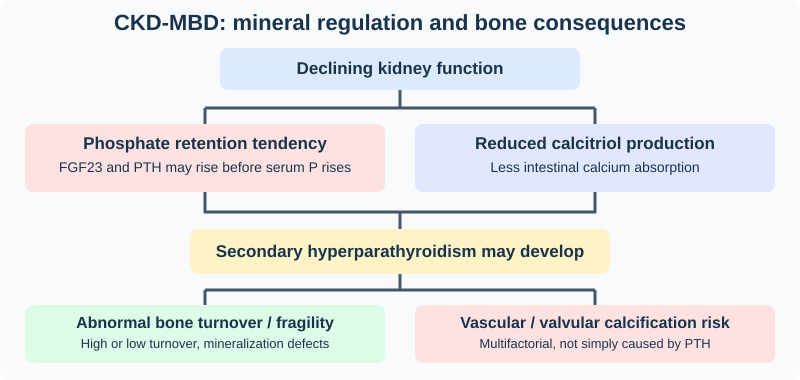

# 📚 CKD Mineral and Bone Disorder — phosphate, calcium, PTH and renal osteodystrophy

[🏠 Chapter](../README.md) · [📝 30 original MCQs](../MCQs/CKD-Mineral-Bone-Disorder-30-MCQs.md) · [📜 Exam evidence](../Previous-Year-Questions/CKD-Mineral-Bone-Disorder-Reported-Evidence.md)

**Study-ready, unattempted.** Adult renal nursing. KDIGO 2017 remains the formal CKD-MBD guideline linked by KDIGO on 27 November 2026. The 2025 controversies conference report discusses evolving evidence and research gaps, not a replacement formal guideline. Clinical prescriptions are individualized.

## 1. Mineral regulation and disease mechanism

**Priority: 🔴 MOST IMPORTANT**

CKD-MBD ka matlab Chronic Kidney Disease–Mineral and Bone Disorder hai. Kidney ki disease ki wajah se calcium, phosphate, vitamin D aur parathyroid hormone (PTH) ka balance disturb ho sakta hai. Haddi ki strength, turnover aur mineralization affect ho sakte hain. Blood vessels aur heart valves mein abnormal mineral deposition bhi is systemic disorder ka part hai.

Normal kidney excess phosphate urine mein remove karti hai. Bone cells fibroblast growth factor 23 (FGF23) release karte hain. Ye functioning nephrons ko phosphate excretion increase karne ka signal deta hai aur active vitamin D production reduce kar sakta hai. Early CKD mein FGF23 aur PTH rise hone se serum phosphate temporarily normal reh sakta hai. Advanced kidney failure mein phosphate clearance inadequate hone par hyperphosphatemia (blood phosphate high) develop ho sakti hai.

Kidney 25-hydroxyvitamin D ko active form 1,25-dihydroxyvitamin D, ya calcitriol, mein convert karti hai. Jab calcitriol kam banta hai toh intestinal calcium absorption reduce ho sakti hai. Phosphate retention, low calcitriol aur calcium changes PTH rise mein contribute karte hain. Secondary hyperparathyroidism mein parathyroid glands response ke roop mein extra PTH banati hain. Long-standing stimulation mein glands autonomous ho sakti hain. Tertiary hyperparathyroidism mein PTH high reh sakta hai even when calcium high ho, including some post-transplant patients. Har high PTH result tertiary disease nahi hai.

## 2. Bone and extraskeletal manifestations

Renal osteodystrophy CKD-MBD ka bone-histology component hai. Ismein bone tissue ke turnover, mineralization aur volume mein abnormalities describe hoti hain. Osteoporosis bone fragility ka alag clinical diagnosis hai, dono coexist kar sakte hain.

| Pattern | Simple explanation |
|---|---|
| Osteitis fibrosa | Persistent severe PTH excess bone turnover increase kar sakta hai. Haddi weak ho sakti hai despite active remodeling. |
| Adynamic bone disease | Bone turnover excessively low hota hai. PTH oversuppression, diabetes, calcium loading aur other factors contribute kar sakte hain. |
| Osteomalacia | Bone matrix mineralize properly nahi hoti. Vitamin D deficiency aur selected toxic exposures contribute kar sakte hain. |
| Mixed uremic bone disease | Turnover aur mineralization abnormalities combine ho sakti hain. |

Bone pain, muscle weakness, reduced mobility, fragility fracture aur children mein poor linear growth possible hain. Bone symptoms absent hone par bhi CKD-MBD ho sakta hai. Fall history aur mobility assess karo. New severe focal bone pain ya suspected fracture mein affected limb protect karke urgent clinical assessment arrange karo.

Vascular calcification blood vessel walls mein abnormal mineral deposition hai. Isse arterial stiffness aur cardiovascular risk increase ho sakta hai. Valvular calcification bhi important risk marker hai. Ye process multifactorial hai, sirf high PTH ka direct effect nahi.

Calciphylaxis rare but life-threatening condition hai. Small blood vessels mein calcification aur thrombosis ki wajah se severe pain aur skin necrosis ho sakti hai. Dialysis patient mein disproportionate deep skin pain, purple net-like lesions ya black necrotic areas urgently report karo. Normal current calcium/phosphate se calciphylaxis exclude nahi hota. Wound care, pain control, infection assessment aur specialist multidisciplinary treatment chahiye.

## 3. Assessment, laboratory trends and KDIGO monitoring

**Priority: 🔴 MOST IMPORTANT**

Serum calcium, phosphate, PTH aur alkaline phosphatase (ALP) monitoring adults mein CKD G3a se start hoti hai. Children mein G2 se suggested hai. 25(OH)D nutritional vitamin D status assess karne mein useful hai. ALP bone ya liver origin se increase ho sakti hai. Bone-specific ALP aur markedly high/low PTH turnover ka clue dete hain, exact histology prove nahi karte.

Adult total calcium commonly around 8.5–10.2 mg/dL aur phosphate around 2.5–4.5 mg/dL hota hai. Local laboratory, age, albumin and clinical context use karo. Ionized calcium biologically active fraction hai. Low albumin se total calcium low aa sakta hai even when ionized calcium normal ho. Critically ill patients aur CKD mein correction formula imperfect hai. When clinically needed, measured ionized calcium better clarify kar sakta hai.

Hypocalcemia mein perioral tingling, muscle cramps, tetany aur prolonged QT possible hain. Severe laryngospasm, seizure, arrhythmia ya new symptomatic calcium decline urgent escalation require karte hain. Chvostek sign facial nerve region tap karne par same-side facial twitch hai. Trousseau sign BP cuff inflation se carpal spasm hai. Ye supportive signs hain, definitive diagnosis nahi.

| Stage | Calcium and phosphate | PTH |
|---|---|---|
| G3a–G3b | 6–12 months | Baseline and CKD progression ke according |
| G4 | 3–6 months | 6–12 months |
| G5 including G5D | 1–3 months | 3–6 months |

ALP G4–G5D mein approximately annually, elevated PTH mein more frequently. Abnormal values, progression aur active treatment mein testing interval shorten ho sakta hai. KDIGO 3.1.4 and 4.1.1 mein serial trends aur calcium, phosphate, PTH together assess karne par emphasis hai. Calcium-phosphate product alone par treatment decide nahi karna. Example calcium 9 and phosphate 6 ka product 54 hai, lekin actual levels and trends ko ignore karke product ko target banana appropriate nahi.

Non-dialysis G3a–G5 mein optimal PTH level established nahi hai. Progressively rising/persistently elevated PTH mein high phosphate intake, hyperphosphatemia, hypocalcemia aur vitamin D deficiency assess karo.

Dialysis G5D mein KDIGO approximate iPTH range 2–9 times assay upper normal limit suggest karta hai. Example lab upper limit 65 pg/mL hai, toh approximate range 130–585 pg/mL hai. Ye rigid normal range ya universal treatment threshold nahi. Marked upward/downward changes even within range treatment review prompt kar sakti hain.

DXA/BMD scan bone density aur fracture risk assess kar sakta hai if result treatment change karega. Bone biopsy turnover/mineralization subtype clarify kar sakti hai when result management affect kare. Lateral abdominal radiograph and echocardiography selected patients mein vascular and valvular calcification assessment ke options hain.

## 4. Treatment, drug safety and nursing care

**Priority: 🔴 MOST IMPORTANT**

KDIGO 2017: progressively/persistently elevated phosphate mein lowering treatment consider karo. High phosphate ko normal range ki taraf reduce karna goal hai. Adult hypercalcemia avoid karo. Serum phosphate normal ho toh preventive binder automatically start nahi karna. Calcium-based binder dose restrict karne ki suggestion hai, particularly high calcium, vascular calcification ya low turnover risk mein clinical team non-calcium option consider kar sakti hai.

| Therapy | Mechanism and nursing precaution |
|---|---|
| Calcium acetate/carbonate | Food phosphate ko gut mein bind karte hain. Calcium load aur hypercalcemia monitor karo. |
| Sevelamer | Non-calcium phosphate binder. GI tolerance aur drug interaction timing check karo. Severe constipation, abdominal pain/vomiting mein prompt review. |
| Lanthanum carbonate | Non-calcium binder. Product-specific chewing or powder administration instructions follow karo. |
| Ferric citrate | Iron-containing phosphate binder. Iron indices review karo because systemic iron absorption possible hai. |
| Aluminum-containing binders | Long-term use avoid karte hain because renal failure mein aluminum toxicity ho sakti hai. Bone, neurologic aur hematologic effects possible hain. |
| Calcitriol/active analogs | PTH suppression and calcium absorption influence karte hain. Calcium aur phosphate rise monitor karo. |
| Cinacalcet | Calcimimetic calcium-sensing receptor sensitivity badhata hai, PTH reduce karta hai. Hypocalcemia, nausea and QT-related risk assess karo. |

Binder ka timing meals/snacks ke prescribed plan ke according rakho. Missed meal ke liye dose automatically double mat karo. Previous CKD bank Q27 already tests basic meal timing. Is package mein drug choice, complications aur clinical review par focus hai.

Vitamin D deficiency ko nutritional vitamin D replacement se correct karna aur active vitamin D prescribe karna separate decisions hain. Adults non-dialysis G3a–G5 mein routine calcitriol/analogs recommended nahi. G4–G5 mein severe progressive secondary hyperparathyroidism ke selected cases mein reserve kiya ja sakta hai. Dialysis patients requiring PTH lowering mein calcimimetic, calcitriol, active analog ya combination acceptable options hain. Choice calcium/phosphate/PTH trends par depend karti hai. Cinacalcet use before administration serum calcium aur prescribed hold parameters check karo. Symptomatic hypocalcemia mein urgent review. US labeling mein secondary HPT use dialysis patients ke liye indicated hai, local product approval verify karo.

Severe HPT unresponsive to medical therapy mein parathyroidectomy consider ho sakti hai. Surgery ke baad hungry bone syndrome mein calcium rapidly bone mein move ho sakta hai, causing prolonged hypocalcemia. Serial calcium, magnesium, phosphate, ECG if indicated, symptoms and prescribed calcium/vitamin D plan monitor karo. 

Persistent high phosphate on dialysis mein intake, binder adherence and dialysis delivery review karo. Team dialytic phosphate removal increase kar sakti hai. KDIGO G5D dialysate calcium 1.25–1.50 mmol/L (2.5–3.0 mEq/L) suggests. Prescription independently change nahi karni.

Indian 2020 commentary local costs, availability, calcium-based binder use with risk review aur selected ND patients mein persistently rising iPTH above 300 pg/mL despite correcting modifiable factors ke baad active vitamin D consideration discuss karti hai. Ye contextual expert recommendations hain, KDIGO ka universal PTH threshold nahi. Affordability aur follow-up barriers nurse assess kare.

Patient education: dietitian ke saath phosphate-containing additives identify karo, protein malnutrition avoid karo, prescribed binders correctly lo aur serial laboratory visits attend karo. Plant, animal aur additive phosphate absorption different ho sakti hai. Food list blanket ban nahi hai. Bone fragility mein safe weight-bearing exercise aur fall prevention individualized honi chahiye.

## ▶️ Teaching and MCQ practice

| Topic | Teaching | MCQ practice |
|---|---|---|
| Mineral feedback loop | [Secondary hyperparathyroidism explained](https://www.youtube.com/watch?v=SYpL-zlZlD0), indexed description | Dedicated renal-specific video mapping pending |
| Dialysis mineral balance | [Mineral Bone Disease in Dialysis](https://www.youtube.com/watch?v=obRGPNjb12I), indexed description | Dedicated renal-specific mapping pending |
| Hypocalcemia signs | [National Kidney Foundation CKD-MBD](https://www.kidney.org/kidney-topics/mineral-and-bone-disorder-ckd-mbd) | [Expert Nursing Classes daily nursing question](https://www.youtube.com/watch?v=zlnlfITHjAw), description contains symptom question in post-thyroidectomy context, related sign only |
| CKD-MBD therapy | [Nephrology Unit Adan Hospital teaching](https://www.youtube.com/watch?v=1Sxu4H8GgSw), indexed | Dedicated medication-specific MCQ video pending |

## References

[KDIGO CKD-MBD official page](https://kdigo.org/guidelines/ckd-mbd/) · [2017 guideline summary, both page images reviewed](https://kdigo.org/wp-content/uploads/2017/02/KDIGO_CKD_MBD_Guideline_r6.pdf) · [2025 controversies conference report announcement](https://kdigo.org/final-report-published-from-kdigo-ckd-mbd-controversies-conference/) · [Indian commentary, 2020](https://indianjnephrol.org/kdigo-2017-clinical-practice-guideline-update-for-the-diagnosis-evaluation-prevention-and-prevention-of-chronic-kidney-diseasemineral-and-bone-disorder-ckdmbd-indian-commentary/) · [National Kidney Foundation](https://www.kidney.org/kidney-topics/mineral-and-bone-disorder-ckd-mbd) · [ERA 2025 calciphylaxis review](https://doi.org/10.1093/ckj/sfaf338) · [Cinacalcet prescribing information](https://www.dailymed.nlm.nih.gov/dailymed/drugInfo.cfm?setid=c288922b-3258-4c1c-bd8a-32a41dd43a63).

[📝 Practice questions](../MCQs/CKD-Mineral-Bone-Disorder-30-MCQs.md) · [🏠 Chapter](../README.md)
