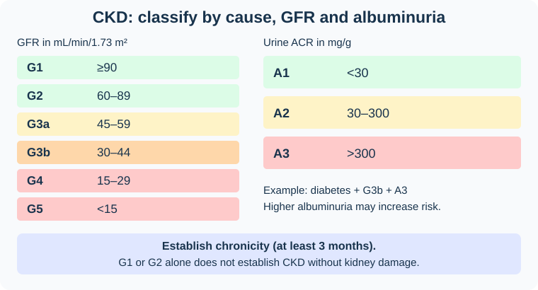

# 📚 Chronic Kidney Disease (CKD) — staging, progression and nursing care

[🏠 Chapter](../README.md) · [📝 30 original CKD MCQs](../MCQs/Chronic-Kidney-Disease-30-MCQs.md) · [📜 Reported exam questions](../Previous-Year-Questions/Chronic-Kidney-Disease-Reported-Exam-Questions.md)

> **Dhyan de:** Study-ready, unattempted. Adult nursing ke liye KDIGO 2024 classification, prevention aur patient care. Complications, renal pharmacology, nutrition aur dialysis ke individual advanced banks agle topics mein expand honge.

## 1. CKD kya hai aur diagnosis kaise hota hai

**Priority:** 🔴 MOST IMPORTANT

Dekho, kidney mein bahut saare nephrons hote hain jo blood filter karte hain. Jab kidney ki structure ya function mein abnormality kam se kam three months tak bani rahe aur health ko affect kare, toh chronic kidney disease kehte hain. CKD early stage mein silent ho sakti hai. Patient urine normal pass kar raha ho, phir bhi kidney damage possible hai.

CKD establish karne ke do common routes hain. eGFR below 60 mL/min/1.73 m² persistent ho sakta hai. Ya kidney damage ka persistent marker present ho sakta hai, jaise albuminuria, abnormal urine sediment, structural abnormality ya transplant history. Ek single low eGFR ko chronic disease assume mat karo. AKI aur AKI on CKD possible hain. Previous labs, history, imaging aur appropriate repeat testing chronicity establish karne mein help karte hain.

Diabetes aur hypertension important causes aur risk factors hain. Glomerular diseases, inherited cystic diseases, long-standing obstruction aur recurrent kidney injury bhi CKD cause kar sakte hain. Har diabetic patient ki kidney disease automatically diabetic nephropathy nahi hoti. Atypical findings mein other causes assess karne hote hain.

## 2. KDIGO CGA classification

**Priority:** 🔴 MOST IMPORTANT

CGA ka matlab Cause, GFR category aur Albuminuria category hai. Sirf eGFR number mat yaad karo. Urine albumin bhi prognosis aur management mein important hai.

| GFR category | eGFR mL/min/1.73 m² |
|---|---|
| G1 | ≥90 |
| G2 | 60–89 |
| G3a | 45–59 |
| G3b | 30–44 |
| G4 | 15–29 |
| G5 | Below 15 |

| Albuminuria category | UACR mg/g |
|---|---|
| A1 | Below 30 |
| A2 | 30–300 |
| A3 | Above 300 |

G1/G2 alone CKD establish nahi karte jab damage marker absent ho. G5 ka matlab kidney failure category hai, lekin har G5 patient ko ek hi number ke basis par immediately dialysis start nahi hoti.

Example: patient ka persistent eGFR 38 aur UACR 500 mg/g hai. GFR 30–44 range mein hai, isliye G3b. Albuminuria above 300 hai, isliye A3. Agar cause diabetes establish hai, toh CGA description diabetic kidney disease G3b A3 ho sakti hai. Same eGFR par A3 generally A1 se higher progression aur cardiovascular risk indicate karti hai.

**Clinical comparison:** AKI hours/days mein develop hoti hai. CKD chronic abnormality hai. AKI on CKD mein old reduced kidney function ke upar acute change aata hai. Small echogenic kidneys chronic disease suggest kar sakti hain, lekin diabetes aur polycystic disease jaise contexts mein size normal ya enlarged bhi ho sakta hai. Ultrasound alone chronicity ka universal proof nahi hai.

## 3. Pathophysiology aur complications

Nephrons lose hone par remaining nephrons extra workload handle karne ki koshish karte hain. Kuch conditions mein increased intraglomerular pressure aur hyperfiltration further damage contribute kar sakte hain. Protein leakage aur scarring progression ka part ho sakte hain. Cause-specific treatment, BP control aur kidney-protective medication se progression slow ho sakti hai. Har patient same speed se progress nahi karta.

Early disease asymptomatic ho sakti hai. Advanced disease mein fatigue, poor appetite, nausea, pruritus, edema, breathlessness, altered sleep aur cognitive symptoms develop ho sakte hain. Ye symptoms nonspecific hain.

- **Azotemia vs uremia:** Azotemia nitrogenous waste elevation ko describe karta hai. Uremia kidney failure se related clinical syndrome hai, jaise encephalopathy ya pericarditis. Sirf ek lab value se uremia confirm nahi hoti.
- **Anemia:** Kidney EPO production kam kar sakti hai. Iron deficiency, inflammation aur blood loss bhi contribute kar sakte hain. KDIGO 2026 anemia guidance correctable causes address karne par emphasize karti hai before ESA therapy.
- **CKD mineral and bone disorder:** Phosphate handling aur calcitriol production alter ho sakte hain. PTH rise kar sakta hai. Calcium, phosphate aur PTH trends saath interpret hote hain.
- **Acid-base and electrolytes:** Net acid excretion aur potassium regulation impaired ho sakti hai. Har CKD patient hyperkalemic nahi hota. Labs aur medicines se risk assess karo.
- **Cardiovascular risk:** Hypertension, vascular disease aur heart failure ka risk clinically important hai. CKD care sirf creatinine lowering nahi hai.

## 4. Nursing management and progression prevention

**Priority:** 🔴 MOST IMPORTANT

Patient ka BP, prescribed home monitoring, glucose control if diabetic, weight, edema, symptoms, medication history aur kidney lab trends review karo. eGFR aur albuminuria monitoring interval risk ke according clinician decide karega. Sudden deterioration ko usual CKD progression assume mat karo.

### Medicines ka nursing connection

ACE inhibitor ya ARB indicated albuminuric CKD mein kidney-protective ho sakta hai. Serum creatinine aur potassium monitor karne hote hain, especially initiation/dose increase ke baad. ACE inhibitor aur ARB ko routine combination mein use nahi karna. SGLT2 inhibitors selected CKD patients mein kidney aur cardiovascular protection provide karte hain, including some people without diabetes. KDIGO 2024 indication eGFR, albuminuria, heart failure aur patient context se linked hai. Prescriber assessment zaroori hai.

NSAIDs aur unreviewed herbal remedies avoid karne ki teaching useful hai. Medicine dose adjustment renal function aur specific drug instructions par depend karta hai. AKI mein renal function estimate rapidly change ho sakta hai. Nurse apni taraf se dose change nahi karegi.

Anemia management mein CBC, iron studies (ferritin aur transferrin saturation) aur prescribed treatment response monitor karo. ESA ka matlab erythropoiesis-stimulating agent hai. Iska aim anemia ko safely manage karna hai, Hb ko arbitrarily high normal level tak push karna nahi. BP aur thrombotic risk clinically important hain. Full anemia treatment thresholds aur monitoring next complications bank mein aayenge.

Phosphate binders prescribed hon toh generally phosphate-containing meals ke saath timing important hoti hai. Individual drug instructions check karo. Patient ko apni taraf se calcium, vitamin D ya potassium supplements start nahi karne chahiye.

### Diet aur fluid advice

CKD diet stage, labs, nutrition, dialysis status aur other illness ke according individualized hoti hai. KDIGO 2024 adult CKD G3–G5 non-dialysis mein around 0.8 g protein/kg/day suggest karta hai. Malnutrition, frailty aur acute illness mein clinician/dietitian individual plan banayenge. Dialysis par protein requirement commonly higher hoti hai. Har CKD patient ko blanket very-low-protein diet dena safe nahi.

Sodium restriction BP aur edema management mein help kar sakti hai. KDIGO general target below 2 g sodium/day (roughly below 5 g salt/day) suggest karta hai, individual exceptions possible hain. Potassium aur phosphorus restrictions laboratory trends aur treatment needs par based honi chahiye. Potassium-containing salt substitute hyperkalemia risk badha sakta hai. Har fruit ko automatically ban ya recommend mat karo. Fluid restriction urine output, edema, heart failure aur dialysis plan ke according hoti hai. Normal hydration needs wale patient ko unnecessary restriction mat do.

### Referral, kidney replacement therapy and supportive care

Progressive decline, severe albuminuria, unclear cause, resistant hypertension, electrolyte issues ya advanced CKD mein nephrology assessment important ho sakta hai. Advanced CKD mein timely modality education, access planning, transplant assessment aur comprehensive conservative care ki discussion honi chahiye. Dialysis initiation symptoms, signs, quality of life, preferences, GFR trend aur refractory complications ke composite assessment se decide hoti hai. Sirf eGFR below 15 ka automatic order nahi hai.

Community screening mein diabetes, hypertension, previous AKI aur family history wale high-risk people ko appropriate BP, diabetes management, serum creatinine/eGFR aur urine ACR assessment ke liye connect karo. Red flags jaise severe breathlessness, confusion, chest pain, significant reduction in urine, persistent vomiting ya severe weakness mein urgent assessment encourage karo. Smoking cessation, appropriate physical activity, medicine review, vaccination aur regular follow-up education do.

## ▶️ Teaching and question practice

- [RegisteredNurseRN — Chronic Renal Failure Nursing](https://www.youtube.com/watch?v=Hwl8WubnO-M), indexed description confirms causes, stages, symptoms and pathophysiology. Older lecture, current classification aur individualized care ke liye written guideline use karo.
- [ADAPT NCLEX — 15 Renal System Practice Questions](https://www.youtube.com/watch?v=_VMKtg57Ej0), indexed description includes CKD, AKI and other renal topics. Broad question practice lead, not verified coverage of individual CKD learning points.
- [NORCET 10 renal system part 02 — CKD](https://www.youtube.com/watch?v=p4Wqo9oK0Gk), mixed teaching and MCQ lead. Playback and specific questions pending.

## References

[National Kidney Foundation CGA classification](https://www.kidney.org/how-to-classify-ckd) · [KDIGO 2024 CKD executive summary](https://doi.org/10.1016/j.kint.2023.10.016) · [NICE CKD assessment and management](https://www.nice.org.uk/guidance/ng203/chapter/Recommendations) · [KDIGO 2026 anemia guideline summary](https://www.guidelinecentral.com/guideline/25104/) · [ICMR July 2026 nephrology workflow](https://www.icmr.gov.in/icmrobject/uploads/STWs/1793170716_nephrology.pdf).

[📝 CKD questions](../MCQs/Chronic-Kidney-Disease-30-MCQs.md) · [🏠 Chapter](../README.md)
