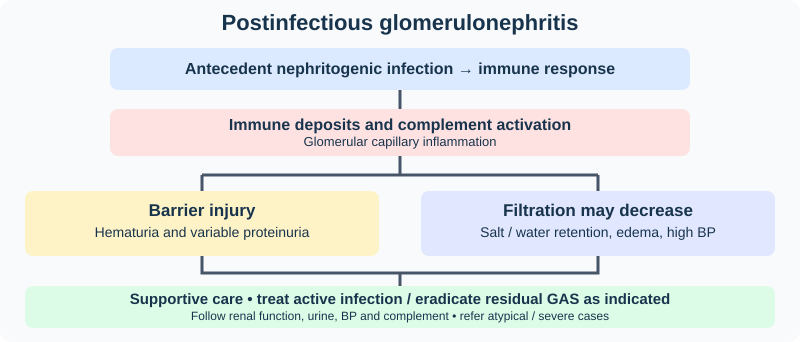

# 📚 Glomerulonephritis — immune injury and infection-related GN

[🏠 Chapter](../README.md) · [📝 30 original MCQs](../MCQs/Glomerulonephritis-30-MCQs.md) · [📜 Exam evidence](../Previous-Year-Questions/Glomerulonephritis-Reported-Evidence.md)

**Study-ready, unattempted.** This package covers general glomerulonephritis and infection-related GN, especially post-streptococcal GN. Separate detailed nephritic syndrome, nephrotic syndrome, RPGN and IgA nephropathy banks follow. No patient-specific treatment prescription.

## 1. What is glomerulonephritis?

**Priority:** 🔴 MOST IMPORTANT

Dekho, glomerulus kidney ke andar capillaries ka chhota filtration unit hai. Blood se water aur small dissolved substances filter hote hain, lekin normally RBC aur large proteins mainly blood mein remain karte hain. Glomerulonephritis (GN) mein is filtering unit mein inflammation aur injury hoti hai. Ye single disease nahi hai. Different infection-related, autoimmune aur other immune mechanisms GN cause kar sakte hain.

Primary glomerular disease predominantly kidney ko affect karti hai. Secondary disease systemic illness ke context mein hoti hai, jaise lupus, infective endocarditis ya vasculitis. Nephritic syndrome GN ki clinical presentation ho sakti hai, but GN and nephritic syndrome identical disease names nahi hain. Nephrotic-range proteinuria aur nephritic findings coexist kar sakti hain. Detailed syndrome comparison next packages mein hai.

Immune complex antigen-antibody association hai. Complexes glomerular structures mein deposit ya locally form ho sakte hain. Complement proteins immune response ka part hain. Activation inflammatory cells recruit kar sakti hai. Capillary wall damage se RBC aur protein urine mein leak ho sakte hain. Filtration surface aur perfusion affect hone se GFR decline ho sakta hai. Sodium-water excretion inadequate hone par edema aur hypertension develop ho sakte hain.

Anti-GBM disease mein glomerular basement membrane ke targets ke against antibodies bind karti hain. Pauci-immune GN mein biopsy immunofluorescence par relatively few immune deposits hote hain, often ANCA-associated vasculitis ke context mein. Detailed rapidly progressive disease treatment separate package mein cover hoga.

## 2. Infection-related glomerulonephritis (IRGN) and PSGN

**Priority:** 🔴 MOST IMPORTANT

IRGN infection ke baad ya ongoing infection ke dauran develop ho sakti hai. Post-streptococcal glomerulonephritis (PSGN) specific nephritogenic group A Streptococcus (Streptococcus pyogenes) strains ke baad immune-mediated nonsuppurative complication hai. Kidney mein bacteria directly pus banate hain, ye usual PSGN mechanism nahi hai.

Classic latent period mein throat infection ke approximately 10 days baad, ya skin infection ke several weeks baad renal symptoms aa sakte hain. CDC 2025 skin infection ke baad up to 3 weeks describe karta hai. Other nephrology references wider intervals describe karti hain, especially skin infections mein. Isliye history mein rigid day cutoff use mat karo. Hematuria simultaneously with respiratory infection can suggest another diagnosis such as IgA nephropathy rather than classic delayed PSGN, but timing alone diagnostic nahi.

PSGN children mein common hai, adults bhi affected ho sakte hain. Adults, particularly older adults and those with comorbidities, poorer recovery risk rakh sakte hain. Active staphylococcal infection, infective endocarditis or infected vascular shunt se infection-related GN ongoing infection ke dauran develop ho sakti hai. Is situation mein source control and antibiotics central hain. Fever, heart murmur, vascular access infection and antimicrobial history specifically ask karo.

PSGN ka renal inflammatory syndrome itself person-to-person transmit nahi hota. Residual group A strep infection spread ho sakti hai. Hand hygiene, respiratory etiquette and wound care important hain. Antibiotics residual GAS eradicate karne aur transmission reduce karne ke liye prescribed ho sakte hain, even when renal symptoms immune-mediated hain. Established renal inflammation ko antibiotic immediately reverse nahi karta. Evidence insufficient hai ki antimicrobial treatment reliably prevents PSGN in every person.

## 3. Evaluation and differential diagnosis

History mein recent sore throat, skin sores, onset dates, recurrence, family kidney disease, hearing problems, medicines, rash, joint symptoms, fever, hemoptysis and urine changes document karo. Typical findings periorbital edema, dark urine, low urine output and elevated BP ho sakti hain. Urine color alone specific diagnosis nahi hai. General assessment bank already covers RBC casts, basic creatinine and biopsy precautions, so those questions are not repeated here.

| Assessment | Purpose |
|---|---|
| Urine microscopy and protein quantification | Glomerular blood and protein leakage, severity and follow-up |
| Creatinine, electrolytes, albumin and CBC | AKI, complications, anemia, protein loss |
| Complement C3 and C4 | Immune mechanism clues, especially transient low C3 in typical PSGN |
| ASO and anti-DNase B | Evidence of recent streptococcal infection, not proof of ongoing bacterial infection |
| Blood cultures and other cultures when indicated | Evaluate suspected active infection such as endocarditis |
| ANA, anti-dsDNA, ANCA, anti-GBM when indicated | Evaluate other immune causes with specialist guidance |
| Kidney biopsy | Clarify atypical or rapidly progressive disease, histology and treatment decisions |

ASO stands for antistreptolysin O. Elevated antibody past exposure support kar sakti hai, but a single high result PSGN prove nahi karta. Anti-DNase B particularly helpful ho sakta hai after skin infection, where ASO rise less reliable ho sakta hai. Throat swab negative after resolved infection PSGN exclude nahi karta.

C3 often reduced during typical PSGN, C4 often normal or less affected. C3 generally recovers over several weeks, often 6–8 weeks. Royal Children's Hospital (RCH) pediatric guideline 8-week complement and renal-function reassessment recommends. AsPNA 2026 pediatric IRGN guidance biopsy for atypical features, nephrotic syndrome, persistent low C3 beyond 12 weeks or rapidly progressive GN describe karta hai. These are different decision points, not a reason to wait 12 weeks with clinical deterioration. Persistent low complement needs specialist reassessment for alternative pathology. Normal C3 does not completely exclude infection-related GN.

Typical uncomplicated pediatric PSGN mein biopsy usually not required. Atypical presentation, unexpectedly heavy protein loss, rapid renal decline, persistent complement disturbance or unclear etiology mein nephrologist biopsy consider karta hai. Biopsy light microscopy par proliferation, immunofluorescence par granular immune deposits and electron microscopy par subepithelial hump-shaped deposits classic clues hain. Humps alone etiology prove nahi karte. ANCA/anti-GBM disease or lupus workup clinical context specific hai.

## 4. Management, nursing care and follow-up

**Priority: 🔴 MOST IMPORTANT**

Supportive care main approach hai in uncomplicated PSGN. Prescribed sodium and fluid adjustment, volume assessment, BP control, loop diuretics for congestion if appropriate and close renal/electrolyte monitoring important hain. Antibiotics prescribed to eradicate residual GAS or treat active bacterial infection. Routine immunosuppression uncomplicated PSGN ke liye standard therapy nahi. Selected crescentic/rapidly progressive IRGN requires specialist individualized decision after infection assessment. Active infection mein unsupervised steroids harmful ho sakte hain.

ICMR July 2026 glomerular workflow early identification, cause-directed care, avoiding nephrotoxins and urgent referral for severe disease support karta hai. AsPNA 2026 recommends inpatient monitoring for significant edema, severe hypertension or AKI in children. Pediatric BP age, sex and height ke according interpret karo. Correct cuff size and calm repeat measurement important hain. Adult fixed threshold directly apply mat karo.

New severe headache, altered consciousness, visual disturbance, seizures, respiratory distress, marked oliguria/anuria, rapidly worsening renal function or pulmonary hemorrhage are red flags. Immediate clinical escalation and stabilization required. Renal replacement therapy selected refractory life-threatening complications mein may be required, not automatically based on urine color or diagnosis.

Patient and family ko recovery time variable explain karo. Gross hematuria, BP, edema and creatinine usually improve earlier than persistent microscopic hematuria. RCH notes microscopic hematuria can persist up to two years after otherwise recovering PSGN. Persistent or recurrent gross hematuria, worsening proteinuria, persistent hypertension or creatinine rise is not routine reassurance. Follow-up urine, BP, renal function and complement plan essential hai, even after clinical improvement. Severe or atypical IRGN may require long-term nephrology follow-up. Avoid NSAIDs and unreviewed herbal medicines. Teach return precautions and follow-up attendance.

## ▶️ Teaching and MCQ practice

| Resource | Verification |
|---|---|
| [RegisteredNurseRN acute poststreptococcal GN](https://www.youtube.com/watch?v=nDklf0bYqeQ) | Indexed teaching description, predates 2026 guideline |
| [Level Up RN pediatric glomerulonephritis](https://www.youtube.com/watch?v=euB8N20-UVY) | Indexed teaching description, signs/labs/nursing care |
| [Nursing Wallah NORCET 10 renal MCQ series, 58:29](https://www.youtube.com/watch?v=FzjMv67IJA8&t=3509s) | Indexed chapter marker on PSGN features, cola-colored urine and hypertension. Topic-level MCQ support, exact playback pending |
| [Voogly renal and urinary Saunders MCQs + concepts](https://www.youtube.com/watch?v=vPLijfb2tIk) | Indexed description names GN, mixed topic practice, exact questions not verified |

## References

[CDC PSGN clinical guidance, August 2025](https://www.cdc.gov/group-a-strep/hcp/clinical-guidance/post-streptococcal-glomerulonephritis.html) · [ICMR July 2026 glomerular workflow](https://www.icmr.gov.in/icmrobject/uploads/STWs/1784807344_glomerulardiseases-updated.pdf), extracted text checked, screenshot unavailable · [AsPNA 2026 pediatric IRGN guideline](https://doi.org/10.1007/s00467-026-07146-4), institutional abstract reviewed, full article not independently reviewed · [RCH pediatric PSGN guidance](https://www.rch.org.au/clinicalguide/guideline_index/Post-streptococcal_glomerulonephritis_(PSGN)/), direct HTML reviewed · [MSD postinfectious GN](https://www.msdmanuals.com/professional/nephrology/glomerular-disorders/postinfectious-glomerulonephritis-pign) · [KDIGO glomerular disease guidelines and chapter updates](https://kdigo.org/guidelines/gd/). Use the current disease-specific updates where relevant.

[📝 Practice questions](../MCQs/Glomerulonephritis-30-MCQs.md) · [🏠 Chapter](../README.md)
