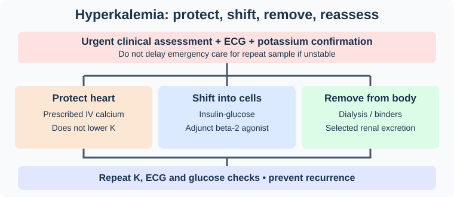

# 📚 Hyperkalemia — renal electrolyte emergency and nursing care

[🏠 Chapter](../README.md) · [📝 Original MCQs](../MCQs/Hyperkalemia-30-MCQs.md) · [📜 Exam evidence](../Previous-Year-Questions/Hyperkalemia-Reported-Evidence.md)

**Study-ready, unattempted.** Adult nursing scope. Emergency medicines sirf prescribed protocol aur monitored clinical setting mein administer hoti hain.

## 1. Potassium balance and causes

**Priority:** 🔴 MOST IMPORTANT

Potassium ek electrolyte hai jo muscles aur nerves ke electrical signals ke liye important hai. Body ka zyada potassium cells ke andar hota hai. Blood mein chhota portion hota hai, isliye thoda sa extracellular change bhi heart rhythm ko disturb kar sakta hai. Normal serum range laboratory ke hisaab se vary karti hai, commonly around 3.5–5.0 mmol/L. Potassium monovalent ion hai, isliye mmol/L aur mEq/L numerical value same hoti hai.

UK Kidney Association classification mein 5.5–5.9 mild, 6.0–6.4 moderate aur ≥6.5 severe hyperkalemia hai. Clinical urgency rate of rise, symptoms, ECG aur renal function par bhi depend karti hai. Local lab critical values aur emergency policy follow karo.

Kidney distal nephron mein potassium secretion regulate karti hai. Aldosterone, distal sodium delivery aur tubular flow important hain. Advanced CKD, AKI ya reduced aldosterone effect mein excretion kam ho sakti hai. ACE inhibitors, ARBs, mineralocorticoid receptor antagonists, trimethoprim aur NSAIDs susceptible patients mein risk badha sakte hain. Drug history aur potassium supplements assess karo. Long-term kidney-protective medicines apni taraf se permanently stop mat karo.

Cell breakdown, jaise rhabdomyolysis ya tumor lysis, intracellular potassium blood mein release kar sakta hai. Insulin deficiency aur hyperosmolality potassium ko cells se bahar shift kar sakte hain. DKA mein measured blood potassium high ho sakta hai jab total body potassium depleted ho. Isliye DKA protocol mein frequent potassium testing aur insulin safety important hai. Acidosis ka potassium par effect underlying acid aur mechanism par depend karta hai.

## 2. Recognition and specimen safety

**Priority:** 🔴 MOST IMPORTANT

Hyperkalemia asymptomatic bhi ho sakti hai. Muscle weakness, paresthesia, palpitations, syncope aur severe rhythm disturbance possible hain. ECG mein tall narrow peaked T waves, PR prolongation, flattened/absent P waves, wide QRS aur severe cases mein sine-wave pattern ho sakta hai. Ye fixed sequence nahi hai. Normal ECG dangerous hyperkalemia exclude nahi karta.

Pseudohyperkalemia ka matlab sample mein potassium falsely high aana hai jab patient ka circulating potassium actually high nahi hai. Difficult collection, hemolysis, prolonged tourniquet, repeated fist clenching, potassium EDTA contamination aur marked thrombocytosis/leukocytosis possibilities hain. Thrombocytosis mein clotting ke time platelet potassium release se serum result plasma se higher ho sakta hai. Clinical team aur laboratory se paired serum/lithium-heparin plasma sample ka plan discuss karo. Unstable patient mein confirmatory result ka wait karke treatment delay nahi karna.

Urgently assess ABC, vital signs, recent potassium trend, kidney function, ECG aur medications. UKKA hospital guidance severe potassium elevation, ECG abnormalities aur selected clinically unwell moderate cases mein continuous rhythm monitoring support karti hai. 12-lead ECG aur repeat biochemical assessment local emergency protocol ke according arrange karo.

## 3. Emergency management and monitoring

**Priority:** 🔴 MOST IMPORTANT

Heart protection aur potassium lowering same treatment nahi hain. Previous AKI bank Q25 calcium ke mechanism aur Q26 glucose monitoring test karta hai. Yahan deeper safety points padho.

| Treatment principle | Nursing explanation |
|---|---|
| Protect the heart | IV calcium prescribed ho toh ECG monitor karo. Calcium chloride aur calcium gluconate same volume mein equivalent elemental calcium nahi dete. Formulation, concentration, route aur IV access verify karo. Extravasation tissue damage kar sakta hai. |
| Shift potassium | IV insulin-glucose temporarily potassium cells ke andar shift karta hai. Nebulized salbutamol adjunct ho sakta hai. Severe cases mein salbutamol alone reliable treatment nahi hai. |
| Remove potassium | Dialysis directly potassium remove karti hai. Selected binders gut se removal support karte hain. Diuretics useful ho sakte hain only if patient ka renal function aur volume status permit karta hai. |
| Reassess | Repeat serum potassium aur rhythm check karo. Insulin ka effect waning hone par rebound hyperkalemia possible hai. |
| Prevent recurrence | Cause, diet, medications, renal follow-up aur dialysis adherence review karo. |

UKKA online hospital summary insulin-glucose ke baad glucose checks baseline se six hours tak describe karti hai. Exact monitoring intervals hospital protocol se verify karo. Baseline low glucose, CKD aur poor intake hypoglycemia risk badha sakte hain. Sweating, confusion, tremor ya altered consciousness mein immediately glucose check aur prescribed hypoglycemia response follow karo.

Potassium-shifting treatment se initial K fall ho sakta hai, lekin total body potassium remove nahi hota. Isliye follow-up blood tests important hain. Severe hyperkalemia in maintenance hemodialysis patient urgent dialysis assessment require karti hai. ECG toxicity ho toh calcium protection prescribed ho sakti hai even if dialysis available hai.

Sodium bicarbonate IV routine hyperkalemia monotherapy nahi hai. Selected severe metabolic acidosis mein clinical team use decide kar sakti hai. Sodium load aur volume status consider karna zaroori hai.

## 4. Chronic prevention and nursing education

Patient ka dietary history, constipation, salt substitutes, supplements aur prescribed medicines review karo. Potassium-containing additives aur salt substitutes clinically important ho sakte hain. Har fruit ban karna ya har patient ko same diet dena sahi nahi hai. Renal dietitian laboratory trends, overall nutrition aur dialysis status se plan banata hai.

Potassium binders jaise patiromer aur sodium zirconium cyclosilicate drug-specific adverse effects aur interaction precautions rakhte hain. Patiromer magnesium lower kar sakta hai. Sodium zirconium cyclosilicate mein sodium load aur edema concern ho sakta hai. Prescribed separation from other oral drugs product instructions se verify karo. Binder ko emergency cardiac stabilization ka substitute mat samjho.

Discharge teaching mein repeat potassium/creatinine testing, medication plan, dialysis attendance aur warning symptoms explain karo. Severe weakness, syncope, chest symptoms ya palpitation mein urgent assessment chahiye. Patient ko symptoms absent hone par bhi scheduled tests attend karne hain.

## ▶️ Teaching and MCQ practice

| Topic | Teaching | MCQ practice |
|---|---|---|
| Causes, symptoms and ECG | [RegisteredNurseRN hyperkalemia review](https://www.youtube.com/watch?v=-6b8svtDWys), indexed description covers causes and ECG | [RRB Nursing Superintendent MSN Part 2](https://www.youtube.com/watch?v=OxAE8DBY8QY&t=70s), indexed chapter marker about peaked T waves. Exact playback not checked. |
| Specimen errors, treatment and follow-up | [UKKA hospital guidance](https://guidelines.ukkidney.org/hyperkalaemia/6-summary-of-clinical-practice-guideline-for-hyperkalaemia/6-2-section-ii-hospital/) | Dedicated question coverage pending except ECG topic lead. |

## References

[UKKA hyperkalemia guideline landing page](https://www.ukkidney.org/health-professionals/guidelines/treatment-acute-hyperkalaemia-adults-0) (July 2026 updated guideline listed) · [UKKA hospital recommendations](https://guidelines.ukkidney.org/hyperkalaemia/6-summary-of-clinical-practice-guideline-for-hyperkalaemia/6-2-section-ii-hospital/) (direct HTML checked) · [Asia-Pacific consensus](https://onlinelibrary.wiley.com/doi/full/10.1111/nep.14281) · [Hyperkalemia treatment standard](https://academic.oup.com/ndt/article/39/7/1097/7616929) · [BMJ 2026 acute hyperkalemia review](https://www.bmj.com/content/394/bmj-2026-100287).

**Quick revision:** Potassium high ho toh ECG normal hone se safety guarantee nahi hoti. Protect, shift, remove, reassess aur cause prevent karo.

[📝 MCQs](../MCQs/Hyperkalemia-30-MCQs.md) · [🏠 Chapter](../README.md)
