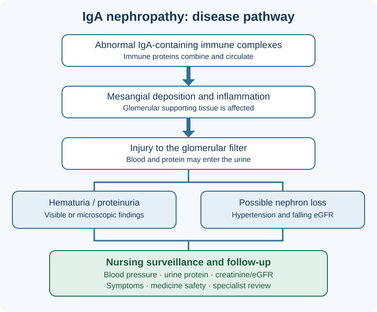

# 🩺 IgA Nephropathy (Berger Disease)

**Study-ready, not yet studied.** Ye Adult Health Nursing aur NORCET practice ke liye hai. Treatment decisions nephrology team aur authorized local protocol ke hisaab se hote hain.

[Chapter](../README.md) · [Topic map](Renal-and-Urinary-System-Topic-Coverage-Map.md) · [Original MCQs](../MCQs/IgA-Nephropathy-30-MCQs.md) · [Previous Year Questions evidence](../Previous-Year-Questions/IgA-Nephropathy-Reported-Evidence.md)

## 1. 🟠 HIGH YIELD — IgA nephropathy kya hai?

Hamare kidney ke andar glomeruli naam ke bahut chhote blood filters hote hain. Normal filter paani aur chhote waste particles ko nikalne deta hai, lekin blood cells aur zyada protein ko blood ke andar hi rakhta hai. IgA, yaani immunoglobulin A, hamare immune system ka ek antibody hai jo khaaskar mucosal surfaces par protection mein madad karta hai. Mucosal surfaces naak, throat aur intestine jaise hisson ki andar ki lining hoti hain.

IgA nephropathy mein IgA1 ke kuch molecules par sugar chains ka pattern abnormal hota hai. In molecules ko galactose-deficient IgA1 kehte hain. Dusre antibodies in molecules se judkar immune complexes bana sakte hain. Ye complexes kidney ke glomerulus ke beech ke supporting tissue, yaani mesangium, mein jama ho sakte hain. Jab wahan inflammation hota hai, toh filter ki normal barrier kharab ho sakti hai aur urine mein blood aur protein aa sakte hain. Is disease ko Berger disease bhi kehte hain.

Ye sirf infection ke bacteria ka kidney tak pahunchna nahi hai. Infection ke aas-paas immune response badhne se symptoms nazar aa sakte hain, lekin disease ka mechanism immune-mediated hai. Har sore throat wale patient ko IgA nephropathy nahi hoti.

Diagram mein samjho ki immune complexes se filter ko nuksan ho sakta hai. Nurse sirf urine ka rang nahi dekhti. Woh protein loss, filtration aur BP ke trend ko bhi follow karti hai.

## 2. 🟠 HIGH YIELD — Clinical presentation aur differential

Kai patients ko shuru mein koi symptom nahi hota. Routine urine examination mein microscopic hematuria ya proteinuria mil sakti hai. Microscopic hematuria ka matlab hai ki urine mein red blood cells hain, lekin aankh se khoon zaroori nahi dikhe. Visible hematuria mein urine pink, brown ya cola jaisa dikh sakta hai.

Kabhi patient ko cold ya sore throat ke dauran ya bahut jaldi baad visible hematuria hoti hai. Is pattern ko synpharyngitic hematuria kehte hain. Classic post-streptococcal glomerulonephritis mein renal symptoms aam taur par infection ke baad ek latent interval ke saath aate hain. Timing ek useful clue hai, lekin akeli timing diagnosis confirm nahi karti.

| Finding | Iska matlab samjho |
|---|---|
| Proteinuria | Filter ki barrier se protein leak ho raha ho sakta hai. |
| Normal serum C3 | IgA nephropathy mein C3 aam taur par normal hota hai, lekin ye result akela diagnosis nahi karta. |
| Purpura, abdominal pain aur joint symptoms | Skin, gut aur joints ki involvement se systemic IgA vasculitis ka doubt hota hai. |
| Fever ke saath active infection aur IgA-dominant deposits | Infection-related glomerulonephritis bhi consider karna chahiye, isliye biopsy pattern ko clinical history ke saath interpret karte hain. |
| Hypertension aur worsening filtration | Long-term kidney damage ka risk ho sakta hai, isliye follow-up zaroori hai. |

IgA vasculitis ko pehle Henoch-Schönlein purpura kaha jaata tha. Ismein chhoti blood vessels ki systemic inflammation hoti hai. Kidney mein deposits primary IgA nephropathy jaise dikh sakte hain, isliye skin, joints aur abdomen ka assessment bhi important hai.

## 3. 🔴 MOST IMPORTANT — Diagnosis aur risk assessment

Urine examination se blood aur protein ka pata lagta hai. Nurse ko serum creatinine, estimated glomerular filtration rate (eGFR) aur urine protein excretion ki reports ko saath mein dekhna chahiye. eGFR kidney ke filtration function ka estimate hai. Protein-creatinine ratio urine protein ka practical estimate deta hai. Jab doctor ko exact timed protein measurement chahiye, toh prescribed collection ka sahi tareeka samjhana important hai.

KDIGO 2025 ke mutabik IgA nephropathy ko confirm karne ke liye kidney biopsy chahiye. Suspected adult IgA nephropathy mein proteinuria 0.5 g/day ya uske equivalent tak pahunchne par biopsy consider ki jaati hai, agar biopsy contraindicated na ho. Serum IgA badha hua hona ya urine dipstick positive hona apne aap mein confirmation nahi hai.

Biopsy mein immunofluorescence naam ki technique se antibodies ke deposit ka pattern dekha jaata hai. IgA-dominant ya co-dominant mesangial staining characteristic finding hai. Pathologist Oxford MEST-C score se injury aur scarring ke alag features describe kar sakta hai. Score prognosis ki discussion mein help karta hai, lekin score ke ek letter se nurse ko koi specific medicine independently select nahi karni chahiye.

Example: Agar adult patient ka urine protein 0.7 g/day hai aur suspected IgA nephropathy hai, toh nurse report ko nephrology team tak pahunchati hai. Patient ko biopsy ki zaroorat aur bleeding risk ke assessment ka decision specialist karega. Is value ko bachchon ke liye automatically apply nahi karna hai.

## 4. 🔴 MOST IMPORTANT — Kidney ko protect karne ka plan

Treatment ke do related goals hote hain. Pehla goal immune-complex injury ko kam karna hai. Doosra goal bache hue nephrons par pressure aur protein leakage ko kam karna hai. Nephron kidney ki functional unit hoti hai. Dono goals ko patient ki risk profile ke hisaab se address kiya jaata hai.

KDIGO 2025 mein proteinuria ko 0.5 g/day se neeche aur ideally 0.3 g/day se neeche rakhna goal hai. BP ka target 120/70 mm Hg ya isse kam bataya gaya hai, lekin patient ki tolerance, standardized measurement, symptoms aur treating team's plan ko dhyan mein rakhte hain. Ye numbers har patient ke liye nurse ka independent medicine-titration order nahi hain.

| Therapy | Nurse ko kya samajhna chahiye? |
|---|---|
| ACE inhibitor ya ARB | Ye glomerular pressure aur protein leakage kam karne mein madad kar sakte hain. BP, potassium aur creatinine ki monitoring order ke mutabik hoti hai. |
| SGLT2 inhibitor | Selected patients mein ye kidney protection mein madad kar sakta hai. Volume status aur illness-related medicine instructions samjhana zaroori hai. |
| Sparsentan | Ye selected adults ke liye specialist option hai, jahan approved aur suitable ho. Isse ACE inhibitor ya ARB ke saath routine combination mein nahi dete. |
| Targeted-release budesonide | Selected progressive-risk patients ke liye disease-specific treatment ho sakta hai. Iska formulation aur monitoring specialist decide karta hai. |
| Systemic glucocorticoids | Selected situations mein inflammation ko kam karne ke liye use hote hain. Infection, metabolic effects aur prophylaxis plan ko carefully monitor karte hain. |

KDIGO 2025 progressive-risk cases mein targeted-release budesonide ka nine-month course suggest karta hai. Agar ye available na ho, toh specialist reduced-dose systemic steroid aur infection prophylaxis consider kar sakta hai. Medicine availability, local approval aur patient-specific contraindications alag ho sakte hain. Har patient ko steroids ya nayi targeted medicines dena zaroori nahi hai.

## 5. Nursing assessment aur patient education

Nurse BP ka reliable trend record karti hai, urine output ko clinical context ke saath dekhti hai aur edema ya breathlessness ki nayi complaint par assessment karti hai. Patient ko samjhao ki urine ka rang normal hone ka matlab ye nahi hai ki protein leak ya kidney risk poori tarah khatam ho gaya hai.

Sodium ka intake kam rakhne, tobacco avoid karne aur suitable physical activity ki advice treating team ke plan ke saath di jaati hai. KDIGO ka sodium goal 2 g/day se kam hai. Sodium aur table salt ek hi quantity nahi hote. Patient ko food labels padhna aur hidden sodium sources pehchanna sikhao. Potassium wale salt substitutes bina advice ke use nahi karne chahiye, khaaskar jab patient RAS-blocking medicine le raha ho ya potassium badha hua ho.

Medicine reconciliation mein prescribed drugs, OTC pain medicines aur herbal products bhi poochho. NSAIDs kidney function ko harm kar sakte hain. Patient ko apni prescribed medicines band karne ya badalne ke bajay nephrology team se instructions leni chahiye.

## 6. Special situations aur escalation

Rapidly progressive IgA nephropathy mein kidney function tezi se gir sakta hai. KDIGO 2025 is clinical pattern ko teen mahine ya usse kam mein eGFR ke kam se kam 50 percent girne se define karta hai, jab dusre causes exclude ho chuke hon. Iska matlab ye nahi ki nurse ko teen mahine wait karna hai. Nayi oliguria, worsening creatinine, breathlessness, severe symptomatic hypertension ya concerning electrolyte report par urgent assessment aur escalation chahiye.

Visible hematuria ke saath AKI bhi ho sakti hai. Blood dikhna band ho jaaye, phir bhi filtration ki report ko follow karna chahiye. Agar kidney function hematuria khatam hone ke do hafton ke baad improve nahi hota, toh KDIGO specialist ko repeat biopsy consider karne ki baat karta hai.

Pregnancy plan karne wali patient ko medicine review aur nephrology-obstetric counseling pehle se chahiye, kyunki kuch kidney-protective medicines pregnancy mein suitable nahi hoti hain. Bachchon mein pediatric guidelines aur age-specific monitoring follow ki jaati hai. Adult thresholds ko seedha copy nahi karna hai.

## ▶️ Teaching aur question practice

| Resource | Coverage aur verification |
|---|---|
| [IgA nephropathy – causes, symptoms, diagnosis, treatment, pathology](https://www.youtube.com/watch?v=TvSdcqZLdbk) | Indexed description se disease mechanism aur presentation ka coverage mila. Direct video retrieval fail hua, playback aur channel metadata ki fresh confirmation baaki hai. Purana video current medicine guidance ka substitute nahi hai. |
| [Pathology – Previous Year Question Series for NEET PG 2025 – Dr. Ranjith](https://www.youtube.com/watch?v=kobopt9xjzg&t=8452s) | Published chapter marker 2:20:52 PSGN vs IgA nephropathy par hai. Ye medical entrance practice hai, Nursing Officer paper evidence nahi hai. Description indexed hai, direct retrieval fail hua aur exact question playback pending hai. |

Nursing-specific dedicated practice video ki verification abhi baaki hai. Isliye related medical practice ko exact nursing question mapping nahi maana gaya hai.

## 📚 References

- [KDIGO 2025 IgAN/IgAV guideline portal](https://kdigo.org/guidelines/iga-nephropathy/) — directly retrieved, 28 Nov 2026.
- [KDIGO key takeaways](https://kdigo.org/wp-content/uploads/2024/08/KDIGO-2025-IgAN-IgAV-Guideline-Key-Takeaways_IgAN.pdf) — page 1 text and page image checked.
- [National Kidney Foundation patient education](https://www.kidney.org/kidney-topics/iga-nephropathy) — directly retrieved, updated August 2026.
- [NCBI Bookshelf IgA nephropathy](https://ncbi.nlm.nih.gov/books/NBK538214/) — indexed clinical background, older treatment discussion is superseded by current KDIGO where applicable.
- [INC 2020 nursing curriculum text reproduction](https://www.legitquest.com/act/indian-nursing-council-revised-regulations-and-curriculum-for-bsc-nursing-program-regulations-2020/CBD2) — indexed adult-health kidney and urinary disorder unit. Detailed histology and recent targeted therapy are enrichment, not proof of exact historical exam depth.

[Chapter](../README.md) · [Practice bank](../MCQs/IgA-Nephropathy-30-MCQs.md) · [Evidence gaps](../Previous-Year-Questions/IgA-Nephropathy-Reported-Evidence.md)
