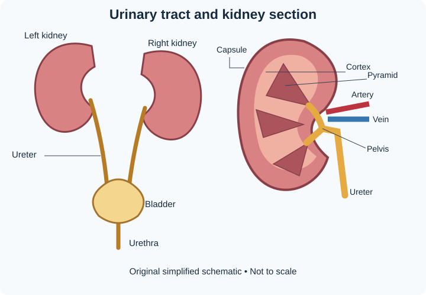
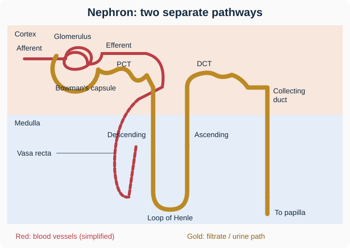

# 📚 Kidney, nephron and urinary tract — anatomy

[🏠 Chapter](../README.md) · [📝 30 anatomy MCQs](../MCQs/Kidney-Nephron-and-Urinary-Tract-Anatomy-30-MCQs.md) · [📜 Exam evidence](../Previous-Year-Questions/Kidney-Anatomy-Reported-Exam-Questions.md)

> **Dhyan de:** Ye study-ready notes hain. Abhi learner ne topic attempt nahi kiya hai. Pehle diagram ke saath samjho, phir MCQs solve karo.

## 1. Kidney ki position aur gross anatomy

**Priority:** 🔴 MOST IMPORTANT · Nursing anatomy

Dekho, kidney ko body ka ek smart water filter samjho. Lekin ye sirf gandagi bahar nahi nikaalti. Ye decide karne mein bhi madad karti hai ki blood mein kitna paani, sodium, potassium aur acid rehna chahiye. Kidney kaam karti rahe toh body ka internal balance maintain rehta hai. Isi balance ko homeostasis kehte hain.

Normally do kidneys hoti hain. Ye spine ke dono sides par pichhe ki taraf hoti hain, roughly T12 se L3 vertebrae ke level par. Ye peritoneum ke pichhe hoti hain, isliye inhe retroperitoneal organs bolte hain. Liver right side par jagah leta hai, isliye right kidney generally left se thodi neeche hoti hai. Adult kidney aam taur par lagbhag 10–12 cm lambi hoti hai. Size body aur age ke hisaab se badal sakta hai.

Kidney ke bilkul upar adrenal gland hoti hai. Adrenal gland hormone banati hai, lekin woh kidney ka filtering part nahi hai.

### Kidney ki protective layers

- Sabse andar renal capsule hoti hai. Ye ek patli fibrous covering hai jo kidney tissue ko seedha cover karti hai.
- Iske bahar perirenal fat hota hai. Ye cushion ki tarah kidney ko protection deta hai.
- Renal fascia kidney aur uske paas ke fat ko support karti hai. Bahar pararenal fat bhi hota hai.

Jab swelling ya obstruction ki wajah se capsule stretch hoti hai, toh patient ko flank pain ho sakta hai. Flank ka matlab peeth aur pet ke side ka area hai. Sirf pain se diagnosis confirm nahi hota.

### Kidney ke andar ke parts

| Structure | Simple meaning aur kaam |
|---|---|
| Renal cortex | Ye bahar ka functional tissue hai. Ismein renal corpuscles aur convoluted tubules hote hain. |
| Renal medulla | Ye andar ka tissue hai. Ismein pyramids aur nephron ke kuch lambe tubular parts hote hain. |
| Renal columns | Ye cortex ka tissue hai jo pyramids ke beech tak jaata hai. |
| Renal papilla | Pyramid ka pointed tip hai jahan papillary ducts urine chhodte hain. |
| Minor calyx | Ye papilla se aane wala urine collect karta hai. |
| Major calyx | Kai minor calyces ismein urine bhejte hain. |
| Renal pelvis | Ye funnel jaisa collecting area hai. Ye urine ko ureter ki taraf bhejta hai. |
| Renal hilum | Kidney ke medial side ka entrance aur exit hai. Yahin se blood vessels, nerves aur renal pelvis/ureter ka connection hota hai. |

**Exam clue:** Hilum ke structures ko aam taur par anterior se posterior V-A-P yaad rakho. Renal vein, renal artery, renal pelvis. Anatomical variation ho sakti hai.

Urine ka direction: papillary duct → minor calyx → major calyx → renal pelvis → ureter. Blood renal artery se aata hai aur renal vein se nikalta hai. In dono routes ko kabhi mix mat karna.

**Nursing example:** Agar stone pelvis se ureter mein atak jaaye, toh urine aage nahi jaa pata. Upar pressure badh sakta hai aur renal collecting system dilate ho sakta hai. Is dilation ko hydronephrosis kehte hain. Fever, severe pain, reduced urine ya unstable vitals ko promptly report karna zaroori hai.

**Reported exam concepts:** [RRB Staff Nurse 20 July 2019 Shift III](../Previous-Year-Questions/Kidney-Anatomy-Reported-Exam-Questions.md) aur NHM UP Staff Nurse 2019 reported capsule question. Official key authentication pending.

## 2. Nephron aur renal blood supply

**Priority:** 🔴 MOST IMPORTANT

Nephron kidney ka microscopic working unit hai. Socho ek bada water filter bahut saare chhote filter units se bana hai. Kidney mein bhi roughly ek million nephrons per kidney ho sakte hain, lekin actual number har individual mein alag ho sakta hai. Har nephron blood se filtrate banata hai, phir useful cheezein wapas blood mein bhejne aur extra waste nikaalne mein madad karta hai.

Nephron ke do main parts hain. Pehla renal corpuscle aur doosra renal tubule. Corpuscle mein glomerulus aur Bowman's capsule hote hain. Glomerulus chhoti blood capillaries ka guchha hai. Bowman's capsule cup ki tarah glomerulus ko surround karti hai. Jo fluid filter hota hai woh capsule ke urinary space mein aata hai.

PCT ka full form proximal convoluted tubule hai. Proximal ka matlab shuru ke paas hai aur convoluted ka matlab ghuma hua hai. PCT ke baad loop of Henle aata hai. Ye neeche ki taraf jaata hai aur phir wapas upar aata hai. DCT ya distal convoluted tubule uske baad aata hai. Connecting tubule collecting duct tak filtrate bhejta hai. Collecting ducts kai nephrons se fluid lete hain aur papilla ki taraf urine bhejte hain.

**Blood ka route:** Renal artery → segmental artery → interlobar artery → arcuate artery → cortical radiate artery → afferent arteriole → glomerulus → efferent arteriole → peritubular capillaries ya vasa recta → veins → renal vein.

Afferent arteriole blood ko glomerulus ke andar laati hai. Efferent arteriole blood ko glomerulus se bahar le jaati hai. Afferent ko Arrival aur Efferent ko Exit se yaad rakho. Dono arterioles hain. Glomerulus ke baad ek doosra capillary network banta hai. Ye tubular exchange ke liye bahut important hai.

### Filtration barrier

Glomerulus ka filter teen important layers se bana hota hai. Fenestrated capillary endothelium mein chhote openings hote hain. Glomerular basement membrane support aur selective barrier deti hai. Podocytes special cells hain jinke foot processes ke beech filtration slits hote hain. Healthy barrier blood cells aur albumin jaise bade proteins ko largely blood mein rakhta hai. Agar barrier damage ho toh urine mein protein ya blood aa sakta hai. Urine result ka interpretation patient ki full assessment aur tests se hota hai.

### Cortical aur juxtamedullary nephron

| Feature | Cortical nephron | Juxtamedullary nephron |
|---|---|---|
| Corpuscle | Outer cortex ki taraf hota hai. | Cortex aur medulla ke junction ke paas hota hai. |
| Loop of Henle | Relatively short hota hai. | Deep medulla tak jaata hai. |
| Blood supply | Peritubular capillaries important hote hain. | Long vasa recta important hote hain. |
| Approximate proportion | 85% ke aaspaas hote hain. | 15% ke aaspaas hote hain. |

Long loop aur vasa recta kidney ko concentrated urine banane ke mechanism mein help karte hain. Iska detailed countercurrent mechanism next physiology topic mein padhenge.

### Juxtaglomerular apparatus (JGA)

JGA ko kidney ka local monitoring station samjho. Glomerulus ke vascular pole ke paas macula densa tubular fluid mein NaCl delivery sense karti hai. Granular juxtaglomerular cells mainly afferent arteriole ki wall mein hote hain aur renin release karte hain. Extraglomerular mesangial cells bhi is region mein hote hain. JGA filtration aur blood pressure regulation mein help karta hai. RAAS ka detailed sequence physiology topic mein aayega.

**Exam evidence:** [JIPMER Nursing Officer 2024 aur MP NHM CHO 2024 Shift 2 reported questions](../Previous-Year-Questions/Kidney-Anatomy-Reported-Exam-Questions.md). Ye third-party reported items hain.

## 3. Ureter, bladder aur urethra

**Priority:** 🟠 HIGH YIELD

Ureter ek muscular tube hai jo kidney se bladder tak urine le jaati hai. Adult mein ye roughly 25–30 cm hoti hai. Iski smooth muscle waves mein contract karti hai. Is movement ko peristalsis bolte hain. Isliye urine ko bladder tak le jaane ke liye sirf gravity par depend nahi karna padta.

Ureter ke teen traditional narrowing points exam mein important hain. Pehla ureteropelvic junction hai, doosra pelvic brim ke paas iliac vessels crossing aur teesra ureterovesical junction hai. Stone in areas mein atak sakta hai, lekin obstruction kisi aur jagah bhi ho sakta hai.

Urinary bladder urine store karti hai. Iski muscular wall ko detrusor bolte hain. Bladder ke andar trigone ek triangular area hai jo dono ureteric openings aur internal urethral opening ke beech hota hai. Ureter bladder wall mein oblique route se enter karta hai. Bladder fill ya contract hone par ye arrangement reflux ko rokne mein help karta hai.

Urethra urine ko bladder se body ke bahar le jaati hai. Adult female urethra roughly 3–4 cm hoti hai aur adult male urethra roughly 18–20 cm ho sakti hai. Female urethra ki short length ascending infection ka ek risk factor hai, lekin infection ka ek hi reason nahi hota. Urethral anatomy catheterization ke liye important hai.

Internal outlet smooth muscle aur bladder neck ka control mainly involuntary hota hai. External urethral sphincter skeletal muscle ka bana hota hai aur voluntary control mein help karta hai. Micturition ka detailed nervous control next physiology topic mein padhenge.

**Nursing connection:** Urine catheter sirf indicated situation mein aseptic technique se lagaya jaata hai. Drainage system closed rakha jaata hai aur bag bladder se neeche rakha jaata hai. Tubing kink ya traction se bachao. Patient ka urine output, pain aur vitals assess karo. Catheter insertion aur CAUTI prevention ke detailed procedure alag renal nursing topic mein honge.

## 4. Kidney ki important functions ka overview

Kidney nitrogenous waste jaise urea aur creatinine ko remove karne mein help karti hai. Ye body ke paani aur electrolytes adjust karti hai aur hydrogen ion secretion aur bicarbonate handling ke through acid-base balance maintain karne mein help karti hai. Renin blood pressure regulation mein role play karta hai. Erythropoietin bone marrow ko red blood cells banane ka signal deta hai. Kidney vitamin D ko active calcitriol mein badalne mein help karti hai. Isliye kidney disease sirf urine ki problem nahi hoti. Anemia, bone mineral disturbances aur fluid imbalance bhi develop ho sakte hain.

## ▶️ YouTube teaching aur practice

- **Teaching:** [Bhushan Science Nursing — renal system anatomy and physiology](https://www.youtube.com/watch?v=xwlkgz8-gcM). Indexed description covers kidney, nephron, bladder and urine formation. Exact playback not checked.
- **Teaching:** [Bhushan Science Nursing — Unit 8 Renal System](https://www.youtube.com/watch?v=UU736Oj78zA). Indexed title/description confirms nursing anatomy in Hindi.
- **MCQ practice:** [PW Nursing Wallah — general science question practice, nephron concept at published 48:16](https://www.youtube.com/watch?v=V07AHpfpoZg&t=2896s). Published chapter marker only. Exact question playback and other anatomy subtopic coverage pending.
- **Other anatomy MCQ practice:** Verification pending. [Question-level mapping and research gaps](../Previous-Year-Questions/Kidney-Anatomy-Reported-Exam-Questions.md).

## Clinical and curriculum references

- [OpenStax Anatomy & Physiology 2e — kidney gross anatomy](https://openstax.org/books/anatomy-and-physiology-2e/pages/25-3-gross-anatomy-of-the-kidney)
- [OpenStax — microscopic kidney anatomy](https://openstax.org/books/anatomy-and-physiology-2e/pages/25-4-microscopic-anatomy-of-the-kidney)
- [OpenStax Fundamentals of Nursing — urinary system](https://openstax.org/books/fundamentals-nursing/pages/26-1-urinary-system)
- [NIDDK — Your Kidneys and How They Work](https://www.niddk.nih.gov/health-information/kidney-disease/kidneys-how-they-work)
- [INC 2020 BSc Nursing curriculum text](https://www.legitquest.com/act/indian-nursing-council-revised-regulations-and-curriculum-for-bsc-nursing-program-regulations-2020/cbd2)

[📝 Solve anatomy MCQs](../MCQs/Kidney-Nephron-and-Urinary-Tract-Anatomy-30-MCQs.md) · [🏠 Chapter](../README.md)
