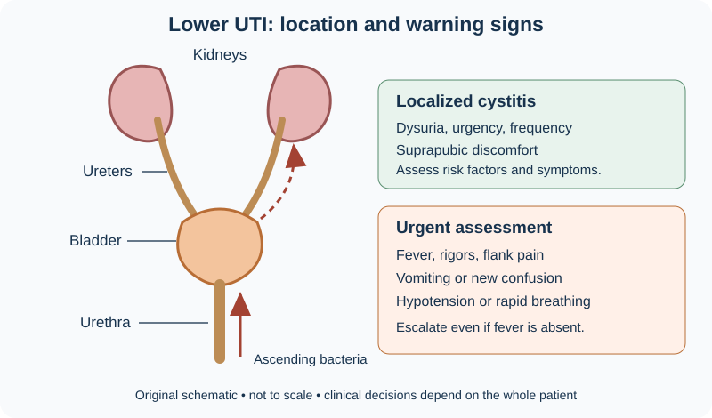

# Lower Urinary Tract Infection and Cystitis

[Chapter index](../README.md) · [30 original MCQs](../MCQs/Lower-Urinary-Tract-Infection-and-Cystitis-30-MCQs.md) · [Evidence and practice-video register](../Previous-Year-Questions/Lower-UTI-Reported-Evidence.md)

## Basic concept

Urinary tract mein kidneys, ureters, bladder aur urethra aate hain. Cystitis ka matlab bladder ki inflammation hai. Bacterial cystitis mein bacteria bladder tak pahunchkar infection karte hain. Har cystitis bacterial nahi hoti. Interstitial cystitis, radiation aur kuch drugs se bhi bladder symptoms ho sakte hain. Isliye symptoms ko patient ki history aur examination ke saath samajhna chahiye.

Aksar bowel flora, khaaskar Escherichia coli, urethral opening ke paas se bladder ki taraf ascend karte hain. Bladder lining mein inflammation se burning urination, baar-baar urine aana, urgency aur suprapubic discomfort hota hai. Lower UTI ko kidney infection samajhkar har patient mein ek hi treatment nahi dena chahiye.

## Symptoms, localization and risk

| Finding | Nursing interpretation |
|---|---|
| Dysuria, frequency, urgency, suprapubic pain | Localized bladder infection possible hai. |
| Vaginal discharge, vulval itching | Vaginitis ya doosri genital condition ko assess karna zaroori hai. |
| Purulent urethral discharge, sexual exposure | Urethritis aur STI evaluation ki zaroorat ho sakti hai. |
| Fever, rigors, flank pain, vomiting | Upper ya systemic urinary infection ka suspicion badhta hai. |
| New confusion, hypotension, tachypnea | Sepsis ho sakta hai, fever absent hone par bhi urgent escalation karein. |

EAU localized UTI aur systemic UTI ko alag classify karta hai. Risk factors dono mein outcome ko affect kar sakte hain. Pregnancy, urinary obstruction, stones, renal impairment, immunosuppression, recent instrumentation aur resistant organism ki history ko note karein. Male patient mein perineal pain, fever ya suspected prostate involvement ko simple bladder infection maan kar ignore na karein.

## Diagnostic reasoning

- History mein symptom onset, severity, fever, flank pain, pregnancy possibility, discharge, previous antibiotics aur recurrent infection poochhein. Vitals, hydration aur mental status assess karein.
- Clean midstream urine specimen local protocol ke according collect karein. Culture indicated ho to antibiotic se pehle specimen lena useful hai, agar urgent treatment delay na ho. Recent antibiotic ka naam aur last dose laboratory aur prescriber ko batayein.
- Leukocyte esterase white blood cells se associated enzyme ka marker hai. Yeh bacteria ki species ya susceptibility nahi batata. Negative nitrite UTI ko universally exclude nahi karta.
- Symptomatic women mein ek plausible uropathogen ka colony count 10^3 CFU/mL bhi clinically important ho sakta hai. Laboratory method, specimen quality, symptoms aur patient group ko saath interpret karein. Har patient ke liye 10^5 CFU/mL ko absolute infection cutoff na banayein.
- Mixed growth aur suspected contamination mein clinical review aur properly collected repeat specimen as indicated useful hote hain. Severe illness mein repeat specimen ka wait karke urgent treatment delay nahi karna chahiye.

### India-specific workflow

ICMR July 2026 nephrology standard treatment workflow mein suitable afebrile adults ke liye three compatible lower urinary symptoms, ya fewer symptoms ke saath leukocyte esterase aur nitrite dono positive, ek diagnostic pathway diya gaya hai. Straightforward low-risk presentations mein routine culture har baar necessary nahi bataya gaya. Yeh ek particular workflow hai, universal diagnostic definition nahi. Pregnancy, male UTI, risk factors, unusual symptoms, suspected systemic illness, persistence ya recurrence mein appropriate culture aur clinical review zaroori ho sakte hain.

## Treatment principles and prescription safety

Antibiotics clinician ke order, local resistance pattern, renal function, allergy, pregnancy status aur infection site ke hisaab se select hote hain. Culture result aane par susceptibility aur patient response ke according prescription review hota hai. Nurse independently antibiotic select, extend ya replace nahi karti.

| Example from guidance | Important context |
|---|---|
| Nitrofurantoin | ICMR workflow mein 100 mg twice daily for 5–7 days ka adult example hai. NICE NG109 selected nonpregnant women mein 3 days aur men/pregnancy mein different duration deta hai. Local prescription follow karein, regimens mix na karein. |
| Fosfomycin trometamol | Selected lower UTI cases mein prescribed single 3 g oral dose ek option hai. Persistent symptoms mein apne aap repeated doses na lein. |
| Other antibiotics | Culture, local policy aur contraindications ke hisaab se clinician decide karta hai. Broad-spectrum drugs ko routine first choice maan kar use na karein. |

Nitrofurantoin bladder infection ke liye use ho sakta hai, lekin suspected pyelonephritis ya prostatic infection mein adequate tissue levels ke liye suitable nahi hai. EAU ke according eGFR below 30 mL/min/1.73 m² par contraindicated hai. NICE routine use ke liye eGFR at least 45 ka threshold aur selected exceptions describe karta hai. Local labeling aur clinician review follow karein. Pregnancy ke term par NICE neonatal haemolysis concern ke karan nitrofurantoin avoid karne ko kehta hai.

**Medication safety:** ICMR workflow nitrofurantoin ke saath citrate urinary alkalinizer avoid karne ko kehta hai. New cough, dyspnea ya jaundice possible serious nitrofurantoin adverse reaction ho sakte hain. Urgent clinical review aur prescribed medication safety protocol follow karein.

Phenazopyridine urinary discomfort ke liye symptomatic analgesic hai, antibiotic nahi. Orange-red urine ho sakta hai, lekin bleeding ko bina assessment drug discoloration na maan lein. Cited product label concurrent antibacterial therapy ke saath use ko two days tak limit karta hai aur renal insufficiency mein contraindication batata hai. Har patient mein iski zaroorat nahi hoti.

## Nursing care and patient education

1. Pain, voiding pattern, urine appearance, intake/output as indicated, vitals aur red flags document karein.
2. Oral fluids patient tolerance aur prescribed restrictions ke according dein. Renal ya heart failure patient mein forced excessive fluid intake na karayein.
3. Prescribed antibiotic ko correct timing aur duration ke saath lene ki teaching dein. Leftover medicines ya self-treatment avoid karein.
4. Urge aane par voiding avoid na karein. Gentle perineal hygiene rakhein aur irritant products se symptoms badhte hon to unhe avoid karein.
5. Fever, rigors, flank pain, persistent vomiting, severe weakness, confusion ya hypotension par urgent clinical care arrange karein.
6. NICE ke according symptoms 48 hours mein improve na hon ya kabhi bhi worsen hon to reassessment chahiye. EAU ke according symptoms treatment ke baad resolve na hon ya two weeks ke andar recur karein to culture aur susceptibility assess karna chahiye.
7. Successfully treated, low-risk asymptomatic nonpregnant woman mein routine follow-up urine culture generally indicated nahi hota. Pregnancy aur special risk groups ke liye clinician-directed plan alag ho sakta hai.

## Exam focus

- Localized bladder symptoms aur systemic warning signs ko alag karein.
- Dipstick result ko clinical context ke bina final diagnosis na banayein.
- Nitrofurantoin ko kidney ya prostate infection ke liye suitable na maan lein.
- Prescribed dosing calculation: 100 mg twice daily for five days = ten doses of 100 mg each. Yeh arithmetic example hai, universal prescription nahi.
- Drug interaction, renal function, pregnancy aur treatment failure ke questions mein safe nursing escalation select karein.

## References

- [ICMR July 2026 nephrology standard treatment workflows](https://www.icmr.gov.in/icmrobject/uploads/STWs/1784807342_nephrology_all.pdf) — extracted official PDF text reviewed, page screenshot unavailable.
- [EAU Guidelines on Urological Infections](https://uroweb.org/guidelines/urological-infections/chapter/the-guideline) — directly opened guideline and indexed relevant sections.
- [NICE NG109: Lower UTI antimicrobial prescribing](https://www.nice.org.uk/guidance/ng109/chapter/recommendations) — directly opened.
- [UKHSA urine infection diagnosis guidance](https://www.gov.uk/government/publications/urinary-tract-infection-diagnosis/diagnosis-of-urinary-tract-infections-quick-reference-tools-for-primary-care) — indexed diagnostic reference.
- [NIDDK bladder infection symptoms and causes](https://www.niddk.nih.gov/health-information/urologic-diseases/bladder-infection-uti-in-adults/symptoms-causes) — indexed.
- [MHRA nitrofurantoin pulmonary and hepatic safety reminder](https://www.gov.uk/drug-safety-update/nitrofurantoin-reminder-of-the-risks-of-pulmonary-and-hepatic-adverse-drug-reactions) — indexed.
- [DailyMed phenazopyridine search](https://dailymed.nlm.nih.gov/dailymed/search.cfm?query=phenazopyridine) — product-label evidence indexed. Check local approved label before administration.

Educational nursing material, not an individual treatment prescription. Pyelonephritis, asymptomatic bacteriuria and recurrent UTI prevention remain separate upcoming topics.
