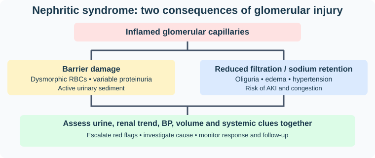

# 📚 Nephritic syndrome — clinical recognition, differential diagnosis and nursing care

[🏠 Chapter](../README.md) · [📝 MCQs](../MCQs/Nephritic-Syndrome-30-MCQs.md) · [📜 Previous Year Questions](../Previous-Year-Questions/Nephritic-Syndrome-Reported-Evidence.md) · [Glomerulonephritis](Glomerulonephritis.md)

**Study-ready, unattempted.** Is lesson mein syndrome recognition aur care par focus hai. PSGN infection, ASO, complement recovery aur biopsy basics previous GN package mein already covered hain. RPGN and IgA disease-specific treatment separate topics hain.

## 1. Clinical pattern and mechanism

**Priority:** 🔴 MOST IMPORTANT

Nephritic syndrome kidney ke glomeruli ki injury ka clinical pattern hai. Glomerulus ko ek filter samjho. Jab is filter ki capillary wall inflamed hoti hai, toh normally blood mein rehne wale red blood cells urine mein enter kar sakte hain. Isse hematuria, yani urine mein blood, hota hai. Protein bhi leak ho sakta hai. Dusri taraf inflammation filtering capacity reduce kar sakti hai. Jab kidney sodium aur water remove nahi kar paati, toh extracellular fluid badh sakta hai. Patient ko edema, high blood pressure aur urine output kam hone ki problem ho sakti hai. Creatinine rise ho sakta hai, lekin har patient mein saare signs ek saath nahi milte.

Nephrotic syndrome ka main pattern heavy protein loss aur low albumin hai. Nephritic syndrome ka prominent clue glomerular bleeding aur inflammatory sediment hai. Dono patterns overlap kar sakte hain. Heavy proteinuria nephritic inflammation exclude nahi karti. Edema alone se distinction nahi hota. Normal BP ya preserved urine output bhi early nephritic disease ko completely rule out nahi karta.

## 2. Urine findings and differential

**Priority:** 🔴 MOST IMPORTANT

Dysmorphic RBCs red cells hain jinka shape abnormal ho gaya hai. Jab RBC damaged filtration barrier aur tubules se pass karta hai toh uski membrane change ho sakti hai. Acanthocyte ek specific dysmorphic shape hai jisme ring aur bleb-like protrusions dikhte hain. Inka presence glomerular bleeding support karta hai, absence disease exclude nahi karta. RBC cast tubule mein protein matrix ke andar RBC trap hone se banta hai. Fresh microscopy helpful hai. Cast absent hone par bhi glomerular disease possible hai.

Blood clots, colicky pain, predominantly normal-shaped RBCs aur lower urinary symptoms se urologic source suspect ho sakta hai. Patient ko dono types of disease ek saath bhi ho sakte hain. Menstrual contamination consider karo, but abnormal renal function ya severe symptoms mein repeat specimen ka wait karke referral delay mat karo. Dipstick protein albumin-sensitive aur concentration-dependent hai. Quantitative urine protein-to-creatinine ratio (uPCR) protein loss assess karne mein help karta hai. uPCR aur urine albumin-to-creatinine ratio (uACR) identical tests nahi hain.

Example: urine total protein 120 mg/dL aur urine creatinine 80 mg/dL ho toh uPCR = 120 ÷ 80 = 1.5 mg/mg = 1.5 g/g = 1,500 mg/g. Ye significant proteinuria hai. Spot ratio daily excretion ka estimate hai, exact 24-hour amount guarantee nahi. Muscle mass, urine creatinine aur sampling affect kar sakte hain. Adult ICMR July 2026 workflow spot PCR above 3 g/g or timed protein above 3.5 g/1.73 m²/day ko nephrotic-range clue describe karta hai. Other references and disease definitions differ. Lab and named guideline context dekho.

## 3. Etiology and bedside assessment

Nephritic presentation ke causes mein postinfectious GN, IgA nephropathy, IgA vasculitis, lupus nephritis aur ANCA/anti-GBM disease aate hain. IgA vasculitis mein palpable purpura yani pressure se disappear na hone wale raised purple lesions, abdominal pain aur joint symptoms possible hain. Family history of kidney failure plus sensorineural hearing impairment hereditary basement-membrane disorder such as Alport syndrome ka clue ho sakta hai. Recent drugs, systemic illness aur infection history bhi important hai. Clinical clue final diagnosis nahi hai.

ICMR workflow supports urinalysis, serum creatinine, complement testing, targeted immune tests and referral according to severity. BP, respiratory findings, weight and perfusion status assess karo. Renal function rapidly change ho rahi ho toh routine eGFR estimate reliable nahi ho sakti. Hemoptysis with renal abnormalities raises pulmonary-renal concern, even if lung bleeding has no visible blood. Rapid renal decline and severe hypertension require urgent review. New pregnancy with nephritic findings warrants same-day specialist assessment. Do not assume all pregnancy-associated proteinuria is preeclampsia.

## 4. Care, safety and recovery

**Priority:** 🔴 MOST IMPORTANT

Nursing plan ka goal safe volume and BP control, complication prevention, cause-directed treatment aur follow-up hai. Prescribed fluid plan ko actual losses, urine output aur clinical volume status se reconcile karo. Acute oliguric congestion mein forced water intake inappropriate ho sakti hai. Stable child with PSGN and prescribed fluid restriction can have BSA-based plan. RCH example 750 mL/m²/day is for selected overloaded children, not a universal prescription. BSA 0.8 m² ho toh prescribed example 600 mL/day hota hai. Actual allowance treating team decides.

Loop diuretics selected congested patients mein use hote hain. Gut edema oral absorption affect kar sakta hai. Oral dose ka response poor ho toh clinical review chahiye, independent escalation nahi. BP fall with signs of hypoperfusion needs immediate reassessment. BP medicine ka goal gradual controlled improvement according to urgency and protocol hai, sudden unsupervised normalization nahi. Blood pressure readings and symptoms ka trend document karo. Dietary sodium restriction individualized hai. Severe protein restriction har nephritic patient ke liye indicated nahi, especially children. 

When disease requires immunosuppression, current infection, vaccination status, drug toxicity risk and baseline labs need specialist review. Do not give unprescribed steroids because the patient has dark urine. Specific treatment depends on cause. ICMR July 2026 workflow supports supportive care and avoiding nephrotoxins, with immediate referral in pulmonary-renal syndrome, RPGN, pregnancy or hypertensive emergency. Clinical red flags override routine appointment schedules.

RCH pediatric PSGN discharge guidance emphasizes improving/stable BP and renal function, near baseline weight and an appropriate treatment/follow-up plan. At home, parent ko prescribed BP/urine monitoring, medication review, warning signs and follow-up schedule teach karo. Weekly BP and urinalysis are described for recovering PSGN in this guideline. Other causes require their own follow-up. Record missed visits and barriers. Persistent hypertension or proteinuria needs clinical reassessment even after edema improves.

## ▶️ Teaching and MCQ practice

| Subtopic | Teaching | MCQ practice |
|---|---|---|
| Recognition and comparison | [RegisteredNurseRN nephrotic versus nephritic nursing review](https://www.youtube.com/watch?v=9sYcXLY3axA), indexed description | [Nursing Wallah renal MCQ series, 58:29](https://www.youtube.com/watch?v=FzjMv67IJA8&t=3509s), related PSGN signs marker, exact item/playback not verified |
| Differential and urinary findings | [Understanding nephritic syndrome](https://www.youtube.com/watch?v=4RyflZ3k5d8), indexed description | Specific question videos pending |
| Management and follow-up | [RCH PSGN guideline](https://www.rch.org.au/clinicalguide/guideline_index/Post-streptococcal_glomerulonephritis_(PSGN)/), written clinical source | Dedicated question videos pending |

## References

[Merck nephritic syndrome, updated February 2026](https://www.merckmanuals.com/professional/nephrology/glomerular-disorders/overview-of-nephritic-syndrome) · [ICMR July 2026 glomerular workflow](https://www.icmr.gov.in/icmrobject/uploads/STWs/1784807344_glomerulardiseases-updated.pdf), extracted text reviewed, screenshot cache miss · [Indian Journal of Nephrology urinalysis review](https://indianjnephrol.org/urinalysis-the-liquid-kidney-biopsy/) · [RCH PSGN clinical guideline](https://www.rch.org.au/clinicalguide/guideline_index/Post-streptococcal_glomerulonephritis_(PSGN)/) · [KDIGO glomerular disease guideline and current disease-specific updates](https://kdigo.org/guidelines/gd/).

[📝 Practice](../MCQs/Nephritic-Syndrome-30-MCQs.md) · [🏠 Chapter](../README.md)
