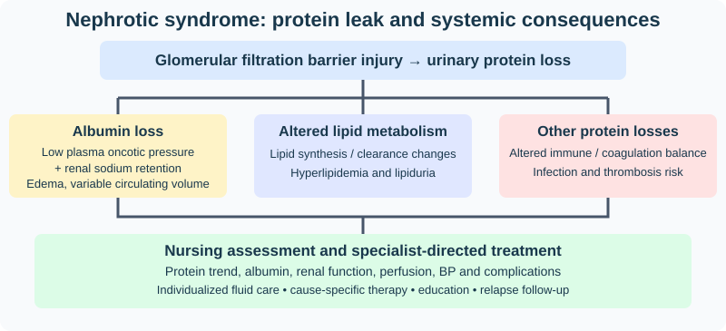

# 📚 Nephrotic syndrome — protein loss, pediatric treatment and nursing safety

[🏠 Chapter](../README.md) · [📝 30 original MCQs](../MCQs/Nephrotic-Syndrome-30-MCQs.md) · [📜 Exam evidence](../Previous-Year-Questions/Nephrotic-Syndrome-Reported-Evidence.md) · [Compare nephritic syndrome](Nephritic-Syndrome.md)

**Study-ready, unattempted.** Yeh lesson adult aur pediatric nephrotic syndrome cover karta hai. Treatment examples guideline recognition aur prescribed order verification ke liye hain. Patient-specific prescription pediatric nephrologist ya treating team decide karti hai.

## 1. Definition, mechanism and causes

**Priority:** 🔴 MOST IMPORTANT

Dekho, glomerulus kidney ka microscopic blood filter hai. Podocytes special cells hain jo filtration barrier ki outer surface cover karte hain. Inke chhote foot processes ke beech slit diaphragm hota hai. Ye barrier albumin jaise important blood proteins ko urine mein excessive amount mein jaane se rokne mein help karta hai. Jab podocytes ya barrier injure hote hain, toh protein leakage badh sakti hai. Proteinuria ka matlab urine mein protein ka abnormal loss hai. Nephrotic syndrome mein protein leakage itni significant ho sakti hai ki blood albumin kam ho jaata hai aur edema develop hoti hai.

Albumin blood vessels ke andar fluid retain karne mein madad karta hai. Is pressure ko oncotic pressure kehte hain. Albumin loss se interstitial fluid accumulation contribute ho sakti hai. Kidney mein sodium retention bhi important mechanism hai. Har nephrotic patient ka effective circulating volume low nahi hota. Kuch patients underfilled hote hain, kuch volume expanded hote hain. Isi liye sirf swelling dekh kar albumin ya diuretic prescribe nahi karna.

Liver lipid metabolism alter kar sakta hai aur lipoprotein clearance reduce ho sakti hai. Isse hyperlipidemia develop ho sakti hai. Filtered lipid tubule cells mein accumulate ho toh urine microscopy mein oval fat bodies ya lipid casts mil sakte hain. Polarized microscopy mein cholesterol esters characteristic Maltese cross pattern de sakte hain. Ye supportive finding hai, mandatory nahi.

| Cause | Samajhne ka point |
|---|---|
| Minimal change disease (MCD) | Young children mein typical idiopathic steroid-sensitive nephrotic syndrome ka common cause hai. Light microscopy near normal ho sakti hai, lekin electron microscopy par podocyte foot processes effaced (flattened) dikhte hain. |
| Focal segmental glomerulosclerosis (FSGS) | Focal ka matlab kuch glomeruli. Segmental ka matlab affected glomerulus ke sirf part mein scarring. Primary, secondary/adaptive aur genetic forms alag treatment rakhte hain. |
| Membranous nephropathy | Capillary wall mein subepithelial immune deposits aur barrier injury ho sakti hai. Selected adults mein anti-PLA2R antibody evaluation helpful hai. Thromboembolism risk important hai. |
| Secondary nephrotic syndrome | Diabetes, lupus, hepatitis B/C, HIV, selected medicines aur other systemic diseases possible causes hain. Underlying cause identify karna zaroori hai. |
| Congenital/infantile or familial disease | Very early onset, family history ya syndromic features genetic evaluation warrant kar sakte hain. Adult ya typical older-child steroid protocol blindly apply nahi hota. |

## 2. Clinical findings, investigation and diagnostic criteria

**Priority:** 🔴 MOST IMPORTANT

Periorbital edema subah prominent ho sakti hai. Ankle swelling, generalized edema (anasarca), ascites ya pleural effusion possible hain. Frothy urine protein loss suggest kar sakti hai, but foam alone diagnostic test nahi hai. BP high, normal ya low ho sakta hai depending on cause and volume status. Hematuria bhi some causes mein ho sakti hai. Nephritic aur nephrotic features overlap kar sakte hain.

Adult convention frequently uses urinary protein above 3.5 g/day in nursing exams. ICMR July 2026 workflow adults mein >3.5 g/1.73 m²/day ya spot uPCR >3 g/g ko nephrotic range describe karta hai. Merck/MSD adult overview uses around 3 g/day or spot PCR ≥3. Named reference and units dekho. Nephrotic-range proteinuria alone full syndrome establish nahi karti. Albumin, edema and clinical cause assess karo.

KDIGO 2025 pediatric definitions age 1–18 years ke liye:

| Parameter | Guideline threshold |
|---|---|
| Nephrotic-range proteinuria | Spot urine PCR ≥2 g/g or ≥1,000 mg/m²/day timed protein |
| Nephrotic syndrome | Above proteinuria plus albumin <3 g/dL, or edema when albumin not available |
| Complete remission | First-morning/timed uPCR ≤0.2 g/g or negative/trace dipstick, or timed protein <100 mg/m²/day, for at least 3 consecutive days |
| Partial remission | uPCR >0.2 but <2 g/g and, when measured, albumin ≥3 g/dL |
| Relapse | Nephrotic-range proteinuria returns after complete remission. Home dipstick commonly ≥3+ on 3 consecutive days. |

First morning urine collect karne se upright activity-related orthostatic proteinuria ka effect kam evaluate ho sakta hai. Dipstick semi-quantitative hai, yani approximate category deta hai. Exact sample timing and manufacturer's reading time follow karo. Protein quantification, albumin, lipids, creatinine, electrolytes, CBC aur cause-directed serology useful hain. Severe hypoalbuminemia, persistent renal decline, unusual features or adult new onset warrant nephrology workup. Typical uncomplicated younger-child idiopathic disease mein initial biopsy routinely necessary nahi hoti. Older onset, macroscopic hematuria, sustained hypertension, unexplained AKI, low complement, family/syndromic features or treatment resistance can prompt biopsy/genetics. KDIGO 2025 Figure 2 flags onset over 12 years and selected atypical cases.

## 3. Pediatric course and prescribed immunosuppressive therapy

**Priority:** 🔴 MOST IMPORTANT

Steroid-sensitive nephrotic syndrome (SSNS) mein standard prednisone/prednisolone treatment start hone ke four weeks ke andar complete remission milti hai. Steroid-resistant nephrotic syndrome (SRNS) definition mein four weeks par complete remission absent hoti hai. Partial responder ke liye weeks 4–6 confirmation period specialist evaluate kar sakta hai. Six weeks tak complete remission aane par late responder classification possible hai. No response, partial response, adherence and genetic/biopsy work-up different decisions hain. Ek isolated dipstick dekhkar dose independently change mat karo.

KDIGO 2025 frequently relapsing NS (FRNS) = initial remission ke baad first 6 months mein at least 2 relapses OR subsequent 12-month period mein at least 3 relapses. Steroid-dependent NS (SDNS) = two consecutive relapses during recommended steroid course/taper or within 14 days after stopping. Indian Society of Pediatric Nephrology 2021/2022 definitions differ in timing and annual relapse count, as explained by Indian Journal of Nephrology commentary. Question mein guideline and year dekho.

KDIGO 2025 initial course either 8 weeks (4 weeks daily + 4 weeks alternate day) or 12 weeks (6 + 6). Daily standard oral dose 60 mg/m²/day OR 2 mg/kg/day, maximum 60 mg/day. Alternate-day phase 40 mg/m² OR 1.5 mg/kg per alternate day, maximum 40 mg. ICMR July 2026 workflow specifically describes 6+6 weeks. Do not mix BSA and weight formula in one calculation or add both doses. Example: prescribed weight-based initial daily dose for a child using selected dosing weight 18 kg is 2 × 18 = 36 mg/day. A selected 35 kg weight gives 70 mg before cap, so maximum 60 mg/day in this named protocol. Only verify the actual written order and dosing weight.

For relapse KDIGO daily standard regimen until complete remission for ≥3 days, followed by alternate-day regimen for 4 weeks. Initial-episode duration and relapse duration different hain. Daily steroids routinely during every respiratory infection relapse prevention ke liye recommend nahi hote. Specific FRNS/SDNS patients already on low-dose alternate-day therapy with repeated infection-associated relapse may have specialist-directed short extra doses.

All SDNS and FRNS with serious glucocorticoid toxicity require review for steroid-sparing agents under KDIGO. Drugs include levamisole, cyclophosphamide, mycophenolate mofetil (MMF), calcineurin inhibitors (CNI, tacrolimus/cyclosporine) and rituximab. Choice patient age, prior response, kidney function, toxicity and resource access se decide hota hai. SRNS requires nephrology and often genetic/biopsy work-up. Selected SRNS patients receive CNI as initial second-line treatment. Genetic forms may respond differently.

Nurse steroid administration schedule clearly document kare. Alternate-day ka matlab prescribed alternate days, not daily half-dose. Monitor BP, glucose, mood, sleep, appetite, growth, infections and long-term bone/eye effects. Prolonged or repeated glucocorticoids adrenal suppression cause kar sakte hain. Illness/vomiting during or after therapy may require urgent adrenal-risk review. Steroids independently stop ya restart mat karo.

CNI levels and creatinine, BP, potassium and glucose review karo according to drug. Cyclophosphamide marrow suppression and gonadal toxicity risk rakhta hai. CBC and cumulative exposure record important hai. MMF GI effects, cytopenia and fetal harm risk rakhta hai. Rituximab B cells reduce karta hai. Before infusion screen for hepatitis B, TB where indicated, baseline immunoglobulins and infusion safety. Exact specialist protocol follow karo.

## 4. Complications, fluid care and family education

**Priority:** 🔴 MOST IMPORTANT

Underfill mein patient visibly swollen hote hue bhi circulating volume low ho sakta hai. Tachycardia, postural symptoms, cool extremities, delayed capillary refill and declining urine output suggest poor perfusion. Overfill mein hypertension and congestion prominent ho sakti hai. Diuretics given without assessing volume AKI or thrombosis risk increase kar sakte hain. Concentrated albumin infusion selected symptomatic severe edema or intravascular depletion cases mein prescribed ho sakti hai, not every low albumin result. Infusion can rapidly increase vascular volume. BP, respiratory status and pulse oximetry monitor karo. New respiratory distress or pulmonary edema signs need urgent escalation and infusion review. 

Urinary loss of some anticoagulant proteins and other coagulation changes plus immobility, inflammation, dehydration or treatment can increase thrombosis risk. Membranous nephropathy adults mein particularly important high-risk cause hai. New unilateral leg swelling, chest pain, breathlessness or flank pain with hematuria requires assessment for thromboembolism, including renal vein thrombosis where appropriate. Confirmed thromboembolism needs prescribed treatment unless contraindicated. Prophylaxis in adults must balance clot risk and bleeding risk. ICMR July 2026 uses low albumin as a risk cue. KDIGO 2021 emphasizes patient-specific risk versus bleeding, rather than a single automatic albumin-based drug order. Routine prophylactic anticoagulation for every child is inappropriate.

Immunoglobulins and complement-related factors urinary loss, edema and immunosuppression infection vulnerability increase kar sakte hain. Fever with abdominal pain and ascites in a child can suggest spontaneous bacterial peritonitis. Urgent assessment chahiye. Fever, altered consciousness, hypotension or severe pain mein emergency referral. Varicella exposure in an unimmunized or immunosuppressed child needs prompt specialist advice for post-exposure prevention. Inactivated vaccines such as influenza and indicated pneumococcal vaccination review karo. Live vaccine timing immunosuppression dose/duration, drug and national guidance se decide hoti hai. ICMR and RCH examples differ in post-treatment intervals, so one universal interval apply nahi karo.

Low/no-added salt diet during edema may help. Fluid restriction patient-specific, particularly hyponatremia or congestion mein. Severe edema alone intravascular overload prove nahi karta. Adequate nutrition important hai. Urine mein protein loss dekhkar unlimited high-protein diet dena appropriate nahi. Pediatric growth protect karo, adult CKD plan individualized rakho.

Home urine dipstick technique demonstrate karvao. First morning specimen, correct timing, date and grade in diary, edema and weight trend, prescribed medication and infection symptoms record karo. Three consecutive 3+ after remission relapse criterion meet kar sakte hain. Family should contact treating team according to action plan. Severe symptoms mein third day ka wait nahi karna. Follow-up steroid course adherence, side effects, growth, BP, proteinuria and renal function review ke liye hota hai.

## ▶️ Teaching and MCQ practice

| Subtopic | Teaching resource | MCQ practice |
|---|---|---|
| Pathophysiology and features | [RegisteredNurseRN pediatric nephrotic syndrome nursing lecture](https://www.youtube.com/watch?v=TlK6jV9fk4A), indexed description, older than current KDIGO | [Nursing Wallah NORCET 10 renal MCQ series, 38:40](https://www.youtube.com/watch?v=FzjMv67IJA8&t=2320s), indexed chapter marker covers proteinuria, edema, hypoalbuminemia and hyperlipidemia. Exact item/playback pending. |
| Pediatric course and steroids | KDIGO 2025 and Indian commentary below | [Aarogyam Infinity pediatric MCQ series part 15](https://www.youtube.com/watch?v=mByPNINZ8u4), indexed description identifies nephrotic syndrome/steroid practice but exact item coverage not established. |
| Complication and family care | [RCH pediatric nephrotic syndrome](https://www.rch.org.au/clinicalguide/guideline_index/nephrotic_syndrome/), written guidance | Dedicated specific question videos pending |

## References

[KDIGO 2025 pediatric nephrotic syndrome](https://kdigo.org/wp-content/uploads/2025/04/KDIGO-2025-Guideline-for-Nephrotic-Syndrome-in-Children.pdf), summary printed pages S256–S259 text and images reviewed · [ICMR July 2026 glomerular workflow](https://www.icmr.gov.in/icmrobject/uploads/STWs/1784807344_glomerulardiseases-updated.pdf), PDF text retrieved, screenshot cache miss · [Indian Journal of Nephrology commentary comparing KDIGO, IPNA and ISPN](https://indianjnephrol.org/evolving-consensus-on-management-of-nephrotic-syndrome-in-childhood-focus-on-kdigo-guidelines-2025/), HTML retrieved · [MSD nephrotic syndrome adult overview](https://www.msdmanuals.com/professional/nephrology/glomerular-disorders/overview-of-nephrotic-syndrome) · [KDIGO glomerular diseases](https://kdigo.org/guidelines/gd/), current chapter updates and 2021 general principles · [RCH pediatric nephrotic syndrome](https://www.rch.org.au/clinicalguide/guideline_index/nephrotic_syndrome/) · [Indian Journal of Nephrology urine microscopy](https://indianjnephrol.org/urinalysis-the-liquid-kidney-biopsy/).

[📝 MCQs](../MCQs/Nephrotic-Syndrome-30-MCQs.md) · [🏠 Chapter](../README.md)
