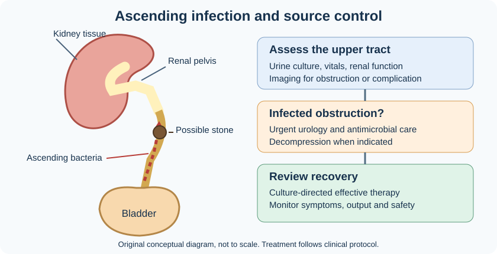

# Pyelonephritis — Upper Urinary Tract Infection

**Study-ready, not yet studied.** Is lesson mein kidney infection ka mechanism, assessment, source control aur nursing management samjhenge. Ye nursing study material hai, individual prescribing instruction nahi.

[Chapter](../README.md) · [30 original MCQs](../MCQs/Pyelonephritis-30-MCQs.md) · [Reported evidence and practice-video gaps](../Previous-Year-Questions/Pyelonephritis-Reported-Evidence.md)

## 1. Pyelonephritis kya hai?

Normal urine kidney ke collecting system se ureter ke through bladder tak flow karti hai. Pyelonephritis mein infection kidney ke renal pelvis aur parenchyma, yani functional kidney tissue, tak pahunch jaati hai. Aksar intestinal organisms, especially Escherichia coli, urethra aur bladder se upar ascend karte hain. Kabhi-kabhi bloodstream infection se bhi kidney involve ho sakti hai.

Bladder tak limited cystitis mein urgency, frequency aur dysuria prominent ho sakte hain. Kidney infection mein fever, chills, flank pain, nausea, vomiting aur costovertebral angle tenderness concern badhate hain. Costovertebral angle lower rib aur spine ke beech back ka region hai. Typical bladder symptoms absent hone par bhi pyelonephritis possible hai. Koi ek symptom diagnosis prove nahi karta.

Urinary stone, obstruction, diabetes, impaired immunity, pregnancy aur structural urinary abnormality se severe course ka risk badh sakta hai. EAU localized aur systemic UTI distinguish karta hai. Risk factors aur actual physiological stability ko saath assess karna chahiye.

## 2. Assessment aur diagnostic reasoning

Nurse onset, fever, rigors, flank pain, vomiting, voiding symptoms, prior antibiotics, resistant isolates, allergies aur kidney disease ka history leti hai. Vital signs, mental status, hydration, pain aur urine output monitor karti hai. Hypotension, tachypnea, new confusion ya poor perfusion urgent deterioration assessment demand karte hain.

EAU pyelonephritis ke sabhi cases mein urine culture aur antimicrobial susceptibility testing recommend karta hai. Urinalysis mein white cells, red cells aur nitrite assess ho sakte hain. Dipstick organism ki exact species aur effective antibiotics nahi batata. WBC casts upper tract inflammation suggest kar sakte hain, lekin unka absence infection exclude nahi karta. Sample treatment se pehle lena useful hai jab feasible ho. Emergency treatment ko specimen collection ke liye delay nahi karna chahiye.

Severe illness ya suspected sepsis mein blood cultures aur indicated blood tests arrange hote hain. Urine mein Staphylococcus aureus milne par possible bloodstream infection ka issue clinician ko communicate karo. EAU is situation mein blood cultures indicate karta hai. Har positive urine finding ko simple cystitis maan lena safe nahi hai.

## 3. Imaging aur obstruction

Ultrasound kidney collecting system ka dilatation aur obstruction-related findings assess karne mein useful hai, especially stone history ya impaired renal function mein. Hydronephrosis ya suspected upper tract obstruction mein clinician CT ya MRI select kar sakta hai. Persistent symptoms 48–72 hours ke baad, severe illness ya clinical deterioration mein additional imaging needed ho sakti hai. Negative initial ultrasound har abscess ya complication exclude nahi karta.

Pregnancy mein complicating factors assess karne ke liye ultrasound ya suitable MRI preferential options hain, kyunki ionizing radiation avoid hoti hai. Necessary emergency imaging ko pregnancy ke naam par indefinitely delay mat karo. Imaging choice specialist assessment aur local policy se decide hoti hai.

Agar infected urine stone ya other obstruction ke peeche trap ho jaaye, toh antibiotic alone sufficient source control nahi de sakta. Confirmed infected obstruction urological emergency hai. Ureteric stent internal drainage route restore kar sakta hai. Percutaneous nephrostomy skin se renal collecting system tak external drainage route banati hai. Specialist patient ke context ke according procedure select karta hai.

Emergency decompression aur effective antimicrobial care pehle arrange hote hain. Sepsis resolve hone par definitive stone treatment plan hota hai. Nurse procedure preparation, prescribed cultures, vital signs, drainage, pain aur fluid balance monitor karti hai. Invasive drain manipulation authorized trained staff hi karte hain.

## 4. Antibiotic management aur nursing safety

ICMR July 2026 nephrology workflow complicated UTI aur pyelonephritis ko bladder se beyond infection ya systemic illness ke context mein describe karta hai. Red flags, pregnancy, obstruction aur recent instrumentation referral decisions affect karte hain. Empirical agent local resistance, previous cultures, illness severity, renal function aur allergy ke according select hota hai.

Nitrofurantoin aur oral fosfomycin ko lower UTI regimens se automatically renal parenchymal infection mein transfer mat karo. EAU pyelonephritis mein in drugs ko avoid karta hai. Urine isolate laboratory mein susceptible ho sakta hai, lekin relevant tissue mein adequate drug levels bhi necessary hain.

Repeated vomiting ya severe illness mein oral route unreliable ho sakta hai. NICE IV therapy consider karta hai jab patient oral medicine retain nahi kar sakta ya severely unwell hai. Aminoglycoside prescribed ho toh renal function aur ordered drug-level monitoring follow karo. Nurse independently dose, route ya antibiotic duration change nahi karti.

IDSA 2025 empirical choice mein recent antimicrobial exposure aur previous resistant organisms ko consider karta hai. Previous 12 months mein fluoroquinolone exposure ho toh empirical fluoroquinolone avoid karne ki conditional recommendation hai. Culture results aane par suitable targeted effective agent consider hota hai.

Clinically improving patient oral medicine absorb kar sakta ho, effective oral option available ho aur indicated source control achieved ho, toh clinician IV-to-oral transition consider kar sakta hai. Urinary-source Gram-negative bacteremia mein oral agent ko bloodstream aur urinary tissue dono mein adequate levels achieve karne chahiye. Fever resolve hona antibiotics independently stop karne ka signal nahi hai.

### Duration ko source ke context mein samjho

ICMR 2026 complicated UTI workflow 7–14 days ka range deta hai. IDSA 2025 selected improving cUTI patients mein shorter effective courses support karta hai, namely 5–7 days for fluoroquinolones ya 7 days for non-fluoroquinolones, subject to evidence and patient suitability. Abscess, severe sepsis, CKD aur other high-risk groups mein evidence limitations hain aur individualized plan chahiye.

IDSA effective therapy ka first day count karta hai. Agar day 1 aur 2 ka drug organism ke against inactive nikla aur effective regimen day 3 par start hua, toh duration planning mein day 3 first effective day hai. Actual prescription clinician decide karta hai.

## 5. Pregnancy aur special populations

Pregnancy mein urinary stasis aur physiological changes ascending infection ka risk affect kar sakte hain. Pyelonephritis maternal sepsis, respiratory complications aur preterm labor se associated ho sakti hai. New tachypnea, uterine contractions, poor perfusion ya worsening symptoms prompt medical aur obstetric reassessment demand karte hain.

ACOG 2023 specifically initial inpatient management aur total 14-day antibiotic course recommend karta hai. EAU selected mild pregnant patients mein close follow-up ke saath appropriate parenteral outpatient care consider karta hai aur improvement ke baad 7–10 days total treatment describe karta hai. In recommendations ko mix karke independent prescription mat banao. Responsible obstetric team ka local evidence-based plan follow karo.

## 6. Complications and recovery

Renal abscess kidney tissue mein localized pus collection hoti hai. Persistent focal pain aur fever despite appropriate therapy mein clinician occult abscess ya obstruction evaluate kar sakta hai. Emphysematous pyelonephritis severe gas-forming necrotizing infection hai, especially diabetes mein concern hota hai. CT par parenchymal gas aur severe clinical illness urgent specialist management demand karte hain. Prescribed infection care ke saath glucose, renal function aur fluid status monitor karo.

Repeated upper tract infection aur vesicoureteral reflux renal scarring se associated ho sakte hain. Reflux ka matlab bladder se urine ka ureters ki taraf reverse movement hai. Renal scars current active infection ka proof nahi hote. Long-term hypertension, proteinuria aur impaired renal function ke liye indicated monitoring continue karna important hai.

## 7. Nursing care checklist

- Patient ki physiological stability assess karo aur deterioration pathway activate karo jab indicated ho.
- Urine culture aur other ordered tests coordinate karo. Severe illness mein urgent treatment delay na karo.
- Prescribed antibiotics ki dose, route, allergy, kidney function, culture results aur actual effective-treatment start verify karo.
- Patient ke fluid plan ke according hydration, intake/output, pain, nausea, glucose when indicated aur renal function monitor karo.
- Infected obstruction ya abscess concern mein urology review arrange karne mein team ko support karo. Drainage procedures trained specialists ke under hote hain.
- Oral step-down aur discharge plan ke liye clinical improvement, ability to take medicine aur follow-up arrangements check karo.
- EAU outpatient pyelonephritis mein 48–72 hours ke andar follow-up describe karta hai. Worsening symptoms ya poor response mein reassessment chahiye. Acute illness mein haematuria present thi toh several weeks baad follow-up urinalysis clinician arrange kar sakta hai.

## Research and practice

| Source | Coverage and access |
|---|---|
| [EAU urological infections](https://uroweb.org/guidelines/urological-infections/chapter/the-guideline) | Direct HTML reviewed, including systemic UTI and pyelonephritis assessment, imaging, antimicrobial and follow-up sections |
| [EAU urolithiasis](https://uroweb.org/guidelines/urolithiasis/chapter/guidelines) | Indexed recommendations for urgent decompression and delayed definitive stone treatment |
| [IDSA 2025 complicated UTI](https://www.idsociety.org/practice-guideline/complicated-urinary-tract-infections) | Direct HTML reviewed for agent selection, route and effective duration |
| [ICMR July 2026 nephrology workflow](https://www.icmr.gov.in/icmrobject/uploads/STWs/1793170716_nephrology.pdf) | Official extracted PDF text reviewed, screenshot unavailable |
| [NICE NG111](https://www.nice.org.uk/guidance/ng111/chapter/recommendations) | Indexed recommendation text, direct access 403 |
| [ACOG 2023 pregnancy UTI](https://www.acog.org/clinical/clinical-guidance/clinical-consensus/articles/2023/08/urinary-tract-infections-in-pregnant-individuals) | Indexed recommendations, direct access 402 |
| [Open RN renal and urinary alterations](https://www.ncbi.nlm.nih.gov/sites/books/NBK613065/) · [Renal abscess](https://www.ncbi.nlm.nih.gov/books/NBK614172/) · [Emphysematous pyelonephritis](https://www.ncbi.nlm.nih.gov/books/NBK599505/) | Indexed nursing and complication references |
| [Merck reflux nephropathy](https://www.merckmanuals.com/professional/nephrology/tubulointerstitial-diseases/vesicoureteral-reflux-and-reflux-nephropathy) | Indexed chronic scarring and monitoring reference |
| [INC-based curriculum text](https://www.legitquest.com/act/indian-nursing-council-revised-regulations-and-curriculum-for-bsc-nursing-program-regulations-2020/cbd2) | Indexed syllabus reproduction includes acute/chronic, upper/lower UTI |
| [Level Up RN teaching](https://www.youtube.com/watch?v=U4C3fjSUETk) | Indexed title identifies pyelonephritis teaching |
| [Sachin Nursing Classes UTI MCQs](https://www.youtube.com/watch?v=mtjTI100_sw) | Indexed dedicated broad UTI practice candidate, exact pyelonephritis items and playback pending |

[Chapter](../README.md) · [Original questions](../MCQs/Pyelonephritis-30-MCQs.md) · [Evidence](../Previous-Year-Questions/Pyelonephritis-Reported-Evidence.md)
