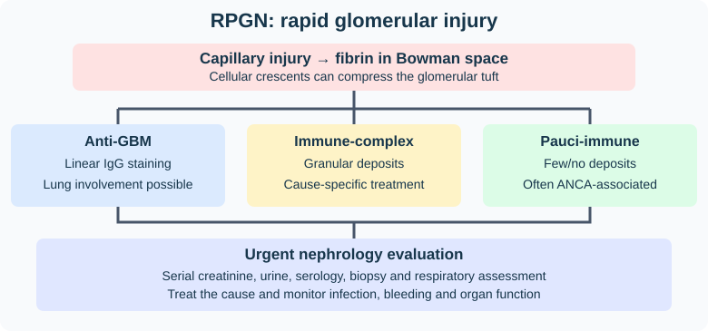

# 📚 Rapidly Progressive Glomerulonephritis (RPGN)

[🏠 Chapter](../README.md) · [📝 Original MCQs](../MCQs/Rapidly-Progressive-Glomerulonephritis-30-MCQs.md) · [📜 Exam evidence](../Previous-Year-Questions/RPGN-Reported-Evidence.md)

**Study-ready, unattempted.** Adult renal nursing. Advanced immunopathology and specialty therapy are clinical enrichment. Treatment is prescribed by the nephrology team.

## 1. Definition and injury mechanism

**Priority: 🔴 MOST IMPORTANT**

Glomerulus kidney ke andar blood filter karne wali capillaries ka group hai. RPGN ka matlab rapidly progressive glomerulonephritis hai. Is syndrome mein inflammation ki wajah se kidney filtration kuch din ya hafton mein rapidly gir sakti hai. Patient ke urine mein blood aur protein aa sakte hain. Creatinine jaldi badh sakta hai. Ye ordinary stable CKD nahi hai aur urgent nephrology evaluation chahiye.

Jab glomerular capillary wall seriously damage hoti hai, toh fibrin aur inflammatory material Bowman space mein leak ho sakte hain. Bowman capsule ki parietal epithelial cells proliferate karti hain aur inflammatory cells bhi collect ho sakte hain. Ye half-moon jaisa cellular mass crescent kehlata hai. Crescent glomerular tuft ko compress karke filtration compromise kar sakta hai. Cellular crescents active injury suggest karte hain. Fibrous crescents chronic scar aur less reversible injury ka clue hain. Biopsy mein crescents milna ek histological observation hai. RPGN clinical course ko describe karta hai. Dono closely related hain lekin sirf crescent percentage se clinical rate establish nahi hota.

## 2. Immunological classification and clinical clues

Immunofluorescence (IF) biopsy tissue par immune proteins ka staining pattern dikhati hai.

| Mechanism | IF pattern | Clinical clue |
|---|---|---|
| Type I anti-GBM | Linear IgG along glomerular basement membrane | Kidney injury with or without alveolar hemorrhage |
| Type II immune-complex | Granular immune deposits | Lupus, infection-related GN, IgA disease and other causes |
| Type III pauci-immune | Few or absent immune deposits | Often ANCA-associated small-vessel vasculitis |
| Double positive | Anti-GBM and ANCA detected | Severe overlap disease, relapse follow-up matters |

GBM ka matlab glomerular basement membrane hai. Anti-GBM antibodies type IV collagen ke alpha-3 chain ke noncollagenous region ko target kar sakti hain. Similar antigen lung ki alveolar basement membrane mein bhi present hai. Jab lung hemorrhage aur GN saath hote hain, traditional Goodpasture syndrome term use hoti hai. Anti-GBM disease kidney-only bhi ho sakti hai. Hemoptysis absent hone se alveolar hemorrhage exclude nahi hota.

ANCA ka matlab antineutrophil cytoplasmic antibody hai. PR3 aur MPO important antigen targets hain. Granulomatosis with polyangiitis (GPA) mein sinus/ENT symptoms, lung involvement aur GN coexist kar sakte hain. Microscopic polyangiitis (MPA) mein small-vessel injury kidney aur lungs affect kar sakti hai. PR3 aur MPO associations absolute nahi hain. Negative ANCA se pauci-immune GN completely exclude nahi hota.

Immune-complex GN mein deposited antigen-antibody complexes inflammation trigger karte hain. Complement C3/C4 result cause-specific clue de sakta hai. Lupus mein ANA aur anti-dsDNA evaluation useful ho sakti hai. Active infection ko immune-mediated vasculitis assume karna dangerous hai because immunosuppression infection worsen kar sakti hai.

## 3. Urgent assessment and diagnostic workup

**Priority: 🔴 MOST IMPORTANT**

Serial serum creatinine, potassium, bicarbonate, CBC, urine microscopy aur urine protein quantify karo as ordered. Kidney function rapidly changing ho toh calculated eGFR reliable steady-state estimate nahi hota. Urine output maintained hone par bhi severe glomerular injury possible hai. Team ko worsening trend promptly report karo. Anti-GBM antibody, PR3/MPO ANCA, complement and cause-specific autoimmune/infection tests clinical suspicion ke hisaab se arrange hote hain. Kidney biopsy IF and light microscopy subtype and active versus chronic injury assess kar sakti hai. High suspicion anti-GBM disease mein specialist treatment biopsy report ke wait se delay nahi karna.

Pulmonary-renal syndrome mein alveolar hemorrhage possibility ko consider karo if new dyspnea, falling Hb, hypoxemia or new diffuse infiltrates accompany GN. ABC, oxygenation and urgent emergency review priority hain. Hemoptysis har case mein nahi hoti. Pulmonary edema, infection and hemorrhage different treatment require kar sakte hain. Nurse sirf X-ray ke basis par final diagnosis nahi karti.

Before biopsy prescribed coagulation review, BP, medication history and consent process verify karo. After biopsy hematuria, new flank pain, BP and pulse trends observe karo. Existing renal assessment bank already covers major post-biopsy hemorrhage recognition.

## 4. Cause-specific treatment and nursing monitoring

KDIGO 2024 ANCA vasculitis mein induction (active disease ko remission mein lana) generally glucocorticoid plus rituximab or cyclophosphamide se hota hai. Choice organ involvement, prior relapse, kidney function, age, fertility concerns, toxicity and access par depend karti hai. Severe kidney impairment mein combination or cyclophosphamide-based strategies specialist consider kar sakte hain. Maintenance ka purpose relapse prevent karna hai, induction se different. Rituximab or azathioprine-based regimens selected patients mein use hote hain.

KDIGO 2024 practice point 9.3.1.9 plasma exchange consider karta hai with creatinine above 3.4 mg/dL, dialysis need, rapid creatinine rise, or hypoxemic diffuse alveolar hemorrhage. Ye universal mandatory treatment nahi hai. Anti-GBM overlap mein plasma exchange add karna recommended practice point hai. Plasma exchange blood se antibody-containing plasma remove karke replacement fluid deta hai. Dialysis small solutes and fluid remove karti hai, pathogenic antibodies remove karne ka equivalent procedure nahi.

KDIGO 2021 anti-GBM disease mein glucocorticoid, cyclophosphamide and plasma exchange standard initial approach hai. A narrow exception exists for dialysis dependence at presentation with biopsy showing 100% crescents or more than 50% global sclerosis and no pulmonary hemorrhage. These findings suggest very poor renal recovery potential. Specialist weighs risks. Do not treat dialysis dependence alone as a contraindication. Plasma exchange generally continues until anti-GBM antibodies undetectable as prescribed. Isolated anti-GBM remission usually needs no long-term maintenance, unlike double-positive disease which follows ANCA maintenance principles.

Before rituximab hepatitis B screening verify karo because viral reactivation possible hai. During infusion new wheeze, swelling, hypotension or severe reaction mein infusion stop and emergency protocol activate karo. Cyclophosphamide bone marrow suppression, infection, hemorrhagic cystitis and fertility harm cause kar sakti hai. CBC, urine symptoms, fertility counseling and prescribed uroprotection review karo. Renal patient ko forced hydration blindly mat do. Glucocorticoids glucose, BP, infection risk and mood affect kar sakte hain. Pneumocystis jirovecii pneumonia prophylaxis and vaccine review clinical team se verify karo. TMP-SMX use mein potassium and renal dosing important hain.

During plasma exchange citrate anticoagulation ionized calcium lower kar sakti hai. Perioral tingling, cramps, hypotension and arrhythmia symptoms promptly report karo. Vascular access, bleeding, fibrinogen if ordered and replacement-fluid reactions monitor karo. Dialysis support needed ho sakti hai for refractory electrolyte disturbance, acidosis or overload. Treatment response serial organ function and symptoms se assess karo. ANCA titer alone relapse diagnose nahi karta. Follow-up mein new ENT, pulmonary, urine and systemic symptoms communicate karo.

## ▶️ Teaching and MCQ practice

| Topic | Teaching | MCQ practice |
|---|---|---|
| RPGN classification | [Crescentic glomerulonephritis](https://www.youtube.com/watch?v=7hCQwTWKFTI), indexed title only | Specific coverage pending |
| Nephritic disorders and RPGN | [NEET PG/FMGE review](https://www.youtube.com/watch?v=kilj4DQJoPw), indexed description, medical exam enrichment | [Glomerulonephritis exam review](https://www.youtube.com/watch?v=S628xNQZBU0), indexed description mentions IF types, exact MCQ format/playback not confirmed, not counted |
| Therapy and nursing safety | Official clinical sources below | Dedicated nursing question-specific videos pending |

## References

[KDIGO 2024 AAV executive summary](https://kdigo.org/wp-content/uploads/2024/04/KDIGO-2024-ANCA-Vasculitis-Guideline-Execcutive-Summary.pdf), extracted text reviewed, page screenshots failed. [KDIGO 2024 full guideline](https://kdigo.org/wp-content/uploads/2024/05/KDIGO-2024-ANCA-Vasculitis-Guideline.pdf) · [KDIGO 2021 anti-GBM executive summary chapter 11](https://kdigo.org/wp-content/uploads/2017/02/KDIGO-2021-GD-Guideline-Executive-Summary.pdf), text reviewed. [NCBI RPGN review](https://www.ncbi.nlm.nih.gov/sites/books/NBK557430/) · [Indian Journal of Nephrology 2025 double-positive case series](https://doi.org/10.25259/IJN_207_2025), Nepal cases published in Indian journal, not an Indian guideline · [ICMR July 2026 workflow](https://www.icmr.gov.in/icmrobject/uploads/STWs/1793170716_nephrology.pdf), indexed text supports immediate referral, full verification pending.

[📝 Practice questions](../MCQs/Rapidly-Progressive-Glomerulonephritis-30-MCQs.md) · [🏠 Chapter](../README.md)
