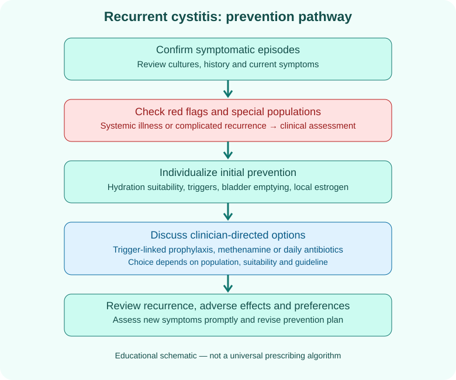

# Recurrent UTI Prevention

**Draft candidate — study-ready material under review, not studied.** Ye chapter ka naya preventive-care topic hai. Ye personal treatment prescription nahi hai.

[Chapter](../README.md) · [30 original MCQs](../MCQs/Recurrent-UTI-Prevention-30-MCQs.md) · [Evidence register](../Previous-Year-Questions/Recurrent-UTI-Prevention-Evidence.md)

## Recurrence ko samjho

Recurrent UTI ka matlab hai ki patient ko baar-baar symptomatic urinary infection ho raha hai. Aam clinical threshold chhe mahine mein kam se kam do episodes ya ek saal mein kam se kam teen episodes hai. Har positive culture ko infection ka episode mat count karo. Symptoms aur available microbiological evidence ko saath dekhna zaroori hai.

Bladder infection aur kidney infection alag clinical problems hain. Agar baar-baar pyelonephritis hoti hai, toh clinician ko underlying obstruction ya urinary tract ki doosri problem investigate karni pad sakti hai. Pregnancy, men aur complicated infection ke liye routine uncomplicated female cystitis pathway ko seedha apply nahi karna chahiye.

## Nursing assessment aur practical prevention

Patient se episodes ki dates, symptoms, recovery, available cultures, previous antibiotic courses aur adverse effects poochho. Isse pata chalega ki prevention ka target kya hai. Agar patient ko urine empty karne mein problem hai, toh clinician ke saath residual urine assessment ki need discuss karo.

Agar patient kam paani peeti hai aur fluid restriction nahi hai, toh suitable hydration badhane par baat ki ja sakti hai. Heart failure ya kidney-related fluid restriction mein fixed high-water target dena unsafe ho sakta hai. Patient ke work schedule, toilet access aur daily routine ko dhyan mein rakho.

Spermicide exposure aur intercourse-related episodes ka pattern bhi relevant ho sakta hai. Patient ko blame mat karo. Contraceptive alternatives aur trigger diary ko uski preference ke hisaab se discuss karo. Har behavioural intervention ke benefit ka evidence equally strong nahi hai.

## Menopause aur local estrogen

Menopause ke baad estrogen kam hone se vaginal tissue aur protective microbial environment change ho sakte hain. Suitable peri- ya postmenopausal patient mein clinician local vaginal estrogen discuss kar sakta hai. Systemic HRT sirf UTI prevention ke liye shuru karna NICE ka recommended approach nahi hai. Cancer history ya hormone-related concerns mein individualized discussion zaroori hai.

## Antibiotic-sparing prevention

Methenamine hippurate selected patients mein daily antibiotic prophylaxis ka alternative ho sakta hai. Ye current symptomatic infection ka replacement treatment nahi hai. Iski suitability clinician assess karta hai, especially renal ya hepatic problems aur interacting medicines ke context mein. Urinary alkalinizing citrate sachets activity kam kar sakte hain. Pregnancy, recurrent upper UTI aur complicated lower UTI mein specialist advice ki zaroorat hai.

NICE mein methenamine treatment ka review chhe mahine ke andar aur phir har saal ya agreed earlier interval par hota hai.

Cranberry products kuch patients mein recurrence kam karne mein madad kar sakte hain, lekin benefit guaranteed nahi hai. Product formulations alag hote hain. D-mannose alone ka reliable benefit AUA 2025 ke updated evidence se establish nahi hua. Probiotics ke results strain aur formulation ke hisaab se vary karte hain.

## Antibiotic prophylaxis aur follow-up

Agar initial measures sufficient nahi hain aur ek clear trigger identify hua hai, toh clinician suitable patient ke liye trigger-associated single-dose prophylaxis consider kar sakta hai. Daily antibiotic prophylaxis bhi kuch patients mein appropriate ho sakti hai. Previous culture, resistance, allergies, renal function, medicine-specific harm aur patient preferences ko review karna zaroori hai.

Daily prophylaxis ko automatic lifelong treatment mat samjho. NICE ke according review kam se kam har chhe mahine mein hona chahiye. Long-term nitrofurantoin mein pulmonary aur hepatic toxicity ke liye vigilance aur relevant renal assessment zaroori hain.

Agar preventive treatment ke dauran naya symptomatic infection ho, toh patient ko agreed clinical assessment pathway follow karna chahiye. Fever, flank pain, vomiting ya systemic deterioration mein urgent assessment ki zaroorat ho sakti hai. Carefully selected patients ke self-start plans bhi clinician-agreed boundaries ke andar hi use hote hain.

## Revision

Episode count, culture evidence, special populations, hydration suitability, estrogen route, methenamine interactions aur prophylaxis review ko alag-alag samjho. Prevention ka outcome sirf antibiotic use nahi hai. Symptomatic recurrence, adverse effects aur quality of life bhi important hain.

## Clinical references and video gaps

- [NICE NG112 recommendations](https://www.nice.org.uk/guidance/ng112/chapter/recommendations)
- [AUA 2025 update summary](https://www.auanews.net/issues/articles/2025/october-2025/updates-to-the-aua/cua/sufu-guideline-on-recurrent-uncomplicated-urinary-tract-infections-in-women)
- [EAU Urological Infections](https://uroweb.org/guidelines/urological-infections/chapter/the-guideline)
- [MHRA nitrofurantoin pulmonary and hepatic safety reminder](https://www.gov.uk/drug-safety-update/nitrofurantoin-reminder-of-the-risks-of-pulmonary-and-hepatic-adverse-drug-reactions)

Teaching and dedicated question-solving video verification remains pending. See the separate evidence register for research limitations.

[Practice questions](../MCQs/Recurrent-UTI-Prevention-30-MCQs.md) · [Evidence register](../Previous-Year-Questions/Recurrent-UTI-Prevention-Evidence.md) · [Chapter](../README.md)
