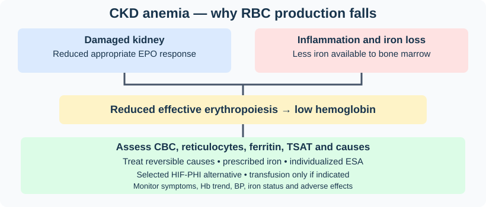

# 📚 Renal anemia — iron evaluation, ESA, HIF-PHI and transfusion

[🏠 Chapter](../README.md) · [📝 Original MCQs](../MCQs/Renal-Anemia-30-MCQs.md) · [📜 Reported evidence](../Previous-Year-Questions/Renal-Anemia-Reported-Evidence.md)

**Study-ready, unattempted.** Adult CKD nursing. Guideline recommendations and treatment thresholds are educational, not independent medication orders. KDIGO 2026 is the current international reference for this package. Indian Society of Nephrology (ISN) 2025 consensus is separately identified wherever its recommendations differ.

## 1. Why anemia develops in CKD

**Priority:** 🔴 MOST IMPORTANT

Hemoglobin (Hb) red blood cells ke andar oxygen carry karta hai. Anemia mein hemoglobin kam hota hai, isliye tissues tak oxygen pahunchane ki capacity kam ho sakti hai. Kidney normally erythropoietin (EPO) hormone banati hai. EPO bone marrow ko RBC banane ka signal deta hai. CKD mein healthy EPO-producing cells ka response insufficient ho sakta hai. Isliye bone marrow anemia ke according enough RBC nahi bana pata.

Inflammation mein hepcidin hormone badh sakta hai. Hepcidin iron ko storage cells se blood mein release karne aur intestine se absorption ko reduce karta hai. Is wajah se ferritin normal ya high hone par bhi marrow ko iron kam mil sakta hai. Dialysis circuit blood loss, frequent blood sampling, gastrointestinal bleeding, poor nutrition aur shorter RBC survival bhi anemia worsen kar sakte hain.

Renal anemia commonly normocytic normochromic hoti hai. Iska matlab RBC ka size aur hemoglobin appearance relatively normal hote hain, lekin number kam ho sakta hai. Har CKD patient mein same pattern nahi hota. Iron deficiency se microcytosis aur B12/folate deficiency se macrocytosis possible hai.

## 2. Assessment and iron interpretation

Fatigue, pallor, exertional dyspnea, dizziness, palpitations aur activity intolerance assess karo. SpO2 normal hone par bhi Hb low ho toh oxygen content low ho sakta hai. Severe dyspnea, syncope, chest pain, active bleeding ya hemodynamic instability mein urgent assessment chahiye.

KDIGO 2026 adult diagnostic thresholds generally Hb below 13 g/dL in men and below 12 g/dL in women hain. Pregnancy aur pediatric patients ke thresholds alag ho sakte hain. Anemia diagnosis threshold, ESA initiation threshold aur ESA treatment target teen different concepts hain.

| Test | Meaning and nursing interpretation |
|---|---|
| CBC and MCV | Hb anemia severity batata hai. MCV RBC size batata hai. Pattern se additional causes suspect kar sakte hain. |
| Reticulocyte count | Reticulocytes young RBC hain. Anemia ke response mein inka count inappropriately low ho toh underproduction ka concern hota hai. |
| Ferritin | Iron stores ka marker hai, lekin inflammation ferritin elevate kar sakti hai. |
| TSAT | Transferrin saturation available circulating iron ka estimate hai. Formula = serum iron ÷ total iron-binding capacity (TIBC) × 100, same units use karo. |
| CRP, B12, folate, blood loss evaluation | Clinical indications ke according other causes identify karne mein help karte hain. |

Example: serum iron 36 µg/dL aur TIBC 240 µg/dL ho toh TSAT = 36 ÷ 240 × 100 = 15%. Ferritin 350 ng/mL ke saath TSAT 15% iron-restricted erythropoiesis suggest kar sakta hai. Ferritin alone iron availability establish nahi karta. Ferritin 45 ng/mL se kam ho aur iron deficiency ka cause unclear ho, toh blood loss assessment consider hoti hai. Heavy periods, hematuria, occult GI loss aur medication history relevant hain.

KDIGO 2026 routine anemia and iron deficiency screening minimum frequency CKD G3 annually, G4 twice yearly, G5 or dialysis every three months batata hai. Symptoms aur treatment status ke according extra tests needed ho sakte hain.

## 3. Iron treatment — KDIGO 2026 and ISN 2025

**Priority:** 🔴 MOST IMPORTANT

KDIGO 2026 adult anemia and CKD recommendations ko modality-specific padho. Iron initiation ka matlab treatment consider karna hai, automatic prescription nahi.

| Patient group | KDIGO 2026 suggested initiation criteria |
|---|---|
| CKD G5 hemodialysis | Ferritin ≤500 ng/mL AND TSAT ≤30% |
| CKD not on dialysis or G5 peritoneal dialysis | Ferritin <100 ng/mL AND TSAT <40%, OR ferritin 100 to <300 ng/mL AND TSAT <25% |

Ferritin ng/mL aur µg/L numerically same hain. Example HD patient ferritin 480 and TSAT 29% dono criteria meet karta hai. PD patient ferritin 250 and TSAT 24% second criterion meet karta hai. Dono modalities ko interchange mat karo.

Hemodialysis mein IV iron preferred ho sakta hai because repeated access aur replacement efficiency helpful hai. Non-dialysis/PD mein oral ya IV iron select karte waqt deficiency severity, tolerance, cost, availability aur preference consider karo. Oral iron se nausea, constipation aur dark stools ho sakte hain. Tarry sticky stools with symptoms ko automatically harmless iron discoloration mat samjho. Oral iron ka inadequate response ya intolerance ho toh team IV iron consider kar sakti hai.

Full KDIGO 2026 practice point 2.2 ke according routine iron withhold karna reasonable hai jab ferritin >700 ng/mL OR TSAT ≥40%. Ye initiation criteria nahi hain. Systemic infection ke dauran iron temporarily suspend karne ka decision clinical team review karti hai. Rare selected high-ferritin, low-TSAT cases require specialist judgement. Iron therapy mein iron parameters generally HD every 1–3 months, non-dialysis/PD every three months assess karo, clinical context mein sooner. KDIGO central HD pathway monthly monitoring use karta hai.

ISN 2025 consensus IV iron initiation ke liye ferritin <700 and TSAT <40% ka broader possible threshold describe karta hai, contraindications consider karte hue. Non-dialysis/PD iron deficiency mein 1–3 months oral trial aur HD mein IV iron support karta hai. KDIGO 2026 modality-specific criteria alag hain. Exam stem mein named guideline aur date dekho.

IV iron administration mein exact preparation, dose, dilution, infusion rate, allergy history aur local protocol verify karo. New wheeze, hypotension ya facial swelling during infusion mein administration stop karo, ABC assessment aur emergency response activate karo. Routine test dose har preparation mein mandatory nahi hoti. Product instructions follow karo.

## 4. ESA and HIF-PHI safety

ESA (erythropoiesis-stimulating agent) EPO signal ko mimic karke marrow RBC production support karta hai. Epoetin aur darbepoetin examples hain. Response days to weeks leta hai, immediate resuscitation treatment nahi. Iron restriction, inflammation, bleeding, malnutrition, hyperparathyroidism aur inadequate dialysis poor response mein contribute kar sakte hain. Reversible causes treat karo before escalating dose.

KDIGO 2026 recommends ESA as first-line over HIF-PHI when pharmacologic erythropoiesis support is needed after correctable causes addressed. HD/PD mein ESA initiation suggested when Hb is around or below 9–10 g/dL, individualized to risks and benefits. Non-dialysis mein symptoms, transfusion risk, cardiovascular risk aur preferences se threshold decide hota hai. ESA-treated adults mein Hb target **below 11.5 g/dL** hai. Normal healthy adult Hb forcefully achieve karna goal nahi hai because higher targets stroke, thrombosis aur cardiovascular adverse events increase kar sakte hain. ISN 2025 describes 10–12 g/dL treatment target and adult ND/HD ESA initiation below 10 after addressing reversible causes. These are distinct guideline statements.

Hb trend after ESA start or dose change generally every 2–4 weeks review hota hai. BP, vascular access, new neurologic symptoms, thrombosis signs aur adherence assess karo. Prescribed dose aur cold chain manufacturer instructions se verify karo. Sudden lack of response with very low reticulocytes requires urgent specialist evaluation for rare pure red cell aplasia and other causes. Uncontrolled hypertension or thrombotic events require clinical review, not automatic administration.

HIF-PHI (hypoxia-inducible factor prolyl hydroxylase inhibitor) ek oral drug class hai jo hypoxia-response signaling stabilize karke endogenous EPO response aur iron handling influence kar sakti hai. Daprodustat, roxadustat and other products ka approval jurisdiction aur dialysis status ke hisaab se different hota hai. KDIGO 2026 mein ESA preferred hai, HIF-PHI selected alternative hai. Active malignancy ya recent cardiovascular/thrombotic event mein HIF-PHI avoid karne ki guidance hai. ISN 2025 additionally lists specific caution/avoidance populations, including pregnancy and proliferative diabetic retinopathy. ESA and HIF-PHI combination recommend nahi hai. Inadequate HIF-PHI response after 3–4 months mein specialist discontinuation review chahiye.

## 5. Transfusion and patient education

RBC transfusion oxygen-carrying capacity rapidly increase kar sakti hai, lekin volume overload, reactions, hyperkalemia and alloimmunization risks hain. Alloimmunization ka matlab donor antigens ke against antibodies develop hona hai. Future kidney transplant matching difficult ho sakti hai. Transplant candidates mein avoidable transfusions reduce karna important hai. Life-threatening bleeding or unstable symptomatic anemia mein lifesaving transfusion delay nahi karna. Chronic stable anemia mein isolated Hb number se transfusion decision nahi hota. Clinical symptoms, risk and alternatives assess hote hain. ISN 2025 essential transfusion mein leukocyte-depleted RBCs prefer karta hai, lekin ye alloimmunization risk eliminate nahi karta.

Transfusion se pehle patient identity, compatibility, consent/prescription, baseline vitals aur access check local protocol se karo. New dyspnea, fever, chills, pain, hypotension ya pulmonary congestion mein transfusion stop, assess ABC and alert team as per reaction protocol. CKD volume status aur potassium monitoring especially relevant ho sakti hai. Stable patient mein prescribed rate, reassessment aur dialysis coordination important hain.

Patient ko explain karo ki ESA, iron aur transfusion ka purpose different hai. Prescribed follow-up blood tests attend karo, medication schedule samjho, signs of bleeding aur thrombosis report karo. Tea/calcium-containing medicines aur oral iron timing ka review pharmacist se karo. Personalized dietitian advice follow karo, renal restrictions ignore karke iron-rich food indiscriminately increase mat karo.

## ▶️ Teaching and MCQ practice

| Topic | Teaching resource | MCQ practice |
|---|---|---|
| CKD anemia mechanism and treatment | [East Kolkata Doctors Group — anemia and bone disease](https://www.youtube.com/watch?v=4-sfFj17MKQ), indexed description, predates KDIGO 2026 | [Lab Tech Guru renal function MCQs](https://www.youtube.com/watch?v=srZzygKWhBs), broad question bank description mentions EPO. Specific renal-anemia question coverage not established. |
| KDIGO 2026 anemia update | [Anemia in CKD: investigation and treatment update](https://www.youtube.com/watch?v=ZU_YhfDSKTw), indexed description | Specific threshold and treatment question videos pending |
| Iron, ESA, HIF-PHI and transfusion | Official written references below | Dedicated item-level practice pending |

## References

[KDIGO 2026 full final guideline](https://kdigo.org/wp-content/uploads/2026/04/KDIGO-2026-Anemia-in-CKD-Guideline.pdf), recommendations 2.1–2.3, practice point 2.2, recommendations 3.2.1–3.3.1 and practice point 3.5.1. [KDIGO key takeaways](https://kdigo.org/wp-content/uploads/2026/03/KDIGO-2026-Anemia-Guideline-Key-Takeaways-for-HCPs.pdf), page image reviewed. [ISN 2025 India consensus](https://indianjnephrol.org/anemia-of-chronic-kidney-disease-in-india-consensus-guidelines-of-indian-society-of-nephrology/), direct HTML. [ERBP commentary](https://doi.org/10.1093/ndt/gfag014), indexed.

**Exam clue:** Ferritin stores batata hai, TSAT availability. HD aur PD iron thresholds different hain. ESA target aur anemia diagnosis threshold same nahi hain.

[📝 Questions](../MCQs/Renal-Anemia-30-MCQs.md) · [🏠 Chapter](../README.md)
