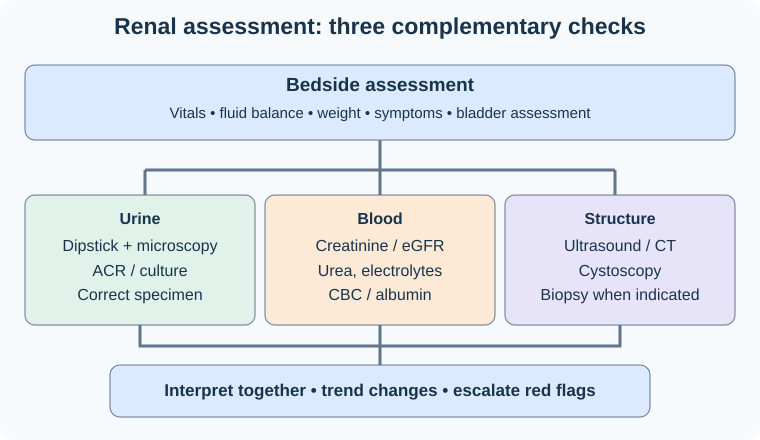

# 📚 Renal assessment and diagnostic investigations

[🏠 Chapter](../README.md) · [📝 30 original MCQs](../MCQs/Renal-Assessment-and-Diagnostics-30-MCQs.md) · [📜 Previous Year Questions](../Previous-Year-Questions/Renal-Assessment-Reported-Exam-Questions.md)

> **Dhyan de:** Study-ready, unattempted. Adult nursing ke liye basic se clinical interpretation tak padho. Individual lab ranges aur local procedures vary kar sakte hain.

[Assessment](#1-bedside-assessment) · [Urine tests](#2-urinalysis-and-specimens) · [Blood tests](#3-blood-tests-and-kidney-function) · [Imaging and biopsy](#4-imaging-and-procedures)

## 1. Bedside assessment

**Priority:** 🔴 MOST IMPORTANT

Dekho, kidney patient ko assess karte time sirf creatinine report mat dekho. Patient ka BP, pulse, respiration, oxygen saturation, temperature, weight aur urine pattern bhi important hain. Kidney blood ko filter karti hai, isliye perfusion aur fluid status mein change hone par urine aur blood tests dono change ho sakte hain.

History mein pucho ki urine kam aa raha hai ya baar-baar aa raha hai. Dysuria ka matlab urine pass karte time pain ya burning hai. Frequency ka matlab baar-baar jaana hai, urgency ka matlab achanak strong urge hai, aur nocturia ka matlab raat ko neend se uthkar urine pass karna hai. Polyuria adult mein generally 3 L/day se zyada total urine ko kehte hain. Frequency aur polyuria ek cheez nahi hain. Hematuria urine mein blood hai, jo visible ya microscopic ho sakta hai.

Flank pain peeth ke side mein hota hai. Costovertebral angle (CVA) ribs aur spine ke paas ka area hai. Wahan tenderness infection ya doosri renal problems ke saath ho sakti hai, lekin akela sign diagnosis confirm nahi karta. Fever, flank pain aur vomiting ko promptly report karo. Suprapubic fullness lower abdomen mein bladder distension indicate kar sakti hai. Portable bladder scan se retained urine ka estimate mil sakta hai.

Patient se diabetes, hypertension, previous UTI, stone, surgery, family kidney disease, recent vomiting/diarrhea aur medicines ki history lo. NSAIDs, contrast exposure aur herbal products ke baare mein bhi pucho. Medicine apni taraf se band ya start mat karo. Clinical team ko risk communicate karo.

### Fluid assessment aur nursing documentation

Daily weight same scale, similar clothes aur comparable time par lo. Roughly 1 kg short-term change around 1 L water change suggest kar sakta hai, lekin ye exact measurement nahi hai. Edema, lung crackles, breathlessness aur BP ko saath mein assess karo. Dry mucosa, postural symptoms aur weak perfusion fluid deficit suggest kar sakte hain. Edema hone ka matlab hamesha effective circulating volume adequate nahi hota.

Intake mein oral, IV aur enteral fluids count karo. Output mein urine, measured vomiting, drains aur other measured losses document karo. Net recorded balance = intake minus measured output. Insensible losses (skin aur breathing se invisible water loss) recorded balance mein usually directly measure nahi hote.

Example: intake 1,900 mL, urine 900 mL, drain 150 mL, vomiting 250 mL. Recorded balance = 1,900 − 1,300 = +600 mL. Is number ko weight aur assessment ke saath interpret karo.

Urine output suddenly girne par catheter hai toh kinks, bag position aur patency assess karo. Bladder distension, vitals aur perfusion check karo. Unstable patient ko urgent emergency review chahiye. Har low urine output ko fluid bolus se treat mat karo. Obstruction aur fluid overload bhi cause ho sakte hain.

## 2. Urinalysis and specimens

**Priority:** 🔴 MOST IMPORTANT

Urinalysis ka matlab urine ka physical, chemical aur microscopic examination hai. Isse clue milta hai ki kidney ya urinary tract mein kya problem ho sakti hai. Ek dipstick result se final diagnosis nahi banta.

| Test | Simple meaning |
|---|---|
| Colour and clarity | Pale yellow se amber normal variation ho sakta hai. Blood, medicines, pigments, cells aur crystals appearance change kar sakte hain. Cloudy urine alone UTI prove nahi karta. |
| Specific gravity (SG) | Ye urine density ko water se compare karta hai. Common teaching range 1.005–1.030 hai. Glucose, protein, contrast aur measurement method result affect kar sakte hain. |
| pH | Urine kitna acidic ya alkaline hai. Often approximately 4.5–8.0. Diet, storage, medication aur infection affect kar sakte hain. |
| Protein | Dipstick primarily albumin detect karta hai. Persistent abnormal finding ko quantitative ACR/PCR aur clinical review se evaluate karo. |
| Blood | Dipstick heme detect karta hai. RBC, free hemoglobin ya myoglobin se positive ho sakta hai. Microscopy helpful hai. |
| Nitrite | Kuch bacteria nitrate ko nitrite banate hain. Negative nitrite UTI ko exclude nahi karta. |
| Leukocyte esterase | White cell enzyme ka clue hai. Inflammation ya contamination bhi result positive kar sakte hain. |
| Glucose and ketones | Glucosuria high filtered load ya tubular/drug effect se aa sakti hai. Ketones fasting ya ketoacidosis jaise conditions mein ho sakte hain. |

SG urinometer (buoyancy), refractometer (light refraction) ya reagent strip se estimate ho sakti hai. In methods ke limitations alag hote hain. Osmolality particles ki number concentration ko reflect karti hai, SG density ko. Dono exactly interchangeable nahi hain. Repeated SG near 1.010 with inability to concentrate or dilute isosthenuria ka clue ho sakti hai. Ek single reading sufficient nahi hai.

### Microscopy: casts ka meaning

Casts tubules ke andar protein matrix mein form hone wale tube-shaped structures hain. RBC casts glomerular bleeding/inflammation ka strong clue hote hain. WBC casts pyelonephritis ya interstitial inflammation ke saath mil sakte hain. Muddy brown granular casts acute tubular injury suggest karte hain. Fatty casts heavy proteinuria/nephrotic syndrome ke saath mil sakte hain. Few hyaline casts exercise ya dehydration mein bhi aa sakte hain. Waxy/broad casts advanced kidney dysfunction ka clue ho sakte hain. Findings ko clinical context se interpret karna hai.

### Correct urine collection

Clean-catch midstream sample mein hand hygiene, local cleansing instructions aur sterile container ka use karo. Patient pehle thoda urine toilet mein pass kare, phir beech ka sample collect kare. Container ki inner surface touch nahi karni. Routine microscopy ke liye first morning sample useful ho sakta hai. Timing test aur local lab instructions se decide hoti hai.

Culture suspected infection ke liye organisms identify karta hai aur susceptibility testing antibiotic selection support karti hai. Indicated culture ideally antibiotic start se pehle collect karo agar urgent treatment delay na ho. Existing catheter se fresh small sample disinfected needleless sampling port se aseptic technique se lo. Drainage bag se culture mat lo. Specimen label bedside par correct patient identifiers, time aur type se verify karo. Prompt transport ya lab-approved preservation follow karo.

24-hour urine collection mein start time par pehli void discard karo. Uske baad saara urine collect karo, aur next day same finish time ki void include karo. Storage/preservative lab instructions ke hisaab se rakho. Missed sample ko hide mat karo. Lab se restart guidance lo. This procedure is different from a single spot ACR.

## 3. Blood tests and kidney function

**Priority:** 🔴 MOST IMPORTANT

Serum creatinine muscle metabolism ka waste product hai. Kidney clearance kam hone par creatinine badh sakta hai. Lekin muscle mass, age, drugs aur changing kidney function bhi result affect karte hain. Low muscle mass wale older patient mein apparently normal creatinine ke bawajood kidney function reduced ho sakta hai. Baseline aur trend compare karo.

BUN ka full form blood urea nitrogen hai. Urea protein breakdown ke nitrogen ko carry karti hai. BUN dehydration, gastrointestinal bleeding, high protein intake aur kidney dysfunction mein badh sakta hai. BUN aur total serum urea same number nahi hain. mg/dL units mein urea roughly BUN × 2.14 hai. Lab report ka actual analyte check karo.

eGFR estimate creatinine-based equation se aata hai. Adult reports often mL/min/1.73 m² mein hoti hain. Rapidly changing creatinine mein routine steady-state eGFR unreliable ho sakta hai. CKD screening ke liye filtration estimate aur urine albumin dono important hain. Cystatin C additional filtration marker hai. Selected patients mein combined equation precision improve kar sakti hai.

### Urine albumin-to-creatinine ratio (UACR)

Albumin normally blood mein largely retained rehta hai. Kidney filter damage par urine mein albumin aa sakta hai. Spot ACR urine albumin ko urine creatinine se divide karke concentration variation ka effect reduce karta hai. First morning sample preferred when practical.

| Albumin category | UACR mg/g |
|---|---|
| A1 | Below 30 |
| A2 | 30–300 |
| A3 | Above 300 |

Example: albumin 60 mg/L aur creatinine 1.5 g/L hai. ACR = 60 ÷ 1.5 = 40 mg/g, yaani A2. Fever, exercise, menstruation aur symptomatic infection temporary change kar sakte hain. Abnormal result repeat/confirm karna hota hai. Single abnormal ACR se chronic disease label nahi lagana.

Electrolytes mein potassium, sodium, bicarbonate, calcium aur phosphate check kiye ja sakte hain. Potassium high ho aur ECG changes ya unstable symptoms ho toh urgent escalation karo. CBC anemia aur infection ke clues de sakta hai. Serum albumin low ho toh protein loss, inflammation, nutrition aur liver disease jaise causes consider hote hain.

## 4. Imaging and procedures

**Priority:** 🟠 HIGH YIELD

Ultrasound sound waves se kidney size, structure, hydronephrosis aur bladder volume assess karta hai. Ismein ionizing radiation nahi hoti. Ultrasound normal hone se har renal disease exclude nahi hoti.

KUB plain X-ray kuch radiopaque stones detect kar sakta hai, lekin sab stones nahi dikhte. Noncontrast CT often suspected stone evaluation mein helpful hota hai. Pregnancy aur radiation concerns mein imaging selection clinical team karegi. Contrast-enhanced CT/urography se pehle relevant kidney function, previous contrast reaction aur prescribed preparation check karo. Iodinated contrast aur MRI gadolinium risk assessments different hote hain. Automatic medicine withholding ya universal hydration instructions mat do. Local radiology protocol follow karo.

Cystoscopy ek scope se urethra aur bladder ke andar dekhne ka procedure hai. Consent, ordered preparation aur infection assessment verify karo. Baad mein mild transient burning ho sakti hai, lekin fever, inability to void, heavy bleeding ya severe pain report karo. Urodynamic studies bladder storage aur emptying function assess karti hain.

### Renal biopsy nursing

Biopsy ka matlab tissue ka small sample lena hai. Kidney biopsy selected glomerular disease, unexplained dysfunction ya transplant concerns mein pathology identify karne mein help karti hai. Har patient ko biopsy ki zaroorat nahi hoti.

Before procedure: consent status, BP, hemoglobin, platelets, coagulation results, prescribed anticoagulant/antiplatelet plan, allergies aur ordered fasting verify karo. Patient ko procedure explain karo. Uncontrolled BP ya bleeding risk team ko report karo. Medicines apni taraf se stop mat karo.

Native kidney percutaneous biopsy often prone position mein ultrasound guidance se hoti hai. Transplant kidney anterior position mein ho sakti hai. After biopsy patient ko prescribed observation aur bed-rest instructions follow karvao. Vitals, puncture site, urine appearance, pain aur output monitor karo. New hypotension, tachycardia, worsening flank pain, dizziness ya gross hematuria bleeding ka warning sign ho sakte hain. Urgent review arrange karo. Discharge instructions mein activity restrictions aur warning signs explain karo.

## ▶️ Teaching and practice

| Topic | Teaching | Dedicated MCQ practice |
|---|---|---|
| Renal assessment, urine and blood tests | [Kidney Function Tests and Interpretation of Results](https://www.youtube.com/watch?v=aa_syowyGvg), indexed description covers tests and casts | Specific question coverage pending |
| RFT, urinalysis, ultrasound, biopsy | [MSN Renal System Part 02, NORCET 10](https://www.youtube.com/watch?v=p4Wqo9oK0Gk), indexed description lists these tests and MCQ discussion | Mixed lecture and MCQ lead only. Individual questions not verified. |
| General renal MCQ review | [JINC E-Nursing renal MCQ-based crash course](https://www.youtube.com/watch?v=MiSTI-Xj9FA) | Broad course lead. Specific assessment coverage not verified. |

No exact playback or timestamp was checked. Question-level gaps remain in the evidence file.

## References

- [Open RN Health Alterations, renal and urinary system](https://www.ncbi.nlm.nih.gov/sites/books/NBK613065/)
- [MSD Manual renal evaluation](https://www.msdmanuals.com/professional/nephrology/approach-to-the-patient-with-renal-issues/evaluation-of-the-patient-with-renal-issues)
- [NIDDK CKD evaluation](https://www.niddk.nih.gov/health-information/professionals/clinical-tools-patient-management/kidney-disease/identify-manage-patients/evaluate-ckd)
- [KDIGO 2024 executive summary](https://doi.org/10.1016/j.kint.2023.10.016)
- [CDC catheter specimen guidance](https://www.cdc.gov/infection-control/hcp/cauti/summary-of-recommendations.html)
- [NKF kidney biopsy](https://www.kidney.org/kidney-topics/kidney-biopsy)

**Quick revision:** History + examination + trend. SG is density. ACR quantifies albumin relative to creatinine. Correct specimen prevents misleading results. Post-biopsy bleeding signs need urgent review.

[📝 Practice](../MCQs/Renal-Assessment-and-Diagnostics-30-MCQs.md) · [📜 Reported evidence](../Previous-Year-Questions/Renal-Assessment-Reported-Exam-Questions.md) · [🏠 Chapter](../README.md)
