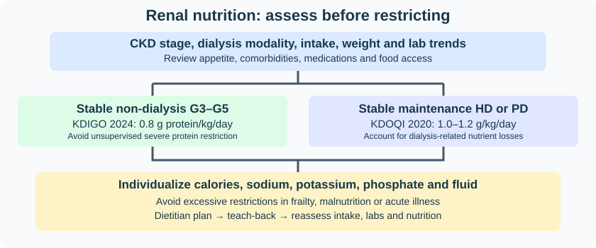

# 📚 Renal Diet and Nutrition — non-dialysis CKD, HD, PD and nursing counseling

[🏠 Chapter](../README.md) · [📝 Original MCQs](../MCQs/Renal-Diet-and-Nutrition-30-MCQs.md) · [📜 Reported exam evidence](../Previous-Year-Questions/Renal-Diet-and-Nutrition-Reported-Evidence.md)

**Study-ready, unattempted.** Adult nursing exam preparation. Diet calculations are learning examples, not personalized meal prescriptions. Clinical nutrition must be individualized by the renal team.

## 1. Nutritional assessment and protein-energy needs

**Priority:** 🔴 MOST IMPORTANT

Renal diet ka matlab har patient ko same low-protein, low-potassium diet dena nahi hai. Kidney function, dialysis status, blood reports, urine output, appetite, diabetes aur body composition ke according plan badalta hai. Diet ka goal kidney aur cardiovascular health support karna hai, saath mein malnutrition avoid karna bhi equally important hai.

Protein-energy wasting (PEW) ka matlab body ke protein aur energy stores reduce hona hai. Poor appetite, inflammation, metabolic acidosis, repeated illness aur dialysis nutrient loss contribute kar sakte hain. Nurse recent intake, unintended weight loss, muscle strength, functional decline, nausea, swallowing problems, food access aur nutrition-focused physical findings assess karti hai. Edema actual tissue loss ko weight scale par mask kar sakta hai. Prescribed dry-weight trend, physical assessment aur dietary history saath evaluate karo. Serum albumin inflammation, dilution aur urinary or dialysate protein loss se bhi affect hota hai, isliye albumin alone nutrition diagnosis nahi hai.

Dietitian structured dietary recall, 3-day food diary, nutrition screening and comprehensive tools such as 7-point Subjective Global Assessment (SGA) when appropriate use kar sakta hai. Family food preparation aur household affordability puchhna useful hai.

### Protein and energy guideline comparison

| Patient group | Teaching reference |
|---|---|
| Stable adults CKD G3–G5, not on dialysis | KDIGO 2024 suggests 0.8 g protein/kg body weight/day |
| Adults at risk of CKD progression | KDIGO advises avoiding high protein intake above 1.3 g/kg/day |
| Selected stable non-dialysis patients with kidney failure risk | Very low protein 0.3–0.4 g/kg/day only with prescribed essential amino acid/ketoacid supplementation and close supervision |
| Stable maintenance hemodialysis or peritoneal dialysis adults | KDOQI 2020 generally 1.0–1.2 g protein/kg/day |
| Metabolically stable adults CKD 1–5D | KDOQI energy guidance 25–35 kcal/kg/day, adjusted to clinical context |

KDOQI 2020 also describes a closely supervised 0.55–0.60 g/kg/day low-protein option for metabolically stable non-diabetic CKD 3–5. KDIGO 2024 0.8 recommendation aur KDOQI lower-protein approach ko different guideline statements samjho. Malnutrition, acute infection, catabolic illness aur frailty mein severe protein restriction inappropriate ho sakti hai. Older adults with sarcopenia may require higher protein and calorie goals. Children ko adult protein restriction apply nahi karni because growth important hai.

Dialysis amino acids aur protein losses cause kar sakti hai. PD dialysate mein protein loss hota hai aur glucose absorb hokar calories contribute karta hai. Peritonitis mein loss aur catabolic stress increase ho sakta hai. Metabolically unstable patient ki needs specialist decide karta hai. 2026 ISRNM/ISPD PD nutrition practice recommendation also supports 1.0–1.2 g/kg/day in stable adults, including those with diabetes, according to indexed text.

### Solved calculations

Example A: dietitian selects reference weight 60 kg for a stable maintenance HD patient and protein target 1.1 g/kg/day. 60 × 1.1 = 66 g/day. This is total dietary protein, not 66 g weight of meat or dal.

Example B: same selected reference weight and energy target 30 kcal/kg/day. 60 × 30 = 1,800 kcal/day. If prescribed total energy includes estimated absorbed PD glucose calories of 300 kcal/day, estimated dietary energy is 1,500 kcal/day. Actual PD absorption varies with dwell, transport and dialysate prescription, so fixed subtraction for all patients is unsafe.

Food choice mein adequate protein and energy ensure karna zaroori hai. Rice/roti, dal, dahi, paneer, egg, fish, soy or other protein options portion and lab results ke according personalize karo. Egg whites high-quality protein source ho sakte hain. Soy bhi all essential amino acids provide kar sakta hai. Vegetarian diet ko blanket ban nahi karna. Indian Journal of Nephrology 2025 dietary counseling review warns that unnecessary restriction of common pulses and milk may worsen nutrition in patients whose baseline protein intake is low.

## 2. Sodium, potassium and phosphate

**Priority:** 🔴 MOST IMPORTANT

Sodium body water aur BP regulate karta hai. Excess sodium thirst, BP rise aur volume retention contribute kar sakta hai. KDIGO 2024 suggests below 2 g sodium per day, roughly below 5 g sodium chloride (salt) per day, for most people with CKD. Sodium-wasting nephropathy is an important exception. This total includes sodium naturally present, cooking salt and packaged foods. Sodium and salt weight are not equal. Table salt is approximately 39% sodium by weight. Example: 3 g salt contains about 1.18 g sodium. Actual salt product label check karo. Achar, papad, instant soup, namkeen, sauces and processed meats may add sodium even when meal does not taste very salty.

Potassium restriction individual labs, drugs, constipation, acidosis, dialysis and food source ke according decide hoti hai. Normal potassium wale sab patients ko fruit and vegetables eliminate karwana unnecessary ho sakta hai. High potassium mein acute emergency care diet advice se replace nahi hoti. Chronic management mein potassium-containing additives, concentrated juices/dried fruits, large portions and low-sodium salt substitutes review kar sakte hain. KCl-based salt substitute existing CKD Q25 mein tested hai. Kidney dietitian low-potassium choices and portion sizes select karta hai. Selected vegetables boiling in ample water and discarding cooking water may reduce potassium content, but amount depends on food and method. Cooking water reuse karne se removed potassium meal mein wapas aa sakta hai. Routine leaching for all patients is unnecessary.

Phosphate absorption source ke according differ karti hai. Inorganic phosphate additives generally highly absorbable hote hain. Plant phytate-bound phosphorus generally less bioavailable hota hai, and animal-source phosphorus intermediate ho sakta hai. Food processing, preparation and individual factors affect absorption. Labels par phosphate, phosphoric acid and similar ingredients identify karo. Adequate protein preserve karte hue unnecessary additive exposure reduce karna important hai. Binders meal-related prescription ke according lo. CKD-MBD package covers medication-specific adverse effects.

## 3. Fluid, special situations and nursing counseling

Fluid allowance residual urine output, dialysis modality, weight trends, edema, blood pressure, losses and clinical prescription se decide hoti hai. Sabko same 1 L/day advice nahi deni. Fluid-overload bank already covers fluid counting, IDWG and ultrafiltration. Here focus on nutrition while following that plan. Soups, beverages, ice and liquid foods prescribed allowance mein count hote hain. Thickened drinks bhi fluid hain. Small frequent energy-dense meals may help poor appetite when dietitian approves. Over-restriction or replacing meals with drinks can worsen nutrition.

Diabetes with CKD mein regular glucose monitoring, carbohydrate distribution and treatment review important hain. Kidney failure, reduced intake and insulin clearance changes hypoglycemia risk badha sakte hain. PD glucose exposure bhi glycemic and energy assessment affect karta hai. Herbal powders, concentrated protein supplements, magnesium-containing supplements and unreviewed vitamins can pose renal-specific risks. Product ingredients and prescribed restrictions verify karo. Do not advise a universal supplement regimen. Renal multivitamin or oral nutrition supplement only when indicated and prescribed.

### Practical counseling sequence

1. Patient ko usual food, portion, cooking method, work schedule, religious/cultural preference, affordability aur medicines explain karne do.
2. Renal team se actual protein/energy target and individualized sodium, potassium, phosphate and fluid plan confirm karo.
3. One achievable change at a time agree karo, jaise high-sodium packaged snack replace karna or protein portion adequately include karna.
4. Teach-back use karo. Patient se pucho woh apne next meal mein kya change karega and why.
5. Follow-up par lab trends, intake, symptoms, weight and muscle function review karo. Unintentional weight loss ya poor intake prompt dietitian reassessment require karta hai.

## ▶️ Teaching and MCQ practice

| Topic | Teaching | MCQ practice |
|---|---|---|
| Renal nutrition basics | [Level Up RN kidney disorders nutrition](https://www.youtube.com/watch?v=KGJwAvUpM5M), CKD chapter 2:50 | Same mixed teaching video has quiz at 6:11, specific items not verified, not a dedicated MCQ bank |
| Dialysis nutrition | [Simple Nursing dialysis essentials](https://www.youtube.com/watch?v=vf-uL6saYd0), indexed nutrition chapter 13:50 | Dedicated question-specific video pending |
| Clinical protein and energy prescriptions | KDIGO/KDOQI written sources below | Dedicated question-specific video pending |

## References

[KDIGO 2024 executive summary, Table 4, printed p. 693](https://kdigo.org/wp-content/uploads/2017/02/KDIGO-2024-CKD-Guideline-Executive-Summary.pdf#page=10), text and screenshot reviewed. [KDOQI 2020 nutrition guideline](https://doi.org/10.1053/j.ajkd.2020.05.006), indexed text, publisher direct page blocked. [Indian dietary counseling review, 2025](https://indianjnephrol.org/how-to-give-dietary-advice-to-patients-with-kidney-disease/), direct HTML reviewed. [Nutrition Compass, Indian Journal of Nephrology](https://indianjnephrol.org/nutrition-compass-guiding-patients-with-chronic-kidney-disease-across-ages/), indexed. [NIDDK hemodialysis nutrition](https://www.niddk.nih.gov/health-information/kidney-disease/kidney-failure/hemodialysis/eating-nutrition). [ISRNM/ISPD 2026 PD nutrition practice recommendation](https://www.jrnjournal.org/article/S1051-2276%2826%2900151-2/fulltext), indexed text, direct retrieval unavailable.

**Exam clue:** Dialysis protein needs often differ from stable non-dialysis CKD. Labs, intake and patient condition guide individual restrictions, not a universal renal food ban.

[📝 Practice questions](../MCQs/Renal-Diet-and-Nutrition-30-MCQs.md) · [🏠 Chapter](../README.md)
