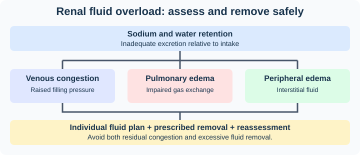

# 📚 Renal fluid overload — assessment, dialysis balance and nursing care

[🏠 Chapter](../README.md) · [📝 30 original MCQs](../MCQs/Renal-Fluid-Overload-30-MCQs.md) · [📜 Reported exam evidence](../Previous-Year-Questions/Renal-Fluid-Overload-Reported-Evidence.md)

**Study-ready, unattempted.** Adult renal nursing. Pehle se published daily weight, basic intake/output aur emergency pulmonary edema questions ko preserve kiya gaya hai.

## 1. Fluid distribution and causes

**Priority:** 🔴 MOST IMPORTANT

Dekho, extracellular fluid cells ke bahar hota hai. Ismein blood plasma aur tissues ke beech ka interstitial fluid aata hai. Kidney sodium aur water ko remove karke balance maintain karti hai. Jab intake excretion se zyada ho jaata hai, toh extracellular volume expand ho sakta hai. AKI, advanced CKD, missed dialysis aur excess IV fluids se ye problem develop ho sakti hai.

Sodium retention thirst aur water retention badha sakti hai. Serum sodium blood mein water ke relative concentration ko reflect karta hai. Isliye sodium overload ke bawajood serum sodium low, normal ya high ho sakta hai. Dilutional hyponatremia mein body water relative to sodium zyada hota hai.

Hydrostatic pressure capillaries se fluid bahar push karta hai. Albumin-related oncotic pressure fluid ko vascular space mein retain karne mein help karta hai. Edema ka matlab interstitial fluid accumulation hai. Edema hamesha adequate circulating volume ka proof nahi hai. Nephrotic syndrome mein protein loss aur renal sodium retention dono contribute kar sakte hain. Heart failure mein venous congestion aur low effective perfusion coexist kar sakte hain.

## 2. Clinical assessment and acute safety

**Priority:** 🔴 MOST IMPORTANT

Patient ki breathlessness, orthopnea (letne par saans phoolna), edema aur activity tolerance pucho. Vitals, oxygen saturation, lung sounds, jugular venous pressure (JVP), weight aur recorded fluid balance saath mein assess karo. Raised JVP elevated right-sided filling pressure ka clue hai, lekin isolated sign se final diagnosis nahi banta. Peripheral edema absent hone par bhi pulmonary congestion ho sakti hai. Bed-bound patient mein dependent sacral edema inspect karo.

Pitting edema mein pressure dene par indentation reh sakti hai. Site, symmetry, skin condition aur progression document karo. Edema grading local standardized scale se karo. Unilateral painful swelling ko automatically renal overload mat samjho. Venous thrombosis ya local cause ka urgent assessment zaroori ho sakta hai.

Acute pulmonary edema mein lung interstitial/alveolar fluid gas exchange impair kar sakta hai. Patient ko severe dyspnea, hypoxemia ya frothy sputum ho sakta hai. Emergency response activate karo, ABC assess karo aur tolerated upright position mein breathing support do if hemodynamically appropriate. Oxygen aur respiratory support local protocol aur clinical indication ke hisaab se do. Unnecessary ongoing fluid infusion ko promptly review/hold per emergency policy, essential medication line ko bina plan disconnect mat karo. Refractory overload urgent nephrology assessment warrant kar sakta hai.

Chest imaging aur lung ultrasound clinical assessment support kar sakte hain. B-lines increased lung water ka clue ho sakti hain lekin specific diagnosis nahi hain. BNP/NT-proBNP renal dysfunction se elevated ho sakte hain, isliye isolated value se overload confirm nahi karte.

## 3. Safe fluid removal and dialysis target weight

**Priority:** 🔴 MOST IMPORTANT

Dry weight adequate hydration ke saath estimated body weight hai. Target weight dialysis session ke liye prescribed post-treatment goal hai. Ye estimate change ho sakta hai jab patient muscle/fat gain ya loss kare, illness ho ya residual urine output change ho. Target too high ho toh congestion persist kar sakti hai. Too low ho toh hypotension aur organ perfusion compromise ho sakti hai.

Interdialytic weight gain (IDWG) = current pre-dialysis weight minus previous post-dialysis weight. Percentage IDWG = gain ÷ reference weight × 100. Reference weight clearly specify karo. Actual gain nutrition aur scale conditions se bhi affect ho sakta hai.

Example: previous post weight 60 kg aur current pre weight 62.4 kg hai. IDWG = 2.4 kg. Previous post weight se percentage = 2.4 ÷ 60 × 100 = 4%. Ye calculation prescribed UF goal nahi hai.

Ultrafiltration (UF) membrane ke across water removal hai. Simple teaching calculation mein net body fluid removal = pre weight minus target post weight, approximately 1 L per kg. Agar patient treatment ke dauran 300 mL fluid receive kare aur other losses absent hon, machine removal goal ko prescribed calculation mein us intake ka account karna hoga. Actual machine settings aur terminology local device policy se verify karo.

UF rate example: 2,400 mL removal over 4 hours = 600 mL/h. Reference body weight 60 kg ho toh rate = 600 ÷ 60 = 10 mL/kg/h. Ye arithmetic practice hai, universal safe rate prescription nahi. Higher removal demand, shorter time aur limited plasma refill symptomatic hypotension ka risk badha sakte hain. Team longer session, staged target attainment ya additional session consider kar sakti hai.

During dialysis dizziness, cramps, nausea aur falling BP intradialytic hypotension suggest kar sakte hain. Promptly assess, reduce/stop UF according to unit protocol, stabilize per prescribed plan and notify team. Bleeding, infection, arrhythmia aur other causes bhi consider karo. Patient ka target weight achieve karna hemodynamic stability se zyada important nahi hai.

Prescribed loop diuretics residual renal excretion hone par selected congested patients mein useful ho sakte hain. Response urine, symptoms, weight, BP aur electrolytes se monitor karo. Dialysis urgent need ko unresponsive diuretic se delay mat karo.

## 4. Prevention and education

Sodium intake ko individualized plan ke hisaab se manage karo. Packaged snacks, achar, papad, instant noodles aur salty sauces hidden sodium contribute kar sakte hain. Food label mein sodium per serving aur actual servings compare karo. Patient ko blame nahi karna. Cost, culture, thirst aur transport barriers samjho.

Fluid allowance residual urine output, dialysis modality, edema, BP aur team prescription se decide hota hai. Soup, tea, milk, ice aur foods that melt into liquid ko prescribed counting plan mein include karo. Mouth care, measured cup aur daily fluid diary help kar sakte hain. Routine fixed allowance sabke liye prescribe mat karo.

Example: prescribed 1,000 mL allowance mein tea 150 mL, soup 200 mL, water 350 mL aur melted ice 100 mL include hue. Remaining = 1,000 − 800 = 200 mL. Ye sirf practice example hai, universal restriction nahi.

Hospital mein oral/enteral intake, IV medication carriers, flushes aur blood products bhi fluid balance affect karte hain. Unneeded maintenance fluid review ke liye team ko notify karo. Shift handover mein current volume findings, intake sources, prescribed restriction, urine response aur dialysis schedule communicate karo. Severe breathlessness, chest pain, confusion ya missed dialysis ke saath acute illness mein urgent care arrange karo.

## ▶️ Teaching and practice

- Teaching: [Level Up RN — Fluid balance, intake/output, deficit and excess](https://www.youtube.com/watch?v=gNejhGMCWZE). Indexed teaching description, playback not verified.
- Question practice: [Hypervolemia — nursing exam/NCLEX questions](https://www.youtube.com/watch?v=Lya_8ocApVo). Indexed description explicitly includes fluid-excess signs and symptoms questions. Direct playback not retrieved. Only related topic-level mapping, not exact item verification.
- Dialysis-specific numerical and UF questions: dedicated video verification pending.

## References

[UK Kidney Association dialysis fluid management](https://guidelines.ukkidney.org/haemodialysis/rationale-for-clinical-practice-guidelines/fluid-in-haemodialysis/) · [NIDDK hemodialysis diet and fluid](https://www.niddk.nih.gov/health-information/kidney-disease/kidney-failure/hemodialysis/eating-nutrition) · [KDIGO dialysis volume conference report](https://pmc.ncbi.nlm.nih.gov/articles/PMC7215236/) · [UKKA AKI fluid therapy](https://www.ukkidney.org/clinical-resources/aki-guide-resources/secondary-care/fluid-therapy/) · [ISCCM AKI/RRT guidelines](https://pmc.ncbi.nlm.nih.gov/articles/PMC9989875/) · [ICMR July 2026 nephrology workflow](https://www.icmr.gov.in/icmrobject/uploads/STWs/1784807342_nephrology_all.pdf).

[📝 Practice questions](../MCQs/Renal-Fluid-Overload-30-MCQs.md) · [🏠 Chapter](../README.md)
