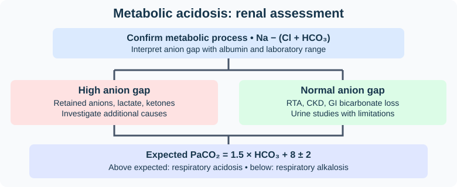

# 📚 Renal metabolic acidosis — anion gap, compensation and RTA

[🏠 Chapter](../README.md) · [📝 Original MCQs](../MCQs/Renal-Metabolic-Acidosis-30-MCQs.md) · [📜 Exam evidence](../Previous-Year-Questions/Renal-Metabolic-Acidosis-Reported-Evidence.md)

**Study-ready, unattempted.** Advanced calculations are clinical enrichment, not proven recruitment exam weighting.

## 1. Acid handling and serum anion gap

**Priority:** 🔴 MOST IMPORTANT

Dekho, body metabolism ke dauran acid banati hai. Bicarbonate blood mein buffer hai, matlab ye extra hydrogen ions neutralize karne mein help karta hai. Kidney filtered bicarbonate wapas absorb karti hai aur acid ko ammonium (NH₄⁺) aur titratable acid ke roop mein urine mein nikaalti hai. Is process se new bicarbonate blood mein add ho sakta hai. Kidney ki acid removal capacity kam hone par metabolic acidosis develop ho sakti hai.

Acidemia ka matlab blood pH 7.35 se kam hai. Acidosis ek process hai jo pH ko lower karta hai. Multiple acid-base disorders saath mein ho toh pH near normal bhi ho sakta hai. Serum total CO₂ bicarbonate ka useful approximate marker hai. Isolated low chemistry bicarbonate ko repeat test, clinical findings aur blood gas ke context mein assess karo. Respiratory alkalosis mein compensation se bicarbonate low ho sakta hai.

Anion gap measured positive aur negative ions ke difference se unmeasured ions ka estimate deta hai. Blood electrically neutral hi rehta hai.

**AG = Na − (Cl + HCO₃), mmol/L**, without potassium. Reference range lab-specific hai. Examples mein baseline AG 12 use karenge jab specified ho. Na 140, Cl 105, HCO₃ 14 → AG 21. Advanced kidney failure mein sulfate, phosphate aur other anions retain ho sakte hain. High gap mein lactate, ketones aur other causes bhi assess karo. CKD ka naam dekh kar har high gap ko uremia mat assume karo.

Normal-gap acidosis mein bicarbonate ke fall ke saath chloride relatively increase karta hai. Diarrhea, renal tubular acidosis, impaired ammonium excretion in CKD aur large chloride-rich fluid exposure examples hain.

Albumin unmeasured anion hai. Low albumin elevated gap ko mask kar sakta hai. Approximate corrected AG = measured AG + 2.5 × (4 − albumin g/dL). Measured AG 12 aur albumin 2 ho toh corrected AG 17. Lab reference aur clinical context zaroori hain.

Delta ratio = (AG − reference AG) ÷ (reference HCO₃ − measured HCO₃). Example baseline 12 and 24, current AG 26, HCO₃ 10. Ratio = 14 ÷ 14 = 1. Much lower ratio additional normal-gap acidosis suggest kar sakta hai. Above about 2 additional alkalinizing process ya previously high bicarbonate suggest kar sakta hai. Ye estimates hain, standalone diagnosis nahi.

## 2. Compensation and Winter formula

Lungs CO₂ exhale karke metabolic acidemia compensate karte hain. Deep labored breathing severe metabolic acidosis mein ho sakti hai, sirf DKA mein nahi. Fatigue aur reduced consciousness compensation impair kar sakte hain.

**Expected PaCO₂ (mmHg) = 1.5 × HCO₃ (mmol/L) + 8 ± 2.** Example HCO₃ 12 → expected 26, range 24–28. Measured PaCO₂ 38 is context mein too high hai despite routine normal range. Ye additional respiratory acidosis suggest karta hai. PaCO₂ 20 additional respiratory alkalosis suggest karega. Formula approximate hai. Acute timing aur ventilatory support matter karte hain.

Patient ki consciousness, breathing effort, circulation aur oxygenation promptly assess karo. Compensatory breathing independently suppress mat karo. Existing Respiratory Day 2 Q53–54 and Advanced Q5 cover range and basic compensation classification. New practice renal-specific consequences aur additional mixed processes par focused hai.

## 3. Renal tubular acidosis (RTA)

RTA mein renal tubules acid handling properly nahi karte. Relatively preserved filtration mein bhi normal-gap metabolic acidosis ho sakti hai.

| Type | Mechanism | Typical potassium | Urine pH clue |
|---|---|---|---|
| Type 1 distal | Distal H⁺ secretion impaired | Low | Often above 5.5 despite systemic acidosis |
| Type 2 proximal | Bicarbonate reabsorption impaired | Low | High during bicarbonate wasting, can fall below 5.5 when serum bicarbonate depleted |
| Type 4 | Reduced aldosterone effect and ammonium excretion | High | Often below 5.5 despite impaired net acid excretion |

Type 1 mein urinary citrate kam aur calcium loss zyada ho sakta hai. Isse calcium phosphate stones aur nephrocalcinosis (kidney tissue mein calcium deposition) ka risk badh sakta hai. Sjögren syndrome aur amphotericin B possible acquired causes hain. Type 2 mein Fanconi syndrome multiple proximal solute losses cause kar sakta hai, including glucose with normal blood glucose and phosphate. Acetazolamide bicarbonate wasting cause kar sakta hai. Type 4 ka aldosterone mechanism existing Hyperkalemia Q7 mein tested hai. Acidic urine ka matlab hamesha adequate total acid removal nahi hota.

Urine anion gap (UAG) = urine Na + urine K − urine Cl. Example 20 + 15 − 65 = −30 mmol/L. Selected normal-gap acidosis mein negative UAG appropriate ammonium chloride excretion suggest kar sakta hai, jaise diarrhea. Positive UAG low ammonium excretion suggest kar sakta hai. Low urine sodium, bicarbonaturia, unusual urinary anions aur CKD mein reliability limited ho sakti hai. Direct ammonium measurement available ho toh better information mil sakti hai. Urease-producing infection aur delayed specimen urine pH alter kar sakte hain. Ek urine result se RTA subtype diagnose mat karo.

Type 1 aur 2 mein prescribed alkali aur potassium monitoring important ho sakti hai. Type 2 mein alkali therapy potassium loss worsen kar sakti hai. Type 4 mein potassium-containing alkali unsafe ho sakti hai. Clinical team individual subtype ke according prescription decide karti hai.

## 4. CKD bicarbonate treatment and nursing safety

**Priority:** 🔴 MOST IMPORTANT

Chronic acidemia muscle protein breakdown aur bone buffering contribute kar sakti hai. Nutrition, muscle strength aur serial chemistry assess karo. Severe acute acidemia cardiac function aur circulation affect kar sakti hai.

KDIGO 2024 practice point 3.10.1 adults with CKD mein clinically consequential acidosis prevent karne ke liye drug treatment with or without dietary intervention consider karta hai, for example bicarbonate below 18 mmol/L. Ye automatic prescription threshold ya universal target nahi hai. Older guidance mein 22 mmol/L frequently taught tha. Low result confirm karke cause, trend aur symptoms assess karo. Practice point 3.10.2 mein serum bicarbonate upper normal limit se upar na jaaye aur BP, potassium aur fluid status worsen na ho, isliye monitoring important hai.

Oral sodium bicarbonate sodium add karta hai. Edema, BP, bloating aur overcorrection assess karo. Dietitian-guided acid-load reduction selected patients mein helpful ho sakti hai, but hyperkalemia risk aur nutrition consider karo. Nurse independently dose change nahi karti.

Acute severe acidemia mein underlying cause, ABC aur urgent team review important hai. IV bicarbonate selected situations mein use hota hai. Sodium load, CO₂ generation, falling ionized calcium aur potassium changes monitor karo. Life-threatening acidosis refractory to medical therapy urgent RRT assessment require kar sakti hai. ISCCM 2022 is principle ko support karta hai. pH alone se bicarbonate vs dialysis automatically decide nahi hota.

## ▶️ Teaching and question practice

| Topic | Teaching | MCQ practice |
|---|---|---|
| Metabolic acidosis | [RegisteredNurseRN review](https://www.youtube.com/watch?v=s91y9YWLU3s) | Renal-specific exact practice pending |
| Anion gap | [Acidosis and AG teaching](https://www.youtube.com/watch?v=sJ7uextBtR8) | Numerical question video pending |
| RTA | [Merck clinical teaching](https://www.merckmanuals.com/en-ca/professional/nephrology/renal-transport-abnormalities/renal-tubular-acidosis) | [Mr Medicine Harrison MCQ discussion](https://www.youtube.com/watch?v=4Tp2Sj0P6QQ), indexed description specifically covers subtypes, urine pH, anion gap and treatment. Advanced medical exam practice, not nursing PYQ. Playback pending. |
| CKD therapy | [KDIGO 2024 practice points](https://kdigo.org/wp-content/uploads/2024/03/KDIGO-2024-CKD-Guideline.pdf#page=45) | Dedicated MCQ video pending |

## References

[KDIGO 2024 p. S160, practice points 3.10.1–3.10.2](https://kdigo.org/wp-content/uploads/2024/03/KDIGO-2024-CKD-Guideline.pdf#page=45), text and page image reviewed. [Merck RTA](https://www.merckmanuals.com/en-ca/professional/nephrology/renal-transport-abnormalities/renal-tubular-acidosis) · [NCBI anion gap review](https://www.ncbi.nlm.nih.gov/sites/books/NBK448090/) · [Merck acid-base disorders](https://www.merckmanuals.com/professional/nephrology/acid-base-regulation-and-disorders/acid-base-disorders) · [ISCCM 2022 AKI/RRT](https://pmc.ncbi.nlm.nih.gov/articles/PMC9989875/), indexed text, direct page blocked. 

[📝 Questions](../MCQs/Renal-Metabolic-Acidosis-30-MCQs.md) · [🏠 Chapter](../README.md)
