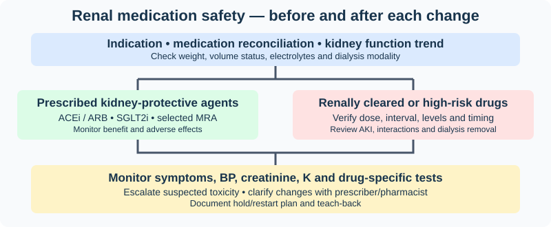

# 📚 Renal pharmacology — safe prescribing support and nursing monitoring

[🏠 Chapter](../README.md) · [📝 Original MCQs](../MCQs/Renal-Pharmacology-30-MCQs.md) · [📜 Reported evidence](../Previous-Year-Questions/Renal-Pharmacology-Reported-Evidence.md)

**Study-ready, unattempted.** Adult nursing education. Numerical examples explain drug-order verification, not independent prescribing. Use local formulary, product-specific labeling and the prescriber's plan.

## 1. Kidney clearance and dose verification

Drug clearance ka matlab body drug ko kitni efficiently remove karti hai. Kidney filtration, secretion aur reabsorption se medicines aur metabolites ki elimination affect hoti hai. Kidney function kam ho jaaye toh kuch drugs body mein accumulate ho sakti hain. Half-life drug concentration ko half hone mein lagne wala time hai. Clearance low hone par half-life badh sakti hai. Same repeated dose dene par adverse effects develop ho sakte hain.

Loading dose ka goal initial concentration achieve karna hai. Ye volume of distribution se strongly related hai. Maintenance dose ka goal elimination ke baad desired concentration maintain karna hai. Renal impairment mein maintenance dose reduce karna, interval extend karna ya dono change karna possible hai. Har loading dose automatically reduce nahi hoti. Sepsis, edema, body size, severity of infection and toxicity risk dosing influence karte hain. Pharmacist se specific order verify karo.

KDIGO 2024 validates creatinine-based eGFR for most routine drug decisions. Narrow therapeutic range (effective and toxic concentrations close together) ya unreliable creatinine mein combined creatinine-cystatin C estimate or measured GFR consider ho sakta hai. Product labeling may specifically require Cockcroft–Gault estimated creatinine clearance (CrCl). eGFR and CrCl automatically interchangeable nahi hain.

Indexed eGFR mL/min/1.73 m² mein hoti hai. Selected extreme body sizes mein absolute GFR mL/min estimate useful ho sakta hai: indexed eGFR × body surface area (BSA) ÷ 1.73. Example eGFR 40 and BSA 2.16 gives about 50 mL/min. Drug-specific dosing method first confirm karo.

Cockcroft–Gault teaching formula for adult male: (140 − age in years) × weight in kg ÷ (72 × stable serum creatinine in mg/dL). Traditional female coefficient 0.85. Actual weight selection especially obesity, edema and low muscle mass requires clinical judgement. Example 68-year-old male, selected weight 72 kg, creatinine 2: 72 × 72 ÷ 144 = 36 mL/min. AKI mein creatinine changing hone se steady-state formula misleading ho sakti hai.

Dialysis drug removal membrane, modality, protein binding, distribution volume and timing par depend karti hai. HD and PD dosing schedules same assume mat karo. CRRT continuously drug remove kar sakti hai. Some drugs need prescribed post-HD supplementation, not all. Missed dialysis or modality change promptly communicate karo.

## 2. Kidney-protective medicines

**Priority: 🔴 MOST IMPORTANT**

ACE inhibitor (ramipril, enalapril) and ARB (losartan) angiotensin pathway reduce karte hain. Efferent arteriole dilate hone se glomerular pressure and albumin leakage kam ho sakte hain. KDIGO recommends appropriate tolerated dose for indicated patients. Check BP, creatinine and potassium in 2–4 weeks after initiation/dose increase, earlier if clinical risk. Rise in creatinine >30% within four weeks merits review for volume depletion, interacting drugs or renovascular disease and treatment decision. Example 1.5 to 2.0 mg/dL = (0.5 ÷ 1.5) × 100 = 33.3%. Not an automatic permanent stop order. Stable eGFR below 30 alone does not justify stopping ACEi/ARB. Symptomatic hypotension or uncontrolled hyperkalemia despite treatment may justify reduction/cessation by team. ACEi angioedema with tongue/lip swelling and breathing difficulty requires immediate emergency care. ACEi/ARB fetal toxicity risk requires pregnancy-related prescription review.

SGLT2 inhibitors (empagliflozin, dapagliflozin) proximal tubular sodium-glucose reabsorption reduce karte hain. Tubuloglomerular feedback and cardiorenal effects kidney protection support karte hain. KDIGO 2024 recommends SGLT2i in T2D with CKD and eGFR ≥20, and adults with CKD eGFR ≥20 plus ACR ≥200 mg/g, or heart failure irrespective of albuminuria. Selected eGFR 20–45 with ACR below 200 also suggested. Product indication and initiation rules differ. Early modest reversible eGFR dip alone discontinuation ka reason nahi. Established tolerated therapy may continue below 20 until KRT initiation.

Prolonged fasting, surgery or critical illness mein ketosis risk rises. Prescriber/anesthesia plan se temporary hold verify karo. US empagliflozin labeling advises at least three days before surgery/prolonged fasting procedures if possible. Other products may differ. Restart only when clinically stable, eating and prescriber-approved. Nausea, abdominal pain, rapid breathing and malaise can indicate ketoacidosis even without marked hyperglycemia. Urgent ketones and acid-base assessment required. Genital fungal symptoms, volume depletion and infection risks teach karo.

Finerenone nonsteroidal mineralocorticoid receptor antagonist hai. KDIGO 2024 suggests proven-benefit nonsteroidal MRA in selected T2D CKD with eGFR >25, normal potassium, persistent albuminuria >30 mg/g despite maximum tolerated RAS inhibitor. Potassium and renal function monitoring essential hain. This differs from unrestricted use in every CKD patient.

## 3. Diuretics and adverse-effect assessment

| Class | Site and action | Nursing focus |
|---|---|---|
| Loop (furosemide, torsemide) | Thick ascending limb, inhibits Na-K-2Cl transport | Volume status, BP, Na/K/Mg, hearing symptoms, prescribed IV rate |
| Thiazide/thiazide-like (hydrochlorothiazide, chlorthalidone, metolazone) | Distal convoluted tubule Na-Cl transport | Sodium, K, glucose, uric acid, orthostatic BP |
| Potassium-sparing (spironolactone, amiloride) | Aldosterone receptor or ENaC effects in distal nephron | Hyperkalemia and interaction review |
| Osmotic (mannitol) | Filtered solute increases tubular osmotic load | Indication, renal excretion, osmolality and pulmonary congestion |

Loop diuretic renal salt and water excretion increase karta hai. Hypokalemia, hypomagnesemia, hyponatremia, metabolic alkalosis and excessive volume depletion possible hain. Fast IV furosemide, severe renal impairment, high doses and concomitant ototoxic drugs hearing damage risk increase kar sakte hain. Tinnitus or new hearing change urgently report karo. Product-specific infusion rate follow karo, universal push rate assume mat karo.

Thiazide-like agents selected advanced CKD patients mein BP lower kar sakte hain. Loop plus thiazide sequential nephron blockade potent diuresis cause kar sakta hai. Close monitoring of volume, electrolytes and renal function important hai. Diuretic therapy edema management mein useful ho sakti hai but AKI itself reverse nahi karti. Mannitol extracellular volume initially expand kar sakta hai. Established anuria and severe pulmonary congestion are important contraindications for many products. Specific label and order verify karo.

## 4. Nephrotoxicity, accumulation and transitions of care

**Priority: 🔴 MOST IMPORTANT**

NSAID prostaglandin synthesis inhibit karte hain. Renal perfusion vulnerable patients mein afferent vasoconstriction ho sakti hai. ACEi/ARB efferent dilation plus diuretic-related volume depletion plus NSAID is a high-risk combination, commonly called triple whammy. OTC cold/pain combinations and herbal medicines bhi medication history mein include karo.

Gentamicin and other aminoglycosides nephrotoxicity and ototoxicity cause kar sakte hain. Drug-level monitoring sample timing regimen-specific hai. Vancomycin serious MRSA infection monitoring AUC-based strategy when available follows local antimicrobial protocol. Never interpret levels without dose and sampling times. New hearing change, creatinine rise or low urine output communicate karo.

Gabapentin renally eliminated hoti hai. Inappropriate maintenance dose can cause excessive drowsiness or neurologic toxicity. Digoxin narrow therapeutic range rakhta hai, renal clearance low and electrolyte abnormality toxicity risk badha sakte hain. Lithium accumulation can occur with dehydration and interactions including thiazides. Avoid independent dose changes. Seek urgent review with suspected toxicity.

Metformin accumulation in severe renal impairment or hypoxic acute illness can increase lactic acidosis risk. US product labeling contraindicates use below eGFR 30 and does not recommend starting at 30–45. Existing use below 45 needs benefit-risk review. Iodinated contrast holds depend on product label, route, eGFR and local radiology policy. US label includes eGFR 30–60 or specified risk factors and reassessment after 48 hours before restart if renal function stable. Do not apply one rule to every contrast agent. Necessary imaging should not be cancelled solely because CKD exists.

On admission, transfer or discharge reconcile prescribed drugs, OTC, supplements, last dose, dialysis schedule and current renal labs. Document reasons for temporary holds, person responsible for restart and required follow-up. Teach the patient to seek help with vomiting, diarrhea, reduced intake, dizziness or new toxicity symptoms. Do not independently tell every patient to stop all medicines during illness.

## ▶️ Teaching and MCQ practice

| Topic | Teaching | MCQ practice |
|---|---|---|
| Diuretic classes | [Level Up RN renal pharmacology](https://www.youtube.com/watch?v=gYGZfu4lzuo), indexed description covers loop, thiazide, potassium-sparing and mannitol | [Drugs acting on kidney — diuretics MCQs part 1](https://www.youtube.com/watch?v=PBQSw_PoZf0), indexed description includes parenteral furosemide and mannitol comparison. Topic-level practice only, exact item playback pending. |
| RAS, SGLT2 and drug dosing | KDIGO official summary below | Dedicated exact-item practice pending |
| Renally cleared medicine safety | Product labels below | Dedicated exact-item practice pending |

## References

[KDIGO 2024 CKD recommendation summary](https://kdigo.org/wp-content/uploads/2026/05/KDIGO-2024-CKD-Guideline-Summary-Recommendations-and-Practice-Points.pdf), printed pages S159, S164–165 text and images checked. [KDIGO pharmacist primer](https://pmc.ncbi.nlm.nih.gov/articles/PMC12158546/). [Indian MoHFW CKD guidance](https://mohfw.gov.in/sites/default/files/Fin%20-%20CKD%20guidelines.pdf), indexed only, not used to replace current product-specific rules. [Empagliflozin label](https://dailymed.nlm.nih.gov/dailymed/drugInfo.cfm?setid=59ed43d9-b4e0-72a2-e063-6394a90a327d) · [Metformin label](https://dailymed.nlm.nih.gov/dailymed/drugInfo.cfm?setid=c3dfa8a1-d10a-4a1a-8eba-5f4e2a5a2949) · [Gabapentin label](https://dailymed.nlm.nih.gov/dailymed/drugInfo.cfm?setid=97935fd9-1d4a-43b6-a5d9-de994591187b), indexed prescribing extracts. Drug-specific local protocol and independent full clinical audit pending.

[📝 Practice questions](../MCQs/Renal-Pharmacology-30-MCQs.md) · [🏠 Chapter](../README.md)
