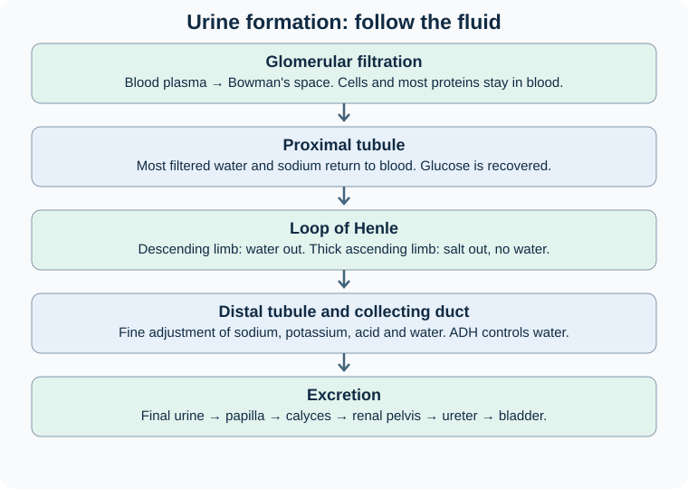
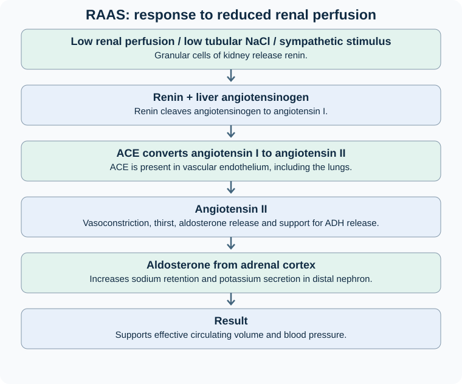

# 📚 Renal physiology — urine formation, GFR, tubular transport and regulation

[🏠 Chapter](../README.md) · [Previous anatomy lesson](Kidney-Nephron-and-Urinary-Tract-Anatomy.md) · [📝 Physiology practice](../MCQs/Renal-Physiology-Urine-Formation-and-Regulation-30-MCQs.md) · [📜 Reported exam evidence](../Previous-Year-Questions/Renal-Physiology-Reported-Exam-Questions.md)

> **Dhyan de:** Study-ready, unattempted. Ye physiology ki detailed foundation guide hai. Clinical lab interpretation, AKI staging aur medicines ka disease-specific management alag subsequent topics mein aayega.

## 1. Urine kaise banta hai aur GFR kya hai

**Priority:** 🔴 MOST IMPORTANT

Dekho, agar kidney sirf blood ko filter kar de aur saara filtered paani bahar nikaal de, toh body bahut jaldi dehydrate ho jaayegi. Isliye kidney ka kaam do parts mein samjho. Pehle ye blood se fluid filter karti hai. Phir jo cheez body ko chahiye, use wapas blood mein bhejti hai. Kuch extra substances ko blood se tubule mein bhi daalti hai. Jo final fluid bachta hai, wahi urine banta hai.

### Glomerular filtration

Blood afferent arteriole se glomerulus mein aata hai. Capillary pressure paani aur small dissolved substances ko Bowman's space mein push karta hai. Healthy barrier blood cells aur most large proteins ko blood mein rakhti hai. Filtered fluid ko glomerular filtrate kehte hain. Ismein glucose bhi hota hai, lekin normal kidney baad mein use reabsorb kar leti hai.

### GFR

GFR ka full form glomerular filtration rate hai. Iska matlab hai dono kidneys ek minute mein kitna filtrate banati hain. Healthy young adult ke standard exam example mein roughly 120–125 mL/min liya jaata hai. Age, sex, body size aur clinical condition ke hisaab se value vary karti hai. Lab eGFR commonly mL/min/1.73 m² mein report hota hai. Ek isolated value se CKD diagnose nahi karni. Chronicity aur kidney damage markers bhi check karne hote hain.

**Solved numerical:** GFR 125 mL/min ho aur ek din tak same rahe. Total filtrate = 125 × 60 × 24 = 180,000 mL = 180 L/day. Agar urine 1.8 L ho, toh 178.2 L paani recover hua. Fraction recovered = 178.2 ÷ 180 × 100 = 99%. GFR aur urine output ek cheez nahi hain.

### Net filtration pressure (NFP)

Capillary hydrostatic pressure filtration ko promote karta hai. Bowman's space ka hydrostatic pressure aur blood proteins ka colloid osmotic pressure filtration ko oppose karte hain. Simplified exam formula mein Bowman space ke protein osmotic pressure ko negligible maana jaata hai.

NFP = glomerular capillary hydrostatic pressure − Bowman's space hydrostatic pressure − plasma colloid osmotic pressure.

Example: 55 − 15 − 30 = 10 mmHg. Agar obstruction ki wajah se Bowman's space pressure 25 mmHg ho jaaye aur baaki values same rahen, NFP = 55 − 25 − 30 = 0 mmHg. Ye simplified numerical hai. Actual kidney filtration mein filtration coefficient aur changing pressures bhi important hain.

### Renal blood flow, plasma flow aur filtration fraction

Kidneys ko resting cardiac output ka roughly 20–25% mil sakta hai. Renal blood flow (RBF) poore blood ka flow hai, jabki renal plasma flow (RPF) blood ke liquid plasma part ka flow hai.

RPF = RBF × (1 − hematocrit as a fraction).

Filtration fraction (FF) = GFR ÷ RPF × 100.

Example: RBF 1,000 mL/min aur hematocrit 40% hai. RPF = 1,000 × 0.60 = 600 mL/min. GFR 120 mL/min hai. FF = 120 ÷ 600 × 100 = 20%.

### Clearance

Clearance ek theoretical plasma volume hai jo kisi substance se per minute clear hota hai.

C = U × V ÷ P. U urine concentration hai, V urine flow rate mL/min mein hai aur P plasma concentration hai. U aur P same concentration unit mein hone chahiye.

Example: Urine creatinine 90 mg/dL, plasma creatinine 1.5 mg/dL, urine flow 1.2 mL/min. Clearance = 90 × 1.2 ÷ 1.5 = 72 mL/min. Creatinine clearance GFR ka approximate estimate hai aur tubular secretion ki wajah se overestimate kar sakta hai. Inulin ideal teaching marker hai kyunki freely filter hota hai aur neither reabsorbed nor secreted. Clinical eGFR equations aur drug dosing context alag hain.

### Autoregulation

Kidney normal pressure range mein blood flow aur filtration ko relatively stable rakhne ki koshish karti hai. Myogenic mechanism mein increased pressure se afferent arteriole ki muscle stretch hoti hai aur response mein contract karti hai. Tubuloglomerular feedback mein macula densa ko NaCl delivery badhne par local signals afferent resistance badha sakte hain. Severe shock mein autoregulation fail ho sakti hai. Afferent constriction GFR kam kar sakti hai. Moderate efferent constriction glomerular pressure support kar sakti hai, lekin severe constriction se filtration kam bhi ho sakti hai.

**Nursing connection:** Shock mein kidney perfusion kam ho sakti hai. Low urine output ko sirf paani kam peene ki problem na samjho. Vitals, perfusion, fluid balance aur catheter patency if present assess karo aur concern promptly escalate karo.

## 2. Reabsorption, secretion aur concentration

**Priority:** 🔴 MOST IMPORTANT

Tubular reabsorption ka matlab hai filtrate se cheezein blood ki taraf wapas jaana. Tubular secretion mein blood/interstitial fluid se cheezein tubular lumen ki taraf jaati hain. Excretion ka matlab final urine mein body se bahar jaana hai.

Ek substance ke liye **Excretion = Filtration − Reabsorption + Secretion**. Amount per unit time ke terms mein ye formula lagta hai.

| Nephron part | Simple explanation |
|---|---|
| PCT | Roughly 65–70% filtered sodium aur water yahin reabsorb hote hain. Normal filtered glucose aur amino acids almost completely recover hote hain jab transport capacity exceed na ho. Bicarbonate ka major recovery bhi yahin hota hai. |
| Thin descending limb | Water easily bahar jaata hai. Medulla salty aur concentrated hoti hai, isliye osmosis se paani filtrate se interstitium ki taraf jaata hai. |
| Thick ascending limb | NKCC2 transporter sodium, potassium aur chloride reabsorb karta hai. Ye limb water ke liye largely impermeable hota hai, isliye tubular fluid dilute hota hai. |
| Early DCT | NaCl cotransporter salt reabsorb karta hai. PTH calcium reabsorption ko increase karta hai. |
| Late DCT and collecting system | Aldosterone sodium reabsorption aur potassium secretion influence karta hai. ADH water permeability badhata hai. Intercalated cells acid-base regulation mein help karte hain. |

### Glucose aur renal threshold

Glucose glomerulus se filter hota hai. PCT mein sodium-glucose cotransport usko blood ki taraf recover karne mein help karta hai. Transporters ki limited capacity hoti hai. Jab glucose load bahut badh jaaye, toh glucose urine mein aa sakta hai. Traditional approximate renal threshold around 180 mg/dL hai, lekin individual threshold vary karta hai. SGLT2 inhibitor use aur proximal tubular dysfunction mein blood glucose relatively lower hone par bhi glucosuria ho sakti hai. Urine glucose alone diabetes diagnosis nahi karta.

### Countercurrent mechanism

Isko do parallel pipelines samjho jisme fluid opposite directions mein chalta hai. Descending limb paani nikaalti hai, jabki ascending limb salt nikaalti hai. Long loops of Henle medulla mein gradually high osmotic concentration banane mein help karte hain. Isi ko countercurrent multiplication kehte hain. Vasa recta opposite direction blood exchange se gradient ko wash out hone se bachati hai. Urea recycling bhi inner medulla mein gradient ko support karti hai.

Jab ADH present hota hai, collecting ducts water permeable ho jaati hain. Medulla ke gradient ki wajah se paani wapas blood mein ja sakta hai aur urine concentrate hota hai. Jab ADH kam ho, toh zyada dilute urine nikal sakta hai. Sirf ADH hona kaafi nahi. Medullary gradient aur tubular response bhi functional hone chahiye.

### Diuretics ka physiology connection

Loop diuretics thick ascending limb mein NKCC2 inhibit karte hain. Isse salt excretion badhti hai aur concentrating gradient weak ho sakta hai. Thiazides early DCT mein NaCl cotransport inhibit karte hain. Potassium-sparing drugs late distal nephron mein aldosterone action ya ENaC par act kar sakti hain. Nurse prescribed drug ke according urine output, BP, electrolytes aur volume status monitor karti hai. Detailed dose, contraindication aur drug interactions renal pharmacology mein aayenge.

**Teaching numerical:** Agar 100 mg/min filter hua, 90 mg/min reabsorb hua aur 5 mg/min secrete hua, excretion = 100 − 90 + 5 = 15 mg/min.

## 3. ADH, RAAS aur renal endocrine functions

**Priority:** 🔴 MOST IMPORTANT

ADH ka full form antidiuretic hormone hai. Antidiuretic ka matlab urine ka water loss kam karne mein help karna. ADH hypothalamus mein banta hai aur posterior pituitary se release hota hai. Jab plasma osmolality badhti hai ya effective circulation ka volume substantially kam hota hai, ADH release badh sakta hai.

ADH collecting duct principal cells ke V2 receptors par action karta hai. Isse apical membrane mein aquaporin-2 water channels insert hote hain. Paani lumen se medullary interstitium aur blood ki taraf move karta hai. Isliye urine ka volume kam aur concentration zyada ho sakti hai. DI mein ADH deficiency ya renal resistance se excessive dilute urine aa sakta hai. SIADH mein inappropriate water retention ki wajah se dilutional hyponatremia ho sakti hai. In dono conditions ka complete management endocrine chapter se cross-reference karna hai.

### RAAS — renin angiotensin aldosterone system

Jab kidney ko kam blood perfusion milti hai, low NaCl delivery macula densa tak aati hai, ya sympathetic beta-1 signal milta hai, toh granular cells renin release kar sakti hain.

1. Liver angiotensinogen banata hai. Renin is protein ko angiotensin I mein convert karta hai.
2. ACE angiotensin I ko angiotensin II mein convert karta hai. ACE vascular endothelium mein hota hai, lungs mein bhi abundant hai.
3. Angiotensin II vessels constrict karta hai aur adrenal cortex se aldosterone release stimulate karta hai. Thirst aur ADH pathways bhi support ho sakte hain.
4. Aldosterone adrenal cortex ki zona glomerulosa se release hota hai. Ye distal nephron mein sodium reabsorption aur potassium secretion increase karta hai. Water sodium ke saath follow kar sakta hai, lekin water permeability aur other factors important hain.

**ADH vs aldosterone:** ADH mainly water handling control karta hai. Aldosterone mainly sodium retention aur potassium excretion influence karta hai. Dono ka source bhi alag hai.

ANP (atrial natriuretic peptide) atrial stretch par release hota hai. Natriuresis ka matlab urine mein sodium excretion badhna. ANP RAAS ke salt-retaining effect ko oppose karne mein help karta hai.

### Kidney aur RBC, bones aur acid-base

Erythropoietin (EPO) kidney ke mainly interstitial cells se low oxygen stimulus par banta hai. Ye bone marrow ko RBC production ka signal deta hai. CKD mein EPO kam hone se anemia ho sakta hai, lekin iron deficiency aur other causes bhi check karte hain.

Kidney 25-hydroxy vitamin D ko 1,25-dihydroxy vitamin D ya calcitriol mein activate karti hai. Ye calcium absorption mein help karta hai. PTH distal calcium reabsorption badhata hai aur proximal phosphate reabsorption kam karta hai. CKD mein mineral and bone disorder ka mechanism multifactorial hota hai.

Kidney filtered bicarbonate recover karti hai aur H+ ko ammonium aur titratable acid ki form mein excrete karne mein help karti hai. New bicarbonate generation bhi acid-base balance maintain karti hai. Kidney dysfunction mein metabolic acidosis develop ho sakti hai. Detailed ABG interpretation respiratory and fluid/electrolyte topics se connect hogi.

## 4. Micturition aur normal urine output

**Priority:** 🟠 HIGH YIELD

Micturition ka matlab bladder se urine nikaalna hai. Jab bladder fill hoti hai, stretch receptors spinal cord aur brain ko signal bhejte hain. Storage phase mein sympathetic activity detrusor ko relax aur outlet closure support karti hai. Pudendal nerve external urethral sphincter ko somatic control deti hai.

Voiding ke time sacral parasympathetic pathway S2–S4 detrusor contraction promote karta hai. Brainstem ka pontine micturition center detrusor contraction aur outlet relaxation coordinate karta hai. External sphincter relax hota hai aur urine bahar jaata hai. Cerebral control normally appropriate time aur place par voiding allow karta hai.

Normal adult daily urine output often roughly 1–2 L hota hai, lekin fluid intake, sweating, medicines, body size aur illness se change hota hai. Adult bedside assessment mein sustained output below 0.5 mL/kg/hour concern ho sakta hai. AKI urine output criterion duration ke saath interpret hota hai. Single low measurement ko alone diagnosis na banao.

**Solved example:** 60 kg adult ne 4 hours mein 100 mL urine pass kiya. Output = 100 ÷ 4 ÷ 60 = 0.417 mL/kg/hour. Ye low hai. Nurse patient condition, fluid balance, catheter patency if applicable aur perfusion assess karke timely report karegi. Sirf is four-hour interval se KDIGO duration criterion satisfy nahi hota.

## ▶️ Teaching and MCQ practice

- [Bhushan Science Nursing — renal anatomy and physiology lecture](https://www.youtube.com/watch?v=xwlkgz8-gcM). Indexed description covers urine formation and nephron. Playback not checked.
- **Dedicated MCQ practice:** [MK Physiology — renal physiology questions](https://www.youtube.com/watch?v=iZt-tZzveXg). Indexed description specifically discusses afferent resistance, GFR and glucosuria. Related questions are mapped in the bank. Exact question match and playback pending.
- [Renal physiology 30-question MCQ video](https://www.youtube.com/watch?v=qcrhuJLRUJE). Indexed description and tags list filtration, GFR, RAAS, ADH, clearance and acid-base. Specific question and channel verification pending, so use only as supplemental lead, not counted exact practice.
- [Question-level reported evidence and video coverage](../Previous-Year-Questions/Renal-Physiology-Reported-Exam-Questions.md).

## References

[OpenStax urine formation](https://openstax.org/books/anatomy-and-physiology-2e/pages/25-5-physiology-of-urine-formation) · [Tubular reabsorption](https://openstax.org/books/anatomy-and-physiology-2e/pages/25-6-tubular-reabsorption) · [Renal blood flow](https://openstax.org/books/anatomy-and-physiology/pages/25-7-regulation-of-renal-blood-flow) · [Endocrine regulation](https://openstax.org/books/anatomy-and-physiology-2e/pages/25-8-endocrine-regulation-of-kidney-function) · [Fluid volume and composition](https://openstax.org/books/anatomy-and-physiology-2e/pages/25-9-regulation-of-fluid-volume-and-composition) · [Urine transport](https://openstax.org/books/anatomy-and-physiology-2e/pages/25-2-gross-anatomy-of-urine-transport) · [KDIGO CKD guideline executive summary](https://doi.org/10.1016/j.kint.2023.10.016).

[📝 Solve 30 original physiology questions](../MCQs/Renal-Physiology-Urine-Formation-and-Regulation-30-MCQs.md) · [🏠 Chapter](../README.md)
