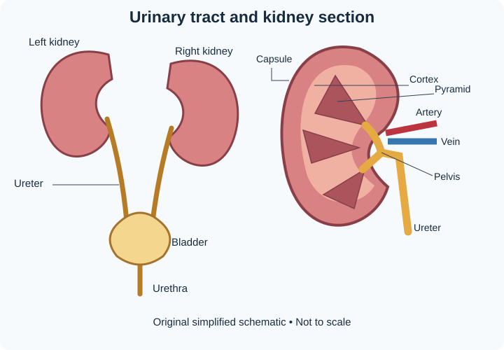

# 🩺 Renal and Urinary System — NORCET and Staff Nurse

**Study-ready expansion in progress, not studied.** Easy Roman Hinglish theory · English questions · hidden option-by-option explanations · original diagrams.

| Section | Published content |
|---|---|
| 📚 Concepts | [Complete topic coverage sequence](Concepts/Renal-and-Urinary-System-Topic-Coverage-Map.md) · [Kidney, nephron and urinary tract anatomy](Concepts/Kidney-Nephron-and-Urinary-Tract-Anatomy.md) · [Renal physiology](Concepts/Renal-Physiology-Urine-Formation-and-Regulation.md) · [Renal assessment and diagnostics](Concepts/Renal-Assessment-and-Diagnostics.md) · [Acute kidney injury](Concepts/Acute-Kidney-Injury.md) · [Chronic kidney disease](Concepts/Chronic-Kidney-Disease.md) |
| 📝 Topic-wise MCQs | [30 new anatomy MCQs](MCQs/Kidney-Nephron-and-Urinary-Tract-Anatomy-30-MCQs.md) · [30 new physiology MCQs](MCQs/Renal-Physiology-Urine-Formation-and-Regulation-30-MCQs.md) · [30 assessment MCQs](MCQs/Renal-Assessment-and-Diagnostics-30-MCQs.md) · [30 AKI MCQs](MCQs/Acute-Kidney-Injury-30-MCQs.md) · [30 CKD MCQs](MCQs/Chronic-Kidney-Disease-30-MCQs.md) · [4 preserved starter MCQs](MCQs/Renal-and-Urinary-System-Topic-Wise-Starter-MCQs.md) |
| 🧪 Mock Tests | [10 × 120 question plan](Mock-Tests/Renal-and-Urinary-System-Mock-Test-Plan.md), 0 published |
| 📜 Previous Year Questions | [4 new anatomy adaptations](Previous-Year-Questions/Kidney-Anatomy-Reported-Exam-Questions.md) · [3 physiology adaptations](Previous-Year-Questions/Renal-Physiology-Reported-Exam-Questions.md) · [2 assessment adaptations](Previous-Year-Questions/Renal-Assessment-Reported-Exam-Questions.md) · [1 AKI adaptation](Previous-Year-Questions/Acute-Kidney-Injury-Reported-Exam-Questions.md) · [2 CKD adaptations](Previous-Year-Questions/Chronic-Kidney-Disease-Reported-Exam-Questions.md) · [2 preserved earlier adaptations](Previous-Year-Questions/Renal-and-Urinary-System-India-Wide-Additional-Reported-PYQs.md) · [Research register](Previous-Year-Questions/Renal-and-Urinary-System-Past-Paper-Research-Register.md) |
| ▶️ Videos | Teaching and MCQ practice are separated in the [anatomy concepts](Concepts/Kidney-Nephron-and-Urinary-Tract-Anatomy.md#-youtube-teaching-aur-practice) and the [physiology concepts](Concepts/Renal-Physiology-Urine-Formation-and-Regulation.md), with explicit pending verification in the evidence files. |

**Inventory:** 154 original questions (150 new, 4 preserved), fourteen published reported adaptations (twelve new, two preserved), seven original SVG diagrams, 0/10 full-length mocks. Historical sources are not authenticated official keys.

## Kaise padhna hai?

Pehle anatomy diagram aur notes padho. Phir 30 questions solve karo. Answer dekhne ke liye dropdown kholo. Har wrong option ka reason bhi padho. Uske baad physiology theory mein urine formation, GFR, tubular transport, RAAS, ADH aur micturition padho, aur 30 physiology questions solve karo. Sabhi naye questions unattempted hain.

## Publishing checkpoint

27 November 2026 — anatomy package published and read back. Initial anatomy concepts commit 10880e69c03ace0c5a34d9740135a79445d9e9e9, two diagrams dcd367d6ee467436a12bdd1ab41d0afd99f989a3 and e7f950719ff5978f57ed8704c79259ced8798a41, initial original bank c5b5628d7cb51037b89bd0cda66ed70fcf992546, evidence 8c93d7e64238f9b8d8041b0df88c1c128bb5e350. Thirty distinct normalized stems, four options and 120 option rationales checked. Difficulty review corrects overgrading of direct anatomy recall. Four independently worded historical adaptations, five reported source records plus one concept-only source, no official exact match claimed. All 30 specific original practice video mappings pending, one published topic-level MCQ marker for one adaptation and three adaptation gaps. Both SKILL.md files retrieved and applicable excerpts reviewed, full fresh line-by-line skill and historical audit log reread not certified. AGENTS, Copilot and all five claims checked. Cross-chapter exact/semantic inventory audit, independent clinical review, video playback and rendered GitHub UI pending. No chapter-completion claim.

27 November 2026 — physiology package published and read back: concepts b3d9412d5b71edffc9c144ee2ed4870a69570482, urine formation diagram bc295c73e89fe84a386ab430090c364517aa4203, RAAS diagram 8b8bf91a08394c4e218848295a08e79d5b099d3e, 30-question bank ce289384036ead46540a8a23a15a994495a4762a, evidence 66d0f2972c936ba140beed80e5a2cdc9335adb8c. Thirty distinct normalized stems, 120 rationales, eleven numerical checks, no exact normalized stem matches against the first new bank. Three topic-level MCQ video mappings from descriptions, 27 original question-specific video gaps, all three adaptations lack verified practice video. No playback claimed. Three new reported adaptations, no authenticated official paper/key. Independent clinical and full cross-chapter semantic audit and rendered UI review pending. Shared global index not modified to preserve concurrent jobs. The two packages are not full individual-subtopic target completion.

27 November 2026 — renal assessment and diagnostics package: concept commit 074832eb934725d364ff3ca13f2b8842e7b94fe8, original diagram e51f7b174d6e0258432b0463274234f7ac9f1d4c, 30 original MCQs a0d91d043aae2351d11b2e850db5401e6d6a7f0e, two reported adaptations 8a70947e9282d0e75d0be4a137eff5c4ca3afbf6, all exact readback. 1 Easy, 25 Medium, 4 Difficult. Four options and 120 individual rationales, correct answer mapping and normalized uniqueness against 64 earlier renal stems checked. Open RN and HPSSC/BHU source pages directly retrieved. NIDDK, MSD, KDIGO executive summary, CDC and NKF indexed evidence. No official historical keys authenticated. Zero specific video mappings, 30 original and two adaptation gaps. Mixed lecture/MCQ and broad practice leads separately logged. Both skills fetched in ranges, root complete, canonical output had truncation, latest applicable rules reviewed. AGENTS and Copilot read, latest audit-learning excerpt examined, full audit-log reread not certified. All five claims and Eye/ENT scope checked at start, chapter-local work only. Full independent clinical/semantic and cross-chapter audit and rendered UI pending. Global tracker not edited.\n\n27 November 2026 — AKI package: concepts 925165c37b70c8d18e9d4115c6948e540c1af563, diagram a14cac3719cea278101cafaae876e0f81f6b78ed, original bank a42a6b843cf4d53c8d1bdc6bdc30f9400dce6ed8 (subsequent narrowed video mapping revision verified), evidence 798dbca0ae43774712a45d91d5411dfd51b9909d. Exact readback. 30 new originals, 26 Medium and 4 Difficult, 120 individual rationales, four options and key mapping checked. Normalized exact matches against 94 prior stems zero. One NCL Staff Nurse 2020 report directly retrieved, no official key. ICMR July 2026 workflow text and UK Kidney Association directly retrieved, PDF screenshot failed due to size, KDIGO and NICE indexed pages blocked on direct open. KDIGO 2026 draft not adopted as final. Three supplemental topic-level video leads, 27 specific original question gaps and one adaptation gap, no exact playback. All five claims rechecked before AKI scope. Full independent clinical/semantic audit and global index reconciliation pending.\n\n27 November 2026 — CKD package: concept commit dcb78e8a3d4c55dffecfb9c1918569f43a2ef60f, diagram 3c0977e6b62681aac244a0af18bc407c4847efc6, 30 original MCQs 4d97848fa3f0ff9a3c2d891c38fe56ed13e20df9, two adaptations 83438d346f0fd1e33ba2c1ba75c40094ba44bbe9. Exact readback. 1 Easy, 28 Medium, 1 Difficult. Four options, 120 rationales, answer mappings and normalized exact duplicate checks against 124 prior original stems passed. NKF staging and both historical sources directly retrieved, KDIGO 2024/2026 indexed, ICMR July 2026 text retrieved in AKI research. Historical diet and uremia threshold corrected in adaptations without claiming official keys. No specific CKD question practice video verified, 30 original and two adaptation gaps. General MCQ and teaching leads separately logged. All five claims rechecked before CKD scope. Full independent clinical/semantic audit, rendered UI, official paper-level verification and individual subtopic targets pending.\n\n**Run total:** 90 newly authored original MCQs, 360 option rationales, five reported adaptations, three original SVG diagrams, three concept guides. All published files read back. 154 originals, 14 reported adaptations, seven diagrams, 0/10 mocks.\n\n**Next:** fluid overload, hyperkalemia, metabolic acidosis, renal anemia, mineral bone disorder, renal diet and pharmacology, then glomerular disorders in existing sequence. Expand individual assessment and physiology subtopic banks before full mocks.

[Full syllabus index](../NORCET-Full-Chapter-Index.md) · [Repository home](../../README.md)

<!-- Manual Renal scope claim: FREE. Verified chapter-local checkpoint above. -->
