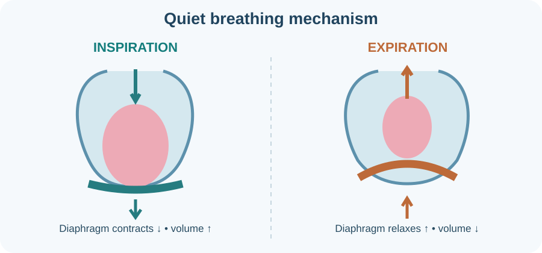

# Day 1 — Alveoli, surfactant, pleura & breathing mechanism

[← Respiratory chapter overview](../README.md) · [Practice the matching MCQs](../MCQs/Day-01-Alveoli-Surfactant-Pleura-Breathing.md)

> **Study status:** These notes consolidate the concepts already covered in the Day 1/Day 2 sessions; no new subject has been introduced here.

---

## Alveolar cells, gas exchange & surfactant

### Three high-yield cell types

| Cell | Key role | Hindi memory |
|---|---|---|
| **Type I pneumocyte** | Thin gas-exchange surface | Type I = exchange |
| **Type II pneumocyte** | Makes pulmonary surfactant | Type II = surfactant |
| **Alveolar macrophage** | Phagocytosis of dust and germs | Safai / cleaning cell |

**Gas exchange:** O₂ crosses from alveoli to capillary blood and CO₂ moves the opposite way mainly by **diffusion**.

### Surfactant

Type II cells se surfactant banta hai. It **lowers surface tension**, helps keep alveoli open and reduces the work of lung inflation.

**Deficiency chain:** Less surfactant → higher surface tension → alveoli are more likely to collapse (**atelectasis**) → harder breathing. Premature infants are at risk of neonatal respiratory distress from surfactant deficiency.

> **Memory:** Surfactant ↓ → tension ↑ → collapse risk ↑.

---

---

## Pleura, diaphragm & inspiration/expiration

### Pleura
- **Visceral pleura** directly covers the lung.
- **Parietal pleura** lines the thoracic cavity.
- The **pleural space** is a potential space with a small amount of lubricating fluid; normal pleural space is **not filled with air**.
- Fluid reduces friction (rubbing) while breathing.

### Breathing mechanism
| Quiet inspiration | Quiet expiration |
|---|---|
| Mostly **active** | Usually **passive** |
| Diaphragm **contracts**, moves **down** | Diaphragm **relaxes**, moves **up** |
| Thoracic volume **increases** | Thoracic volume **decreases** |
| Alveolar pressure falls below atmospheric | Alveolar pressure transiently rises above atmospheric |
| Air **enters** | Air **exits** |

**Main inspiratory muscle:** diaphragm; phrenic nerve carries motor supply from **C3–C5**. External intercostals assist with rib elevation.

**Pressure idea (Boyle's law):** When thoracic volume rises, pressure tends to fall, creating inward airflow.

**Memory:** IN → diaphragm DOWN → chest UP (volume); OUT → diaphragm UP → volume DOWN.

---

---

**Next:** [Try the MCQs for these topics](../MCQs/Day-01-Alveoli-Surfactant-Pleura-Breathing.md)
