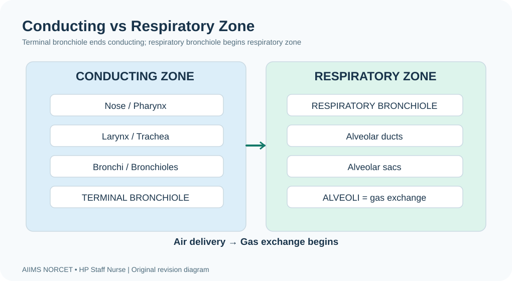
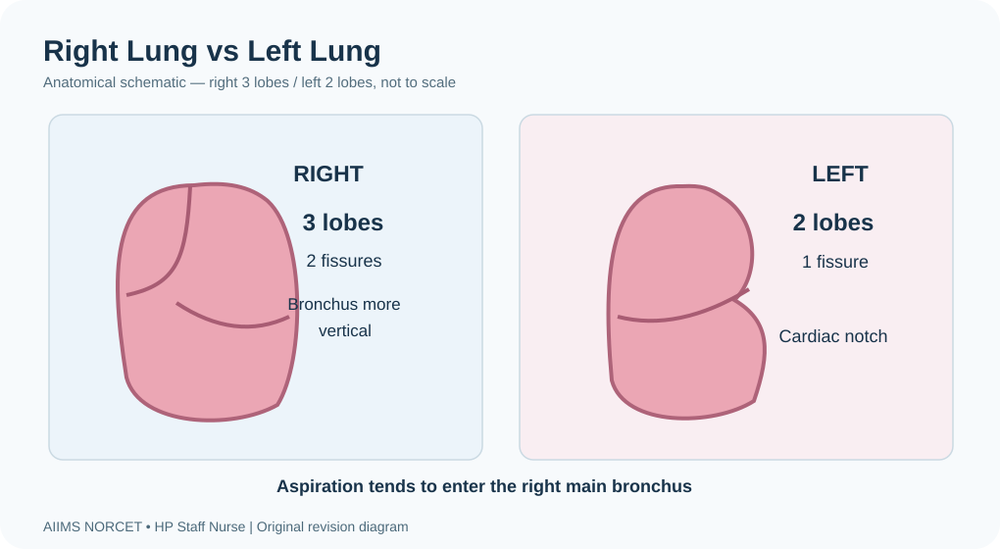
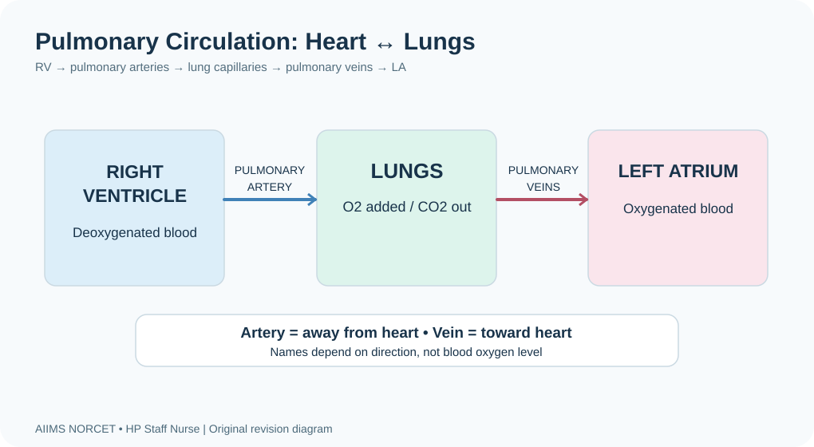
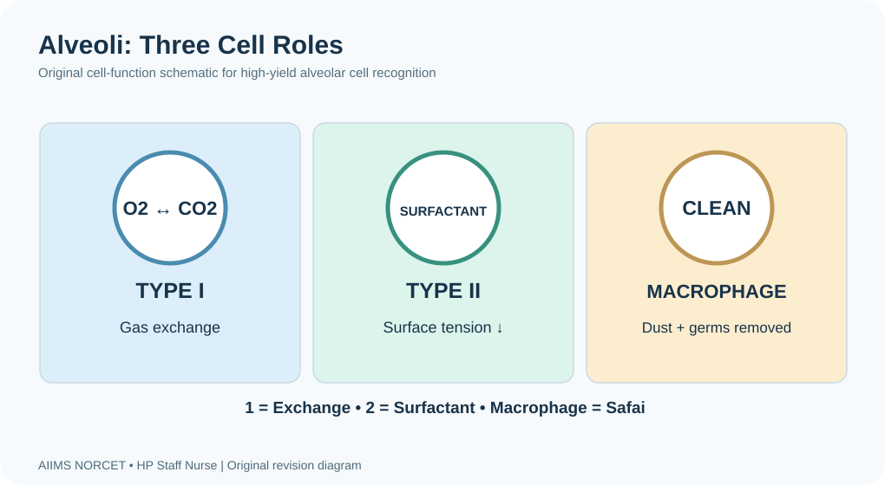
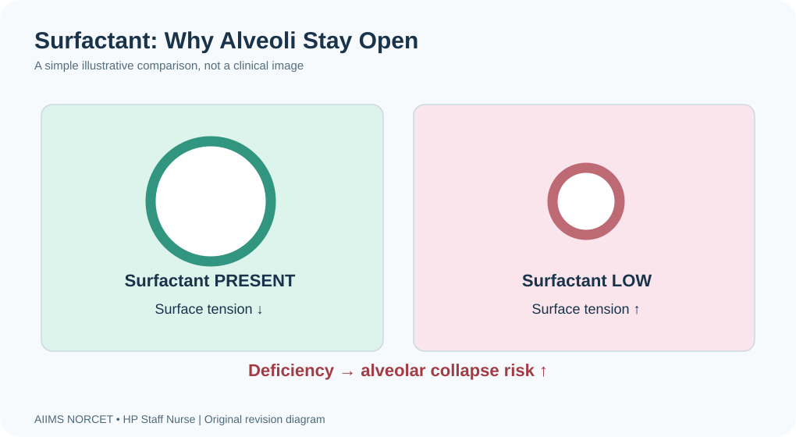
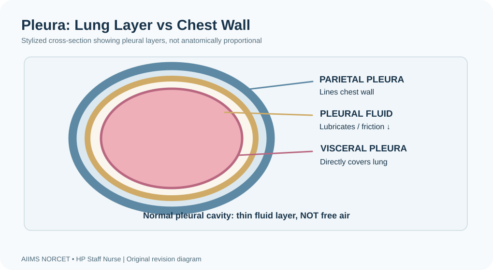
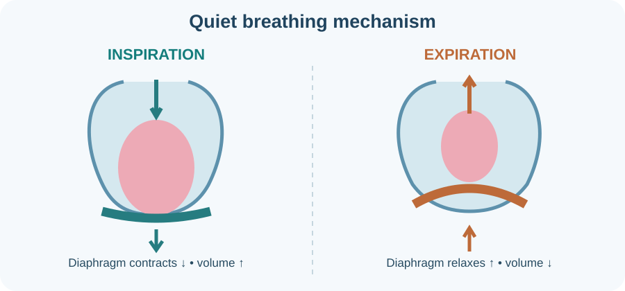
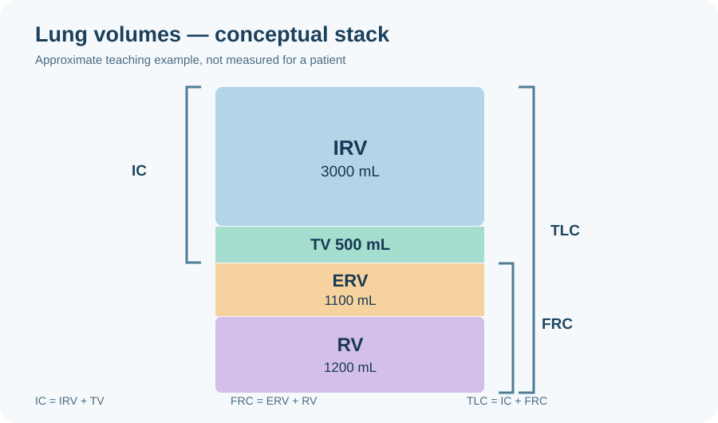
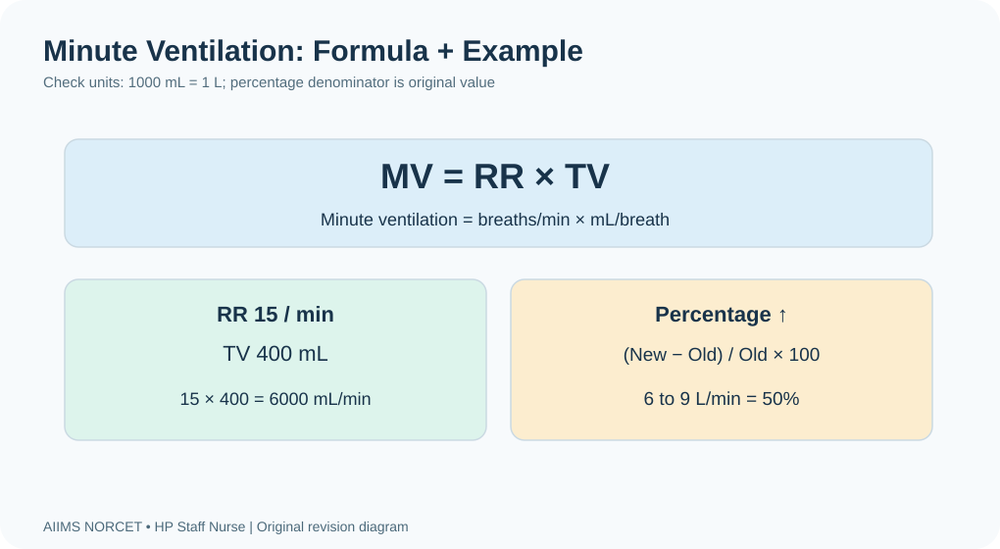
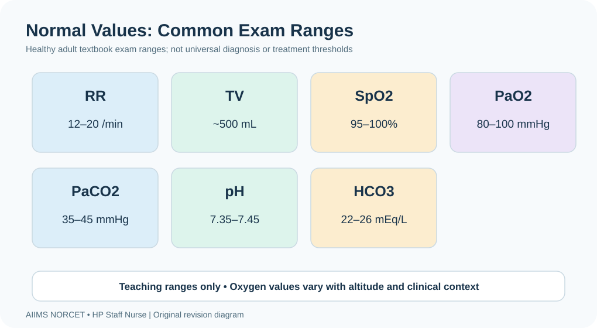

# 🫁 Day 1 — Respiratory Anatomy & Physiology | Complete Hinglish Notes

**AIIMS NORCET 12 + HP Staff Nurse (HPRCA)** • Basic se exam level tak • Simple Hindi-English

[🏠 Chapter](../README.md) · [📝 Day 1 ke 40 MCQs](../MCQs/Day-01-Complete-Respiratory-Anatomy-Physiology.md) · [🏥 Previous Year Questions](../Previous-Year-Questions/README.md) · [🔎 Sources](../References.md)

> **Dhyan de:** Medical terms English mein hain. Explanation easy Hinglish mein hai, aur sirf Day 1 mein padhe topics cover hain.

## 📚 Is guide mein kya-kya hai?

1. [Respiration kya hota hai?](#1-respiration-kya-hota-hai)
2. [Air ka pathway — nose se alveoli tak](#2-air-ka-pathway--nose-se-alveoli-tak)
3. [Conducting zone vs respiratory zone](#3-conducting-zone-vs-respiratory-zone)
4. [Lungs: right aur left](#4-lungs-right-aur-left)
5. [Pulmonary circulation](#5-pulmonary-circulation)
6. [Alveoli aur unke 3 important cells](#6-alveoli-aur-unke-3-important-cells)
7. [Surfactant aur deficiency](#7-surfactant-aur-deficiency)
8. [Pleura aur pleural fluid](#8-pleura-aur-pleural-fluid)
9. [Inspiration aur expiration](#9-inspiration-aur-expiration)
10. [Lung volumes aur capacities](#10-lung-volumes-aur-capacities)
11. [Minute ventilation numericals](#11-minute-ventilation-numericals)
12. [Normal respiratory values](#12-normal-respiratory-values)
13. [Last-minute NORCET revision](#13-last-minute-norcet-revision)

---

## 🎬 Day 1 — Topic-wise YouTube padhai aur MCQ practice

**Dhyan de:** Ye specific real video links aur unke published descriptions check kiye gaye hain (25 Nov 2026). Videos ko poora dekhkar personally verify nahi kiya. **MCQ practice videos original NORCET past-paper proof nahi hain.** Ek full-lecture video multiple studied topics cover kar sakta hai.

| Day 1 studied topic | Concept padhne ka YouTube video | YouTube MCQ practice | Kaise use karo? |
|---|---|---|---|
| Respiration basics / air pathway | [Varsha Nursing Academy — Respiratory anatomy](https://www.youtube.com/watch?v=4POeOaTv_F8) | [Respiration physiology MCQs — Dear Competitive Exams](https://youtu.be/nLSz8qI5Pgo) | Pathway aur breathing basics dekho |
| Conducting / respiratory zones | [Bhushan Science Nursing — Respiratory full chapter](https://www.youtube.com/watch?v=g6top1bzdUg) | [Respiration physiology MCQs](https://youtu.be/nLSz8qI5Pgo) | Terminal aur respiratory bronchiole ke differences revise karo; dedicated video separately verified nahi |
| Right/left lung lobes | [Varsha Nursing Academy — Lung anatomy](https://www.youtube.com/watch?v=4POeOaTv_F8) | [Respiration physiology MCQs](https://youtu.be/nLSz8qI5Pgo) | Right 3, left 2 lobes yaad karo |
| Pulmonary circulation | [Bhushan Science Nursing — Respiratory overview](https://www.youtube.com/watch?v=g6top1bzdUg) | [Respiratory mixed MCQs — Om Nursing Academy](https://www.youtube.com/watch?v=_dOjXZ6vCck) | Blood flow diagram notes mein dekho; dedicated circulation video verify nahi hua |
| Alveoli / cell roles | [Indian Medical Lecture — Alveoli and gas exchange](https://www.youtube.com/watch?v=DWjdTTd3ezI) | [Respiration physiology MCQs](https://youtu.be/nLSz8qI5Pgo) | Type I / Type II / macrophages ke liye [notes](#6-alveoli-aur-unke-3-important-cells) bhi padho |
| Surfactant | [Bhushan Science Nursing — Respiratory overview](https://www.youtube.com/watch?v=g6top1bzdUg) | [Respiratory mixed MCQs](https://www.youtube.com/watch?v=_dOjXZ6vCck) | Surfactant ka specific video verify nahi hua; [surfactant diagram](../Assets/surfactant-comparison.svg) dekho |
| Pleura | [Varsha Nursing Academy — Respiratory anatomy](https://www.youtube.com/watch?v=4POeOaTv_F8) | [Respiratory mixed MCQs](https://www.youtube.com/watch?v=_dOjXZ6vCck) | Dedicated pleura video verify nahi hua; [pleura diagram](../Assets/pleura-layers.svg) dekho |
| Inspiration / expiration | [Bhushan Science Nursing — Mechanism of breathing](https://www.youtube.com/watch?v=g6top1bzdUg) | [Respiration physiology MCQs](https://youtu.be/nLSz8qI5Pgo) | Diaphragm up/down ka visual notes mein compare karo |
| Lung volumes / capacities | [Bhushan Science Nursing — Lung volumes and capacities](https://www.youtube.com/watch?v=g6top1bzdUg) | [Respiration physiology MCQs](https://youtu.be/nLSz8qI5Pgo) | TV/IRV/ERV/RV aur formulas solve karo |
| Minute ventilation numericals | [Bhushan Science Nursing — Respiratory overview](https://www.youtube.com/watch?v=g6top1bzdUg) | [Respiration physiology MCQs](https://youtu.be/nLSz8qI5Pgo) | RR × TV numericals ke liye hamare [solved examples](#11-minute-ventilation-numericals) use karo; video mein exact numerical coverage verify nahi hua |
| Normal values (RR, PaCO₂, SpO₂) | [Bhushan Science Nursing — Respiratory overview](https://www.youtube.com/watch?v=g6top1bzdUg) | [Respiratory mixed MCQs](https://www.youtube.com/watch?v=_dOjXZ6vCck) | Values ko [normal-value chart](../Assets/normal-values-study-chart.svg) se match karo; dedicated values lecture separately verify nahi hua |

**Exam practice:** [Day 1 ke 40 original English MCQs + answers](../MCQs/Day-01-Complete-Respiratory-Anatomy-Physiology.md). Om Nursing Academy ka mixed MCQ video COPD/ventilator jaise **unstudied** topics bhi cover kar sakta hai; abhi sirf padha hua content attempt karo.

---

## 1. Respiration kya hota hai?

**Respiration** ka simple matlab hai: body ko **O₂ (oxygen)** milna aur **CO₂ (carbon dioxide)** bahar nikalna. Ismein 3 basic terms ko alag samajhna zaroori hai.

| Term | Easy Hindi-English explanation |
|---|---|
| **Ventilation / Breathing** | Hawa ka lungs ke andar aana aur bahar jaana |
| **External respiration** | Alveoli aur pulmonary blood ke beech O₂ aur CO₂ ka gas exchange |
| **Internal respiration** | Blood aur body tissues ke beech O₂ aur CO₂ ka gas exchange |

**Example:** Jab tum saans leti ho, air lungs tak pahunchti hai. Alveoli mein O₂ blood mein jaati hai aur CO₂ blood se alveoli mein aati hai. Fir expiration se CO₂ bahar nikalti hai.

**NORCET trick:** *Breathing = air movement; external respiration = lungs mein gas exchange.* Dono ko ek mat samajhna.

## 2. Air ka pathway — nose se alveoli tak

### Correct sequence

**Nose → Pharynx → Larynx → Trachea → Bronchi → Bronchioles → Terminal bronchioles → Respiratory bronchioles → Alveolar ducts/sacs → Alveoli**

| Structure | Simple language mein kaam | Yaad rakhne ka trick |
|---|---|---|
| **Nose / nasal cavity** | Air ko **warm, filter aur humidify** karta hai | Air-conditioning |
| **Pharynx** | Food aur air dono ka common passage | Common passage |
| **Larynx** | Voice produce karne mein help | **Voice box** |
| **Epiglottis** | Swallowing ke time airway entrance ko protect karne mein help | Airway protection |
| **Trachea** | Windpipe; air ko bronchi tak le jaati hai | C-shaped cartilage |
| **Bronchi** | Right/left lung mein air pahunchate hain | Main branches |
| **Bronchioles** | Chhoti airways jo air ko aage le jaati hain | Small branches |
| **Alveoli** | Oxygen aur CO₂ ka **main gas-exchange site** | Tiny air sacs |

### Confusion clear karo
- **Pharynx** aur **larynx** alag hain: pharynx common passage hai, larynx voice box.
- **Epiglottis** swallowing mein airway protection ka part hai; airway closing mein aur bhi structures help karte hain.
- **Trachea** ki cartilage support se passage open rehta hai.

**Exam example:** “Voice box kaun hai?” → **Larynx**. “Alveoli ka main function kya hai?” → **Gas exchange**.

## 3. Conducting zone vs respiratory zone

Sabhi airways mein gas exchange nahi hota. Kuch airways ka kaam sirf air ko transport karna hai.

| **Conducting zone** | **Respiratory zone** |
|---|---|
| Air ko aage conduct karti hai | Actual gas exchange start hota hai |
| Nose se **terminal bronchioles** tak | **Respiratory bronchioles** se alveoli tak |
| Last part = **Terminal bronchiole** | First part = **Respiratory bronchiole** |

**NORCET memory:** **Terminal = conducting ka END** aur **Respiratory bronchiole = respiratory zone ka START**.

**Common mistake:** Terminal bronchiole ko respiratory zone ka first part select mat karna.

## 4. Lungs: right aur left

| Right lung | Left lung |
|---|---|
| **3 lobes** — superior, middle, inferior | **2 lobes** — superior, inferior |
| **2 fissures** — horizontal + oblique | **1 fissure** — oblique |
| Right main bronchus comparatively **shorter, wider, more vertical** | **Cardiac notch** present — heart ke liye jagah |
| Aspirated foreign body often right main bronchus ki taraf jaata hai | Left bronchus relatively less vertical |

**Trick:** **Right = 3**, **Left = 2**. Cardiac notch **left** lung mein hota hai.

**Exam trap:** “Foreign body aspiration commonly kis bronchus mein?” → **Right main bronchus** (especially adult teaching question).

## 5. Pulmonary circulation

Ye flow bina dekhe yaad karna bahut zaroori hai.

1. **Right ventricle** se deoxygenated blood nikalta hai.
2. **Pulmonary artery** is blood ko **lungs** tak le jaati hai.
3. Lungs mein O₂ blood mein aati hai aur CO₂ release hoti hai.
4. **Pulmonary veins** oxygenated blood wapas heart mein laati hain.
5. Blood sabse pehle **left atrium** mein enter karta hai.

**Right Ventricle → Pulmonary Arteries → Lungs → Pulmonary Veins → Left Atrium**

**Important:** Pulmonary **artery = deoxygenated blood** aur pulmonary **veins = oxygenated blood**. Artery/vein ka naam blood ke oxygen level se nahi, **heart se direction** se decide hota hai.

**Question:** “Lungs se oxygenated blood heart ke kis chamber mein enter karega?” → **Left atrium**.

## 6. Alveoli aur unke 3 important cells

Alveoli lungs ke chhote air sacs hain. Inke aas-paas capillaries hoti hain. **Oxygen alveoli se blood mein** aur **CO₂ blood se alveoli mein** mainly **diffusion** se move karta hai.

| Cell | Function | Memory trick |
|---|---|---|
| **Type I pneumocyte** | Thin surface se **gas exchange** | Type I = **Exchange** |
| **Type II pneumocyte** | **Surfactant** produce karta hai | Type II = **Surfactant** |
| **Alveolar macrophage** | Dust aur germs ko engulf/remove karta hai | **Cleaning cell** 🧹 |

**Phagocytosis ka matlab:** Cell germs ya particles ko engulf karke remove karta hai.

**3 rapid answers:** Gas exchange? **Type I**. Surfactant? **Type II**. Germs remove? **Macrophage**.

**Exam mistake:** Type I aur Type II ko interchange mat karna.

## 7. Surfactant aur deficiency

**Surfactant** Type II pneumocytes banate hain. Ye alveoli ki **surface tension ko kam** karta hai, jis se alveoli ko open rakhna relatively easy hota hai.

### Normal condition
**Surfactant present → Surface tension low → Alveoli stable → Breathing easier**

### Deficiency condition
**Surfactant ↓ → Surface tension ↑ → Alveoli collapse ka risk ↑ → Breathing difficult**

Alveoli ke collapse hone ko **atelectasis** keh sakte hain.

**Clinical exam example:** Premature newborn mein surfactant deficiency ho sakti hai, jo neonatal respiratory distress se associated hai.

**Memory trick:** *Surfactant kam, tension zyada, collapse ka risk zyada.*

**Wrong statement:** “Surfactant deficiency decreases surface tension.” **False** — deficiency mein tension badhegi.

## 8. Pleura aur pleural fluid

Pleura lungs ki double-layered covering hai.

| Part | Kya cover karta hai? |
|---|---|
| **Visceral pleura** | Directly lung surface ko |
| **Parietal pleura** | Chest cavity ki andar wali lining ko |
| **Pleural fluid** | Dono surfaces ke movement mein **friction kam** karta hai |

Normal pleural space ek **potential space** hai jisme thoda lubricating fluid hota hai; normally free air nahi hoti.

**Trick:** **Visceral = lung wali**, **Parietal = wall wali**.

**Exam:** “Lungs ko directly cover karne wali layer?” → **Visceral**.

## 9. Inspiration aur expiration

**Inspiration = saans andar lena**. **Expiration = saans bahar nikalna**.

Main inspiratory muscle **diaphragm** hai. Iski motor nerve **phrenic nerve (C3–C5)** hai. External intercostal muscles inspiration mein ribs elevate karne mein help karte hain.

| Inspiration (IN) | Expiration (OUT) |
|---|---|
| Diaphragm **contracts** | Diaphragm **relaxes** |
| Diaphragm **neeche** jaata hai | Diaphragm **upar** aata hai |
| Thoracic volume **badhta hai** | Thoracic volume **ghatta hai** |
| Alveolar pressure briefly atmosphere se **kam** | Alveolar pressure briefly atmosphere se **zyada** |
| Air **andar** jaati hai | Air **bahar** jaati hai |
| Quiet inspiration normally **active** | Quiet expiration normally **passive** |

### Pressure ka concept
Jab thoracic/lung volume badhta hai, toh pressure thoda kam hota hai aur air lungs mein enter karti hai. Volume ghatne par pressure briefly badhta hai aur air bahar nikalti hai. Ye **Boyle's law** ka basic application hai.

**Memory:**
- **IN → diaphragm DOWN → volume UP → pressure DOWN → air IN**
- **OUT → diaphragm UP → volume DOWN → pressure UP → air OUT**

Quiet expiration mostly muscle relaxation aur **elastic recoil** se hoti hai.

## 10. Lung volumes aur capacities

### Pehle 4 volumes samjho

| Volume | Full name | Simple meaning |
|---|---|---|
| **TV** | Tidal Volume | Normal ek breath mein aane-jaane wali air |
| **IRV** | Inspiratory Reserve Volume | Normal inspiration ke baad **extra air andar** le sakte ho |
| **ERV** | Expiratory Reserve Volume | Normal expiration ke baad **extra air bahar** nikal sakte ho |
| **RV** | Residual Volume | **Maximum forced expiration** ke baad bhi lungs mein bachi air |

### Ab 4 capacities ki formulas

| Capacity | Formula | Easy meaning |
|---|---|---|
| **IC** | **TV + IRV** | Normal expiration ke baad maximum inhale karne ki capacity |
| **VC** | **IRV + TV + ERV** | Maximum voluntarily move ki ja sakne wali air |
| **FRC** | **ERV + RV** | **Normal quiet expiration** ke baad lungs mein bachi air |
| **TLC** | **IRV + TV + ERV + RV** | Maximum inspiration ke baad total air |

**Extra shortcut:** **TLC = IC + FRC** aur **TLC = VC + RV**.

### FRC aur RV mein confusion?
- **FRC:** Normal expiration ke baad remaining air.
- **RV:** Maximum force se expiration ke baad remaining air.
- Isliye **FRC = ERV + RV**, sirf RV nahi.

### Step-by-step numericals

**Example 1 — IRV nikaalo:** IC = 3600 mL, TV = 550 mL.

IC = TV + IRV  
IRV = 3600 − 550 = **3050 mL**.

**Example 2 — FRC nikaalo:** TLC = 5800 mL, IC = 3500 mL.

FRC = TLC − IC = 5800 − 3500 = **2300 mL**.

**Example 3 — RV nikaalo:** TLC = 5300, TV = 480, IRV = 2520, ERV = 980 mL.

RV = TLC − (TV + IRV + ERV)  
= 5300 − (480 + 2520 + 980)  
= **1320 mL**.

**Example 4 — VC se IRV:** VC = 4600, ERV = 1000, TV = 500 mL.

IRV = VC − ERV − TV  
= 4600 − 1000 − 500 = **3100 mL**.

**Exam trick:** Total capacity diya ho toh missing volume ke liye **subtract** karo. Har value ki unit same rakho.

## 11. Minute ventilation numericals

Ye Day 1 mein humne kaafi practice ki thi, so formula pakka yaad rakhna:

> **Minute Ventilation (MV) = Respiratory Rate (RR) × Tidal Volume (TV)**

| Kya find karna hai? | Formula |
|---|---|
| **MV** | RR × TV |
| **RR** | MV ÷ TV |
| **TV** | MV ÷ RR |

**1000 mL = 1 litre (L)**. Agar TV mL mein ho toh MV mL/min aayega.

### Example A — Direct multiplication
RR = 20/min, TV = 350 mL.

MV = 20 × 350 = 7000 mL/min = **7 L/min**.

### Example B — TV nikaalo
MV = 7.92 L/min aur RR = 18/min.

Pehle 7.92 L ko **7920 mL** banao.  
TV = 7920 ÷ 18 = **440 mL**.

### Example C — RR nikaalo
MV = 6.75 L/min, TV = 450 mL.

RR = 6750 ÷ 450 = **15/min**.

### Example D — Before aur after compare
Before: RR = 12, TV = 450 → MV = **5.4 L/min**.

After: RR = 18, TV = 350 → MV = **6.3 L/min**.

Increase = 6.3 − 5.4 = **0.9 L/min**.

### Example E — MV same rakhni hai
Pehle RR 12 aur TV 550 → MV **6600 mL/min**.

Naya RR = 15, toh naya TV = 6600 ÷ 15 = **440 mL**.

### Example F — Percentage increase

**Formula: (New MV − Old MV) ÷ Old MV × 100**

Old MV = 6 L/min; New MV = 9 L/min.  
Increase = 9 − 6 = 3 L/min.  
Percentage = 3 ÷ 6 × 100 = **50%**.

**Important:** Percentage mein **old/original value** se divide karna hai, new value se nahi.

### Example G — RR badhne ka matlab MV hamesha badhegi?
**Nahi!**

Before: 10 × 600 = 6000 mL/min.  
After: 15 × 400 = 6000 mL/min.

RR badha, lekin TV kam hua. Isliye total MV **same** hai.

### Numericals ki 5-step checklist
1. Question MV, RR ya TV mein se kya pooch raha hai?
2. L aur mL ki units same hain?
3. Formula sahi choose ki?
4. Before aur after dono values nikali?
5. Percentage mein original value se divide kiya?

## 12. Normal respiratory values

| Parameter | Normal adult exam reference | Unit |
|---|---|---|
| **Respiratory Rate (RR)** | **12–20** | breaths/min |
| **Tidal Volume (TV)** | **~500** | mL/breath, typical teaching value |
| **SpO₂** | **95–100%** | healthy adult near sea level |
| **PaO₂** | **80–100** | mmHg, usual sea-level exam range |
| **PaCO₂** | **35–45** | mmHg |
| **Arterial pH** | **7.35–7.45** | unitless |
| **HCO₃⁻** | **22–26** | mEq/L |

**Dhyan:** Ye common textbook exam values hain. Actual patients mein altitude, age, condition aur lab reference ke hisaab se differences ho sakte hain. Especially pahadi regions mein oxygen numbers alag ho sakte hain.

### NORCET normal-vs-abnormal traps
- RR **24/min** → common adult resting range se **upar**.
- PaCO₂ **33 mmHg** → common range se **neeche**.
- pH **7.46** → usual upper limit **7.45** se upar.
- PaO₂ **89 mmHg** → common sea-level exam range mein.
- **SpO₂ = % saturation**, **PaO₂ = pressure (mmHg)**. Dono ka numerical value equal hona zaroori nahi.

**Trick:** PaCO₂ **35–45**, pH **7.35–7.45**.

## 13. Last-minute NORCET revision

| Teacher poochhe… | Tumhara quick answer |
|---|---|
| Right lung mein lobes? | **3** |
| Left lung mein lobes? | **2**, cardiac notch |
| Conducting zone last part? | **Terminal bronchiole** |
| Respiratory zone first part? | **Respiratory bronchiole** |
| Gas exchange cell? | **Type I** |
| Surfactant cell? | **Type II** |
| Germ-cleaning cell? | **Macrophage** |
| Surfactant deficiency? | **Surface tension ↑, collapse risk ↑** |
| Visceral pleura? | **Lung ki covering** |
| Pulmonary veins kis chamber mein? | **Left atrium** |
| Normal expiration ke baad air? | **FRC** |
| Max forced expiration ke baad air? | **RV** |
| Minute ventilation? | **RR × TV** |
| Adult normal RR? | **12–20/min** |

### Ready ho? Khud se 4 mini checks karo

1. IC 3500 mL, TV 500 mL → IRV = **3000 mL**.
2. RR 16/min, TV 450 mL → MV = **7.2 L/min**.
3. Type II cells ka main function → **Surfactant**.
4. pH 7.48; PaCO₂ 42 → pH usual range se **upar**.

**Ab is chapter ki practice karo:** [Day 1 ke 40 English MCQs + Hinglish explanations](../MCQs/Day-01-Complete-Respiratory-Anatomy-Physiology.md) → [Final 15-question mock](../MCQs/Day-01-Final-Mock-15.md).
\n\n[📝 Matching MCQs](../MCQs/Day-01-Complete-Respiratory-Anatomy-Physiology.md) · [🏥 Previous Year Questions](../Previous-Year-Questions/README.md)

---

**Dhyan de:** Ye hamare study notes hain, official AIIMS paper nahi. [Medical references](../References.md).

---

**🔗 Aage navigate karo:** [🏠 Chapter](../README.md) · [📝 Day 1 ke 40 MCQs](../MCQs/Day-01-Complete-Respiratory-Anatomy-Physiology.md) · [🏥 Previous Year Questions](../Previous-Year-Questions/README.md) · [🔎 Sources](../References.md)
