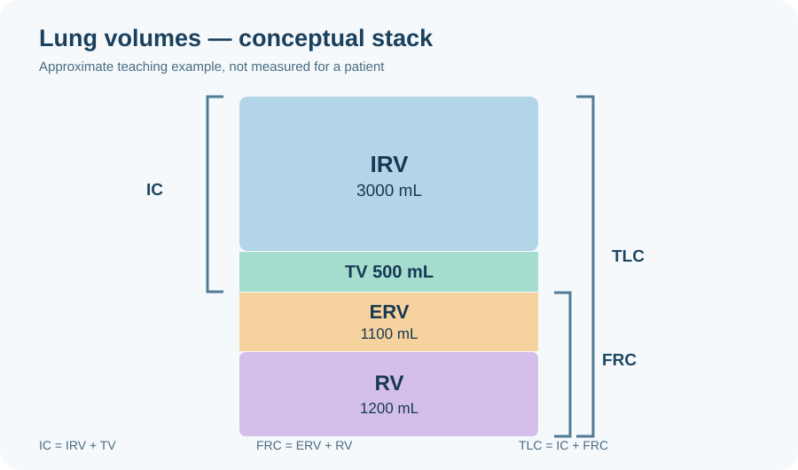

# Day 1 — Lung volumes, minute ventilation & normal values

[← Respiratory chapter overview](../README.md) · [Practice the matching MCQs](../MCQs/Day-01-Lung-Volumes-Minute-Ventilation-Normal-Values.md)

> **Study status:** These notes consolidate the concepts already covered in the Day 1/Day 2 sessions; no new subject has been introduced here.

---

## Lung volumes & capacities

### Individual volumes
- **TV (Tidal volume):** ordinary quiet breath (~500 mL in a typical adult teaching example).
- **IRV:** extra air breathed **in** after a normal inspiration.
- **ERV:** extra air breathed **out** after a normal expiration.
- **RV:** air **remaining after maximal forced expiration**.

### Capacities (combinations)
| Capacity | Formula | What it means |
|---|---|---|
| **IC** inspiratory capacity | TV + IRV | Air inspired from end of quiet expiration |
| **VC** vital capacity | IRV + TV + ERV | Maximum voluntarily movable air |
| **FRC** functional residual capacity | ERV + RV | Remaining after **normal** expiration |
| **TLC** total lung capacity | TV + IRV + ERV + RV | Total air after maximal inspiration |

**Useful shortcut: TLC = IC + FRC.**

#### Two common confusions
1. **RV vs FRC:** RV after **maximum forced** expiration; FRC after **normal quiet** expiration.
2. Capacity given, component missing? **Subtract** known component(s). Example IC 3600, TV 550 → IRV = **3050 mL**.

Approximate volumes vary substantially by age, sex, height and lung health.

---

---

## Minute ventilation (numericals)

### The formula triangle

**MV = RR × TV** (minute ventilation = breaths per minute × mL per breath).

- **TV = MV ÷ RR**
- **RR = MV ÷ TV**
- **1000 mL = 1 L**

#### Example A: Forward
RR = 20/min, TV = 350 mL → MV = 20 × 350 = 7000 mL/min = **7 L/min**.

#### Example B: Reverse
MV = 7.92 L/min = 7920 mL/min; RR = 18/min → TV = 7920 ÷ 18 = **440 mL**.

#### Example C: Before versus after
Before: 12/min × 450 mL = **5.4 L/min**.
After: 18/min × 350 mL = **6.3 L/min**.
Increase = **0.9 L/min**.

#### Percentage increase
**(New MV − Old MV) ÷ Old MV × 100.**

For 6 to 9 L/min: (9−6)/6 × 100 = **50%**.

**Exam trap:** Do not assume higher RR automatically means higher MV: tidal volume may change too. Total MV is different from *alveolar ventilation*, which was deliberately **not** part of our Day 1 study.

---

---

## Normal adult respiratory values

### NORCET-friendly reference table (adult, rest)

| Measurement | Common exam reference | Unit |
|---|---|---|
| Respiratory rate **RR** | **12–20** | breaths/min |
| Tidal volume **TV** | **~500** | mL (typical teaching estimate) |
| **SpO₂** | **95–100** | % (healthy at/near sea level) |
| **PaO₂** | **80–100** | mmHg (sea-level teaching range) |
| **PaCO₂** | **35–45** | mmHg |
| Arterial **pH** | **7.35–7.45** | unitless |
| **HCO₃⁻** | **22–26** | mEq/L (common teaching range) |

**Caution:** age, altitude, disease and labs modify interpretation. These are **study ranges**, not stand-alone treatment thresholds.

#### Memory tricks
- PaCO₂ **35–45**, pH **7.35–7.45** (same 35–45 pattern, pH starts with 7).
- **SpO₂ is a percentage**; **PaO₂ is a pressure**. SpO₂ 97% ≠ PaO₂ exactly 97 mmHg.
- Read question wording: **WITHIN normal** versus **OUTSIDE normal**.
- RR 24/min above common adult resting range; PaCO₂ 33 mmHg below common range; arterial pH 7.46 above range.

---

---

**Next:** [Try the MCQs for these topics](../MCQs/Day-01-Lung-Volumes-Minute-Ventilation-Normal-Values.md)
