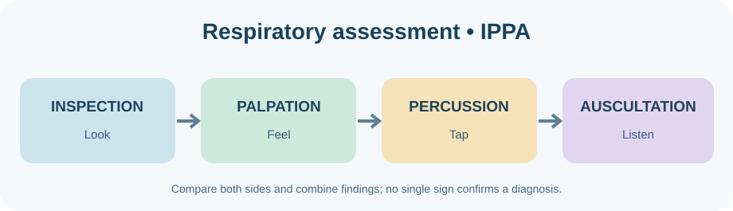
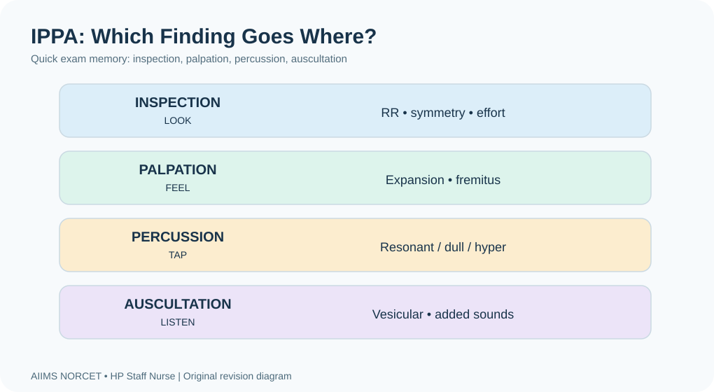
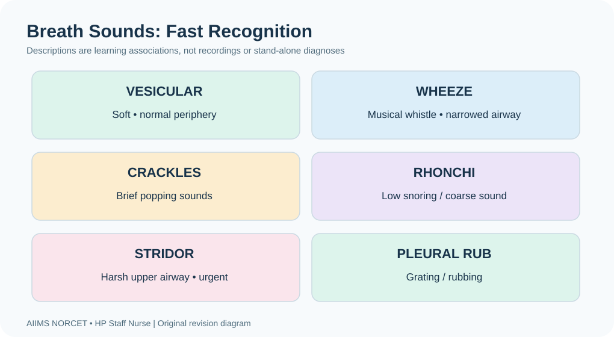
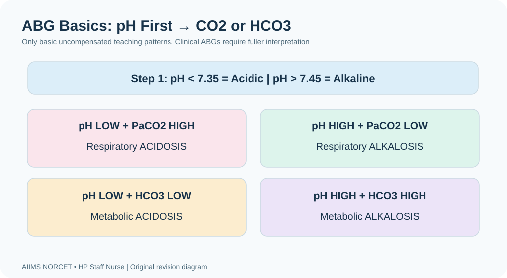
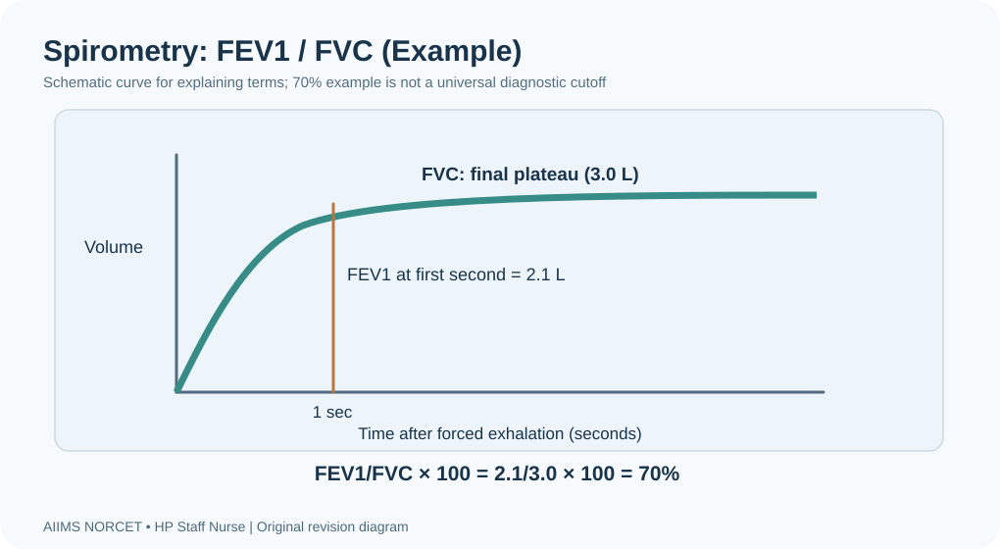

# 🩺 Day 2 — Respiratory Assessment & Diagnostics | Complete Hinglish Notes

**AIIMS NORCET 12 + HP Staff Nurse • Simple Hindi-English • Basic se exam level tak**

[🏠 Chapter](../README.md) · [📝 Day 2 ke 36 MCQs](../MCQs/Day-02-Complete-Respiratory-Assessment-Diagnostics.md) · [🏥 Previous Year Questions](../Previous-Year-Questions/README.md) · [🔎 Sources](../References.md)

> **Dhyan de:** Notes easy Hinglish mein hain. IPPA, ABG aur spirometry ke basics cover hain. Diagnostic investigations ka abhi sirf intro padha hai.

## 📚 Is guide mein kya-kya hai?

1. [Respiratory assessment ka order — IPPA](#1-respiratory-assessment-ka-order--ippa)
2. [Inspection — patient ko dekhna](#2-inspection--patient-ko-dekhna)
3. [Palpation — haath se feel karna](#3-palpation--haath-se-feel-karna)
4. [Percussion — chest tap karna](#4-percussion--chest-tap-karna)
5. [Auscultation — stethoscope se sunna](#5-auscultation--stethoscope-se-sunna)
6. [ABG ke basic values](#6-abg-ke-basic-values)
7. [ABG interpretation — step by step](#7-abg-interpretation--step-by-step)
8. [Spirometry — FEV₁, FVC aur ratio](#8-spirometry--fev₁-fvc-aur-ratio)
9. [Basic diagnostic investigations](#9-basic-diagnostic-investigations)
10. [NORCET last-minute revision](#10-norcet-last-minute-revision)

---

## 1. Respiratory assessment ka order — IPPA

Physical assessment mein hum commonly **IPPA** follow karte hain:

| Letter | Step | Easy meaning |
|---|---|---|
| **I** | **Inspection** | **Dekho** — patient ki breathing observe karo |
| **P** | **Palpation** | **Feel karo** — haath se chest movement aur vibration |
| **P** | **Percussion** | **Tap karo** — chest tap karke note suno |
| **A** | **Auscultation** | **Stethoscope se suno** — breath sounds |

**Trick:** *I = Inspect, P = Palpate, P = Percuss, A = Auscultate.*

Routine exam mein patient ko explain karo, comfortable position do aur dono sides ko compare karo. Agar patient ko severe breathing distress ho toh assessment complete karne se pehle urgent clinical help/escalation zaroori hai.

## 2. Inspection — patient ko dekhna

**Inspection** ka matlab hai patient ko **touch kiye bina observe** karna.

### Kya-kya check karna hai?
- **Respiratory rate (RR):** Ek minute mein kitni breaths le raha hai?
- **Rhythm:** Breaths regular hain ya irregular?
- **Depth:** Saans shallow hai ya normal/deep?
- **Chest symmetry:** Right aur left dono chest sides equally rise kar rahi hain?
- **Work of breathing:** Accessory muscles use ho rahe hain? Nasal flaring ya retractions dikh rahe hain?
- **Posture aur speech:** Patient comfortably bol pa raha hai ya saans phool rahi hai?
- **Colour aur SpO₂:** Broader assessment ka part ho sakta hai.

### Rate-related words
- **Tachypnea:** Breathing usual range se **fast**.
- **Bradypnea:** Breathing usual range se **slow**.
- Adult resting RR ka common exam range **12–20/min**.

**Example:** RR = 26/min (adult at rest). Kya normal hai? **Nahi**; common exam range se above hai, isliye **tachypnea**.

**NORCET question:** “Chest movement symmetry aur accessory muscle use kis technique se assess karoge?” → **Inspection**.

**Yaad:** Ek finding dekhkar direct final diagnosis nahi banana.

## 3. Palpation — haath se feel karna

**Palpation** mein haath use karke chest wall ko check karte hain.

### Important findings
1. **Chest expansion:** Dono sides inspiration pe equally expand ho rahi hain?
2. **Tracheal position:** Normally approximately **midline** hoti hai.
3. **Tenderness/swelling:** Chest wall pe koi pain ya swelling hai?
4. **Tactile fremitus:** Patient bolte waqt chest wall pe **vibration feel** hoti hai.

### Tactile fremitus ko example se samjho

Patient ko "ninety-nine" bolne ke liye kaha jaata hai. Nurse chest ke corresponding areas pe hands rakhkar vibration compare karti hai.

| Fremitus finding | Kis condition mein ho sakti hai? |
|---|---|
| **Increased** | **Consolidation** mein vibration better transmit ho sakti hai, agar airway open ho |
| **Decreased** | **Pleural effusion**, pneumothorax ya airway obstruction mein vibration kam feel ho sakti hai |

**Important:** Ye possible associations hain, single finding se diagnosis confirm nahi hota.

**Memory:** *Fremitus = vibration FEEL karna*, stethoscope se sunna nahi.

**Exam trap:** “Tactile fremitus” ko auscultation mat choose karna. Answer **palpation** hai.

## 4. Percussion — chest tap karna

**Percussion** ka meaning chest ko tap karke sound/note assess karna hai.

Kyon? Underlying tissues mein air, fluid ya solid tissue hone se note change ho sakti hai.

| Sound / note | Easy explanation | Common association |
|---|---|---|
| **Resonant** | Normal air-filled lung ka usual note | Normal peripheral lung |
| **Dull** | Fluid ya dense tissue ki wajah se muted sound | Pleural effusion, consolidation |
| **Hyperresonant** | Extra air ki wajah se relatively booming sound | Pneumothorax, hyperinflation |
| **Flat** | Bahut dense tissue pe sound | Bone/muscle |

### Yaad karne ka shortcut
- **Normal air → Resonant**
- **Fluid/solid → Dull**
- **Extra air → Hyperresonant**

**Example 1:** Healthy lung field mein percussion ka expected sound? → **Resonance**.

**Example 2:** Pleural effusion ke over usually? → **Dullness**.

**Example 3:** Pneumothorax jaisi extra-air condition mein? → **Hyperresonance** ho sakta hai.

**NORCET point:** Right aur left ke matching areas compare karo. Sirf percussion note se disease confirm nahi hoti.

## 5. Auscultation — stethoscope se sunna

**Auscultation** means stethoscope se breath sounds sunna. Right aur left corresponding lung regions ko compare karo. Patient ko comfortable deep breaths lene ko bol sakte hain.

### Normal breath sounds

| Sound | Kaisa sunai deta hai? | Kahan normal milta hai? |
|---|---|---|
| **Vesicular** | Soft, low-pitched | **Most peripheral lung fields** |
| **Bronchial** | Louder, high-pitched/tubular | Normally trachea/manubrium ke paas |
| **Bronchovesicular** | Dono ke beech | Main bronchi ke around |

### Abnormal / added sounds

| Sound | Simple sound description | Association |
|---|---|---|
| **Wheeze** | Musical **whistle** jaisi sound | Narrow airways |
| **Crackles / rales** | **Popping** / crackling jaisi | Fluid/reopening small airways |
| **Rhonchi** | Low-pitched **snoring** jaisi | Secretions ya large-airway narrowing |
| **Stridor** | Harsh sound, often inspiration mein upper airway se | Upper-airway obstruction possible — urgent assessment |
| **Pleural friction rub** | **Grating / rubbing** jaisi | Inflamed pleural surfaces |

### Sound identify karne ki quick practice
- “Musical whistle?” → **Wheeze**.
- “Popping/crackling?” → **Crackles**.
- “Snoring low sound?” → **Rhonchi**.
- “Harsh inspiration, neck ke paas?” → **Stridor**.
- “Pleura rub karne jaisi grating?” → **Pleural friction rub**.

**Important:** Normal vesicular aur bronchial sounds ka location bhi matter karta hai. Stridor/severe respiratory distress mein prompt medical assessment zaroori hai.

### IPPA recap
Inspection = **look**; Palpation = **feel**; Percussion = **tap**; Auscultation = **listen**.

---

## 6. ABG ke basic values

**ABG = Arterial Blood Gas**. Is test se blood ke oxygenation aur **acid-base status** ko samajhne mein help milti hai.

| Parameter | Common adult exam range | Meaning |
|---|---|---|
| **pH** | **7.35–7.45** | Blood acidic ya alkaline? |
| **PaCO₂** | **35–45 mmHg** | **Respiratory component** |
| **HCO₃⁻** | **22–26 mEq/L** | **Metabolic component** |
| **PaO₂** | **80–100 mmHg** | Arterial oxygen pressure; near sea level |

**Trick:** PaCO₂ = **35–45** aur pH = **7.35–7.45**.

**Normal values ka caution:** Actual reference intervals lab, age aur altitude se vary kar sakte hain. Ye simplified exam pattern hai.

## 7. ABG interpretation — step by step

Is topic mein humne basic acid-base classification padhi thi. Advanced compensation aur mixed disorders abhi nahi padh rahe.

### Step 1: pH dekho

- **pH < 7.35** → **Acidemia** (blood acidic side).
- **pH > 7.45** → **Alkalemia** (blood alkaline side).
- **7.35–7.45** → usual reference range mein; further assessment phir bhi needed ho sakti hai.

### Step 2: PaCO₂ dekho

**PaCO₂ respiratory side ko represent karta hai.**
- **CO₂ badhe** → pH ko neeche/acidic direction mein le ja sakta hai.
- **CO₂ ghate** → pH ko upar/alkaline direction mein le ja sakta hai.

### Step 3: HCO₃⁻ dekho

**HCO₃⁻ metabolic side ko represent karta hai.**
- **HCO₃⁻ badhe** → pH alkaline direction mein.
- **HCO₃⁻ ghate** → pH acidic direction mein.

### Four basic exam patterns

| pH | PaCO₂ | HCO₃⁻ | Answer |
|---|---|---|---|
| **Low** | **High** | Normal/relatively unchanged | **Respiratory acidosis** |
| **High** | **Low** | Normal/relatively unchanged | **Respiratory alkalosis** |
| **Low** | Normal/variable | **Low** | **Metabolic acidosis** |
| **High** | Normal/variable | **High** | **Metabolic alkalosis** |

**Ye simplified uncomplicated patterns hain.** Clinical ABG mein compensation aur mixed disorders bhi hote hain.

### Example A: Respiratory acidosis

**pH 7.30, PaCO₂ 52 mmHg, HCO₃⁻ 24 mEq/L**

1. pH **low** → acidemia.
2. PaCO₂ **high** → respiratory side se acidity badh rahi hai.
3. HCO₃⁻ normal range mein hai.
4. **Answer = Respiratory acidosis (simple uncompensated pattern)**.

### Example B: Respiratory alkalosis

**pH 7.49, PaCO₂ 31, HCO₃⁻ 24**

pH high = alkaline. PaCO₂ low hai, jo alkaline direction explain karta hai. **Answer: Respiratory alkalosis**.

### Example C: Metabolic acidosis

**pH 7.27, PaCO₂ 40, HCO₃⁻ 17**

pH low, HCO₃⁻ low. **Answer: Metabolic acidosis**.

### Example D: Metabolic alkalosis

**pH 7.48, PaCO₂ 40, HCO₃⁻ 30**

pH high, HCO₃⁻ high. **Answer: Metabolic alkalosis**.

**NORCET rule:** Pehle **pH**, fir **PaCO₂**, fir **HCO₃⁻**. Sirf ek number dekhkar disorder decide mat karna.

---

## 8. Spirometry — FEV₁, FVC aur ratio

**Spirometry** lungs se forcefully air kitni aur kitni fast nikalti hai, ye measure karne wala test hai.

| Term | Simple meaning |
|---|---|
| **FVC** | Full inspiration ke baad forcefully bahar nikali ja sakne wali **total air volume** |
| **FEV₁** | Forced expiration ke **first 1 second** mein exhaled volume |
| **FEV₁/FVC** | Pehle 1 second mein total forced volume ka kitna part exhale hua |
| **PEF** | Forced expiration ke dauran **peak flow** |

### Ratio calculate karna

**Formula: FEV₁/FVC × 100**

**Example:** FEV₁ = 2.1 L, FVC = 3.0 L.

Ratio = (2.1 ÷ 3.0) × 100 = **70%**.

**Another example:** FEV₁ = 2.4 L, FVC = 3.2 L.

Ratio = (2.4 ÷ 3.2) × 100 = **75%**.

**Trick:** FEV₁ = **first 1 second**. FVC = **total forced expiration**.

### Obstructive vs restrictive pattern — sirf basics

- **Obstructive pattern:** FEV₁/FVC **reduced** ho sakta hai. Iska link airflow obstruction se hai.
- **Possible restrictive pattern:** FVC kam aur FEV₁/FVC normal/high ho sakta hai, **lekin low FVC se restriction confirm nahi hota**. Confirm karne ke liye **TLC** chahiye.
- **RV** (Residual Volume) basic spirometry se directly measure **nahi** hota, kyunki ye maximum expiration ke baad lungs mein bachi air hai.

### Procedure ka simple idea
1. Patient ko procedure samjhao.
2. Correct position aur mouth seal ensure karo.
3. Maximum inspiration karwao.
4. Forcefully aur quickly expiration complete karwao.
5. Acceptable efforts aur repeatability important hain.

**Exam trap:** FEV₁ aur FVC ko confuse mat karna. Ek **first second**, doosra **total forced breath out**.

---

## 9. Basic diagnostic investigations

> **Important:** Ye Day 2 ka introductory topic tha. Advanced CT interpretation, bronchoscopy procedures aur detailed microbiology abhi nahi padhi—unhe abhi add nahi karna.

| Test | Simple meaning |
|---|---|
| **Pulse oximetry** | Bina arterial blood sample liye **estimated SpO₂** batata hai |
| **Chest X-ray** | Chest/lungs ki image; gross abnormalities dekhne mein help |
| **ABG** | pH, gases aur acid-base information |
| **Spirometry** | Forced expiratory air volume/flow |
| **Sputum examination** | Respiratory secretions ka lab examination, jab prescribed ho |

**Nursing basics:** Patient identity verify karo, test ko explain karo, infection prevention follow karo, aur local instructions ke according preparation/monitoring karo.

**Difference:** Pulse oximeter **% saturation** batata hai; ABG mein **PaO₂/PaCO₂** pressures aur pH bhi milte hain.

## 10. NORCET last-minute revision

| Question ka clue | Correct concept |
|---|---|
| Dekhkar RR aur chest movement | **Inspection** |
| Haath se vibrations feel karna | **Palpation / fremitus** |
| Normal lung tap note | **Resonant** |
| Fluid/solid ka tap note | **Dull** |
| Extra-air tap note | **Hyperresonant** |
| Normal peripheral breath sound | **Vesicular** |
| Musical whistle | **Wheeze** |
| Popping | **Crackles** |
| Snoring sound | **Rhonchi** |
| Harsh inspiratory upper-airway sound | **Stridor** |
| pH low + PaCO₂ high | **Respiratory acidosis** |
| pH high + PaCO₂ low | **Respiratory alkalosis** |
| pH low + HCO₃⁻ low | **Metabolic acidosis** |
| pH high + HCO₃⁻ high | **Metabolic alkalosis** |
| Air exhaled in first second | **FEV₁** |
| Total forced expired air | **FVC** |
| RV simple spirometry mein measured? | **Nahi** |

### Khud se 3 mini checks
1. “Patient ke chest se wheezing sound aa rahi hai; ye kya indicate kar sakti hai?” → **Narrowed airways**.
2. “pH 7.49, PaCO₂ 31, HCO₃⁻ 24?” → **Respiratory alkalosis (basic pattern)**.
3. “FEV₁ 1.8 L, FVC 3 L. Ratio?” → (1.8/3) × 100 = **60%**.

**Ab practice:** [Day 2 ke 36 English MCQs + Hinglish explanations](../MCQs/Day-02-Complete-Respiratory-Assessment-Diagnostics.md) aur [quick revision](../Revision/Day-02-Quick-Revision.md).
\n\n[📝 Matching MCQs](../MCQs/Day-02-Complete-Respiratory-Assessment-Diagnostics.md) · [🏥 Previous Year Questions](../Previous-Year-Questions/README.md)

---

**Dhyan de:** Ye hamare study notes hain, official AIIMS paper nahi. [References](../References.md).

---

**🔗 Aage navigate karo:** [🏠 Chapter](../README.md) · [📝 Day 2 ke 36 MCQs](../MCQs/Day-02-Complete-Respiratory-Assessment-Diagnostics.md) · [🏥 Previous Year Questions](../Previous-Year-Questions/README.md) · [🔎 Sources](../References.md)
