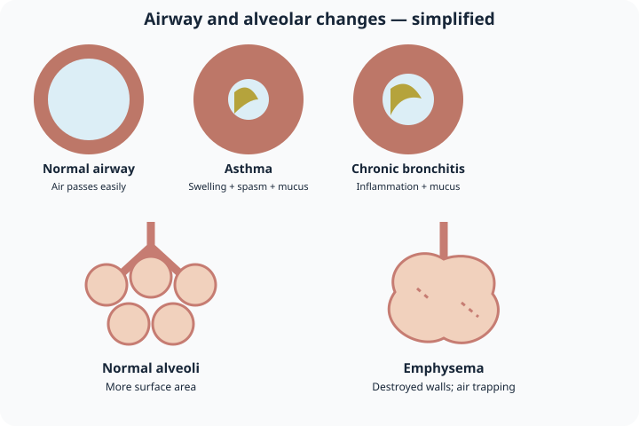

# Day 3 — Bronchial Asthma, COPD, Chronic Bronchitis & Emphysema

[Chapter](../README.md) | [Day 3 diseases](../Concepts/Day-03-Asthma-COPD-Chronic-Bronchitis-Emphysema.md) | [Day 3 care](../Concepts/Day-03-Inhalers-Oxygen-Nebulization-Nursing-Management.md) | [Previous Year Questions](../Previous-Year-Questions/README.md) | [Revision](../Revision/Day-03-Quick-Revision.md) | [References](../References.md)

**Status:** Theory lesson presented on 25 November 2026; MCQ practice and learner mastery pending. No attempted scores or solved questions recorded.

[Asthma](#1-bronchial-asthma) | [COPD](#2-copd) | [Chronic bronchitis](#3-chronic-bronchitis) | [Emphysema](#4-emphysema)

Day 1 mein lungs ka structure aur working samjhi thi, Day 2 mein assessment aur investigations padhi thi. Aaj samjhenge ki lungs mein disease hone par kya changes aate hain aur nurse ko kya karna chahiye. Exam priority high hai; official fixed weightage nahi.

## 1. Bronchial Asthma

Asthma ek chronic inflammatory airway disease hai, jisme breathing tubes mein swelling aur narrowing hoti hai. Is wajah se patient ko saans lene aur bahar nikalne mein difficulty hoti hai.

### Asthma mein 3 main changes

- **Bronchospasm:** Bronchi ki smooth muscles tight ho jaati hain.
- **Inflammation:** Airway ki inner lining mein swelling aa jaati hai.
- **Excess mucus:** Airways mein mucus zyada banne lagta hai.

**Example:** Ek straw se saans lene ka imagine karo. Agar straw ko daba diya jaye aur uske andar mucus bhi ho, toh air pass hona difficult ho jayega. Asthma mein kuch aisa hi hota hai.

**Triggers:** Dust, pollen, smoke, cold air, exercise, respiratory infections aur kuch medicines susceptible patients mein asthma trigger kar sakti hain.

| Symptom | Meaning |
|---|---|
| Wheezing | Seeti jaisi sound, usually expiration mein |
| Dyspnea | Saans lene mein difficulty |
| Chest tightness | Chest mein jakdan |
| Cough | Especially night ya early morning |
| Prolonged expiration | Saans bahar nikalne mein zyada time |

**Diagnosis:** Spirometry mein airflow obstruction aur lung function ki variability check ki jaati hai. Bronchodilator dene ke baad airflow improve ho sakta hai. Peak expiratory flow (PEFR) monitoring bhi useful hai.

| Drug | Function |
|---|---|
| Salbutamol | Rapid bronchodilation |
| Budesonide | Airway inflammation kam karna |
| ICS-formoterol | Prescribed asthma regimens mein controller aur reliever |
| Ipratropium | Severe acute attacks mein additional bronchodilation |
| Systemic corticosteroids | Significant exacerbation mein inflammation kam karna |

Modern asthma management mein ICS-containing treatment important hai. Sirf salbutamol par long-term depend karna recommended nahi hai. [GINA 2026](https://ginasthma.org/2026-gina-summary-guide/).

**Status asthmaticus:** Severe, prolonged asthma attack jo usual initial treatment se adequately improve nahi hota. Ye medical emergency hai.

**Silent chest:** Severe asthma mein agar air movement bahut kam ho jaye aur wheezing bhi sunai na de, toh ye dangerous sign hai, improvement nahi.

> **Dhyan de:** Asthma = Spasm + Swelling + Secretions (3S).

## 2. COPD

Full form: Chronic Obstructive Pulmonary Disease. COPD ek long-term lung disease hai jisme airways aur alveoli mein changes ki wajah se airflow persistently obstructed rehta hai. Patient ko especially saans bahar nikalne mein difficulty hoti hai.

**Causes:** Smoking major risk factor hai. Chulhe ka smoke, biomass fuel, air pollution, occupational dust aur alpha-1 antitrypsin deficiency bhi causes ho sakte hain.

Long-term smoke exposure → airway inflammation + alveolar damage → airflow obstruction → air trapping → breathlessness.

**Air trapping ka meaning:** Patient air andar le leta hai, lekin poori air bahar nahi nikal paati. Kuch air lungs ke andar trapped reh jaati hai.

**Symptoms:** Chronic cough, sputum production, progressive breathlessness, wheezing, fatigue aur prolonged expiration.

**Diagnostic test:** COPD confirm karne ke liye clinical history ke saath post-bronchodilator spirometry use hoti hai. GOLD criterion: FEV1/FVC < 0.70 after bronchodilator.

**Example:** Agar FEV1 = 1.2 L aur FVC = 3 L hai: 1.2 ÷ 3 = 0.40 = 40%. Ye airflow obstruction show karta hai aur appropriate clinical context mein COPD support karta hai. [GOLD science committee](https://pmc.ncbi.nlm.nih.gov/articles/PMC11799884/).

| Feature | Asthma | COPD |
|---|---|---|
| Common onset | Younger age | Middle/older age |
| Airflow obstruction | Variable, often reversible | Persistent |
| Common risk | Allergy, triggers | Smoking, smoke exposure |
| Symptoms | Aate-jaate hain | Usually progressive |
| Main treatment | ICS-containing therapy | Bronchodilators |
| Night symptoms | Common | Ho sakte hain |

> **Dhyan de:** Dono diseases kisi bhi age mein ho sakti hain. Sirf reversibility se inko reliably differentiate nahi kar sakte.

## 3. Chronic Bronchitis

Bronchi mein long-term inflammation aur excessive mucus production ko chronic bronchitis kehte hain.

**Most important exam definition:** Productive cough kam se kam 3 months har saal, 2 consecutive years tak, dusre causes exclude karne ke baad.

Bronchial lining mein swelling hoti hai, mucus glands aur goblet cells mucus zyada produce karte hain. Airway narrow ho jaata hai aur patient ko productive cough hoti hai.

**Common findings:** Productive cough with sputum, rhonchi or wheezing, breathlessness, cyanosis in advanced cases, recurrent respiratory infections.

**Blue Bloater:** Chronic bronchitis ka traditional exam term hai. Cyanosis aur advanced disease mein peripheral edema ho sakta hai. Har patient mein ye findings nahi hoti.

> **Dhyan de:** Chronic Bronchitis = Bronchi + Mucus + 3 months × 2 years.

## 4. Emphysema

Emphysema mein alveolar walls destroy ho jaati hain aur air spaces abnormally enlarge ho jaate hain.

**Example:** Grapes ke bunch ko imagine karo. Bahut saare chhote grapes milkar zyada surface area banate hain. Agar unke beech ki walls destroy ho jaayen aur ek bada sac ban jaye, toh gas exchange ke liye available surface area kam ho jayega.

Alveolar destruction → decreased elastic recoil → difficulty in expiration → air trapping → lung hyperinflation.

**Signs:** Progressive dyspnea, barrel-shaped chest, pursed-lip breathing, reduced breath sounds, hyperresonance on percussion, weight loss in advanced disease.

**Pink Puffer:** Emphysema ka traditional exam term hai. Ye modern diagnostic classification nahi hai.

| Feature | Chronic Bronchitis | Emphysema |
|---|---|---|
| Main structure | Bronchi | Alveoli |
| Main problem | Excess mucus | Alveolar destruction |
| Cough | Prominent productive cough | Often less sputum |
| Classic term | Blue Bloater | Pink Puffer |
| Barrel chest | Ho sakta hai | Classic finding |
| Percussion | Variable | Hyperresonance |

Dono COPD ke components ho sakte hain aur ek hi patient mein coexist bhi kar sakte hain. [NIH COPD](https://www.nhlbi.nih.gov/education/BreatheBetter/COPD-national-action-plan-overview).

## Video teaching and practice

| Studied topic | Teaching video | MCQ practice | Importance |
|---|---|---|---|
| Asthma | [Bronchial Asthma Explained in Hindi — title verified](https://www.youtube.com/watch?v=ypuyh_t1Npc) | [Aarogyam Infinity MCQ Series Part 25](https://www.youtube.com/watch?v=tOxTKjgTcTo) | Very high |
| COPD | [NORCET Xpress respiratory topics](https://www.youtube.com/watch?v=3dWnyE63nJ8) | [Aarogyam Part 25](https://www.youtube.com/watch?v=tOxTKjgTcTo) | Very high |
| Chronic bronchitis | [NORCET Xpress — COPD includes bronchitis](https://www.youtube.com/watch?v=3dWnyE63nJ8) | [Aarogyam Part 25 — classic comparison](https://www.youtube.com/watch?v=tOxTKjgTcTo) | High |
| Emphysema | [NORCET Xpress — COPD includes emphysema](https://www.youtube.com/watch?v=3dWnyE63nJ8) | [Aarogyam Part 25 — classic comparison](https://www.youtube.com/watch?v=tOxTKjgTcTo) | High |

Metadata checked 25 Nov 2026; full video/transcripts, durations and individual creator details not independently confirmed. Skip unstudied diseases. Day 3 MCQ attempts pending; existing [Day 2 practice](../MCQs/Day-02-Complete-Respiratory-Assessment-Diagnostics.md) remains available.

[Chapter](../README.md) | [Day 3 diseases](../Concepts/Day-03-Asthma-COPD-Chronic-Bronchitis-Emphysema.md) | [Day 3 care](../Concepts/Day-03-Inhalers-Oxygen-Nebulization-Nursing-Management.md) | [Previous Year Questions](../Previous-Year-Questions/README.md) | [Revision](../Revision/Day-03-Quick-Revision.md) | [References](../References.md)

**Status:** Theory lesson presented on 25 November 2026; MCQ practice and learner mastery pending. No attempted scores or solved questions recorded.
