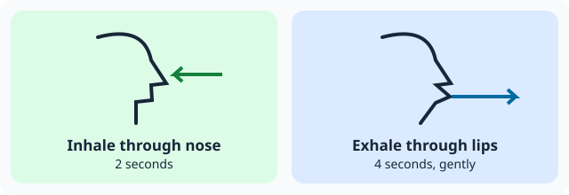

# Day 3 — Inhalers, Oxygen Therapy, Nebulization & Nursing Management

[Chapter](../README.md) | [Day 3 diseases](../Concepts/Day-03-Asthma-COPD-Chronic-Bronchitis-Emphysema.md) | [Day 3 care](../Concepts/Day-03-Inhalers-Oxygen-Nebulization-Nursing-Management.md) | [Previous Year Questions](../Previous-Year-Questions/README.md) | [Revision](../Revision/Day-03-Quick-Revision.md) | [References](../References.md)

**Status:** Theory lesson presented on 25 November 2026; MCQ practice and learner mastery pending. No attempted scores or solved questions recorded.

[Inhalers](#5-inhalers--respiratory-drugs) | [Oxygen](#6-oxygen-therapy--delivery-devices) | [Nebulization](#7-nebulization) | [Nursing](#8-nursing-management)

## 5. Inhalers & Respiratory Drugs

Inhaler ek device hai jo medicine directly respiratory tract mein pahunchata hai. Medicine directly lungs mein kaam karti hai aur kai medicines ke systemic side effects kam ho sakte hain.

| Drug class | Example | Main action |
|---|---|---|
| SABA (short-acting beta2 agonist) | Salbutamol | Quick bronchodilation |
| LABA (long-acting beta2 agonist) | Formoterol, Salmeterol | Long-acting bronchodilation |
| SAMA (short-acting muscarinic antagonist) | Ipratropium | Short-acting bronchodilation |
| LAMA (long-acting muscarinic antagonist) | Tiotropium | Long-acting bronchodilation |
| ICS (inhaled corticosteroid) | Budesonide, Fluticasone | Inflammation kam karna |
| Leukotriene antagonist | Montelukast | Asthma control mein help |
| Systemic steroid | Prednisolone | Acute exacerbation mein inflammation kam karna |

**Reliever vs controller:** Salbutamol tight airway ko jaldi open karta hai, jabki budesonide airway ki swelling ko control karta hai. Kuch prescribed combination inhalers, jaise ICS-formoterol, dono roles perform kar sakte hain.

| Drug | Side effects |
|---|---|
| Salbutamol | Tachycardia, tremors, hypokalemia |
| Ipratropium | Dry mouth |
| Budesonide | Oral candidiasis, hoarseness |
| Theophylline | Nausea, arrhythmias, seizures in toxicity |
| Systemic steroids | Hyperglycemia, infection risk |

**MDI:** Fixed dose release karta hai. Press karte waqt slowly aur deeply inhale karna hota hai. **DPI:** Powder medicine hoti hai; generally forceful, deep inhalation chahiye. **Spacer:** MDI ke saath use hota hai; medicine ko lungs tak pahunchane aur coordination mein help karta hai.

**MDI use:** Cap remove karo aur device instructions ke according shake karo. Inhaler se door normal breath out karo. Mouthpiece lips ke beech rakho. Press karte hue slowly deep breath lo. Approximately 10 seconds hold karo agar possible ho; slowly breath out karo. Steroid inhaler ke baad mouth rinse karke water spit out karo. [MedlinePlus technique](https://medlineplus.gov/ency/patientinstructions/000041.htm) | [Spacer](https://medlineplus.gov/ency/patientinstructions/000042.htm).

> **Dhyan de:** ICS ke baad mouth rinsing oral candidiasis prevent karne mein help karti hai. Asthma mein LABA alone use nahi karna chahiye.

### Respiratory drugs — extra exam points

| Drug | Important concept |
|---|---|
| Salbutamol | Beta2 receptor stimulation |
| Ipratropium | Muscarinic receptor blockade |
| Tiotropium | Long-acting maintenance bronchodilator |
| Montelukast | Leukotriene receptor antagonist |
| Theophylline | Methylxanthine, narrow therapeutic index |
| Sodium cromoglycate | Mast cell stabilizer, preventive drug (classic exam fact) |
| Omalizumab | Anti-IgE drug for selected severe allergic asthma |

**Narrow therapeutic index:** Effective aur toxic dose ke beech difference kam. Theophylline toxicity mein vomiting, tachyarrhythmia aur seizures ho sakte hain; routine rescue drug nahi hai. Montelukast acute attack rescue drug nahi; neuropsychiatric adverse effects important hain. [GINA](https://ginasthma.org/2026-gina-summary-guide/).

### 🔴 Inhaler aur medication safety (study-ready)

MDI mein spray ko inhale karne ka timing important hai. Spacer spray ko briefly hold karta hai, isliye patient ko coordination mein help milti hai. Ek time par ek puff do. DPI mein powder ko disperse karne ke liye sufficient inspiratory effort chahiye. Device ke andar exhale mat karo, kyunki moisture powder ko affect kar sakti hai. Device-specific instructions follow karo aur patient se return demonstration lo.

Repeated salbutamol doses potassium ko cells ke andar shift kar sakti hain. Isse hypokalemia ho sakti hai. Severe palpitations, chest symptoms ya deterioration mein urgent assessment karo. Theophylline ke saath vomiting, arrhythmia aur seizure serious toxicity ke clues hain. Clinician drug level aur interactions assess kare.

**Montelukast:** FDA boxed warning ke according new mood, sleep ya behaviour changes par medicine stop karke healthcare professional se immediately contact karna hai. Immediate self-harm danger mein emergency help lo. Montelukast acute attack ka rescue drug nahi hai. [FDA warning](https://www.fda.gov/drugs/drug-safety-communications/fda-requires-boxed-warning-about-serious-mental-health-side-effects-asthma-and-allergy-drug).

Asthma mein ICS-containing treatment ko apne aap stop mat karo. Formoterol aur salmeterol ko interchangeable rescue drug mat samjho. [Disease concepts](Day-03-Asthma-COPD-Chronic-Bronchitis-Emphysema.md#1-bronchial-asthma) · [Care bank Q1–15, Q45](../MCQs/Day-03-Drugs-Oxygen-Nursing-45.md).

## 6. Oxygen Therapy & Delivery Devices

Oxygen therapy ka purpose patient ki low blood oxygen level (hypoxemia) ko correct karna hai. FiO2 = Fraction of Inspired Oxygen, yani patient jo air inhale kar raha hai usmein oxygen ka proportion. Normal room air approximately 21%.

| Device | Flow (L/min) | Approx. FiO2 | Key point |
|---|---|---|---|
| Room air | — | 21% | Baseline |
| Nasal cannula | 1–6 | 24–44% | Patient baat aur khana kha sakta hai |
| Simple face mask | 5–10 (some protocols 6–10) | 35–60% | Minimum adequate flow se CO2 rebreathing avoid |
| Partial rebreather | 6–10 | 40–70% | Reservoir bag; kuch exhaled air dobara inhale |
| Non-rebreather | 10–15 | 60–90%+ | Severe hypoxemia mein emergency oxygen |
| Venturi | Adapter-specific | 24–60% | Fixed prescribed concentration |

FiO2 approximate hai; device design, fit aur breathing par depend karti hai. Flow aur targets local orders/protocol ke according. [Open RN oxygen therapy](https://www.ncbi.nlm.nih.gov/books/NBK596733/) | [Acute oxygen guideline](https://pmc.ncbi.nlm.nih.gov/articles/PMC4654337/).

**Nasal cannula calculation:** Common exam approximation FiO2 (%) ≈ 20 + 4 × flow. At 2 L/min: 20 + 4 × 2 = 28%. At 4 L/min: 20 + 4 × 4 = 36%. Actual FiO2 fixed nahi hoti.

**COPD oxygen:** Acute exacerbation mein especially hypercapnic respiratory failure ke risk wale patients mein common initial target SpO2 88–92%, ABG aur clinical assessment ke according. Excessive uncontrolled oxygen kuch patients mein CO2 retention badha sakti hai. COPD patient ko oxygen dena mana nahi hai: hypoxemia mein controlled, monitored oxygen do.

> **Dhyan de:** Precise oxygen concentration = Venturi mask. Emergency high-concentration oxygen = NRBM.

### Oxygen therapy — extra high-yield concepts

**Hypoxia:** Body tissues mein oxygen ki kami. **Hypoxemia:** Arterial blood mein oxygen ki kami.

| Early signs of hypoxia | Late/severe signs |
|---|---|
| Restlessness, anxiety | Cyanosis (may be absent) |
| Tachypnea, tachycardia | Decreased consciousness, possible bradycardia, severe deterioration |

> **Dhyan de:** Restlessness early sign ho sakta hai; cyanosis ka wait mat karo.

| Complication | Simple meaning |
|---|---|
| Oxygen toxicity | Excessive oxygen exposure se lung damage |
| Absorption atelectasis | Alveoli collapse ho sakte hain |
| Hypercapnia | Susceptible patients mein CO2 retention |
| Mucosal dryness | Nose aur airway dryness |
| Retinopathy of prematurity | Preterm babies mein excessive oxygen se retinal damage ka risk |

**HFNC:** High flow nasal cannula; heated humidified oxygen, adult devices often up to approximately 60 L/min. **Ambu bag/BVM:** Inadequate breathing/apnea mein trained staff ke liye manual positive-pressure ventilation. **T-piece:** Artificial airway wale spontaneously breathing patient ko oxygen deliver kar sakta hai. Detailed ventilator settings abhi scope mein nahi hain. [Open RN Oxygen Therapy](https://www.ncbi.nlm.nih.gov/books/NBK596733/).

### 🔴 Oxygen targets and device troubleshooting

Flow L/min mein measure hota hai aur FiO2 percentage mein. Example: 2 L/min par estimated 28% aur 4 L/min par estimated 36% ka difference 8 percentage points hai. Actual nasal cannula FiO2 variable hoti hai.

**Acute asthma:** GINA 2026 mein oxygen needed ho toh SpO2 92–95% ka target diya hai. **Hypercapnia-risk COPD:** initial target commonly 88–92% pending ABG. Ye different clinical contexts hain. Emergency protocol aur individual prescription follow karo. SpO2 PaCO2 directly nahi batati. New drowsiness mein ABC assessment aur urgent escalation karo. Excess oxygen susceptible patient mein V/Q changes aur Haldane effect se CO2 rise kar sakti hai. Oxygen blanket withhold mat karo.

Venturi adapter specified concentration ke liye oxygen aur room air mix karta hai. Rapid breathing mein total gas flow inadequate ho sakta hai. Manufacturer ke flow instructions review karo aur entrainment ports clear rakho. Universal 4 L/min cap COPD mein valid nahi hai. NRBM reservoir collapse ho toh patient, source, tubing, valves aur flow check karo. Device alone ventilation guarantee nahi karta.

Preterm babies mein excessive oxygen aur fluctuations ROP risk badha sakte hain. Hypoxia bhi harmful hai. Prescribed neonatal target follow karo, adult target copy mat karo.

[GINA 2026](https://ginasthma.org/2026-gina-summary-guide/) · [BTS oxygen guidance](https://bmjopenrespres.bmj.com/content/4/1/e000170). **🟣 BHU Staff Nurse 2019 — related reported Venturi concept:** [source-traced practice](../Previous-Year-Questions/Day-03-Reported-Nursing-Exam-Questions.md). Official key unverified. [Care bank Q16–30](../MCQs/Day-03-Drugs-Oxygen-Nursing-45.md).

## 7. Nebulization

Nebulization ek procedure hai jisme liquid medicine ko fine mist (chhoti-chhoti droplets) mein convert karke patient ko inhale karwaya jaata hai.

| Medicine | Purpose |
|---|---|
| Salbutamol | Bronchodilation |
| Ipratropium | Bronchodilation |
| Budesonide | Airway inflammation control |
| Sterile normal saline | Dilution, when prescribed |

**Procedure:** Hand hygiene, patient identity, prescribed drug/dose/expiry check; baseline RR/pulse/SpO2/breath sounds assess; sitting/Fowler's position; prescribed medicine cup mein daalo; mask/mouthpiece attach; normally breathe; mist khatam hone tak device instructions follow; dobara assess; clean equipment and document.

Jet nebulizer driving flow commonly 6–8 L/min, device-specific instructions follow karo. Treatment often 5–15 minutes. COPD patients at risk of CO2 retention may need air-driven nebulizer with prescribed supplemental oxygen separately. [Clinical source](https://pmc.ncbi.nlm.nih.gov/articles/PMC4654337/).

| Feature | Nebulizer | Inhaler |
|---|---|---|
| Form | Fine mist | Aerosol/powder |
| Time | Relatively longer | Usually quick |
| Portability | Kam | Zyada |
| Coordination | Kam required | Technique important |

Nebulizer hamesha inhaler se zyada effective nahi hota. Correct technique ke saath MDI plus spacer bhi effective ho sakta hai. [MedlinePlus](https://medlineplus.gov/ency/patientinstructions/000006.htm).

### 🟠 Nebulization — nursing safety

Patient identity, prescription aur baseline respiratory effort verify karo. Single-patient equipment, manufacturer ki cleaning instructions aur local infection-control policy follow karo. Prescribed sterile solution use karo, tap water se dilute mat karo. Hypercapnic acidosis mein suitable air-driven nebulizer aur separately titrated oxygen use ho sakti hai. Treatment ke baad prescribed oxygen setup restore karo. Falling SpO2, worsening dyspnea ya severe tachycardia mein routine completion se pehle patient assessment aur urgent escalation priority hai. [BTS guidance](https://bmjopenrespres.bmj.com/content/4/1/e000170) · [Care Q31–35 and Q43](../MCQs/Day-03-Drugs-Oxygen-Nursing-45.md).

## 8. Nursing Management

**High Fowler's position:** 60–90° upright, chest expansion mein help. **Tripod position:** Patient aage lean karta hai aur arms support par rakhta hai; breathing effort kam karne mein help mil sakti hai.

**Pursed-lip breathing:** COPD mein trapped air ko bahar nikalne mein help karne wali technique. Nose se 2 seconds inhale, lips halka close karke 4 seconds gently exhale. Bilkul aise jaise candle ko gently blow karna ho. Force nahi lagana. Isse expiration prolonged hota hai aur small airways ko jaldi collapse hone se bachane mein help mil sakti hai. [American Lung Association](https://www.lung.org/lung-health-diseases/lung-disease-lookup/copd/resource-library/pursed-lip-breathing-video?form=FUNWDCDEGUJ).

| Nursing intervention | Reason |
|---|---|
| Assess airway, breathing, circulation | Life-threatening problem identify |
| Monitor RR, SpO2, pulse | Patient condition assess |
| Auscultate breath sounds | Airflow changes identify |
| Give prescribed oxygen | Hypoxemia correct |
| Prescribed bronchodilators | Airways open |
| Smoking cessation | COPD progression slow karne mein help |
| Teach inhaler technique | Effective medication delivery |
| Small frequent meals in COPD | Eating ke dauran breathlessness kam karne mein help |
| Vaccination education | Infection risk kam |
| Pulmonary rehabilitation | Exercise tolerance aur daily function improve |

**Emergency warning signs:** Silent chest, cyanosis, confusion, drowsiness, inability to speak full sentences, severe accessory muscle use, falling SpO2 → immediate assessment and emergency escalation.

**Oxygen safety:** Smoking, open flame aur oil-based products avoid karo. Reservoir bag inflate hona chahiye. Oxygen therapy prescribed target aur patient response ke according monitor karo.

### Clinical nursing priority — extra scenarios

| Patient situation | Nursing action |
|---|---|
| NRBM reservoir bag collapsed | Oxygen supply, flow aur mask system check karo; patient assess karo |
| Venturi mask air ports blocked | Obstruction remove karo |
| Steroid inhaler use kiya | Mouth rinse and spit |
| Severe asthma mein silent chest | Emergency escalation |
| COPD patient oxygen ke baad drowsy | Urgent assessment, ABG and escalation; oxygen prescribed target par titrate |
| Sudden restlessness | Oxygenation aur vitals assess |
| Nebulization ke baad severe tachycardia | Patient assess and significant adverse effect report |
| COPD mein expiration difficult | Pursed-lip breathing |
| Meals ke time dyspnea | Small frequent meals when safe |

Nebulization se pehle aur baad pulse, RR, SpO2 aur breath sounds assess karo. CO2 retention risk wale COPD patients mein air-driven nebulizer aur separately controlled supplemental oxygen ki zarurat ho sakti hai. [Acute airway disease review](https://pmc.ncbi.nlm.nih.gov/articles/PMC8806296/).

### 🟠 Breathing exercises and discharge care

Pursed-lip breathing mein relaxed prolonged expiration se halka back pressure ban sakta hai. Diaphragmatic breathing mein inspiration ke time abdomen gently rise karta hai. Dono techniques alag hain. Kuch hyperinflated patients diaphragmatic breathing tolerate nahi karte. Patient ko force ya prolonged breath hold mat karwao. Rehabilitation advice aur individual tolerance ke according technique select karo.

Stable patient mein small frequent meals aur rest se eating-related fatigue kam ho sakti hai. New confusion, severe distress ya swallowing difficulty mein meal rok kar airway aur breathing assess karo. Discharge par smoking cessation, prescribed inhalers, oxygen fire safety, vaccine eligibility, action plan aur follow-up discuss karo. Teach-back mein patient apne words mein warning signs aur action samjhata hai. Return demonstration mein technique dikhata hai.

**🟣 HPSSSB Staff Nurse October 2020** diaphragmatic breathing aur **🟣 RRB Staff Nurse July 2019 Shift I** pursed-lip breathing related reports hain. [Source-traced practice adaptations](../Previous-Year-Questions/Day-03-Reported-Nursing-Exam-Questions.md). Official keys pending. [Care Q36–45](../MCQs/Day-03-Drugs-Oxygen-Nursing-45.md). [ALA breathing exercises](https://www.lung.org/lung-health-diseases/wellness/breathing-exercises).

## Video teaching and practice

| Topic | Teaching | MCQ practice |
|---|---|---|
| Inhalers | [UC Davis Health MDI and spacer](https://www.youtube.com/watch?v=1Ba5Tbv8C9o) · [MedlinePlus technique](https://medlineplus.gov/ency/patientinstructions/000042.htm) | **YouTube MCQ practice: verification pending** for device technique. [Nursing Wallah acute asthma drug MCQ 11:58](https://www.youtube.com/watch?v=tOxTKjgTcTo&t=718s) for drug topic only |
| Oxygen devices | [Level Up RN oxygen devices](https://www.youtube.com/watch?v=1BZXEL7a0TA) · [Earlier teaching lead](https://www.youtube.com/watch?v=XoFsjZrrfZ8), fresh verification pending | [Nursing Wallah Part 25 Venturi MCQ 37:29](https://www.youtube.com/watch?v=tOxTKjgTcTo&t=2249s) · [Earlier written practice](https://testustad.com/subjects/fundamentals-of-nursing/oxygen-therapy-and-airway-care) |
| Nebulization | [Health Sector — Nebulization Procedure in Nursing](https://www.youtube.com/watch?v=G92xglQ7OTg) | **YouTube MCQ practice: verification pending** |
| Nursing management | [National Jewish Health pursed-lip breathing](https://www.youtube.com/watch?v=AqIPW474azk) · [NORCET Xpress earlier lead](https://www.youtube.com/watch?v=3dWnyE63nJ8), fresh verification pending | [Nursing Wallah Part 25 COPD oxygen discussion 34:43](https://www.youtube.com/watch?v=tOxTKjgTcTo&t=2083s), topic teaching, not dedicated practice. **YouTube MCQ practice: verification pending** for rehabilitation/discharge |

Audit 27 Nov 2026: UC Davis Health, Level Up RN, Health Sector, National Jewish Health and Nursing Wallah video metadata checked. Playback and exact question matches pending. Chat device photos not copied because reuse rights and exact assets unavailable. Original diagram is a reconstruction, not identical screenshot. Day 3 MCQ practice pending.

[Chapter](../README.md) | [Day 3 diseases](../Concepts/Day-03-Asthma-COPD-Chronic-Bronchitis-Emphysema.md) | [Day 3 care](../Concepts/Day-03-Inhalers-Oxygen-Nebulization-Nursing-Management.md) | [Previous Year Questions](../Previous-Year-Questions/README.md) | [Revision](../Revision/Day-03-Quick-Revision.md) | [References](../References.md)

**Status:** Theory lesson presented on 25 November 2026; MCQ practice and learner mastery pending. No attempted scores or solved questions recorded.

## Day 3 new practice

[45 nursing and care MCQs](../MCQs/Day-03-Drugs-Oxygen-Nursing-45.md) · [30-question final mock](../MCQs/Day-03-Final-Mock-30.md) · [Research and paper leads](../MCQs/Research-and-Paper-Leads.md). Practice not yet attempted.

**Curriculum alignment:** [INC B.Sc Nursing curriculum](https://www.legitquest.com/act/indian-nursing-council-revised-regulations-and-curriculum-for-bsc-nursing-program-regulations-2020/cbd2) includes oxygen administration, pulse oximetry, nebulization and respiratory care. New sections study-ready hain. Specific historical frequency aur full GNM/PB BSc review pending.
