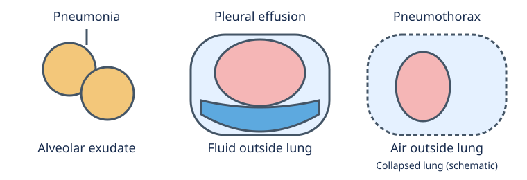

# Day 4 — Pneumonia, Pulmonary Tuberculosis & Pleural Disorders

[Chapter](../README.md) | [Concepts](../Concepts/Day-04-Pneumonia-Tuberculosis-Pleural-Disorders.md) | [MCQs](../MCQs/Day-04-Pneumonia-Tuberculosis-Pleural-Disorders.md) | [Previous Year Questions](../Previous-Year-Questions/README.md) | [References](../References.md)

**Status:** Theory presented; five original questions attempted. Asthma and COPD were revised, not a new chapter. [Day 3 diseases](Day-03-Asthma-COPD-Chronic-Bronchitis-Emphysema.md) and [inhalers and oxygen](Day-03-Inhalers-Oxygen-Nebulization-Nursing-Management.md) remain their original home.

[Pneumonia](#1-pneumonia) | [TB](#2-pulmonary-tuberculosis) | [Pleural disorders](#3-pleural-disorders) | [Revision](#quick-revision)

## 1. Pneumonia

Pneumonia is an infection of lung parenchyma involving alveoli, causing inflammation and filling of alveoli with fluid or exudate. Easy language: alveoli mein air ki jagah inflammatory fluid aa jata hai, isliye oxygen blood tak pahunchne mein difficulty hoti hai.

Bacteria, viruses aur fungi causes hain. **Streptococcus pneumoniae** common bacterial cause hai.

| Type | Meaning |
|---|---|
| Community-acquired | Healthcare setting ke bahar acquired |
| Hospital-acquired | Admission ke 48 hours ya uske baad, admission par incubating nahi |
| Aspiration pneumonia | Oral/gastric contents inhale hone se infection |
| Viral | Virus se |

Fever, productive cough, dyspnea, chest pain, tachypnea, crackles aur low SpO2 assess karo. Chest X-ray, CBC, pulse oximetry, sputum culture aur selected severe cases mein blood cultures useful hain. Consolidation mein alveoli fluid se bharte hain; crackles, bronchial breathing aur dull percussion mil sakte hain.

Nursing care: semi-Fowler's/High Fowler's, respiratory rate, oxygen saturation, temperature, prescribed antibiotics for bacterial disease, oxygen when indicated, hydration if not contraindicated, coughing/deep breathing. Monitor for sepsis, respiratory failure, pleural effusion, empyema and lung abscess. New confusion, hypotension ya increasing oxygen need ko urgently escalate karo.

**High-yield extension:** Lobar pneumonia ek lobe ka relatively uniform consolidation; bronchopneumonia patchy multifocal involvement. Aspiration pneumonitis chemical injury hai, bacterial aspiration pneumonia infection hai; dono automatically same treatment nahi. CURB-65 severity aid: Confusion, Urea >7 mmol/L, RR ≥30, BP systolic <90 or diastolic ≤60, age ≥65. Har criterion 1 point; score clinical judgment replace nahi karta.

## 2. Pulmonary tuberculosis

Tuberculosis is an infectious disease caused by Mycobacterium tuberculosis. Lungs mainly affected, but extrapulmonary disease bhi ho sakti hai. Infectious pulmonary/laryngeal TB coughing, speaking or singing se airborne particles release karti hai. Sharing utensils or handshakes usually transmission route nahi hai.

Cough ≥2 weeks, hemoptysis, fever, night sweats, weight loss, loss of appetite and fatigue important findings hain. Symptoms duration alone se TB exclude nahi karte. Sputum NAAT (CBNAAT/Truenat), smear microscopy, culture and drug susceptibility testing, chest X-ray use hote hain. X-ray alone confirmation nahi hai.

| Drug | Abbreviation | Important adverse effects |
|---|---|---|
| Isoniazid | H | Peripheral neuropathy, hepatotoxicity |
| Rifampicin | R | Orange-red body fluids, hepatotoxicity |
| Pyrazinamide | Z | Hyperuricemia, hepatotoxicity |
| Ethambutol | E | Optic neuritis, red-green colour vision changes |

**NORCET high-yield: Ethambutol → optic neuritis.** Visual changes promptly report karo. Isoniazid ke saath pyridoxine prescribed in at-risk patients helps prevent neuropathy. HRZE common first-line drugs hain; regimen duration disease site, susceptibility and national guidelines par depend karta hai. Medicines independently stop mat karo; suspected significant toxicity urgently report karo.

Nursing: airborne precautions, fit-tested N95 respirator for staff, appropriate isolation/ventilation, patient mask during necessary transport, cough etiquette, adherence support, nutrition and prescribed follow-up sputum testing.

**High-yield extension:** Latent TB infection generally asymptomatic/noninfectious; active pulmonary TB infectious ho sakti hai. TST/IGRA infection suggest karte hain, active disease distinguish nahi karte. MDR-TB means resistance to at least isoniazid and rifampicin. NTEP = National Tuberculosis Elimination Programme; DOT = directly observed treatment, adherence support ka part. Drug-resistant disease needs susceptibility-guided specialist regimen.

## 3. Pleural disorders

### Pleural effusion

Abnormal accumulation of fluid in pleural space. Dyspnea, pleuritic chest pain, reduced breath sounds and **dullness on percussion**. Chest X-ray and ultrasound detect fluid; thoracentesis diagnostic/therapeutic ho sakti hai. Heart failure often transudate; infection/malignancy often exudate. Light's criteria: any one — fluid/serum protein >0.5, fluid/serum LDH >0.6, fluid LDH > two-thirds upper normal serum LDH — supports exudate.

Thoracentesis: patient sitting and leaning forward if tolerated; explain, monitor vitals and respiratory distress. Ultrasound guidance and trained clinician. Monitor for pneumothorax, bleeding, infection, and re-expansion pulmonary edema. New breathlessness/chest pain promptly report karo.

### Pneumothorax

Presence of air in pleural space causing partial or complete lung collapse. Sudden chest pain, sudden dyspnea, reduced breath sounds on affected side, **hyperresonance**. Stable cases need individualized assessment.

**Tension pneumothorax = life-threatening emergency.** Pressure increases, venous return falls and obstructive shock ho sakta hai. Severe distress, hypotension, tachycardia; neck vein distension may occur, tracheal deviation is a late sign. Urgent emergency response, immediate decompression by trained clinician followed by definitive management commonly chest drain; unstable suspected tension pneumothorax mein imaging ka wait nahi.

### Chest tube drainage

Drain below chest level, tubing kink-free, connections secure; monitor output, colour, respiratory status and insertion site. Water seal tidaling may reflect pressure changes; absent tidaling could mean lung expansion or blockage, so assess patient and system. Continuous bubbling in water-seal chamber may indicate air leak; suction chamber behavior is device-dependent. **Never routinely clamp a chest tube**, especially an actively bubbling drain. Avoid routine stripping/milking; report disconnection, displacement or abrupt changes and follow local emergency protocol.

## Quick revision

| Finding | Think |
|---|---|
| Reversible/variable obstruction | Asthma |
| Persistent obstruction; post-BD FEV1/FVC <0.70 | COPD |
| Productive cough 3 months each of 2 consecutive years | Chronic bronchitis |
| Acute COPD with hypercapnia risk | Controlled oxygen, initial 88–92% pending ABG |
| Alveolar infection | Pneumonia |
| Airborne transmission | Pulmonary TB |
| Optic neuritis | Ethambutol |
| Pleural fluid, dull percussion | Effusion |
| Pleural air, hyperresonance | Pneumothorax |
| Shock with suspected tension pneumothorax | Emergency decompression |

**Exam focus:** High-yield clinical distinctions, not verified frequency counts. ARDS, pulmonary embolism and full respiratory failure were only proposed for later study, not marked completed.

## Sources and practice

- [CDC TB clinical overview](https://www.cdc.gov/tb/hcp/clinical-overview/index.html)
- [CDC TB treatment](https://www.cdc.gov/tb/hcp/treatment/tuberculosis-disease.html)
- [BTS pleural procedures](https://thorax.bmj.com/content/78/Suppl_3/s43)
- [BTS pleural disease guideline](https://thorax.bmj.com/content/early/2023/08/08/thorax-2023-220304)
- [Aarogyam Infinity respiratory MCQ practice](https://www.youtube.com/watch?v=tOxTKjgTcTo) — metadata identifies pneumonia and tension pneumothorax questions; full transcript not reviewed.
- Separate concept teaching videos and authentic new previous-year paper wording not independently verified in this pass.

[Chapter](../README.md) | [Concepts](../Concepts/Day-04-Pneumonia-Tuberculosis-Pleural-Disorders.md) | [MCQs](../MCQs/Day-04-Pneumonia-Tuberculosis-Pleural-Disorders.md) | [Previous Year Questions](../Previous-Year-Questions/README.md) | [References](../References.md)
