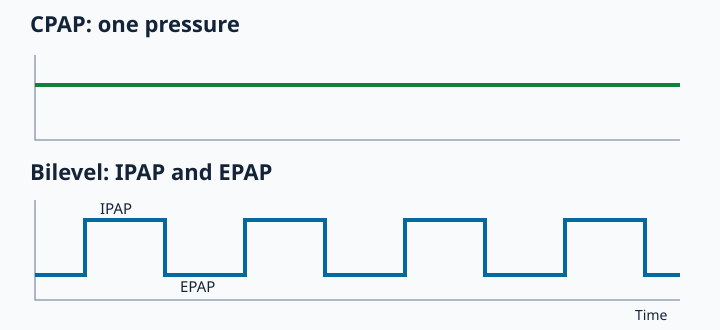

# Day 4 — Mechanical Ventilation, Artificial Airways, Suctioning & VAP

[Chapter](../README.md) | [Day 4 previous concepts](Day-04-Pneumonia-Tuberculosis-Pleural-Disorders.md) | [Previous Year Questions](../Previous-Year-Questions/README.md) | [References](../References.md)

**Theory presented 26 November 2026; practice unattempted.** Roman Hinglish, high-yield exam scope. Original chat device photos not reused.

## Mechanical ventilation
Ventilator ek machine hai jo inadequate breathing ko support karti hai. Oxygen mask oxygen de sakta hai, lekin respiratory muscles exhaust hone par CO2 eliminate karne ke liye ventilation support chahiye. Invasive: ETT/tracheostomy; non-invasive: mask. Apnea, severe respiratory failure, inadequate airway protection, fatigue indications hain; ICU team decides.

| Mode | Easy meaning |
|---|---|
| CMV | Machine mandatory breaths deti hai |
| A/C | Patient-triggered ya machine-triggered breaths ko preset support |
| SIMV | Synchronized mandatory breaths ke beech spontaneous breaths |
| PSV | Patient initiates, machine pressure support deti hai |
| CPAP | Spontaneous breathing mein one continuous positive pressure |
| BiPAP | Higher inspiratory IPAP, lower expiratory EPAP |

CPAP OSA aur selected cardiogenic edema mein; bilevel NIV acute COPD hypercapnic acidosis mein useful ho sakta hai. Inability to protect airway mein NIV inappropriate ho sakti hai.

FiO2 inspired oxygen; TV delivered volume; RR breaths/min; PEEP end-expiratory pressure; plateau pressure no-flow pressure. PEEP balloon ko completely deflate hone se bachane jaisa hai: alveolar recruitment help. ARDS lung-protective TV about 6 mL/kg predicted body weight (4–8), plateau pressure ≤30 cm H2O. Actual settings team decides.

| High-pressure alarm | Low-pressure/volume alarm |
|---|---|
| Mucus, kink, biting, bronchospasm, stiff lungs | Disconnect, circuit leak, cuff leak, displacement |

Patient and ABC first, then tube/circuit check, urgent help if distress. Never simply silence alarm. If ventilation ineffective, trained team provides manual ventilation as indicated.
Complications: barotrauma (pressure injury), volutrauma (overstretch), VAP, hypotension due to reduced venous return, oxygen toxicity. Weaning = reduce support; SBT = trial of spontaneous breathing; extubation = remove ETT after readiness/airway protection assessment.

## ETT and tracheostomy
ETT mouth/nose via trachea; tracheostomy neck stoma into trachea. Indications upper airway obstruction, prolonged ventilation, selected secretion management. Outer cannula maintains airway, inner cannula removable in applicable models, obturator guides insertion and must be removed after insertion, cuff seals positive pressure, pilot balloon inflation system, flange secures tube. Cuff manometer commonly 20–30 cm H2O; excess pressure injures mucosa, low pressure may leak. Humidification because nose bypassed; assess stoma, skin, bleeding, infection; bedside same size + smaller replacement, obturator, suction, BVM per protocol. Continuous waveform capnography confirms tracheal ETT placement; radiograph checks depth. Fresh tracheostomy displacement: call emergency airway team, oxygenate as appropriate, avoid blind reinsertion. Suspected blockage: assess airway and patency, activate emergency algorithm. No independent invasive procedure without training.

## Suction
Negative pressure removes mucus; use clinical indications (visible secretions, coarse sounds, suspected obstruction, rising resistance), not automatic schedule. Preoxygenate as indicated; sterile open suction, no suction during insertion, short withdrawal suction, allow recovery; generally avoid routine saline. Max 15 s per pass/procedure; adult common teaching 100–150 mmHg suction magnitude; AARC adult upper limit below 200 mmHg magnitude, use lowest effective per local protocol. Catheter occludes <50% ETT lumen in adults. Complications hypoxemia, mucosal injury, vagal bradycardia, bleeding and infection. Desaturation/bradycardia: stop and assess/oxygenate urgently.

## VAP
Pneumonia generally ≥48 h after invasive ventilation. Head of bed 30–45° if appropriate, hand hygiene, regular oral care with toothbrushing, minimize sedation as clinically appropriate, assess daily readiness for liberation, secure cuff, change circuit only when indicated. Routine chlorhexidine oral care not recommended by 2022 adult VAP prevention guidance.

## Sources and videos
- [Open RN tracheostomy and suction](https://www.ncbi.nlm.nih.gov/books/NBK596713/)
- [AARC suction guideline](https://pubmed.ncbi.nlm.nih.gov/35078900/) · [VAP prevention](https://pmc.ncbi.nlm.nih.gov/articles/PMC10903147/)
- [Merck thoracic trauma](https://www.merckmanuals.com/professional/injuries-poisoning/thoracic-trauma/overview-of-thoracic-trauma) · [Bronchiectasis](https://www.merckmanuals.com/professional/pulmonary-disorders/bronchiectasis-and-atelectasis/bronchiectasis)
- [AIIMS nursing curriculum](https://aiimsbhubaneswar.nic.in/wp-content/uploads/2024/06/NursingSyllabus.pdf)
- Teaching: [Critical care nursing, Dr Ujjwal](https://www.youtube.com/watch?v=urPD3YtXua0), [NORCET Xpress respiratory](https://www.youtube.com/watch?v=3dWnyE63nJ8). MCQ: [Aarogyam Part 25](https://www.youtube.com/watch?v=tOxTKjgTcTo), [Mixed respiratory MCQs](https://www.youtube.com/watch?v=_dOjXZ6vCck). Metadata checked, full transcripts not reviewed; individual topic video matches not all verified.

[Chapter](../README.md) | [Day 4 previous concepts](Day-04-Pneumonia-Tuberculosis-Pleural-Disorders.md) | [Previous Year Questions](../Previous-Year-Questions/README.md) | [References](../References.md)
