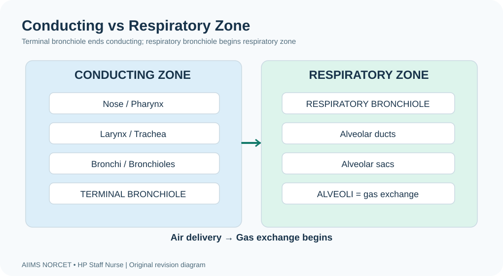
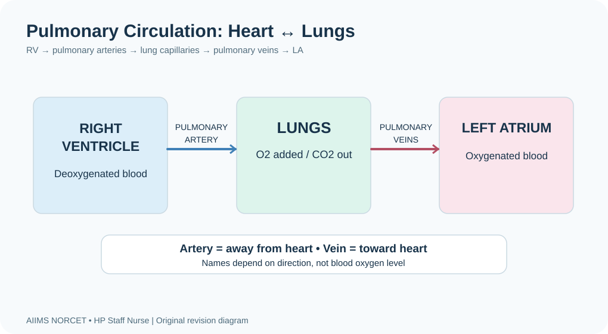
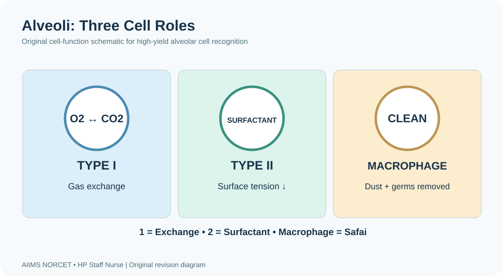
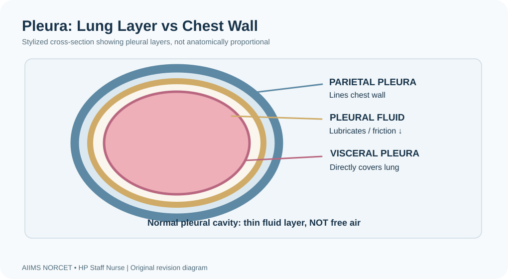
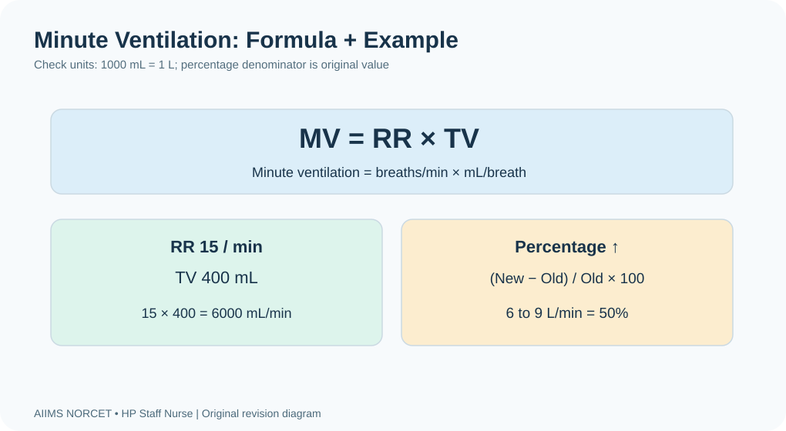

# Day 1 — Respiratory Anatomy & Physiology (40 Original English MCQs)

[🏠 Chapter](../README.md) · [📖 Day 1 Concepts](../Concepts/Day-01-Complete-Respiratory-Anatomy-Physiology.md) · [🎯 Final mock](Day-01-Final-Mock-15.md) · [🏥 Previous Year Questions](../Previous-Year-Questions/README.md)

> **Question wording policy:** All question stems and A/B/C/D options below are restored word-for-word from the original English questions previously authored in this repository. Answers, explanations and exam tips are in easy Hinglish. These are **original practice questions**, not verified past-examination questions.

### Solve kaise karna hai?

1. Pehle poora question aur options padhkar apna answer select karo.
2. Uske baad **✅ Answer aur easy explanation** expand karo.
3. Galti ho toh formula ya concept phir se revise karo.
4. Tumhare Day 1 ke weak areas **minute ventilation, lung volumes aur normal values** par special focus rakho.

---

## Airway aur conducting/respiratory zone

[📖 Is topic ka detailed explanation](../Concepts/Day-01-Complete-Respiratory-Anatomy-Physiology.md#3-conducting-zone-vs-respiratory-zone) · [📚 Previous Year Questions](../Previous-Year-Questions/README.md)

### Q1. Which structure is known as the voice box?

- **A.** Pharynx
- **B.** Larynx
- **C.** Trachea
- **D.** Bronchiole

✅ Answer aur easy explanation dekho

**B.** **Larynx** ko voice box kehte hain, kyunki ismein vocal folds hote hain. Pharynx air/food ka common passage hai.

**Baaki options kyun nahi?** Pharynx food + air ka passage hai, trachea windpipe hai, aur bronchiole chhoti airway hai. Inmein se voice produce karne ka specific organ **larynx** hai.

**🧠 NORCET / HP exam trick:** Voice box aur windpipe ko ek mat samajhna.

[📖 Poora concept phir se padho](../Concepts/Day-01-Complete-Respiratory-Anatomy-Physiology.md) · [🏥 Related Previous Year Questions](../Previous-Year-Questions/README.md)

### Q2. Which structure helps guard the laryngeal inlet when swallowing?

- **A.** Carina
- **B.** Uvula
- **C.** Epiglottis
- **D.** Trachea

✅ Answer aur easy explanation dekho

**C.** **Epiglottis** swallowing ke time laryngeal inlet ki protection mein help karta hai.

**Baaki options kyun nahi?** Carina trachea ke split hone ka point hai; uvula soft palate ka part, trachea windpipe. Inmein se **epiglottis** swallowing ke waqt laryngeal inlet ke protection mein participate karta hai.

**🧠 NORCET / HP exam trick:** Epiglottis airway ko protect karta hai, food digestion nahi.

[📖 Poora concept phir se padho](../Concepts/Day-01-Complete-Respiratory-Anatomy-Physiology.md) · [🏥 Related Previous Year Questions](../Previous-Year-Questions/README.md)

### Q3. Last structure of the conducting zone?

- **A.** Terminal bronchiole
- **B.** Respiratory bronchiole
- **C.** Alveolar duct
- **D.** Alveolar sac

✅ Answer aur easy explanation dekho

**A.** **Terminal bronchiole** conducting zone ka last part hai. Respiratory bronchiole se gas-exchange zone start hota hai.

**Baaki options kyun nahi?** Respiratory bronchiole se gas exchange shuru hota hai, alveolar duct aur alveolar sac iske baad aate hain. **Terminal bronchiole** abhi conducting passage ka hissa hai.

**🧠 NORCET / HP exam trick:** Terminal = conducting zone END.

[📖 Poora concept phir se padho](../Concepts/Day-01-Complete-Respiratory-Anatomy-Physiology.md) · [🏥 Related Previous Year Questions](../Previous-Year-Questions/README.md)

### Q4. Which is the first portion of the respiratory zone?

- **A.** Primary bronchus
- **B.** Terminal bronchiole
- **C.** Larynx
- **D.** Respiratory bronchiole

✅ Answer aur easy explanation dekho

**D.** **Respiratory bronchiole** respiratory zone ka first part hai. Terminal bronchiole abhi conducting zone mein hota hai.

**Baaki options kyun nahi?** Primary bronchus aur larynx air conduct karte hain; terminal bronchiole bhi conducting zone mein hai. **Respiratory bronchiole** ke walls par alveolar outpouchings se gas exchange ka chance shuru hota hai.

**🧠 NORCET / HP exam trick:** Question mein FIRST respiratory-zone part poochha ho toh D.

[📖 Poora concept phir se padho](../Concepts/Day-01-Complete-Respiratory-Anatomy-Physiology.md) · [🏥 Related Previous Year Questions](../Previous-Year-Questions/README.md)

### Q5. What is the main function of nasal passages in breathing?

- **A.** Producing surfactant
- **B.** Warming, filtering and humidifying air
- **C.** Transporting oxygenated blood
- **D.** Main alveolar gas exchange

✅ Answer aur easy explanation dekho

**B.** Nose air ko **warm, filter aur humidify** karta hai—yaani garam, clean aur moist banata hai.

**Baaki options kyun nahi?** Surfactant Type II alveolar cells banate hain, naak nahi. Oxygenated blood transport pulmonary vessels ka kaam hai, aur gas exchange lungs ke alveoli mein hota hai.

**🧠 NORCET / HP exam trick:** Nose ka role conditioning: warm + filter + humidify.

[📖 Poora concept phir se padho](../Concepts/Day-01-Complete-Respiratory-Anatomy-Physiology.md) · [🏥 Related Previous Year Questions](../Previous-Year-Questions/README.md)

---

## Lungs aur pulmonary circulation

[📖 Is topic ka detailed explanation](../Concepts/Day-01-Complete-Respiratory-Anatomy-Physiology.md#5-pulmonary-circulation) · [📚 Previous Year Questions](../Previous-Year-Questions/README.md)

### Q6. How many lobes does the healthy adult right lung have?

- **A.** Two
- **B.** Three
- **C.** Four
- **D.** One

✅ Answer aur easy explanation dekho

**B.** **Right lung = 3 lobes**. Left lung = 2 lobes. Ye NORCET ka favourite factual point hai.

**Baaki options kyun nahi?** Two lobes **left** lung ke hain, four aur one usual adult lungs ke lobe counts nahi. Right lung mein superior, middle aur inferior lobes hote hain.

**🧠 NORCET / HP exam trick:** Right 3 / Left 2 + left cardiac notch.

[📖 Poora concept phir se padho](../Concepts/Day-01-Complete-Respiratory-Anatomy-Physiology.md) · [🏥 Related Previous Year Questions](../Previous-Year-Questions/README.md)

### Q7. Which left-lung structure accommodates the heart?

- **A.** Horizontal fissure
- **B.** Carina
- **C.** Cardiac notch
- **D.** Tracheal ring

✅ Answer aur easy explanation dekho

**C.** **Cardiac notch** left lung mein heart ke liye jagah banata hai.

**Baaki options kyun nahi?** Horizontal fissure right lung se associated hai; carina tracheal bifurcation hai; tracheal ring airway support deta hai. **Cardiac notch** left lung ki heart-facing indentation hai.

**🧠 NORCET / HP exam trick:** Left = heart ke liye jagah.

[📖 Poora concept phir se padho](../Concepts/Day-01-Complete-Respiratory-Anatomy-Physiology.md) · [🏥 Related Previous Year Questions](../Previous-Year-Questions/README.md)

### Q8. An aspirated foreign body more commonly enters which main bronchus?

- **A.** Left
- **B.** Right
- **C.** Both equally
- **D.** Neither

✅ Answer aur easy explanation dekho

**B.** **Right main bronchus** relatively shorter, wider aur more vertical hota hai, isliye aspirated object is taraf zyada ja sakta hai.

**Baaki options kyun nahi?** Left main bronchus comparatively longer aur less vertical hota hai. Isliye typical adult aspiration question mein **right** choose karte hain, dono equally nahi.

**🧠 NORCET / HP exam trick:** Right: shorter + wider + more vertical.

[📖 Poora concept phir se padho](../Concepts/Day-01-Complete-Respiratory-Anatomy-Physiology.md) · [🏥 Related Previous Year Questions](../Previous-Year-Questions/README.md)

### Q9. Blood returning oxygenated from the lungs first enters which heart chamber?

- **A.** Right atrium
- **B.** Right ventricle
- **C.** Left ventricle
- **D.** Left atrium

✅ Answer aur easy explanation dekho

**D.** **Pulmonary veins → Left atrium**. Left ventricle uske baad aayega.

**Baaki options kyun nahi?** Right atrium systemic venous blood leta hai; right ventricle se blood lungs jaata hai; left ventricle mein blood left atrium ke baad aata hai. **Pulmonary veins pehle left atrium** mein open hoti hain.

**🧠 NORCET / HP exam trick:** Pathway: RV → lungs → LA.

[📖 Poora concept phir se padho](../Concepts/Day-01-Complete-Respiratory-Anatomy-Physiology.md) · [🏥 Related Previous Year Questions](../Previous-Year-Questions/README.md)

### Q10. Pulmonary arteries normally carry blood that is:

- **A.** Deoxygenated to the lungs
- **B.** Oxygenated to the body
- **C.** Oxygenated to the right atrium
- **D.** Deoxygenated to the left atrium

✅ Answer aur easy explanation dekho

**A.** Pulmonary arteries **deoxygenated blood** ko right ventricle se lungs tak le jaati hain.

**Baaki options kyun nahi?** Artery/vein ka naam **direction** se decide hota hai, O₂ se nahi. Pulmonary artery RV se lungs jaati hai; oxygenated pulmonary venous blood left atrium mein wapas aata hai.

**🧠 NORCET / HP exam trick:** Pulmonary circulation systemic circuit ki oxygen-label rule se different lag sakti hai.

[📖 Poora concept phir se padho](../Concepts/Day-01-Complete-Respiratory-Anatomy-Physiology.md) · [🏥 Related Previous Year Questions](../Previous-Year-Questions/README.md)

---

## Alveoli cells, gas exchange aur surfactant

[📖 Is topic ka detailed explanation](../Concepts/Day-01-Complete-Respiratory-Anatomy-Physiology.md#6-alveoli-aur-unke-3-important-cells) · [📚 Previous Year Questions](../Previous-Year-Questions/README.md)

### Q11. Which cell is the principal surfactant producer?

- **A.** Type I pneumocyte
- **B.** Type II pneumocyte
- **C.** Macrophage
- **D.** Capillary endothelial cell

✅ Answer aur easy explanation dekho

**B.** **Type II pneumocytes** surfactant banate hain. Type I gas exchange mein help karte hain.

**Baaki options kyun nahi?** Type I thin gas-exchange surface provide karta hai; macrophage germs clean karta hai; endothelial cells capillary wall ka part hain. **Type II** surfactant manufacture karta hai.

**🧠 NORCET / HP exam trick:** II = surfactant; I = exchange.

[📖 Poora concept phir se padho](../Concepts/Day-01-Complete-Respiratory-Anatomy-Physiology.md) · [🏥 Related Previous Year Questions](../Previous-Year-Questions/README.md)

### Q12. What is the main job of Type I pneumocytes?

- **A.** Produce mucus
- **B.** Fight infection by phagocytosis
- **C.** Provide thin gas-exchange surface
- **D.** Make surfactant

✅ Answer aur easy explanation dekho

**C.** **Type I pneumocytes** ek thin gas-exchange surface provide karte hain.

**Baaki options kyun nahi?** Mucus production mainly goblet cells jaise airway cells ka role hai; phagocytosis macrophages karte hain; surfactant Type II banate hain. **Type I** thin cell barrier se gas diffusion support karta hai.

**🧠 NORCET / HP exam trick:** Question cell-function match mein ek-ek role check karo.

[📖 Poora concept phir se padho](../Concepts/Day-01-Complete-Respiratory-Anatomy-Physiology.md) · [🏥 Related Previous Year Questions](../Previous-Year-Questions/README.md)

### Q13. Which cell engulfs inhaled microbes in alveoli?

- **A.** Alveolar macrophage
- **B.** Type I pneumocyte
- **C.** Type II pneumocyte
- **D.** Ciliated tracheal cell

✅ Answer aur easy explanation dekho

**A.** **Alveolar macrophages** phagocytosis ke through dust aur microbes clean karte hain.

**Baaki options kyun nahi?** Type I aur Type II pneumocytes primarily exchange/surfactant roles wale hain. Ciliated tracheal cells mucus clearance mein help karte hain, alveolar phagocytosis nahi. **Macrophages = scavenger/cleaning cell**.

**🧠 NORCET / HP exam trick:** Macrophages ko alveolar dust-cell bhi keh sakte hain.

[📖 Poora concept phir se padho](../Concepts/Day-01-Complete-Respiratory-Anatomy-Physiology.md) · [🏥 Related Previous Year Questions](../Previous-Year-Questions/README.md)

### Q14. Surfactant deficiency most directly leads to:

- **A.** Lower surface tension
- **B.** Higher surface tension and collapse tendency
- **C.** More alveolar oxygen production
- **D.** Expansion without effort

✅ Answer aur easy explanation dekho

**B.** Surfactant kam → **surface tension badhegi** → alveoli collapse ka risk badhega.

**Baaki options kyun nahi?** Surfactant normally tension **kam** karta hai. Deficiency se opposite hoga: tension **badhegi** aur collapse tendency badhegi. Oxygen production ya effortless expansion surfactant ka role nahi.

**🧠 NORCET / HP exam trick:** Premature newborn + surfactant deficiency = collapse risk.

[📖 Poora concept phir se padho](../Concepts/Day-01-Complete-Respiratory-Anatomy-Physiology.md) · [🏥 Related Previous Year Questions](../Previous-Year-Questions/README.md)

### Q15. Oxygen primarily crosses the alveolar–capillary membrane by:

- **A.** Osmosis
- **B.** Active transport
- **C.** Filtration
- **D.** Diffusion

✅ Answer aur easy explanation dekho

**D.** Oxygen aur CO₂ ka exchange mainly **diffusion** se hota hai.

**Baaki options kyun nahi?** **Osmosis** water movement ka term hai; filtration fluid/pressure-related process; active transport energy use karta hai. Alveolar respiratory gases partial pressure gradient se **diffuse** karte hain.

**🧠 NORCET / HP exam trick:** O₂ alveoli → blood; CO₂ blood → alveoli.

[📖 Poora concept phir se padho](../Concepts/Day-01-Complete-Respiratory-Anatomy-Physiology.md) · [🏥 Related Previous Year Questions](../Previous-Year-Questions/README.md)

---

## Pleura aur breathing mechanism

[📖 Is topic ka detailed explanation](../Concepts/Day-01-Complete-Respiratory-Anatomy-Physiology.md#8-pleura-aur-pleural-fluid) · [📚 Previous Year Questions](../Previous-Year-Questions/README.md)

### Q16. Which pleural layer directly touches lung surface?

- **A.** Parietal
- **B.** Visceral
- **C.** Pericardial
- **D.** Mucosal

✅ Answer aur easy explanation dekho

**B.** **Visceral pleura** lung ki surface ko directly cover karti hai. Parietal pleura chest cavity ko line karti hai.

**Baaki options kyun nahi?** Parietal pleura chest cavity ko line karti hai; pericardium heart ki covering hai. Lung surface se directly attached **visceral pleura** hai.

**🧠 NORCET / HP exam trick:** Visceral = lung; parietal = chest wall.

[📖 Poora concept phir se padho](../Concepts/Day-01-Complete-Respiratory-Anatomy-Physiology.md) · [🏥 Related Previous Year Questions](../Previous-Year-Questions/README.md)

### Q17. What does pleural fluid primarily do?

- **A.** Create air pressure
- **B.** Make surfactant
- **C.** Reduce friction
- **D.** Carry oxygen

✅ Answer aur easy explanation dekho

**C.** Pleural fluid **friction kam** karta hai taaki breathing mein pleural layers smoothly slide kar sakein.

**Baaki options kyun nahi?** Surfactant alveolar Type II cells produce karti hain, pleural fluid nahi. Pleural fluid blood mein oxygen transport bhi nahi karta. Ye pleural surfaces ko **lubricate** karke rubbing kam karta hai.

**🧠 NORCET / HP exam trick:** Pleural fluid ≠ alveolar surfactant.

[📖 Poora concept phir se padho](../Concepts/Day-01-Complete-Respiratory-Anatomy-Physiology.md) · [🏥 Related Previous Year Questions](../Previous-Year-Questions/README.md)

### Q18. During quiet inspiration, the diaphragm:

- **A.** Contracts and descends
- **B.** Relaxes and ascends
- **C.** Contracts and ascends
- **D.** Remains stationary

✅ Answer aur easy explanation dekho

**A.** Diaphragm **contract karke neeche** jaata hai, thoracic volume badhta hai aur air andar aati hai.

**Baaki options kyun nahi?** Relaxation/ascending diaphragm expiration se linked hai. Quiet inspiration mein diaphragm **contract karke flatten/descend** hota hai; chest volume badhne se air enter karti hai.

**🧠 NORCET / HP exam trick:** IN → diaphragm DOWN → volume UP.

[📖 Poora concept phir se padho](../Concepts/Day-01-Complete-Respiratory-Anatomy-Physiology.md) · [🏥 Related Previous Year Questions](../Previous-Year-Questions/README.md)

### Q19. Quiet expiration in a resting adult is usually:

- **A.** A forceful abdominal contraction
- **B.** Caused by diaphragm contraction
- **C.** Impossible without coughing
- **D.** Passive due to elastic recoil

✅ Answer aur easy explanation dekho

**D.** Quiet expiration normally **passive** hoti hai: inspiratory muscles relax aur elastic recoil air ko bahar nikalte hain.

**Baaki options kyun nahi?** Abdominal muscles usually **forced** expiration mein important hoti hain; quiet expiration diaphragm contraction ya coughing se nahi. At rest elastic recoil + relaxation se air bahar nikalti hai.

**🧠 NORCET / HP exam trick:** Quiet expiration passive; forced expiration active ho sakti hai.

[📖 Poora concept phir se padho](../Concepts/Day-01-Complete-Respiratory-Anatomy-Physiology.md) · [🏥 Related Previous Year Questions](../Previous-Year-Questions/README.md)

### Q20. The main diaphragm motor nerve arises from:

- **A.** T1–T3
- **B.** C3–C5
- **C.** T8–T12
- **D.** L1–L3

✅ Answer aur easy explanation dekho

**B.** **Phrenic nerve C3–C5** se aati hai. Memory: C3, 4, 5 keep the diaphragm alive.

**Baaki options kyun nahi?** T1–T3, T8–T12 aur L1–L3 diaphragm ki main phrenic motor roots nahi hain. **C3, C4, C5** motor supply deti hain.

**🧠 NORCET / HP exam trick:** C3–C5 keeps the diaphragm alive.

[📖 Poora concept phir se padho](../Concepts/Day-01-Complete-Respiratory-Anatomy-Physiology.md) · [🏥 Related Previous Year Questions](../Previous-Year-Questions/README.md)

---

## Lung volumes aur capacities

[📖 Is topic ka detailed explanation](../Concepts/Day-01-Complete-Respiratory-Anatomy-Physiology.md#10-lung-volumes-aur-capacities) · [📚 Previous Year Questions](../Previous-Year-Questions/README.md)

### Q21. What remains after maximal forced expiration?

- **A.** TV
- **B.** IRV
- **C.** RV
- **D.** ERV

✅ Answer aur easy explanation dekho

**C.** Wo **Residual Volume (RV)** hai. RV ko voluntarily aur bahar nahi nikal sakte.

**Baaki options kyun nahi?** TV normal breath ka volume, IRV extra inhalation aur ERV extra expiration hai. Maximum expiration ke baad jo bhi permanently bachi air hai wahi **RV** hai.

**🧠 NORCET / HP exam trick:** RV cannot be voluntarily exhaled.

[📖 Poora concept phir se padho](../Concepts/Day-01-Complete-Respiratory-Anatomy-Physiology.md) · [🏥 Related Previous Year Questions](../Previous-Year-Questions/README.md)

### Q22. What remains after a normal quiet expiration?

- **A.** VC
- **B.** FRC
- **C.** IRV
- **D.** IC

✅ Answer aur easy explanation dekho

**B.** **Functional Residual Capacity (FRC)**. Formula: **FRC = ERV + RV**.

**Baaki options kyun nahi?** VC maximum movable air; IRV extra inspired air; IC inhaled capacity hai. Normal quiet expiration ke baad total **ERV + RV = FRC** remains.

**🧠 NORCET / HP exam trick:** Normal OUT = FRC; forced MAX OUT = RV.

[📖 Poora concept phir se padho](../Concepts/Day-01-Complete-Respiratory-Anatomy-Physiology.md) · [🏥 Related Previous Year Questions](../Previous-Year-Questions/README.md)

### Q23. If IC = 3450 mL and TV = 500 mL, IRV equals:

- **A.** 3950
- **B.** 2950
- **C.** 2450
- **D.** 3450

✅ Answer aur easy explanation dekho

**B.** IC = TV + IRV. IRV = 3450 − 500 = **2950 mL**.

**Baaki options kyun nahi?** IC = TV + IRV. Isliye IRV ke liye addition nahi, **subtraction** karna hai: 3450−500 = 2950. 3950 mL galti se add karne par aata hai.

**🧠 NORCET / HP exam trick:** Total se known component minus karo.

[📖 Poora concept phir se padho](../Concepts/Day-01-Complete-Respiratory-Anatomy-Physiology.md) · [🏥 Related Previous Year Questions](../Previous-Year-Questions/README.md)

### Q24. If VC = 4400 mL, ERV = 900 mL and TV = 500 mL, IRV equals:

- **A.** 3000
- **B.** 3400
- **C.** 3900
- **D.** 2500

✅ Answer aur easy explanation dekho

**A.** VC = IRV + TV + ERV. IRV = 4400 − 500 − 900 = **3000 mL**.

**Baaki options kyun nahi?** VC = IRV + TV + ERV. TV aur ERV **dono** subtract karne honge: 4400−(500+900)=3000. Sirf ek component minus karne se answer wrong aayega.

**🧠 NORCET / HP exam trick:** VC mein RV include nahi hota.

[📖 Poora concept phir se padho](../Concepts/Day-01-Complete-Respiratory-Anatomy-Physiology.md) · [🏥 Related Previous Year Questions](../Previous-Year-Questions/README.md)

### Q25. If TLC = 5900 mL and IC = 3600 mL, FRC equals:

- **A.** 1300
- **B.** 3600
- **C.** 2300
- **D.** 9500

✅ Answer aur easy explanation dekho

**C.** TLC = IC + FRC. FRC = 5900 − 3600 = **2300 mL**.

**Baaki options kyun nahi?** TLC = IC + FRC. Isliye FRC = **5900−3600 = 2300 mL**. 9500 mL add karne wali common error hai; yaad karo question missing capacity maang raha hai.

**🧠 NORCET / HP exam trick:** IC + FRC = TLC; capacity formula memorize karo.

[📖 Poora concept phir se padho](../Concepts/Day-01-Complete-Respiratory-Anatomy-Physiology.md) · [🏥 Related Previous Year Questions](../Previous-Year-Questions/README.md)

---

## Minute ventilation numericals

[📖 Is topic ka detailed explanation](../Concepts/Day-01-Complete-Respiratory-Anatomy-Physiology.md#11-minute-ventilation-numericals) · [📚 Previous Year Questions](../Previous-Year-Questions/README.md)

### Q26. RR 17/min and TV 400 mL. MV is:

- **A.** 6.8 L/min
- **B.** 7.2 L/min
- **C.** 5.8 L/min
- **D.** 8.0 L/min

✅ Answer aur easy explanation dekho

**A.** MV = RR × TV = 17 × 400 = **6800 mL/min = 6.8 L/min**.

**Baaki options kyun nahi?** RR ka unit breaths/min aur TV ka unit mL/breath hai; multiplication se **mL/min** aayega. 17×400=6800 mL/min, phir 1000 se divide = 6.8 L/min.

**🧠 NORCET / HP exam trick:** Unit conversion chhodi toh answer galat ho sakta hai.

[📖 Poora concept phir se padho](../Concepts/Day-01-Complete-Respiratory-Anatomy-Physiology.md) · [🏥 Related Previous Year Questions](../Previous-Year-Questions/README.md)

### Q27. MV is 8.1 L/min and TV is 450 mL. RR is:

- **A.** 15/min
- **B.** 16/min
- **C.** 18/min
- **D.** 20/min

✅ Answer aur easy explanation dekho

**C.** Pehle 8.1 L ko 8100 mL banao. RR = MV ÷ TV = 8100 ÷ 450 = **18/min**.

**Baaki options kyun nahi?** Pehle **8.1 L = 8100 mL** banao. Fir RR = MV/TV = 8100/450=18/min. 8.1 ko 450 se direct divide karna unit mistake hogi.

**🧠 NORCET / HP exam trick:** RR nikalna ho → MV ÷ TV.

[📖 Poora concept phir se padho](../Concepts/Day-01-Complete-Respiratory-Anatomy-Physiology.md) · [🏥 Related Previous Year Questions](../Previous-Year-Questions/README.md)

### Q28. MV is 7.2 L/min and RR is 16/min. TV is:

- **A.** 350 mL
- **B.** 400 mL
- **C.** 450 mL
- **D.** 500 mL

✅ Answer aur easy explanation dekho

**C.** 7.2 L = 7200 mL. TV = MV ÷ RR = 7200 ÷ 16 = **450 mL**.

**Baaki options kyun nahi?** MV 7.2 L/min = **7200 mL/min**. TV = 7200/16 = 450 mL/breath. TV ka final unit mL/breath hona chahiye, breaths/min nahi.

**🧠 NORCET / HP exam trick:** TV nikalna ho → MV ÷ RR.

[📖 Poora concept phir se padho](../Concepts/Day-01-Complete-Respiratory-Anatomy-Physiology.md) · [🏥 Related Previous Year Questions](../Previous-Year-Questions/README.md)

### Q29. Before: RR 10, TV 600; after: RR 15, TV 400. Change in MV?

- **A.** Increase by 2 L/min
- **B.** Decrease by 1 L/min
- **C.** Increase by 1 L/min
- **D.** No change

✅ Answer aur easy explanation dekho

**D.** Before: 10 × 600 = **6000**. After: 15 × 400 = **6000 mL/min**. Isliye **no change**.

**Baaki options kyun nahi?** Before 10×600 = 6000, after 15×400 = 6000 mL/min. RR badha lekin TV utna hi kam hua ki total air per minute same raha. Bas RR dekhkar conclusion mat nikalo.

**🧠 NORCET / HP exam trick:** Before aur after MV dono calculate karo.

[📖 Poora concept phir se padho](../Concepts/Day-01-Complete-Respiratory-Anatomy-Physiology.md) · [🏥 Related Previous Year Questions](../Previous-Year-Questions/README.md)

### Q30. MV rises from 6 L/min to 7.5 L/min. Percent increase?

- **A.** 15%
- **B.** 20%
- **C.** 25%
- **D.** 30%

✅ Answer aur easy explanation dekho

**C.** (New − Old)/Old × 100 = (7.5 − 6)/6 × 100 = **25%**.

**Baaki options kyun nahi?** Change = **7.5−6 = 1.5 L/min**. Percentage = 1.5 / **6 (old)** ×100 = 25%. New 7.5 se divide karoge toh 20% galat result aayega.

**🧠 NORCET / HP exam trick:** Percentage change mein old denominator.

[📖 Poora concept phir se padho](../Concepts/Day-01-Complete-Respiratory-Anatomy-Physiology.md) · [🏥 Related Previous Year Questions](../Previous-Year-Questions/README.md)

---

## Normal adult respiratory values

[📖 Is topic ka detailed explanation](../Concepts/Day-01-Complete-Respiratory-Anatomy-Physiology.md#12-normal-respiratory-values) · [📚 Previous Year Questions](../Previous-Year-Questions/README.md)

### Q31. Which value is outside usual normal arterial pH range?

- **A.** 7.38
- **B.** 7.42
- **C.** 7.46
- **D.** 7.40

✅ Answer aur easy explanation dekho

**C.** Usual pH range **7.35–7.45** hai, isliye **7.46** high hai.

**Baaki options kyun nahi?** pH normal range 7.35–7.45 hai. 7.38, 7.42 aur 7.40 andar aate hain. **7.46** upper limit se upar hai. Word **outside** ko notice karo.

**🧠 NORCET / HP exam trick:** Normal vs abnormal MCQ mein question wording twice padho.

[📖 Poora concept phir se padho](../Concepts/Day-01-Complete-Respiratory-Anatomy-Physiology.md) · [🏥 Related Previous Year Questions](../Previous-Year-Questions/README.md)

### Q32. Which is a normal resting adult RR?

- **A.** 9/min
- **B.** 16/min
- **C.** 24/min
- **D.** 28/min

✅ Answer aur easy explanation dekho

**B.** RR **16/min** common adult resting range **12–20/min** ke andar hai.

**Baaki options kyun nahi?** 9/min slow hai; 24/min aur 28/min adult rest range se fast hain. **16/min** 12–20 ke beech hai. Exercise/fever ya age se RR change ho sakta hai.

**🧠 NORCET / HP exam trick:** Adult **resting** context yaad rakho.

[📖 Poora concept phir se padho](../Concepts/Day-01-Complete-Respiratory-Anatomy-Physiology.md) · [🏥 Related Previous Year Questions](../Previous-Year-Questions/README.md)

### Q33. Which value is within usual PaCO₂ reference range?

- **A.** 31 mmHg
- **B.** 48 mmHg
- **C.** 52 mmHg
- **D.** 39 mmHg

✅ Answer aur easy explanation dekho

**D.** **39 mmHg** common normal range ke andar hai.

**Baaki options kyun nahi?** 31 mmHg normal se neeche, 48 aur 52 upar hain. **39 mmHg** usual 35–45 range mein hai. CO₂ ko pH ya PaO₂ ki range se confuse mat karna.

**🧠 NORCET / HP exam trick:** PaCO₂ 35–45 mmHg.

[📖 Poora concept phir se padho](../Concepts/Day-01-Complete-Respiratory-Anatomy-Physiology.md) · [🏥 Related Previous Year Questions](../Previous-Year-Questions/README.md)

### Q34. For healthy adults near sea level, which SpO₂ is within usual exam range?

- **A.** 87%
- **B.** 91%
- **C.** 93%
- **D.** 98%

✅ Answer aur easy explanation dekho

**D.** **98%** common healthy sea-level SpO₂ reference range **95–100%** mein aata hai.

**Baaki options kyun nahi?** 87%, 91% aur 93% typical healthy adult near-sea-level teaching range se neeche hain; **98%** 95–100 mein aata hai. Altitude aur clinical targets alag ho sakte hain.

**🧠 NORCET / HP exam trick:** SpO₂ (%) vs PaO₂ (mmHg) differentiate karo.

[📖 Poora concept phir se padho](../Concepts/Day-01-Complete-Respiratory-Anatomy-Physiology.md) · [🏥 Related Previous Year Questions](../Previous-Year-Questions/README.md)

### Q35. SpO₂ 97% means PaO₂ must be exactly 97 mmHg.

- **A.** True
- **B.** False
- **C.** Always if breathing normally
- **D.** Only after exercise

✅ Answer aur easy explanation dekho

**B.** **Nahi.** SpO₂ saturation **percentage** hai, PaO₂ oxygen **pressure** in mmHg. Dono same cheez nahi hain.

**Baaki options kyun nahi?** SpO₂ hemoglobin ki oxygen saturation percent hai; PaO₂ dissolved O₂ pressure mmHg hai. Dono physiology se linked hain lekin same scale nahi, isliye 97 aur 97 equal hona zaroori nahi.

**🧠 NORCET / HP exam trick:** Units samajhkar question solve karo.

[📖 Poora concept phir se padho](../Concepts/Day-01-Complete-Respiratory-Anatomy-Physiology.md) · [🏥 Related Previous Year Questions](../Previous-Year-Questions/README.md)

---

## Extra 5 practice MCQs — Day 1 ke wahi concepts

[📖 Is topic ka detailed explanation](../Concepts/Day-01-Complete-Respiratory-Anatomy-Physiology.md#7-surfactant-aur-deficiency) · [📚 Previous Year Questions](../Previous-Year-Questions/README.md)

These five newer questions use the **same Day 1 concepts**, including the calculation mistakes revised during practice. They are not claimed to be previous-year NORCET questions.

### Q36. A student sees TLC 5.4 L and VC 4.1 L on a report. Which lung volume is 1.3 L?

- **A.** Expiratory reserve volume
- **B.** Tidal volume
- **C.** Residual volume
- **D.** Inspiratory reserve volume

💡 Hint (answer-neutral)

Maximum inspiration ke baad total air aur voluntarily exhale ho sakne wali air ka difference socho.

✅ Answer aur easy explanation dekho

**C.** TLC = VC + RV. RV = 5.4 − 4.1 = **1.3 L**. Yahi residual volume hai.

**Baaki options kyun nahi?** TLC = VC + RV. Difference **5.4−4.1=1.3 L** RV hai. ERV, TV aur IRV VC ka part hain, lekin TLC aur VC ka difference specifically residual volume hai.

**🧠 NORCET / HP exam trick:** TLC−VC = RV.

[📖 Poora concept phir se padho](../Concepts/Day-01-Complete-Respiratory-Anatomy-Physiology.md) · [🏥 Related Previous Year Questions](../Previous-Year-Questions/README.md)

### Q37. A patient breathes 15 times/min. To maintain MV 6.6 L/min, what must TV be?

- **A.** 330 mL
- **B.** 400 mL
- **C.** 440 mL
- **D.** 550 mL

💡 Hint (answer-neutral)

Pehle litres ko millilitres mein convert karo, phir MV ko RR se divide karo.

✅ Answer aur easy explanation dekho

**C.** 6.6 L = 6600 mL. TV = 6600 ÷ 15 = **440 mL/breath**.

**Baaki options kyun nahi?** MV fixed 6.6 L = **6600 mL/min**. RR 15/min hai, TV = 6600/15=**440 mL**. RR aur TV multiply hote hain; TV nikalne ke liye divide karna hai.

**🧠 NORCET / HP exam trick:** Same MV maintain = RR × TV same.

[📖 Poora concept phir se padho](../Concepts/Day-01-Complete-Respiratory-Anatomy-Physiology.md) · [🏥 Related Previous Year Questions](../Previous-Year-Questions/README.md)

### Q38. Total minute ventilation increases from 7.2 L/min to 9.0 L/min. What is the percentage increase?

- **A.** 20%
- **B.** 25%
- **C.** 30%
- **D.** 40%

💡 Hint (answer-neutral)

Percentage increase mein denominator hamesha **old MV** hoti hai.

✅ Answer aur easy explanation dekho

**B.** Difference 1.8 L. Percentage increase = 1.8 ÷ **7.2 (old)** × 100 = **25%**.

**Baaki options kyun nahi?** New−old = 9.0−7.2 = 1.8 L/min. 1.8/7.2×100=**25%**. 1.8/9×100 = 20% aata hai, par new denominator wrong hai.

**🧠 NORCET / HP exam trick:** Percent increase: Old MV base.

[📖 Poora concept phir se padho](../Concepts/Day-01-Complete-Respiratory-Anatomy-Physiology.md) · [🏥 Related Previous Year Questions](../Previous-Year-Questions/README.md)

### Q39. After a quiet normal expiration, which statement is correct?

- **A.** Only residual volume remains in the lungs
- **B.** Functional residual capacity remains in the lungs
- **C.** No air remains in the lungs
- **D.** Vital capacity equals the remaining air

💡 Hint (answer-neutral)

Question mein **normal expiration** likha hai, maximum forced expiration nahi.

✅ Answer aur easy explanation dekho

**B.** Normal expiration ke baad **FRC** bachi rehti hai. Maximum forced expiration ke baad **RV** bachi rehti hai.

**Baaki options kyun nahi?** After quiet expiration **FRC** remains, jo **ERV + RV** hota hai. ‘Only RV’ maximum forced expiration ka endpoint hai; lungs normal breathing mein completely empty nahi hote.

**🧠 NORCET / HP exam trick:** Question ke **normal** aur **maximal** words underline karo.

[📖 Poora concept phir se padho](../Concepts/Day-01-Complete-Respiratory-Anatomy-Physiology.md) · [🏥 Related Previous Year Questions](../Previous-Year-Questions/README.md)

### Q40. A healthy young adult at sea level has RR 18/min, SpO₂ 98%, PaCO₂ 41 mmHg and pH 7.47. Which measurement is outside the common textbook reference interval?

- **A.** RR
- **B.** SpO₂
- **C.** PaCO₂
- **D.** Arterial pH

💡 Hint (answer-neutral)

Har value ko apne normal reference range se compare karo. **Outside** padhkar answer dena.

✅ Answer aur easy explanation dekho

**D.** **pH 7.47**, usual upper limit **7.45** se zyada hai. Baaki common near-sea-level reference ranges mein hain.

**Baaki options kyun nahi?** RR 18, SpO₂ 98%, PaCO₂ 41 usual textbook range mein hain, lekin pH **7.47** range **7.35–7.45** se above hai. Isliye D choose karoge. Ye exam reference check hai, diagnosis nahi.

**🧠 NORCET / HP exam trick:** Har value ko apni unit aur range se compare karo.

[📖 Poora concept phir se padho](../Concepts/Day-01-Complete-Respiratory-Anatomy-Physiology.md) · [🏥 Related Previous Year Questions](../Previous-Year-Questions/README.md)

---

[📖 Day 1 ke notes phir se padho](../Concepts/Day-01-Complete-Respiratory-Anatomy-Physiology.md)

---

**🔗 Aage navigate karo:** [🏠 Chapter](../README.md) · [📖 Day 1 Concepts](../Concepts/Day-01-Complete-Respiratory-Anatomy-Physiology.md) · [🎯 Final mock](Day-01-Final-Mock-15.md) · [🏥 Previous Year Questions](../Previous-Year-Questions/README.md)
