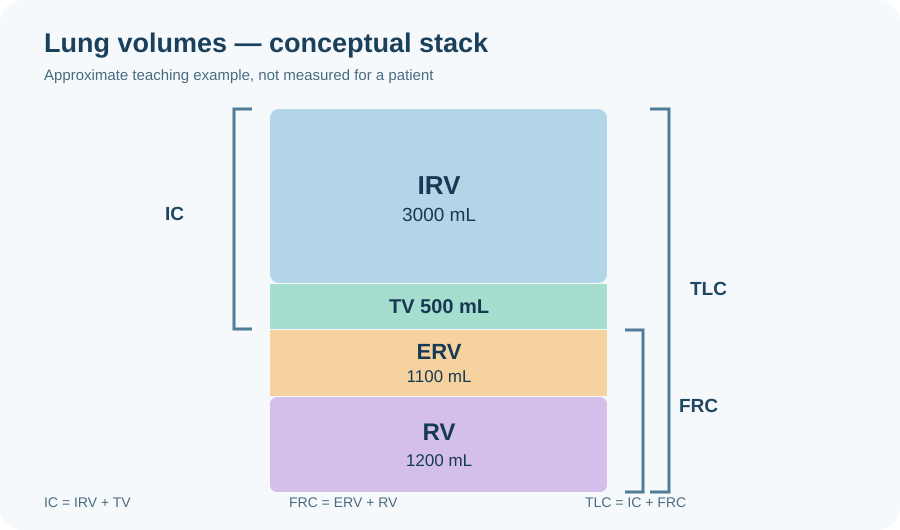
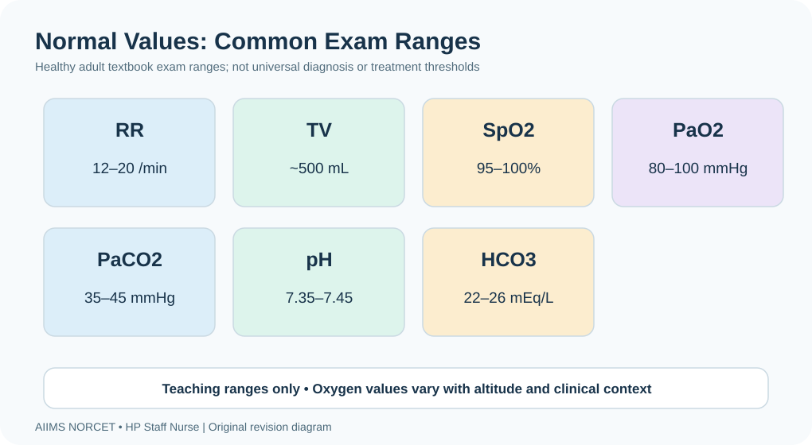
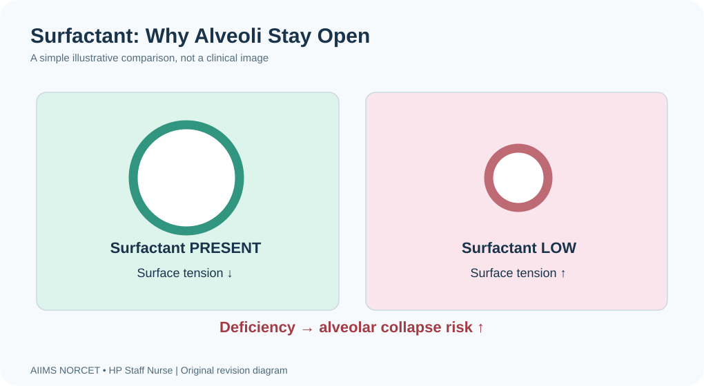

# 📝 Day 1 — Respiratory Anatomy & Physiology: 44 Practice MCQ slots (including revision overlaps)

[🏠 Chapter](../README.md) · [📖 Day 1 Concepts](../Concepts/Day-01-Complete-Respiratory-Anatomy-Physiology.md) · [🎯 Final mock](Day-01-Final-Mock-15.md) · [🏥 Previous Year Questions](../Previous-Year-Questions/README.md)

> **Dhyan de:** Sawaal aur A/B/C/D options original English mein hain. Answer ki explanation easy Hinglish mein hai. Ye practice questions hain, actual Previous Year Questions nahi. Pehle solve kiye hue stems/options aur status preserve kiye gaye hain. Revision overlap ko unique authorship mein double-count mat karo.

## 🎬 YouTube se concept aur MCQ practice

**Dhyan de:** Neeche actual topic-related videos ke links hain. Ye official past paper ki proof nahi hain; video descriptions ke basis par select kiye hain.

- **Concept video:** [Bhushan Science Nursing — Respiratory full chapter](https://www.youtube.com/watch?v=g6top1bzdUg)
- **MCQ practice:** [Dear Competitive Exams — Respiration Physiology MCQs](https://youtu.be/nLSz8qI5Pgo)
- [Day 1 ke har topic ke concept + video links](../Concepts/Day-01-Complete-Respiratory-Anatomy-Physiology.md). [Aarogyam Infinity Part 27 respiratory MCQs](https://www.youtube.com/watch?v=lAy0Cb9o5ss) — published description covers conducting zone, lung lobes, breathing muscles, gas exchange and lung volumes. Q1–30 and Q41–44 topic-level practice, exact item matches pending. Doosre [mixed respiratory MCQs](https://www.youtube.com/watch?v=_dOjXZ6vCck) mein unstudied advanced topics skip karo.

### Kaise solve karna hai?

1. Pehle poora question aur options padhkar apna answer select karo.
2. Uske baad **✅ Answer aur easy explanation** expand karo.
3. Galti ho toh formula ya concept phir se revise karo.
4. Tumhare Day 1 ke weak areas **minute ventilation, lung volumes aur normal values** par special focus rakho.

---

## Airway aur conducting/respiratory zone

[📖 Is topic ka detailed explanation](../Concepts/Day-01-Complete-Respiratory-Anatomy-Physiology.md#3-conducting-zone-vs-respiratory-zone) · [📚 Previous Year Questions](../Previous-Year-Questions/README.md)

### Q1. Which structure is known as the voice box?

- **A.** Pharynx
- **B.** Larynx
- **C.** Trachea
- **D.** Bronchiole

**Difficulty:** 🟢 Easy · **Priority:** 🟡 IMPORTANT · NORCET / Staff Nurse (All India)

✅ Answer aur easy explanation dekho

**Correct answer: B. Larynx**

**Kyun sahi hai?** Larynx mein vocal folds hote hain. Inki vibration se voice generate hoti hai.

**Baaki options kyun galat hain?**

- **A.** Pharynx air aur food ka passage hai.
- **C.** Trachea air ko lungs ki taraf conduct karti hai.
- **D.** Bronchiole chhoti airway hai, voice organ nahi.

**Exam trick:** Voice box aur windpipe ko ek mat samajhna.

[Clinical reference 1](https://openstax.org/books/anatomy-and-physiology-2e/pages/22-1-organs-and-structures-of-the-respiratory-system)

[📖 Poora concept phir se padho](../Concepts/Day-01-Complete-Respiratory-Anatomy-Physiology.md) · [🏥 Related Previous Year Questions](../Previous-Year-Questions/README.md)

### Q2. Which structure helps guard the laryngeal inlet when swallowing?

- **A.** Carina
- **B.** Uvula
- **C.** Epiglottis
- **D.** Trachea

**Difficulty:** 🟢 Easy · **Priority:** 🟠 HIGH YIELD · NORCET / Staff Nurse (All India)

✅ Answer aur easy explanation dekho

**Correct answer: C. Epiglottis**

**Kyun sahi hai?** Swallowing ke time epiglottis laryngeal inlet ko cover karne mein help karti hai. Airway protection mein vocal fold closure aur swallowing coordination bhi important hain.

**Baaki options kyun galat hain?**

- **A.** Carina trachea ki bifurcation hai.
- **B.** Uvula soft palate ka part hai.
- **D.** Trachea air passage hai, laryngeal inlet ko guard karne wali flap nahi.

**Exam trick:** Epiglottis airway ko protect karta hai, food digestion nahi.

[Clinical reference 1](https://openstax.org/books/anatomy-and-physiology-2e/pages/22-1-organs-and-structures-of-the-respiratory-system)

[📖 Poora concept phir se padho](../Concepts/Day-01-Complete-Respiratory-Anatomy-Physiology.md) · [🏥 Related Previous Year Questions](../Previous-Year-Questions/README.md)

### Q3. Last structure of the conducting zone?

- **A.** Terminal bronchiole
- **B.** Respiratory bronchiole
- **C.** Alveolar duct
- **D.** Alveolar sac

**Difficulty:** 🟢 Easy · **Priority:** 🟠 HIGH YIELD · NORCET / Staff Nurse (All India)

✅ Answer aur easy explanation dekho

**Correct answer: A. Terminal bronchiole**

**Kyun sahi hai?** Terminal bronchiole conducting zone ka aakhri segment hai. Iske baad respiratory bronchiole se respiratory zone shuru hota hai.

**Baaki options kyun galat hain?**

- **B.** Respiratory bronchiole mein gas exchange shuru ho sakta hai.
- **C.** Alveolar duct respiratory zone mein hai.
- **D.** Alveolar sac gas-exchanging alveoli ka cluster hai.

**Exam trick:** Terminal = conducting zone END.

[Clinical reference 1](https://openstax.org/books/anatomy-and-physiology-2e/pages/22-1-organs-and-structures-of-the-respiratory-system)

[📖 Poora concept phir se padho](../Concepts/Day-01-Complete-Respiratory-Anatomy-Physiology.md) · [🏥 Related Previous Year Questions](../Previous-Year-Questions/README.md)

### Q4. Which is the first portion of the respiratory zone?

- **A.** Primary bronchus
- **B.** Terminal bronchiole
- **C.** Larynx
- **D.** Respiratory bronchiole

**Difficulty:** 🟢 Easy · **Priority:** 🟠 HIGH YIELD · NORCET / Staff Nurse (All India) · Revision overlap

✅ Answer aur easy explanation dekho

**Correct answer: D. Respiratory bronchiole**

**Kyun sahi hai?** Respiratory bronchiole respiratory zone ka first part hai. Iski walls mein alveoli hoti hain jahan gas exchange possible hai.

**Baaki options kyun galat hain?**

- **A.** Primary bronchus air conduct karta hai.
- **B.** Terminal bronchiole conducting zone ka last part hai.
- **C.** Larynx conducting airway aur voice production mein involved hai.

**Exam trick:** Respiratory bronchiole se respiratory zone shuru hota hai.

[Clinical reference 1](https://openstax.org/books/anatomy-and-physiology-2e/pages/22-1-organs-and-structures-of-the-respiratory-system)

**Revision mapping:** Q3 complementary recall. Retained for learner history. Do not count as a new unique question without semantic reconciliation.

[📖 Poora concept phir se padho](../Concepts/Day-01-Complete-Respiratory-Anatomy-Physiology.md) · [🏥 Related Previous Year Questions](../Previous-Year-Questions/README.md)

### Q5. What is the main function of nasal passages in breathing?

- **A.** Producing surfactant
- **B.** Warming, filtering and humidifying air
- **C.** Transporting oxygenated blood
- **D.** Main alveolar gas exchange

**Difficulty:** 🟢 Easy · **Priority:** 🟡 IMPORTANT · NORCET / Staff Nurse (All India)

✅ Answer aur easy explanation dekho

**Correct answer: B. Warming, filtering and humidifying air**

**Kyun sahi hai?** Nasal passages incoming air ko warm aur moist karti hain aur particles trap karne mein help karti hain. Isse lower airways ko conditioning milti hai.

**Baaki options kyun galat hain?**

- **A.** Surfactant mainly Type II pneumocytes banate hain.
- **C.** Blood transport vessels ka function hai.
- **D.** Main gas exchange alveoli mein hota hai.

**Exam trick:** Nose ka role conditioning: warm + filter + humidify.

[Clinical reference 1](https://openstax.org/books/anatomy-and-physiology-2e/pages/22-1-organs-and-structures-of-the-respiratory-system)

[📖 Poora concept phir se padho](../Concepts/Day-01-Complete-Respiratory-Anatomy-Physiology.md) · [🏥 Related Previous Year Questions](../Previous-Year-Questions/README.md)

---

## Lungs aur pulmonary circulation

[📖 Is topic ka detailed explanation](../Concepts/Day-01-Complete-Respiratory-Anatomy-Physiology.md#5-pulmonary-circulation) · [📚 Previous Year Questions](../Previous-Year-Questions/README.md)

### Q6. How many lobes does the healthy adult right lung have?

- **A.** Two
- **B.** Three
- **C.** Four
- **D.** One

**Difficulty:** 🟢 Easy · **Priority:** 🟡 IMPORTANT · NORCET / Staff Nurse (All India)

✅ Answer aur easy explanation dekho

**Correct answer: B. Three**

**Kyun sahi hai?** Healthy adult right lung mein superior, middle aur inferior lobes hote hain. Left lung mein do lobes hote hain.

**Baaki options kyun galat hain?**

- **A.** Two left lung ka usual count hai.
- **C.** Four usual right lung lobe count nahi hai.
- **D.** One bhi usual right lung count nahi hai.

**Exam trick:** Right 3 / Left 2 + left cardiac notch.

[Clinical reference 1](https://openstax.org/books/anatomy-and-physiology-2e/pages/22-2-the-lungs)

[📖 Poora concept phir se padho](../Concepts/Day-01-Complete-Respiratory-Anatomy-Physiology.md) · [🏥 Related Previous Year Questions](../Previous-Year-Questions/README.md)

### Q7. Which left-lung structure accommodates the heart?

- **A.** Horizontal fissure
- **B.** Carina
- **C.** Cardiac notch
- **D.** Tracheal ring

**Difficulty:** 🟢 Easy · **Priority:** 🟡 IMPORTANT · NORCET / Staff Nurse (All India)

✅ Answer aur easy explanation dekho

**Correct answer: C. Cardiac notch**

**Kyun sahi hai?** Cardiac notch left lung ke anterior border ki indentation hai jo heart ke liye space provide karti hai.

**Baaki options kyun galat hain?**

- **A.** Horizontal fissure right lung mein hoti hai.
- **B.** Carina tracheal bifurcation hai.
- **D.** Tracheal ring trachea ko support karti hai.

**Exam trick:** Left = heart ke liye jagah.

[Clinical reference 1](https://openstax.org/books/anatomy-and-physiology-2e/pages/22-2-the-lungs)

[📖 Poora concept phir se padho](../Concepts/Day-01-Complete-Respiratory-Anatomy-Physiology.md) · [🏥 Related Previous Year Questions](../Previous-Year-Questions/README.md)

### Q8. An aspirated foreign body more commonly enters which main bronchus?

- **A.** Left
- **B.** Right
- **C.** Both equally
- **D.** Neither

**Difficulty:** 🟡 Medium · **Priority:** 🟠 HIGH YIELD · NORCET / Staff Nurse (All India)

✅ Answer aur easy explanation dekho

**Correct answer: B. Right**

**Kyun sahi hai?** Typical adult anatomy mein right main bronchus wider, shorter aur more vertical hota hai. Is wajah se aspirated object aksar right side enter karta hai, lekin patient age, position aur object ke hisaab se left side bhi possible hai.

**Baaki options kyun galat hain?**

- **A.** Left bronchus comparatively narrow aur horizontal hai.
- **C.** Dono sides ka risk har situation mein equal nahi hai.
- **D.** Foreign body kisi bhi main bronchus mein enter kar sakta hai.

**Exam trick:** Right: shorter + wider + more vertical.

[Clinical reference 1](https://www.ncbi.nlm.nih.gov/books/NBK537353/)

[📖 Poora concept phir se padho](../Concepts/Day-01-Complete-Respiratory-Anatomy-Physiology.md) · [🏥 Related Previous Year Questions](../Previous-Year-Questions/README.md)

### Q9. Blood returning oxygenated from the lungs first enters which heart chamber?

- **A.** Right atrium
- **B.** Right ventricle
- **C.** Left ventricle
- **D.** Left atrium

**Difficulty:** 🟢 Easy · **Priority:** 🟡 IMPORTANT · NORCET / Staff Nurse (All India)

✅ Answer aur easy explanation dekho

**Correct answer: D. Left atrium**

**Kyun sahi hai?** Pulmonary veins lungs se oxygenated blood left atrium mein return karti hain. Phir mitral valve se blood left ventricle mein jaata hai.

**Baaki options kyun galat hain?**

- **A.** Right atrium systemic venous blood receive karta hai.
- **B.** Right ventricle blood ko lungs bhejta hai.
- **C.** Left ventricle left atrium ke baad blood receive karta hai.

**Exam trick:** Pathway: RV → lungs → LA.

[Clinical reference 1](https://openstax.org/books/anatomy-and-physiology-2e/pages/22-2-the-lungs)

[📖 Poora concept phir se padho](../Concepts/Day-01-Complete-Respiratory-Anatomy-Physiology.md) · [🏥 Related Previous Year Questions](../Previous-Year-Questions/README.md)

### Q10. Pulmonary arteries normally carry blood that is:

- **A.** Deoxygenated to the lungs
- **B.** Oxygenated to the body
- **C.** Oxygenated to the right atrium
- **D.** Deoxygenated to the left atrium

**Difficulty:** 🟢 Easy · **Priority:** 🟠 HIGH YIELD · NORCET / Staff Nurse (All India)

✅ Answer aur easy explanation dekho

**Correct answer: A. Deoxygenated to the lungs**

**Kyun sahi hai?** Pulmonary arteries right ventricle se relatively deoxygenated blood lungs tak le jaati hain. Artery ka naam blood flow ki direction se decide hota hai, oxygen level se nahi.

**Baaki options kyun galat hain?**

- **B.** Oxygenated blood body tak systemic arteries le jaati hain.
- **C.** Pulmonary arteries right atrium mein oxygenated blood return nahi karti.
- **D.** Left atrium mein pulmonary veins oxygenated blood return karti hain.

**Exam trick:** Pulmonary circulation systemic circuit ki oxygen-label rule se different lag sakti hai.

[Clinical reference 1](https://openstax.org/books/anatomy-and-physiology-2e/pages/22-2-the-lungs)

[📖 Poora concept phir se padho](../Concepts/Day-01-Complete-Respiratory-Anatomy-Physiology.md) · [🏥 Related Previous Year Questions](../Previous-Year-Questions/README.md)

---

## Alveoli cells, gas exchange aur surfactant

[📖 Is topic ka detailed explanation](../Concepts/Day-01-Complete-Respiratory-Anatomy-Physiology.md#6-alveoli-aur-unke-3-important-cells) · [📚 Previous Year Questions](../Previous-Year-Questions/README.md)

### Q11. Which cell is the principal surfactant producer?

- **A.** Type I pneumocyte
- **B.** Type II pneumocyte
- **C.** Macrophage
- **D.** Capillary endothelial cell

**Difficulty:** 🟢 Easy · **Priority:** 🟠 HIGH YIELD · NORCET / Staff Nurse (All India)

✅ Answer aur easy explanation dekho

**Correct answer: B. Type II pneumocyte**

**Kyun sahi hai?** Type II pneumocytes pulmonary surfactant produce karte hain. Surfactant surface tension kam karta hai aur alveoli ko stable rakhne mein help karta hai.

**Baaki options kyun galat hain?**

- **A.** Type I pneumocyte thin diffusion surface provide karta hai.
- **C.** Macrophage debris aur microbes engulf karta hai.
- **D.** Capillary endothelial cell blood vessel wall ka part hai.

**Exam trick:** II = surfactant; I = exchange.

[Clinical reference 1](https://openstax.org/books/anatomy-and-physiology-2e/pages/22-1-organs-and-structures-of-the-respiratory-system)

[📖 Poora concept phir se padho](../Concepts/Day-01-Complete-Respiratory-Anatomy-Physiology.md) · [🏥 Related Previous Year Questions](../Previous-Year-Questions/README.md)

### Q12. What is the main job of Type I pneumocytes?

- **A.** Produce mucus
- **B.** Fight infection by phagocytosis
- **C.** Provide thin gas-exchange surface
- **D.** Make surfactant

**Difficulty:** 🟢 Easy · **Priority:** 🟠 HIGH YIELD · NORCET / Staff Nurse (All India)

✅ Answer aur easy explanation dekho

**Correct answer: C. Provide thin gas-exchange surface**

**Kyun sahi hai?** Type I pneumocytes thin alveolar lining ka major surface area banate hain. Inki patli structure gas diffusion facilitate karti hai.

**Baaki options kyun galat hain?**

- **A.** Mucus mainly conducting airway ke goblet cells se aata hai.
- **B.** Phagocytosis alveolar macrophages ka role hai.
- **D.** Surfactant Type II pneumocytes banate hain.

**Exam trick:** Question cell-function match mein ek-ek role check karo.

[Clinical reference 1](https://openstax.org/books/anatomy-and-physiology-2e/pages/22-1-organs-and-structures-of-the-respiratory-system)

[📖 Poora concept phir se padho](../Concepts/Day-01-Complete-Respiratory-Anatomy-Physiology.md) · [🏥 Related Previous Year Questions](../Previous-Year-Questions/README.md)

### Q13. Which cell engulfs inhaled microbes in alveoli?

- **A.** Alveolar macrophage
- **B.** Type I pneumocyte
- **C.** Type II pneumocyte
- **D.** Ciliated tracheal cell

**Difficulty:** 🟢 Easy · **Priority:** 🟠 HIGH YIELD · NORCET / Staff Nurse (All India)

✅ Answer aur easy explanation dekho

**Correct answer: A. Alveolar macrophage**

**Kyun sahi hai?** Alveolar macrophages inhaled debris aur microbes engulf karke alveolar defense mein help karte hain.

**Baaki options kyun galat hain?**

- **B.** Type I cells gas exchange barrier ka part hain.
- **C.** Type II cells surfactant produce karte hain.
- **D.** Ciliated tracheal cells mucus transport mein help karte hain, alveolar phagocyte nahi hain.

**Exam trick:** Macrophages ko alveolar dust-cell bhi keh sakte hain.

[Clinical reference 1](https://openstax.org/books/anatomy-and-physiology-2e/pages/22-1-organs-and-structures-of-the-respiratory-system)

**Related paper evidence:** HPSSC Staff Nurse Post Code 933, 10 April 2022, Series A Q3. Extracted scan text confirms the macrophage concept, not the identical practice options. Official answer key not verified. [Scan](https://www.snowstudy.in/wp-content/uploads/2022/09/Staff-Nurse-933-Post-Code-Question-Paper.pdf#page=3).

[📖 Poora concept phir se padho](../Concepts/Day-01-Complete-Respiratory-Anatomy-Physiology.md) · [🏥 Related Previous Year Questions](../Previous-Year-Questions/README.md)

### Q14. Surfactant deficiency most directly leads to:

- **A.** Lower surface tension
- **B.** Higher surface tension and collapse tendency
- **C.** More alveolar oxygen production
- **D.** Expansion without effort

**Difficulty:** 🟡 Medium · **Priority:** 🟠 HIGH YIELD · NORCET / Staff Nurse (All India)

✅ Answer aur easy explanation dekho

**Correct answer: B. Higher surface tension and collapse tendency**

**Kyun sahi hai?** Surfactant alveolar fluid ki surface tension kam karta hai. Deficiency se alveoli ko inflate rakhna mushkil ho sakta hai aur collapse ki tendency badhti hai.

**Baaki options kyun galat hain?**

- **A.** Deficiency tension ko lower nahi karti.
- **C.** Alveoli oxygen produce nahi karte.
- **D.** Deficiency effortless expansion ke opposite effect de sakti hai.

**Exam trick:** Premature newborn + surfactant deficiency = collapse risk.

[Clinical reference 1](https://openstax.org/books/anatomy-and-physiology-2e/pages/22-3-the-process-of-breathing)

[📖 Poora concept phir se padho](../Concepts/Day-01-Complete-Respiratory-Anatomy-Physiology.md) · [🏥 Related Previous Year Questions](../Previous-Year-Questions/README.md)

### Q15. Oxygen primarily crosses the alveolar–capillary membrane by:

- **A.** Osmosis
- **B.** Active transport
- **C.** Filtration
- **D.** Diffusion

**Difficulty:** 🟢 Easy · **Priority:** 🟠 HIGH YIELD · NORCET / Staff Nurse (All India)

✅ Answer aur easy explanation dekho

**Correct answer: D. Diffusion**

**Kyun sahi hai?** Oxygen partial pressure gradient ke according respiratory membrane se diffuse karti hai. Is process ke liye direct cellular energy expenditure required nahi hota.

**Baaki options kyun galat hain?**

- **A.** Osmosis water movement hai.
- **B.** Active transport energy-dependent movement hai.
- **C.** Filtration pressure-driven fluid movement ko describe karti hai.

**Exam trick:** O₂ alveoli → blood; CO₂ blood → alveoli.

[Clinical reference 1](https://openstax.org/books/anatomy-and-physiology-2e/pages/22-4-gas-exchange)

[📖 Poora concept phir se padho](../Concepts/Day-01-Complete-Respiratory-Anatomy-Physiology.md) · [🏥 Related Previous Year Questions](../Previous-Year-Questions/README.md)

---

## Pleura aur breathing mechanism

[📖 Is topic ka detailed explanation](../Concepts/Day-01-Complete-Respiratory-Anatomy-Physiology.md#8-pleura-aur-pleural-fluid) · [📚 Previous Year Questions](../Previous-Year-Questions/README.md)

### Q16. Which pleural layer directly touches lung surface?

- **A.** Parietal
- **B.** Visceral
- **C.** Pericardial
- **D.** Mucosal

**Difficulty:** 🟢 Easy · **Priority:** 🟠 HIGH YIELD · NORCET / Staff Nurse (All India)

✅ Answer aur easy explanation dekho

**Correct answer: B. Visceral**

**Kyun sahi hai?** Visceral pleura lung surface se closely attached hoti hai. Parietal pleura thoracic cavity ki inner surfaces ko line karti hai.

**Baaki options kyun galat hain?**

- **A.** Parietal pleura chest wall side par hoti hai.
- **C.** Pericardium heart ki covering hai.
- **D.** Mucosal lining airway ya doosre internal passages se related hai.

**Exam trick:** Visceral = lung; parietal = chest wall.

[Clinical reference 1](https://openstax.org/books/anatomy-and-physiology-2e/pages/22-2-the-lungs)

[📖 Poora concept phir se padho](../Concepts/Day-01-Complete-Respiratory-Anatomy-Physiology.md) · [🏥 Related Previous Year Questions](../Previous-Year-Questions/README.md)

### Q17. What does pleural fluid primarily do?

- **A.** Create air pressure
- **B.** Make surfactant
- **C.** Reduce friction
- **D.** Carry oxygen

**Difficulty:** 🟢 Easy · **Priority:** 🟡 IMPORTANT · NORCET / Staff Nurse (All India)

✅ Answer aur easy explanation dekho

**Correct answer: C. Reduce friction**

**Kyun sahi hai?** Pleural fluid dono pleural surfaces ko smoothly slide karne mein help karta hai. Isse friction kam hota hai aur pleural coupling maintain hone mein madad milti hai.

**Baaki options kyun galat hain?**

- **A.** Pleural fluid ka primary role air pressure create karna nahi.
- **B.** Surfactant alveolar Type II cells banate hain.
- **D.** Oxygen transport mainly blood ka function hai.

**Exam trick:** Pleural fluid ≠ alveolar surfactant.

[Clinical reference 1](https://openstax.org/books/anatomy-and-physiology-2e/pages/22-2-the-lungs)

[📖 Poora concept phir se padho](../Concepts/Day-01-Complete-Respiratory-Anatomy-Physiology.md) · [🏥 Related Previous Year Questions](../Previous-Year-Questions/README.md)

### Q18. During quiet inspiration, the diaphragm:

- **A.** Contracts and descends
- **B.** Relaxes and ascends
- **C.** Contracts and ascends
- **D.** Remains stationary

**Difficulty:** 🟢 Easy · **Priority:** 🟠 HIGH YIELD · NORCET / Staff Nurse (All India)

✅ Answer aur easy explanation dekho

**Correct answer: A. Contracts and descends**

**Kyun sahi hai?** Quiet inspiration mein diaphragm contract karke flatten aur descend hota hai. Thoracic volume badhta hai, alveolar pressure atmosphere se kam hota hai aur air andar aati hai.

**Baaki options kyun galat hain?**

- **B.** Relaxation aur ascent quiet expiration se related hain.
- **C.** Normal contraction diaphragm ko upar nahi le jaati.
- **D.** Quiet inspiration mein diaphragm stationary nahi rehta.

**Exam trick:** IN → diaphragm DOWN → volume UP.

[Clinical reference 1](https://openstax.org/books/anatomy-and-physiology-2e/pages/22-3-the-process-of-breathing)

[📖 Poora concept phir se padho](../Concepts/Day-01-Complete-Respiratory-Anatomy-Physiology.md) · [🏥 Related Previous Year Questions](../Previous-Year-Questions/README.md)

### Q19. Quiet expiration in a resting adult is usually:

- **A.** A forceful abdominal contraction
- **B.** Caused by diaphragm contraction
- **C.** Impossible without coughing
- **D.** Passive due to elastic recoil

**Difficulty:** 🟢 Easy · **Priority:** 🟠 HIGH YIELD · NORCET / Staff Nurse (All India)

✅ Answer aur easy explanation dekho

**Correct answer: D. Passive due to elastic recoil**

**Kyun sahi hai?** Rest par quiet expiration mein inspiratory muscles relax hoti hain. Lung aur chest system ki elastic recoil air ko bahar nikalne mein help karti hai.

**Baaki options kyun galat hain?**

- **A.** Forceful abdominal contraction forced expiration mein useful hota hai.
- **B.** Diaphragm contraction quiet inspiration ka mechanism hai.
- **C.** Coughing normal quiet expiration ke liye required nahi.

**Exam trick:** Quiet expiration passive; forced expiration active ho sakti hai.

[Clinical reference 1](https://openstax.org/books/anatomy-and-physiology-2e/pages/22-3-the-process-of-breathing)

[📖 Poora concept phir se padho](../Concepts/Day-01-Complete-Respiratory-Anatomy-Physiology.md) · [🏥 Related Previous Year Questions](../Previous-Year-Questions/README.md)

### Q20. The main diaphragm motor nerve arises from:

- **A.** T1–T3
- **B.** C3–C5
- **C.** T8–T12
- **D.** L1–L3

**Difficulty:** 🟢 Easy · **Priority:** 🟠 HIGH YIELD · NORCET / Staff Nurse (All India) · Revision overlap

✅ Answer aur easy explanation dekho

**Correct answer: B. C3–C5**

**Kyun sahi hai?** Phrenic nerve chiefly C3, C4 aur C5 roots se aati hai aur diaphragm ko motor supply deti hai. High cervical injury breathing compromise kar sakti hai.

**Baaki options kyun galat hain?**

- **A.** T1–T3 main phrenic roots nahi hain.
- **C.** T8–T12 main phrenic roots nahi hain.
- **D.** L1–L3 main diaphragm motor roots nahi hain.

**Exam trick:** C3–C5 keeps the diaphragm alive.

[Clinical reference 1](https://www.ncbi.nlm.nih.gov/books/NBK513325/)

**Revision mapping:** Clinical Mock Q19 related phrenic-root recall. Retained for learner history. Do not count as a new unique question without semantic reconciliation.

[📖 Poora concept phir se padho](../Concepts/Day-01-Complete-Respiratory-Anatomy-Physiology.md) · [🏥 Related Previous Year Questions](../Previous-Year-Questions/README.md)

---

## Lung volumes aur capacities

[📖 Is topic ka detailed explanation](../Concepts/Day-01-Complete-Respiratory-Anatomy-Physiology.md#10-lung-volumes-aur-capacities) · [📚 Previous Year Questions](../Previous-Year-Questions/README.md)

### Q21. What remains after maximal forced expiration?

- **A.** TV
- **B.** IRV
- **C.** RV
- **D.** ERV

**Difficulty:** 🟢 Easy · **Priority:** 🟠 HIGH YIELD · NORCET / Staff Nurse (All India)

✅ Answer aur easy explanation dekho

**Correct answer: C. RV**

**Kyun sahi hai?** Maximal forced expiration ke baad jo air lungs mein bachi rehti hai usse residual volume kehte hain. Simple spirometry directly RV measure nahi karti.

**Baaki options kyun galat hain?**

- **A.** TV ordinary breath ka volume hai.
- **B.** IRV normal inspiration ke baad extra inspired volume hai.
- **D.** ERV normal expiration ke baad extra exhaled volume hai.

**Exam trick:** RV cannot be voluntarily exhaled.

[Clinical reference 1](https://openstax.org/books/anatomy-and-physiology-2e/pages/22-3-the-process-of-breathing)

[📖 Poora concept phir se padho](../Concepts/Day-01-Complete-Respiratory-Anatomy-Physiology.md) · [🏥 Related Previous Year Questions](../Previous-Year-Questions/README.md)

### Q22. What remains after a normal quiet expiration?

- **A.** VC
- **B.** FRC
- **C.** IRV
- **D.** IC

**Difficulty:** 🟢 Easy · **Priority:** 🟠 HIGH YIELD · NORCET / Staff Nurse (All India)

✅ Answer aur easy explanation dekho

**Correct answer: B. FRC**

**Kyun sahi hai?** Normal quiet expiration ke end par FRC remains. Ismein ERV aur RV dono include hote hain. Maximal expiration ke baad sirf RV remains.

**Baaki options kyun galat hain?**

- **A.** VC maximum voluntarily movable volume hai.
- **C.** IRV extra inhaled volume hai.
- **D.** IC normal expiration ke end se maximum inhalation tak ka volume hai.

**Exam trick:** Normal OUT = FRC; forced MAX OUT = RV.

[Clinical reference 1](https://openstax.org/books/anatomy-and-physiology-2e/pages/22-3-the-process-of-breathing)

[📖 Poora concept phir se padho](../Concepts/Day-01-Complete-Respiratory-Anatomy-Physiology.md) · [🏥 Related Previous Year Questions](../Previous-Year-Questions/README.md)

### Q23. If IC = 3450 mL and TV = 500 mL, IRV equals:

- **A.** 3950
- **B.** 2950
- **C.** 2450
- **D.** 3450

**Difficulty:** 🟡 Medium · **Priority:** 🟡 IMPORTANT · NORCET / Staff Nurse (All India)

✅ Answer aur easy explanation dekho

**Correct answer: B. 2950**

**Kyun sahi hai?** IC = TV + IRV. Isliye IRV = 3450 − 500 = 2950 mL.

**Baaki options kyun galat hain?**

- **A.** 3950 mL addition ka result hai, subtraction ka nahi.
- **C.** 2450 mL given values ka correct difference nahi hai.
- **D.** 3450 mL poora IC hai, IRV alone nahi.

**Exam trick:** Total se known component minus karo.

[Clinical reference 1](https://openstax.org/books/anatomy-and-physiology-2e/pages/22-3-the-process-of-breathing)

[📖 Poora concept phir se padho](../Concepts/Day-01-Complete-Respiratory-Anatomy-Physiology.md) · [🏥 Related Previous Year Questions](../Previous-Year-Questions/README.md)

### Q24. If VC = 4400 mL, ERV = 900 mL and TV = 500 mL, IRV equals:

- **A.** 3000
- **B.** 3400
- **C.** 3900
- **D.** 2500

**Difficulty:** 🟡 Medium · **Priority:** 🟡 IMPORTANT · NORCET / Staff Nurse (All India)

✅ Answer aur easy explanation dekho

**Correct answer: A. 3000**

**Kyun sahi hai?** VC = IRV + TV + ERV. Dono known components subtract karo: 4400 − 500 − 900 = 3000 mL.

**Baaki options kyun galat hain?**

- **B.** 3400 mL correct difference nahi hai.
- **C.** 3900 mL sirf TV subtract karne se aata hai.
- **D.** 2500 mL given components subtract karne ka correct result nahi.

**Exam trick:** VC mein RV include nahi hota.

[Clinical reference 1](https://openstax.org/books/anatomy-and-physiology-2e/pages/22-3-the-process-of-breathing)

[📖 Poora concept phir se padho](../Concepts/Day-01-Complete-Respiratory-Anatomy-Physiology.md) · [🏥 Related Previous Year Questions](../Previous-Year-Questions/README.md)

### Q25. If TLC = 5900 mL and IC = 3600 mL, FRC equals:

- **A.** 1300
- **B.** 3600
- **C.** 2300
- **D.** 9500

**Difficulty:** 🟡 Medium · **Priority:** 🟡 IMPORTANT · NORCET / Staff Nurse (All India)

✅ Answer aur easy explanation dekho

**Correct answer: C. 2300**

**Kyun sahi hai?** TLC = IC + FRC. Isliye FRC = 5900 − 3600 = 2300 mL.

**Baaki options kyun galat hain?**

- **A.** 1300 mL correct difference nahi hai.
- **B.** 3600 mL given IC hai.
- **D.** 9500 mL dono values add karne se aata hai.

**Exam trick:** IC + FRC = TLC; capacity formula memorize karo.

[Clinical reference 1](https://openstax.org/books/anatomy-and-physiology-2e/pages/22-3-the-process-of-breathing)

[📖 Poora concept phir se padho](../Concepts/Day-01-Complete-Respiratory-Anatomy-Physiology.md) · [🏥 Related Previous Year Questions](../Previous-Year-Questions/README.md)

---

## Minute ventilation numericals

[📖 Is topic ka detailed explanation](../Concepts/Day-01-Complete-Respiratory-Anatomy-Physiology.md#11-minute-ventilation-numericals) · [📚 Previous Year Questions](../Previous-Year-Questions/README.md)

### Q26. RR 17/min and TV 400 mL. MV is:

- **A.** 6.8 L/min
- **B.** 7.2 L/min
- **C.** 5.8 L/min
- **D.** 8.0 L/min

**Difficulty:** 🟡 Medium · **Priority:** 🟠 HIGH YIELD · NORCET / Staff Nurse (All India)

✅ Answer aur easy explanation dekho

**Correct answer: A. 6.8 L/min**

**Kyun sahi hai?** Minute ventilation = RR × TV. 17 × 400 = 6800 mL/min, yaani 6.8 L/min.

**Baaki options kyun galat hain?**

- **B.** 7.2 L/min given RR aur TV se nahi milta.
- **C.** 5.8 L/min multiplication ka correct result nahi hai.
- **D.** 8.0 L/min 8000 mL/min hota, jabki yahan 6800 hai.

**Exam trick:** Unit conversion chhodi toh answer galat ho sakta hai.

[Clinical reference 1](https://openstax.org/books/anatomy-and-physiology-2e/pages/22-3-the-process-of-breathing)

[📖 Poora concept phir se padho](../Concepts/Day-01-Complete-Respiratory-Anatomy-Physiology.md) · [🏥 Related Previous Year Questions](../Previous-Year-Questions/README.md)

### Q27. MV is 8.1 L/min and TV is 450 mL. RR is:

- **A.** 15/min
- **B.** 16/min
- **C.** 18/min
- **D.** 20/min

**Difficulty:** 🟡 Medium · **Priority:** 🟠 HIGH YIELD · NORCET / Staff Nurse (All India)

✅ Answer aur easy explanation dekho

**Correct answer: C. 18/min**

**Kyun sahi hai?** 8.1 L/min ko 8100 mL/min mein convert karo. RR = 8100 ÷ 450 = 18 breaths/min.

**Baaki options kyun galat hain?**

- **A.** 15/min se 6.75 L/min milta.
- **B.** 16/min se 7.2 L/min milta.
- **D.** 20/min se 9 L/min milta.

**Exam trick:** RR nikalna ho → MV ÷ TV.

[Clinical reference 1](https://openstax.org/books/anatomy-and-physiology-2e/pages/22-3-the-process-of-breathing)

[📖 Poora concept phir se padho](../Concepts/Day-01-Complete-Respiratory-Anatomy-Physiology.md) · [🏥 Related Previous Year Questions](../Previous-Year-Questions/README.md)

### Q28. MV is 7.2 L/min and RR is 16/min. TV is:

- **A.** 350 mL
- **B.** 400 mL
- **C.** 450 mL
- **D.** 500 mL

**Difficulty:** 🟡 Medium · **Priority:** 🟠 HIGH YIELD · NORCET / Staff Nurse (All India)

✅ Answer aur easy explanation dekho

**Correct answer: C. 450 mL**

**Kyun sahi hai?** 7.2 L/min = 7200 mL/min. TV = 7200 ÷ 16 = 450 mL per breath.

**Baaki options kyun galat hain?**

- **A.** 350 mL se 5.6 L/min milta.
- **B.** 400 mL se 6.4 L/min milta.
- **D.** 500 mL se 8 L/min milta.

**Exam trick:** TV nikalna ho → MV ÷ RR.

[Clinical reference 1](https://openstax.org/books/anatomy-and-physiology-2e/pages/22-3-the-process-of-breathing)

[📖 Poora concept phir se padho](../Concepts/Day-01-Complete-Respiratory-Anatomy-Physiology.md) · [🏥 Related Previous Year Questions](../Previous-Year-Questions/README.md)

### Q29. Before: RR 10, TV 600; after: RR 15, TV 400. Change in MV?

- **A.** Increase by 2 L/min
- **B.** Decrease by 1 L/min
- **C.** Increase by 1 L/min
- **D.** No change

**Difficulty:** 🟡 Medium · **Priority:** 🟡 IMPORTANT · NORCET / Staff Nurse (All India)

✅ Answer aur easy explanation dekho

**Correct answer: D. No change**

**Kyun sahi hai?** Before MV = 10 × 600 = 6000 mL/min. After MV = 15 × 400 = 6000 mL/min. Total MV same hai, lekin alveolar ventilation same hona zaroori nahi hai.

**Baaki options kyun galat hain?**

- **A.** 2 L/min ka increase nahi hua.
- **B.** 1 L/min ka decrease nahi hua.
- **C.** 1 L/min ka increase nahi hua.

**Exam trick:** Before aur after MV dono calculate karo.

[Clinical reference 1](https://openstax.org/books/anatomy-and-physiology-2e/pages/22-3-the-process-of-breathing)

[📖 Poora concept phir se padho](../Concepts/Day-01-Complete-Respiratory-Anatomy-Physiology.md) · [🏥 Related Previous Year Questions](../Previous-Year-Questions/README.md)

### Q30. MV rises from 6 L/min to 7.5 L/min. Percent increase?

- **A.** 15%
- **B.** 20%
- **C.** 25%
- **D.** 30%

**Difficulty:** 🟡 Medium · **Priority:** 🟡 IMPORTANT · NORCET / Staff Nurse (All India)

✅ Answer aur easy explanation dekho

**Correct answer: C. 25%**

**Kyun sahi hai?** Increase = 7.5 − 6 = 1.5 L/min. Old value 6 se divide karke 100 multiply karo: 25%.

**Baaki options kyun galat hain?**

- **A.** 15% correct calculation se nahi milta.
- **B.** 20% new value 7.5 ko denominator lene se aata hai.
- **D.** 30% given increase se match nahi karta.

**Exam trick:** Percentage change mein old denominator.

[Clinical reference 1](https://openstax.org/books/anatomy-and-physiology-2e/pages/22-3-the-process-of-breathing)

[📖 Poora concept phir se padho](../Concepts/Day-01-Complete-Respiratory-Anatomy-Physiology.md) · [🏥 Related Previous Year Questions](../Previous-Year-Questions/README.md)

---

## Normal adult respiratory values

[📖 Is topic ka detailed explanation](../Concepts/Day-01-Complete-Respiratory-Anatomy-Physiology.md#12-normal-respiratory-values) · [📚 Previous Year Questions](../Previous-Year-Questions/README.md)

### Q31. Which value is outside usual normal arterial pH range?

- **A.** 7.38
- **B.** 7.42
- **C.** 7.46
- **D.** 7.40

**Difficulty:** 🟢 Easy · **Priority:** 🟠 HIGH YIELD · NORCET / Staff Nurse (All India)

✅ Answer aur easy explanation dekho

**Correct answer: C. 7.46**

**Kyun sahi hai?** Usual arterial pH teaching interval 7.35–7.45 hai. 7.46 upper limit se upar hai, yaani alkalemia, lekin cause determine karne ke liye ABG context chahiye.

**Baaki options kyun galat hain?**

- **A.** 7.38 usual interval mein hai.
- **B.** 7.42 usual interval mein hai.
- **D.** 7.40 usual interval mein hai.

**Exam trick:** Normal vs abnormal MCQ mein question wording twice padho.

[Clinical reference 1](https://medlineplus.gov/lab-tests/arterial-blood-gas-abg-test/)

[📖 Poora concept phir se padho](../Concepts/Day-01-Complete-Respiratory-Anatomy-Physiology.md) · [🏥 Related Previous Year Questions](../Previous-Year-Questions/README.md)

### Q32. Which is a normal resting adult RR?

- **A.** 9/min
- **B.** 16/min
- **C.** 24/min
- **D.** 28/min

**Difficulty:** 🟢 Easy · **Priority:** 🟠 HIGH YIELD · NORCET / Staff Nurse (All India)

✅ Answer aur easy explanation dekho

**Correct answer: B. 16/min**

**Kyun sahi hai?** Resting adults ke liye common teaching range 12–20 breaths/min hai. 16/min is range mein hai. Reference source aur patient context se range thodi vary kar sakti hai.

**Baaki options kyun galat hain?**

- **A.** 9/min usual adult resting range se low hai.
- **C.** 24/min usual resting range se high hai.
- **D.** 28/min usual resting range se high hai.

**Exam trick:** Adult **resting** context yaad rakho.

[Clinical reference 1](https://medlineplus.gov/ency/article/007198.htm)

[📖 Poora concept phir se padho](../Concepts/Day-01-Complete-Respiratory-Anatomy-Physiology.md) · [🏥 Related Previous Year Questions](../Previous-Year-Questions/README.md)

### Q33. Which value is within usual PaCO₂ reference range?

- **A.** 31 mmHg
- **B.** 48 mmHg
- **C.** 52 mmHg
- **D.** 39 mmHg

**Difficulty:** 🟢 Easy · **Priority:** 🟠 HIGH YIELD · NORCET / Staff Nurse (All India)

✅ Answer aur easy explanation dekho

**Correct answer: D. 39 mmHg**

**Kyun sahi hai?** Usual arterial PaCO2 teaching range 35–45 mmHg hai. 39 mmHg is range mein hai.

**Baaki options kyun galat hain?**

- **A.** 31 mmHg lower hai.
- **B.** 48 mmHg higher hai.
- **C.** 52 mmHg bhi higher hai.

**Exam trick:** PaCO₂ 35–45 mmHg.

[Clinical reference 1](https://medlineplus.gov/lab-tests/arterial-blood-gas-abg-test/)

[📖 Poora concept phir se padho](../Concepts/Day-01-Complete-Respiratory-Anatomy-Physiology.md) · [🏥 Related Previous Year Questions](../Previous-Year-Questions/README.md)

### Q34. For healthy adults near sea level, which SpO₂ is within usual exam range?

- **A.** 87%
- **B.** 91%
- **C.** 93%
- **D.** 98%

**Difficulty:** 🟢 Easy · **Priority:** 🟠 HIGH YIELD · NORCET / Staff Nurse (All India)

✅ Answer aur easy explanation dekho

**Correct answer: D. 98%**

**Kyun sahi hai?** Healthy adult near sea level mein usual SpO2 95–100% hoti hai. 98% typical reference interval mein hai. Oxygen prescription target patient ki condition ke according alag ho sakta hai.

**Baaki options kyun galat hain?**

- **A.** 87% usual healthy reference se kam hai.
- **B.** 91% bhi usual healthy reference se kam hai.
- **C.** 93% typical 95–100% range se kam hai.

**Exam trick:** SpO₂ (%) vs PaO₂ (mmHg) differentiate karo.

[Clinical reference 1](https://medlineplus.gov/lab-tests/pulse-oximetry/)

[📖 Poora concept phir se padho](../Concepts/Day-01-Complete-Respiratory-Anatomy-Physiology.md) · [🏥 Related Previous Year Questions](../Previous-Year-Questions/README.md)

### Q35. SpO₂ 97% means PaO₂ must be exactly 97 mmHg.

- **A.** True
- **B.** False
- **C.** Always if breathing normally
- **D.** Only after exercise

**Difficulty:** 🟢 Easy · **Priority:** 🟠 HIGH YIELD · NORCET / Staff Nurse (All India)

✅ Answer aur easy explanation dekho

**Correct answer: B. False**

**Kyun sahi hai?** SpO2 hemoglobin ki estimated oxygen saturation percentage hai, jabki PaO2 arterial blood mein dissolved oxygen ka partial pressure mmHg mein hai. Inka relation nonlinear hai, isliye values exactly equal nahi hoti.

**Baaki options kyun galat hain?**

- **A.** Statement true nahi hai.
- **C.** Normal breathing mein bhi numeric equality guaranteed nahi hai.
- **D.** Exercise se bhi equality ka rule establish nahi hota.

**Exam trick:** Units samajhkar question solve karo.

[Clinical reference 1](https://medlineplus.gov/lab-tests/pulse-oximetry/) · [Clinical reference 2](https://medlineplus.gov/lab-tests/arterial-blood-gas-abg-test/)

[📖 Poora concept phir se padho](../Concepts/Day-01-Complete-Respiratory-Anatomy-Physiology.md) · [🏥 Related Previous Year Questions](../Previous-Year-Questions/README.md)

---

## Extra 5 practice MCQs — Day 1 ke wahi concepts

[📖 Is topic ka detailed explanation](../Concepts/Day-01-Complete-Respiratory-Anatomy-Physiology.md#7-surfactant-aur-deficiency) · [📚 Previous Year Questions](../Previous-Year-Questions/README.md)

These five newer questions use the **same Day 1 concepts**, including the calculation mistakes revised during practice. They are not claimed to be previous-year NORCET questions.

### Q36. A student sees TLC 5.4 L and VC 4.1 L on a report. Which lung volume is 1.3 L?

- **A.** Expiratory reserve volume
- **B.** Tidal volume
- **C.** Residual volume
- **D.** Inspiratory reserve volume

**Difficulty:** 🟡 Medium · **Priority:** 🟡 IMPORTANT · NORCET / Staff Nurse (All India)

💡 Hint (answer-neutral)

Maximum inspiration ke baad total air aur voluntarily exhale ho sakne wali air ka difference socho.

✅ Answer aur easy explanation dekho

**Correct answer: C. Residual volume**

**Kyun sahi hai?** TLC = VC + RV. RV = 5.4 − 4.1 = 1.3 L. Ye maximum forced expiration ke baad remaining volume hai.

**Baaki options kyun galat hain?**

- **A.** ERV vital capacity mein included hai.
- **B.** TV bhi vital capacity ka component hai.
- **D.** IRV bhi vital capacity mein included hai.

**Exam trick:** TLC−VC = RV.

[Clinical reference 1](https://openstax.org/books/anatomy-and-physiology-2e/pages/22-3-the-process-of-breathing)

[📖 Poora concept phir se padho](../Concepts/Day-01-Complete-Respiratory-Anatomy-Physiology.md) · [🏥 Related Previous Year Questions](../Previous-Year-Questions/README.md)

### Q37. A patient breathes 15 times/min. To maintain MV 6.6 L/min, what must TV be?

- **A.** 330 mL
- **B.** 400 mL
- **C.** 440 mL
- **D.** 550 mL

**Difficulty:** 🟡 Medium · **Priority:** 🟡 IMPORTANT · NORCET / Staff Nurse (All India) · Revision overlap

💡 Hint (answer-neutral)

Pehle litres ko millilitres mein convert karo, phir MV ko RR se divide karo.

✅ Answer aur easy explanation dekho

**Correct answer: C. 440 mL**

**Kyun sahi hai?** 6.6 L/min = 6600 mL/min. TV = 6600 ÷ 15 = 440 mL/breath.

**Baaki options kyun galat hain?**

- **A.** 330 mL × 15 = 4.95 L/min.
- **B.** 400 mL × 15 = 6 L/min.
- **D.** 550 mL × 15 = 8.25 L/min.

**Exam trick:** Same MV maintain = RR × TV same.

[Clinical reference 1](https://openstax.org/books/anatomy-and-physiology-2e/pages/22-3-the-process-of-breathing)

**Revision mapping:** Q28 same calculation method. Retained for learner history. Do not count as a new unique question without semantic reconciliation.

[📖 Poora concept phir se padho](../Concepts/Day-01-Complete-Respiratory-Anatomy-Physiology.md) · [🏥 Related Previous Year Questions](../Previous-Year-Questions/README.md)

### Q38. Total minute ventilation increases from 7.2 L/min to 9.0 L/min. What is the percentage increase?

- **A.** 20%
- **B.** 25%
- **C.** 30%
- **D.** 40%

**Difficulty:** 🟡 Medium · **Priority:** 🟡 IMPORTANT · NORCET / Staff Nurse (All India) · Revision overlap

💡 Hint (answer-neutral)

Percentage increase mein denominator hamesha **old MV** hoti hai.

✅ Answer aur easy explanation dekho

**Correct answer: B. 25%**

**Kyun sahi hai?** Increase = 9.0 − 7.2 = 1.8 L/min. Old value 7.2 se divide karo: 1.8 ÷ 7.2 × 100 = 25%.

**Baaki options kyun galat hain?**

- **A.** 20% new denominator use karne se aata hai.
- **C.** 30% correct fraction se match nahi karta.
- **D.** 40% bhi correct calculation nahi hai.

**Exam trick:** Percent increase: Old MV base.

[Clinical reference 1](https://openstax.org/books/anatomy-and-physiology-2e/pages/22-3-the-process-of-breathing)

**Revision mapping:** Q30 same percentage calculation. Retained for learner history. Do not count as a new unique question without semantic reconciliation.

[📖 Poora concept phir se padho](../Concepts/Day-01-Complete-Respiratory-Anatomy-Physiology.md) · [🏥 Related Previous Year Questions](../Previous-Year-Questions/README.md)

### Q39. After a quiet normal expiration, which statement is correct?

- **A.** Only residual volume remains in the lungs
- **B.** Functional residual capacity remains in the lungs
- **C.** No air remains in the lungs
- **D.** Vital capacity equals the remaining air

**Difficulty:** 🟢 Easy · **Priority:** 🟡 IMPORTANT · NORCET / Staff Nurse (All India) · Revision overlap

💡 Hint (answer-neutral)

Question mein **normal expiration** likha hai, maximum forced expiration nahi.

✅ Answer aur easy explanation dekho

**Correct answer: B. Functional residual capacity remains in the lungs**

**Kyun sahi hai?** Quiet expiration ke baad FRC = ERV + RV bachi rehti hai. Is concept ko Q22 mein bhi practice kiya gaya hai.

**Baaki options kyun galat hain?**

- **A.** Sirf RV maximal forced expiration ke baad bacha hota hai.
- **C.** Normal expiration ke baad lungs empty nahi hote.
- **D.** VC voluntarily movable volume hai, remaining volume nahi.

**Exam trick:** Question ke **normal** aur **maximal** words underline karo.

[Clinical reference 1](https://openstax.org/books/anatomy-and-physiology-2e/pages/22-3-the-process-of-breathing)

**Revision mapping:** Q22 same FRC recall. Retained for learner history. Do not count as a new unique question without semantic reconciliation.

[📖 Poora concept phir se padho](../Concepts/Day-01-Complete-Respiratory-Anatomy-Physiology.md) · [🏥 Related Previous Year Questions](../Previous-Year-Questions/README.md)

### Q40. A healthy young adult at sea level has RR 18/min, SpO₂ 98%, PaCO₂ 41 mmHg and pH 7.47. Which measurement is outside the common textbook reference interval?

- **A.** RR
- **B.** SpO₂
- **C.** PaCO₂
- **D.** Arterial pH

**Difficulty:** 🟡 Medium · **Priority:** 🟡 IMPORTANT · NORCET / Staff Nurse (All India)

💡 Hint (answer-neutral)

Har value ko apne normal reference range se compare karo. **Outside** padhkar answer dena.

✅ Answer aur easy explanation dekho

**Correct answer: D. Arterial pH**

**Kyun sahi hai?** pH 7.47 usual arterial 7.35–7.45 reference interval se upar hai. Baaki given values common textbook adult reference intervals mein hain. Sirf pH se primary disorder decide nahi kar sakte.

**Baaki options kyun galat hain?**

- **A.** RR 18/min usual resting range mein hai.
- **B.** SpO2 98% typical healthy near-sea-level range mein hai.
- **C.** PaCO2 41 mmHg usual 35–45 range mein hai.

**Exam trick:** Har value ko apni unit aur range se compare karo.

[Clinical reference 1](https://medlineplus.gov/lab-tests/arterial-blood-gas-abg-test/) · [Clinical reference 2](https://medlineplus.gov/ency/article/007198.htm) · [Clinical reference 3](https://medlineplus.gov/lab-tests/pulse-oximetry/)

[📖 Poora concept phir se padho](../Concepts/Day-01-Complete-Respiratory-Anatomy-Physiology.md) · [🏥 Related Previous Year Questions](../Previous-Year-Questions/README.md)

---

[📖 Day 1 ke notes phir se padho](../Concepts/Day-01-Complete-Respiratory-Anatomy-Physiology.md)

---

**🔗 Aage navigate karo:** [🏠 Chapter](../README.md) · [📖 Day 1 Concepts](../Concepts/Day-01-Complete-Respiratory-Anatomy-Physiology.md) · [🎯 Final mock](Day-01-Final-Mock-15.md) · [🏥 Previous Year Questions](../Previous-Year-Questions/README.md)

## Day 4 revisit — four unattempted applied questions

### Q41. Patient A breathes 12/min with tidal volume 500 mL; patient B breathes 24/min with tidal volume 250 mL. Assuming dead space 150 mL, which statement is correct?

**Difficulty:** 🔴 Difficult · **Priority:** 🟠 HIGH YIELD · NORCET / HP Staff Nurse / PGIMER (original) · Revision overlap

- **A.** Both have equal alveolar ventilation
- **B.** B has alveolar ventilation 6 L/min
- **C.** Both have minute ventilation 6 L/min, but A has greater alveolar ventilation
- **D.** A has alveolar ventilation 1.2 L/min

✅ Correct answer and detailed explanation

**Correct answer: C. Both have minute ventilation 6 L/min, but A has greater alveolar ventilation**

**Kyun sahi hai?** A ka MV 12 × 500 = 6000 mL/min aur B ka MV 24 × 250 = 6000 mL/min hai. A ki alveolar ventilation = (500 − 150) × 12 = 4.2 L/min. B ki = (250 − 150) × 24 = 2.4 L/min. Diye gaye simplified assumptions mein A ki alveolar ventilation greater hai.

**Baaki options kyun galat hain?**

- **A.** Alveolar ventilation equal nahi hai.
- **B.** B ka total MV 6 L/min hai, alveolar ventilation 2.4 L/min hai.
- **D.** A ki alveolar ventilation 4.2 L/min hai, 1.2 nahi.

**Exam trick:** MV A/B both 6.

[Clinical reference 1](https://www.ncbi.nlm.nih.gov/books/NBK442016/)

**Revision mapping:** Advanced Q2 overlapping numerical scenario. Retained for learner history. Do not count as a new unique question without semantic reconciliation.

### Q42. A perfused alveolus is completely obstructed and receives no fresh gas. What is its V/Q ratio?

**Difficulty:** 🟡 Medium · **Priority:** 🟠 HIGH YIELD · NORCET / HP Staff Nurse / PGIMER (original)

- **A.** Approximately 0.8
- **B.** Infinity
- **C.** Exactly 1
- **D.** Zero

✅ Correct answer and detailed explanation

**Correct answer: D. Zero**

**Kyun sahi hai?** Perfusion present hai lekin ventilation zero hai. V/Q = 0, jo idealized shunt unit ko represent karta hai.

**Baaki options kyun galat hain?**

- **A.** 0.8 whole-lung average ka common teaching estimate hai, is unit ka nahi.
- **B.** Infinity absent perfusion aur present ventilation wale idealized dead space se associated hai.
- **C.** Exactly 1 ka matlab matching ventilation aur perfusion hai.

**Exam trick:** V=0 and Q>0, so shunt V/Q=0.

[Clinical reference 1](https://pmc.ncbi.nlm.nih.gov/articles/PMC13090562/)

### Q43. An alveolus remains ventilated but its capillary blood flow is completely blocked. What does this represent?

**Difficulty:** 🟡 Medium · **Priority:** 🟠 HIGH YIELD · NORCET / HP Staff Nurse / PGIMER (original)

- **A.** Alveolar dead space
- **B.** A pure shunt
- **C.** Normal gas exchange
- **D.** Increased diffusion without blood

✅ Correct answer and detailed explanation

**Correct answer: A. Alveolar dead space**

**Kyun sahi hai?** Alveolus ventilated hai lekin blood flow absent hai. Isliye gas exchange ke liye ventilation waste hoti hai, jise alveolar dead space kehte hain. Idealized V/Q infinity ki taraf jaata hai.

**Baaki options kyun galat hain?**

- **B.** Shunt mein perfusion present aur ventilation absent hoti hai.
- **C.** Normal gas exchange ke liye ventilation aur perfusion dono chahiye.
- **D.** Blood flow ke bina effective oxygen transfer into circulating blood nahi ho sakta.

**Exam trick:** No perfusion despite ventilation = dead space, V/Q approaches infinity.

[Clinical reference 1](https://pmc.ncbi.nlm.nih.gov/articles/PMC13090562/)

### Q44. During vigorous exercise, tissue CO2 and temperature rise. Which oxygen-hemoglobin curve change favors oxygen delivery?

**Difficulty:** 🟡 Medium · **Priority:** 🟠 HIGH YIELD · NORCET / HP Staff Nurse / PGIMER (original)

- **A.** Leftward shift with increased hemoglobin affinity
- **B.** Rightward shift with increased oxygen unloading
- **C.** No change is possible
- **D.** Complete loss of hemoglobin production

✅ Correct answer and detailed explanation

**Correct answer: B. Rightward shift with increased oxygen unloading**

**Kyun sahi hai?** Exercise ke time CO2 aur temperature badhne se hemoglobin ki oxygen affinity kam ho sakti hai aur curve right shift hoti hai. Isse tissues mein oxygen unloading facilitate hoti hai. CO2/pH effect ko Bohr effect kehte hain, temperature ka effect separately bhi contribute karta hai.

**Baaki options kyun galat hain?**

- **A.** Left shift affinity badhata hai aur unloading difficult kar sakta hai.
- **C.** Physiological changes curve ko shift kar sakte hain.
- **D.** Acute exercise hemoglobin production ko completely stop nahi karti.

**Exam trick:** High CO2/temperature shift curve right, Hb unloads O2 easier (Bohr effect for CO2/pH).

[Clinical reference 1](https://openstax.org/books/anatomy-and-physiology-2e/pages/22-5-transport-of-gases)

[Concepts](../Concepts/Day-01-Complete-Respiratory-Anatomy-Physiology.md) · [Reported Previous Year Questions](../Previous-Year-Questions/Day-04-Reported-Exam-Leads.md) · [Chapter](../README.md)
