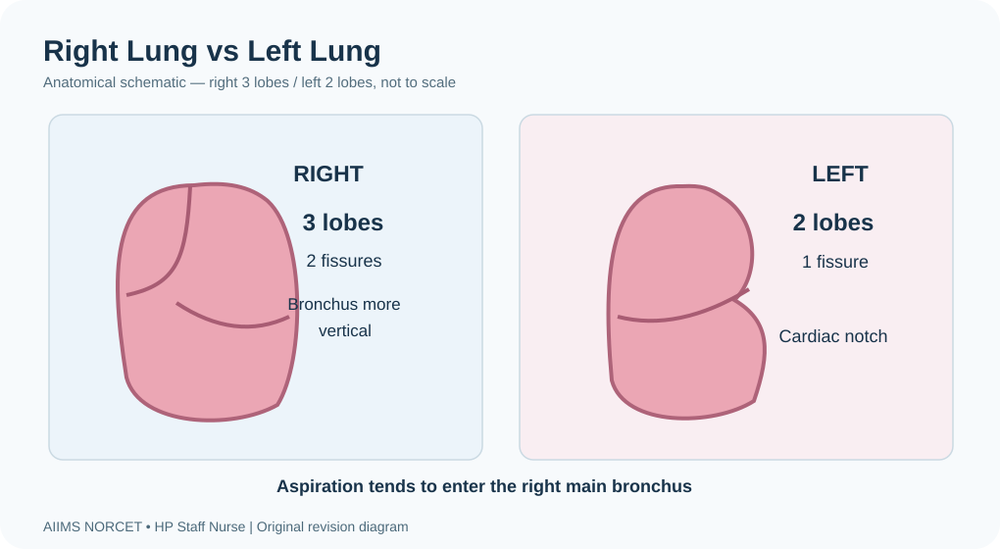
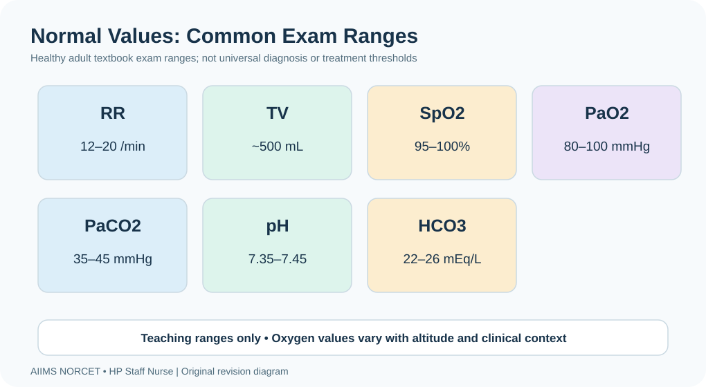

# 🎯 Day 1 — Final Revision Mock: 15 Questions

> **Dhyan de:** Sawaal aur A/B/C/D options original English mein hain. Answer ki explanation easy Hinglish mein hai. Ye practice questions hain, actual Previous Year Questions nahi.

## 🎬 Mock se pehle / baad quick video revision

[Respiratory full chapter — Bhushan Science Nursing](https://www.youtube.com/watch?v=g6top1bzdUg) · [Respiration MCQ practice — Dear Competitive Exams](https://youtu.be/nLSz8qI5Pgo) · [Day 1 topic-wise videos](../Concepts/Day-01-Complete-Respiratory-Anatomy-Physiology.md)

**15 questions · Har sahi answer = 1 mark.** Pehle khud solve karo, phir explanation kholo. Ye Day 1 ka practice mock hai.

[🏠 Chapter](../README.md) · [📖 Day 1 Concepts](../Concepts/Day-01-Complete-Respiratory-Anatomy-Physiology.md) · [📝 44 practice slots](Day-01-Complete-Respiratory-Anatomy-Physiology.md) · [🏥 Previous Year Questions](../Previous-Year-Questions/README.md)

### Q1. After the nasal cavity, which sequence best follows normal inhaled airflow?
- A. Pharynx → larynx → trachea → bronchi
- B. Larynx → pharynx → bronchi → trachea
- C. Trachea → larynx → pharynx → bronchi
- D. Bronchi → larynx → trachea → pharynx

**Difficulty:** 🟢 Easy · **Priority:** 🟡 IMPORTANT · NORCET / Staff Nurse

✅ Sahi answer aur explanation dekho

**Correct answer: A. Pharynx → larynx → trachea → bronchi**

**Kyun sahi hai?** Nose se air pharynx, phir larynx, trachea aur main bronchi tak jaati hai. Is sequence ko upper airway se lower airway ki taraf follow karo.

**Baaki options kyun galat hain?**

- **B.** Pharynx larynx se pehle aur trachea bronchi se pehle hoti hai.
- **C.** Trachea larynx ke baad aati hai, pehle nahi.
- **D.** Bronchi trachea ke branches hain. Normal inward airflow bronchi se pharynx ki taraf start nahi hoti.

[Clinical reference 1](https://openstax.org/books/anatomy-and-physiology/pages/22-1-organs-and-structures-of-the-respiratory-system)

[📖 Day 1 concept details](../Concepts/Day-01-Complete-Respiratory-Anatomy-Physiology.md) · [🏥 Previous Year Question examples](../Previous-Year-Questions/README.md)

### Q2. Nasal passages primarily:
- A. Exchange O₂ with blood
- B. Produce surfactant
- C. Warm, filter and humidify air
- D. Carry pulmonary venous blood

**Difficulty:** 🟢 Easy · **Priority:** 🟡 IMPORTANT · NORCET / Staff Nurse

✅ Sahi answer aur explanation dekho

**Correct answer: C. Warm, filter and humidify air**

**Kyun sahi hai?** Nasal passages incoming air ko warm, filter aur humidify karti hain. Mucus aur nasal structures particles trap karne mein help karte hain.

**Baaki options kyun galat hain?**

- **A.** Main oxygen exchange alveolar-capillary membrane par hota hai.
- **B.** Pulmonary surfactant Type II alveolar cells banate hain.
- **D.** Pulmonary venous blood vessels mein flow karta hai, nasal air passage mein nahi.

[Clinical reference 1](https://openstax.org/books/anatomy-and-physiology/pages/22-1-organs-and-structures-of-the-respiratory-system)

**Revision mapping:** Day 1 bank Q5. Existing revision item, not additional unique authorship.

[📖 Day 1 concept details](../Concepts/Day-01-Complete-Respiratory-Anatomy-Physiology.md) · [🏥 Previous Year Question examples](../Previous-Year-Questions/README.md)

### Q3. Correct lobes?
- A. Right 2; left 3
- B. Right 3; left 2
- C. Both 3
- D. Both 2

**Difficulty:** 🟢 Easy · **Priority:** 🟡 IMPORTANT · NORCET / Staff Nurse

✅ Sahi answer aur explanation dekho

**Correct answer: B. Right 3; left 2**

**Kyun sahi hai?** Healthy adult right lung ke superior, middle aur inferior lobes hote hain. Left lung ke superior aur inferior lobes hote hain. Left side mein cardiac notch aur heart ke liye space hoti hai.

**Baaki options kyun galat hain?**

- **A.** Right aur left ka count ulta diya hai.
- **C.** Left lung mein normally teen lobes nahi hote.
- **D.** Right lung mein normally do nahi, teen lobes hote hain.

[Clinical reference 1](https://openstax.org/books/anatomy-and-physiology-2e/pages/22-2-the-lungs)

**Revision mapping:** Day 1 bank Q6–7. Existing revision item, not additional unique authorship.

[📖 Day 1 concept details](../Concepts/Day-01-Complete-Respiratory-Anatomy-Physiology.md) · [🏥 Previous Year Question examples](../Previous-Year-Questions/README.md)

### Q4. Which is first in the respiratory zone?
- A. Primary bronchus
- B. Terminal bronchiole
- C. Trachea
- D. Respiratory bronchiole

**Difficulty:** 🟢 Easy · **Priority:** 🟡 IMPORTANT · NORCET / Staff Nurse

✅ Sahi answer aur explanation dekho

**Correct answer: D. Respiratory bronchiole**

**Kyun sahi hai?** Terminal bronchiole conducting zone ka last segment hai. Respiratory bronchiole respiratory zone ka first part hai, jahan walls mein alveoli ki wajah se gas exchange possible hota hai.

**Baaki options kyun galat hain?**

- **A.** Primary bronchus conducting airway hai.
- **B.** Terminal bronchiole conducting zone ke end par hai.
- **C.** Trachea conducting airway hai, gas exchange zone ka first part nahi.

[Clinical reference 1](https://openstax.org/books/anatomy-and-physiology/pages/22-1-organs-and-structures-of-the-respiratory-system)

**Revision mapping:** Day 1 bank Q3–4. Existing revision item, not additional unique authorship.

[📖 Day 1 concept details](../Concepts/Day-01-Complete-Respiratory-Anatomy-Physiology.md) · [🏥 Previous Year Question examples](../Previous-Year-Questions/README.md)

### Q5. Which alveolar cell removes dust and germs?
- A. Alveolar macrophage
- B. Type I
- C. Type II
- D. Ciliated epithelium

**Difficulty:** 🟢 Easy · **Priority:** 🟠 HIGH YIELD · NORCET / Staff Nurse

✅ Sahi answer aur explanation dekho

**Correct answer: A. Alveolar macrophage**

**Kyun sahi hai?** Alveolar macrophages inhaled dust aur microbes ko engulf karke lung defense mein help karte hain. Is process ko phagocytosis kehte hain.

**Baaki options kyun galat hain?**

- **B.** Type I pneumocytes thin gas-exchange surface provide karte hain.
- **C.** Type II pneumocytes surfactant produce karte hain.
- **D.** Ciliated epithelium conducting airway mein mucus transport mein help karti hai, alveolar phagocytosis ka primary cell nahi.

[Clinical reference 1](https://openstax.org/books/anatomy-and-physiology/pages/22-1-organs-and-structures-of-the-respiratory-system)

**Revision mapping:** Day 1 bank Q13. Existing revision item, not additional unique authorship.

**Related historical evidence:** HPSSC Staff Nurse Post Code 933, Series A, 10 April 2022, Q3 tests alveolar macrophages. The third-party [paper scan](https://www.snowstudy.in/wp-content/uploads/2022/09/Staff-Nurse-933-Post-Code-Question-Paper.pdf#page=3) extracted text supports the topic, not an exact match to this practice item. Official answer key unverified.

[📖 Day 1 concept details](../Concepts/Day-01-Complete-Respiratory-Anatomy-Physiology.md) · [🏥 Previous Year Question examples](../Previous-Year-Questions/README.md)

### Q6. Surfactant deficiency makes alveoli:
- A. Expand more easily
- B. Have lower surface tension
- C. More prone to collapse
- D. Produce more oxygen

**Difficulty:** 🟡 Medium · **Priority:** 🟠 HIGH YIELD · NORCET / Staff Nurse

✅ Sahi answer aur explanation dekho

**Correct answer: C. More prone to collapse**

**Kyun sahi hai?** Surfactant alveolar fluid ki surface tension kam karta hai. Jab surfactant insufficient ho, alveoli ko inflate rakhna harder ho sakta hai aur collapse tendency badhti hai.

**Baaki options kyun galat hain?**

- **A.** Deficiency se lung expansion easy nahi hoti.
- **B.** Surfactant kam hone se surface tension badhne ki tendency hoti hai.
- **D.** Alveoli oxygen generate nahi karti, gas exchange karti hain.

[Clinical reference 1](https://openstax.org/books/anatomy-and-physiology-2e/pages/22-3-the-process-of-breathing)

**Revision mapping:** Day 1 bank Q14. Existing revision item, not additional unique authorship.

[📖 Day 1 concept details](../Concepts/Day-01-Complete-Respiratory-Anatomy-Physiology.md) · [🏥 Previous Year Question examples](../Previous-Year-Questions/README.md)

### Q7. Which membrane directly covers lungs?
- A. Parietal pleura
- B. Visceral pleura
- C. Pericardium
- D. Mucosa

**Difficulty:** 🟢 Easy · **Priority:** 🟡 IMPORTANT · NORCET / Staff Nurse

✅ Sahi answer aur explanation dekho

**Correct answer: B. Visceral pleura**

**Kyun sahi hai?** Visceral pleura lung ki surface se attached hoti hai. Parietal pleura thoracic cavity ki inner wall aur related surfaces line karti hai.

**Baaki options kyun galat hain?**

- **A.** Parietal pleura chest wall side par hoti hai.
- **C.** Pericardium heart ki covering hai.
- **D.** Mucosa internal passages ki lining hai, lung surface ki pleural covering nahi.

[Clinical reference 1](https://openstax.org/books/anatomy-and-physiology-2e/pages/22-2-the-lungs)

**Revision mapping:** Day 1 bank Q16. Existing revision item, not additional unique authorship.

[📖 Day 1 concept details](../Concepts/Day-01-Complete-Respiratory-Anatomy-Physiology.md) · [🏥 Previous Year Question examples](../Previous-Year-Questions/README.md)

### Q8. Normal inspiration causes:
- A. Diaphragm relaxation and increased chest volume
- B. Diaphragm contraction and decreased chest volume
- C. Diaphragm relaxation and falling alveolar pressure
- D. Diaphragm contraction and increased chest volume

**Difficulty:** 🟡 Medium · **Priority:** 🟠 HIGH YIELD · NORCET / Staff Nurse

✅ Sahi answer aur explanation dekho

**Correct answer: D. Diaphragm contraction and increased chest volume**

**Kyun sahi hai?** Quiet inspiration mein diaphragm contract karke flatten aur descend hota hai. Thoracic volume badhta hai aur airflow ke dauran alveolar pressure atmospheric pressure se kam hota hai. Air lungs mein enter karti hai.

**Baaki options kyun galat hain?**

- **A.** Diaphragm relaxation usual quiet expiration se related hai.
- **B.** Diaphragm contraction se thoracic volume increase hota hai, decrease nahi.
- **C.** Quiet inspiration ka primary mechanism relaxation nahi, contraction hai.

[Clinical reference 1](https://openstax.org/books/anatomy-and-physiology-2e/pages/22-3-the-process-of-breathing)

**Revision mapping:** Day 1 bank Q18. Existing revision item, not additional unique authorship.

[📖 Day 1 concept details](../Concepts/Day-01-Complete-Respiratory-Anatomy-Physiology.md) · [🏥 Previous Year Question examples](../Previous-Year-Questions/README.md)

### Q9. Pulmonary veins drain into:
- A. Left atrium
- B. Right atrium
- C. Right ventricle
- D. Left ventricle

**Difficulty:** 🟢 Easy · **Priority:** 🟡 IMPORTANT · NORCET / Staff Nurse

✅ Sahi answer aur explanation dekho

**Correct answer: A. Left atrium**

**Kyun sahi hai?** Pulmonary veins oxygenated blood lungs se left atrium tak return karti hain. Phir blood mitral valve cross karke left ventricle mein jaata hai.

**Baaki options kyun galat hain?**

- **B.** Right atrium normally systemic venous blood receive karta hai.
- **C.** Right ventricle blood pulmonary arteries ke through lungs bhejta hai.
- **D.** Left ventricle blood left atrium ke through receive karta hai, pulmonary veins directly nahi.

[Clinical reference 1](https://openstax.org/books/anatomy-and-physiology-2e/pages/22-2-the-lungs)

**Revision mapping:** Day 1 bank Q9. Existing revision item, not additional unique authorship.

[📖 Day 1 concept details](../Concepts/Day-01-Complete-Respiratory-Anatomy-Physiology.md) · [🏥 Previous Year Question examples](../Previous-Year-Questions/README.md)

### Q10. TLC 5400 mL, FRC 2200 mL, TV 550 mL. IRV?
- A. 2100 mL
- B. 3200 mL
- C. 2650 mL
- D. 3750 mL

**Difficulty:** 🔴 Difficult · **Priority:** 🟠 HIGH YIELD · NORCET / Staff Nurse

✅ Sahi answer aur explanation dekho

**Correct answer: C. 2650 mL**

**Kyun sahi hai?** TLC = IC + FRC. IC = 5400 − 2200 = 3200 mL. IC = TV + IRV, isliye IRV = 3200 − 550 = 2650 mL. Pehle capacity find karo, phir known volume subtract karo.

**Baaki options kyun galat hain?**

- **A.** 2100 mL given formulas ka correct result nahi hai.
- **B.** 3200 mL IC hai, IRV alone nahi.
- **D.** 3750 mL IC mein TV add karne se aata hai, jabki subtract karna hai.

[Clinical reference 1](https://openstax.org/books/anatomy-and-physiology-2e/pages/22-3-the-process-of-breathing)

**Revision mapping:** Day 1 bank Q23/Q25 combined calculation, not identical. Existing revision item, not additional unique authorship.

[📖 Day 1 concept details](../Concepts/Day-01-Complete-Respiratory-Anatomy-Physiology.md) · [🏥 Previous Year Question examples](../Previous-Year-Questions/README.md)

### Q11. MV 8.64 L/min and TV 480 mL. RR?
- A. 16/min
- B. 18/min
- C. 20/min
- D. 22/min

**Difficulty:** 🟡 Medium · **Priority:** 🟠 HIGH YIELD · NORCET / Staff Nurse

✅ Sahi answer aur explanation dekho

**Correct answer: B. 18/min**

**Kyun sahi hai?** Minute ventilation = RR × TV. 8.64 L/min = 8640 mL/min. RR = 8640 ÷ 480 = 18 breaths/min.

**Baaki options kyun galat hain?**

- **A.** 16 × 480 = 7680 mL/min, given 8640 nahi.
- **C.** 20 × 480 = 9600 mL/min.
- **D.** 22 × 480 = 10560 mL/min.

[Clinical reference 1](https://openstax.org/books/anatomy-and-physiology-2e/pages/22-3-the-process-of-breathing)

**Revision mapping:** Day 1 bank Q27 same calculation method. Existing revision item, not additional unique authorship.

[📖 Day 1 concept details](../Concepts/Day-01-Complete-Respiratory-Anatomy-Physiology.md) · [🏥 Previous Year Question examples](../Previous-Year-Questions/README.md)

### Q12. RR 18 and TV 400 become RR 20 and TV 450. MV rises by:
- A. 12.5%
- B. 20%
- C. 30%
- D. 25%

**Difficulty:** 🔴 Difficult · **Priority:** 🟠 HIGH YIELD · NORCET / Staff Nurse

✅ Sahi answer aur explanation dekho

**Correct answer: D. 25%**

**Kyun sahi hai?** Old MV = 18 × 400 = 7200 mL/min. New MV = 20 × 450 = 9000 mL/min. Increase = 1800 mL/min. Percentage increase = 1800 ÷ 7200 × 100 = 25%. Old value denominator use karo.

**Baaki options kyun galat hain?**

- **A.** 12.5% given before-after volumes se match nahi karta.
- **B.** 20% new value ko denominator lene se aata hai.
- **C.** 30% correct relative increase nahi hai.

[Clinical reference 1](https://openstax.org/books/anatomy-and-physiology-2e/pages/22-3-the-process-of-breathing)

**Revision mapping:** Day 1 bank Q38 same ventilation values, additional RR/TV calculations. Existing revision item, not additional unique authorship.

[📖 Day 1 concept details](../Concepts/Day-01-Complete-Respiratory-Anatomy-Physiology.md) · [🏥 Previous Year Question examples](../Previous-Year-Questions/README.md)

### Q13. Which two values are normal for a resting healthy adult near sea level?
- A. RR 14/min AND PaCO₂ 43 mmHg
- B. SpO₂ 94% AND pH 7.48
- C. RR 24/min AND PaCO₂ 50
- D. pH 7.48 AND RR 9/min

**Difficulty:** 🟡 Medium · **Priority:** 🟠 HIGH YIELD · NORCET / Staff Nurse

✅ Sahi answer aur explanation dekho

**Correct answer: A. RR 14/min AND PaCO₂ 43 mmHg**

**Kyun sahi hai?** RR 14/min common resting adult 12–20 range mein hai. PaCO2 43 mmHg usual 35–45 teaching interval mein hai. Dono measurements acceptable hain, clinical context aur lab reference intervals bhi matter karte hain.

**Baaki options kyun galat hain?**

- **B.** pH 7.48 usual 7.35–7.45 se high hai. SpO2 94% bhi typical healthy sea-level teaching interval ke lower side par hai.
- **C.** RR 24/min aur PaCO2 50 mmHg usual reference intervals se high hain.
- **D.** pH 7.48 elevated aur RR 9/min usual resting range se low hai.

[Clinical reference 1](https://www.ncbi.nlm.nih.gov/books/NBK593208/) · [Clinical reference 2](https://medlineplus.gov/lab-tests/arterial-blood-gas-abg-test/)

**Revision mapping:** Day 1 bank Q31–34 combined reference-range application. Existing revision item, not additional unique authorship.

[📖 Day 1 concept details](../Concepts/Day-01-Complete-Respiratory-Anatomy-Physiology.md) · [🏥 Previous Year Question examples](../Previous-Year-Questions/README.md)

### Q14. PaO₂ 89 mmHg is generally within common sea-level adult exam range.
- A. True
- B. False
- C. Only if PaCO₂ is high
- D. Only during forced inspiration

**Difficulty:** 🟢 Easy · **Priority:** 🟠 HIGH YIELD · NORCET / Staff Nurse

✅ Sahi answer aur explanation dekho

**Correct answer: A. True**

**Kyun sahi hai?** PaO2 89 mmHg common nursing teaching interval 80–100 mmHg mein aata hai. MedlinePlus 75–100 mmHg bhi list karta hai. Age, altitude, inspired oxygen aur lab interval ke hisaab se interpretation vary karti hai.

**Baaki options kyun galat hain?**

- **B.** 89 mmHg ko universally abnormal kehna correct nahi hai.
- **C.** Is value ko normal interval mein hone ke liye PaCO2 high hona required nahi hai.
- **D.** Forced inspiration bhi required condition nahi hai.

[Clinical reference 1](https://www.ncbi.nlm.nih.gov/books/NBK593208/) · [Clinical reference 2](https://medlineplus.gov/lab-tests/arterial-blood-gas-abg-test/)

**Audit note:** Legacy true/false-style item retained for attempt history. Use stronger four-option clinical questions for future mocks.

[📖 Day 1 concept details](../Concepts/Day-01-Complete-Respiratory-Anatomy-Physiology.md) · [🏥 Previous Year Question examples](../Previous-Year-Questions/README.md)

### Q15. Air remaining after maximal forced expiration is:
- A. FRC
- B. IC
- C. VC
- D. RV

**Difficulty:** 🟢 Easy · **Priority:** 🟠 HIGH YIELD · NORCET / Staff Nurse

✅ Sahi answer aur explanation dekho

**Correct answer: D. RV**

**Kyun sahi hai?** Maximum forced expiration ke baad lungs mein jo air bachi rehti hai usse residual volume kehte hain. Normal quiet expiration ke baad FRC = ERV + RV remains.

**Baaki options kyun galat hain?**

- **A.** FRC normal expiration ke end par remaining air hai, maximal forced expiration ke end par nahi.
- **B.** IC normal expiration ke baad maximum inspiration tak inhale ki ja sakne wali air hai.
- **C.** VC maximal inspiration ke baad maximum voluntarily exhaled air hai.

[Clinical reference 1](https://openstax.org/books/anatomy-and-physiology-2e/pages/22-3-the-process-of-breathing)

**Revision mapping:** Day 1 bank Q21. Existing revision item, not additional unique authorship.

[📖 Day 1 concept details](../Concepts/Day-01-Complete-Respiratory-Anatomy-Physiology.md) · [🏥 Previous Year Question examples](../Previous-Year-Questions/README.md)

[🏠 Respiratory chapter](../README.md) · [📖 Day 1 ke notes](../Concepts/Day-01-Complete-Respiratory-Anatomy-Physiology.md)

---

**🔗 Aage navigate karo:** [🏠 Chapter](../README.md) · [📖 Day 1 Concepts](../Concepts/Day-01-Complete-Respiratory-Anatomy-Physiology.md) · [📝 44 practice slots](Day-01-Complete-Respiratory-Anatomy-Physiology.md) · [🏥 Previous Year Questions](../Previous-Year-Questions/README.md)

## Post-mock video and evidence review

- [Aarogyam Infinity NORCET respiratory MCQ Part 27](https://www.youtube.com/watch?v=lAy0Cb9o5ss) — indexed description supports respiratory muscles and lung volumes (Q8, Q10–12, Q15 topic practice). Playback and exact timestamps not verified, direct page retrieval failed.
- [HPSSC Post Code 933 paper discussion](https://www.youtube.com/watch?v=hOx-iFU-JcU) — title identifies the 10 April 2022 examination, useful historical research lead for Q5. Transcript and specific question coverage not verified, not an official answer key.
- This is a legacy revision mock. Original scoring and question IDs retained. Do not count reused concepts or calculations as automatically new unique questions. Dedicated video mapping for ABG reference intervals and full historical verification pending.
