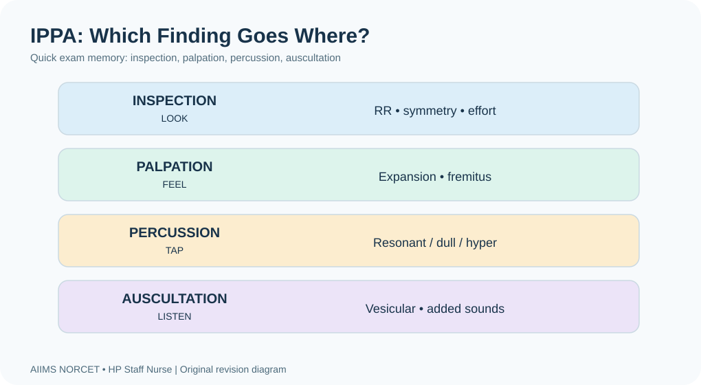
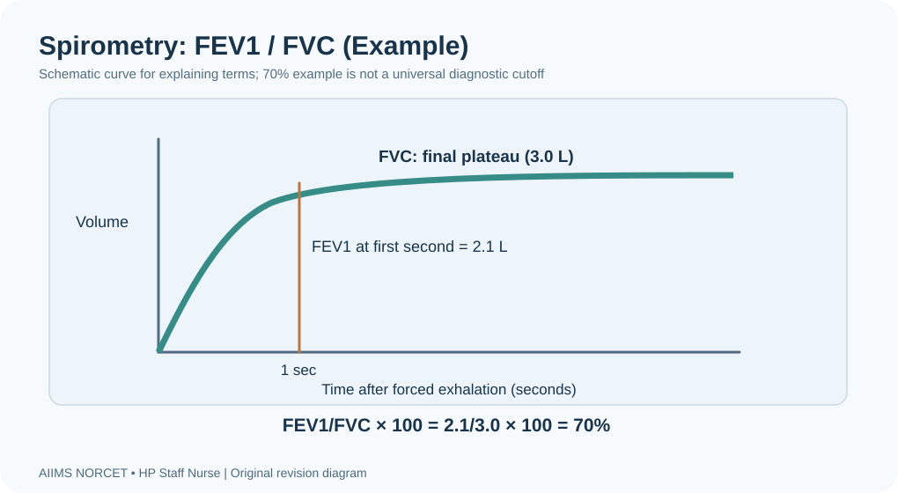

# 📝 Day 2 — Respiratory Assessment & Diagnostics: 36 Practice MCQs

[🏠 Chapter](../README.md) · [📖 Day 2 Concepts](../Concepts/Day-02-Complete-Respiratory-Assessment-Diagnostics.md) · [⚡ Revision](../Revision/Day-02-Quick-Revision.md) · [🏥 Previous Year Questions](../Previous-Year-Questions/README.md)

> **Dhyan de:** Sawaal aur A/B/C/D options original English mein hain. Answer ki explanation easy Hinglish mein hai. Ye practice questions hain, actual Previous Year Questions nahi.

## 🎬 YouTube se concept aur MCQ practice

**Dhyan de:** Neeche actual topic-related videos ke links hain. Ye official past paper ki proof nahi hain; video descriptions ke basis par select kiye hain.

- **Concept video:** [Alka Medical Education — IPPA Hindi](https://www.youtube.com/watch?v=PdbeHsh1OPM)
- **MCQ practice:** [Ambition Nursing Classes — ABG MCQs](https://www.youtube.com/watch?v=G_2-0P9EfAg)
- [Day 2 ke subtopic-wise video links](../Concepts/Day-02-Complete-Respiratory-Assessment-Diagnostics.md). IPPA, auscultation aur spirometry MCQ videos separately verified nahi mile; page ke 36 MCQs solve karo.

### Kaise solve karna hai?

1. **Pehle apna answer select** karo; explanation tabhi kholo.
2. IPPA mein **look, feel, tap, listen** ka difference samjho.
3. ABG mein pehle **pH**, fir **PaCO₂**, fir **HCO₃⁻** dekho.
4. Spirometry mein **FEV₁ / FVC × 100** formula use karo.

---

## Inspection — patient ko dekhna

[📖 Is topic ka detailed explanation](../Concepts/Day-02-Complete-Respiratory-Assessment-Diagnostics.md#2-inspection--patient-ko-dekhna) · [📚 Previous Year Questions](../Previous-Year-Questions/README.md)

### Q1. The first IPPA step in routine respiratory examination is:

- **A.** Percussion
- **B.** Inspection
- **C.** Auscultation
- **D.** Palpation

**Difficulty:** Easy | **Exam focus:** NORCET / Staff Nurse (All India)

✅ Answer aur easy explanation dekho

**B.** **Inspection** pehle hota hai: patient ko dekhkar breathing observe karte hain.

**Baaki options kyun nahi?** Palpation mein hand se feel, percussion mein tap, auscultation mein stethoscope use hota hai. **Inspection** mein nurse pehle visual signs—RR, symmetry, work of breathing—observe karti hai.

**Exam trick:** IPPA = Dekho, Feel, Tap, Suno.

[📖 Concept detail se padho](../Concepts/Day-02-Complete-Respiratory-Assessment-Diagnostics.md) · [📚 Paper-linked questions](../Previous-Year-Questions/README.md)

### Q2. Which finding primarily belongs to inspection?

- **A.** Chest expansion symmetry
- **B.** Tactile fremitus
- **C.** Percussion note
- **D.** Breath sound

**Difficulty:** Easy | **Exam focus:** NORCET / Staff Nurse (All India)

✅ Answer aur easy explanation dekho

**A.** **Inspection** mein chest ka rise/fall aur symmetry **dekhte** hain.

**Baaki options kyun nahi?** **Chest expansion symmetry** eyes se dekh sakte hain; fremitus ko touch se feel karna padta hai. Percussion note tapping se aur breath sounds stethoscope se assess karte hain.

**Exam trick:** Method ko observation ke verb se match karo.

[📖 Concept detail se padho](../Concepts/Day-02-Complete-Respiratory-Assessment-Diagnostics.md) · [📚 Paper-linked questions](../Previous-Year-Questions/README.md)

### Q3. A resting adult RR of 26/min is:

- **A.** Within 12–20/min
- **B.** Bradypnea
- **C.** Tachypnea
- **D.** Apnea

**Difficulty:** Easy | **Exam focus:** NORCET / Staff Nurse (All India)

✅ Answer aur easy explanation dekho

**C.** Common adult resting RR 12–20/min hai. **26/min fast** hai, so **tachypnea**.

**Baaki options kyun nahi?** Tachypnea fast breathing hai. Bradypnea slow, apnea breathing absent hoti hai. RR 26/min adult resting 12–20 se upar hai, isliye option C best hai.

**Exam trick:** RR normal value ke saath clinical context bhi dekhna chahiye.

[📖 Concept detail se padho](../Concepts/Day-02-Complete-Respiratory-Assessment-Diagnostics.md) · [📚 Paper-linked questions](../Previous-Year-Questions/README.md)

---

## Palpation — haath se feel karna

[📖 Is topic ka detailed explanation](../Concepts/Day-02-Complete-Respiratory-Assessment-Diagnostics.md#3-palpation--haath-se-feel-karna) · [📚 Previous Year Questions](../Previous-Year-Questions/README.md)

### Q4. A nurse places hands on the posterior chest to compare movement during inhalation. What is assessed?

- **A.** Chest expansion
- **B.** Percussion note
- **C.** Bronchial breathing
- **D.** PaCO₂

**Difficulty:** Easy | **Exam focus:** NORCET / Staff Nurse (All India)

✅ Answer aur easy explanation dekho

**A.** **Chest expansion** palpation se feel karke compare ki jaati hai.

**Baaki options kyun nahi?** **Chest expansion** dono hemithorax mein hands se compare hoti hai. Percussion sound tapping se aur bronchial sound stethoscope se sunte hain. PaCO₂ ABG ka component hai, haath se nahi milta.

**Exam trick:** Palpation = chest movement feel.

[📖 Concept detail se padho](../Concepts/Day-02-Complete-Respiratory-Assessment-Diagnostics.md) · [📚 Paper-linked questions](../Previous-Year-Questions/README.md)

### Q5. A vibration felt over chest while patient speaks is called:

- **A.** Resonance
- **B.** Fremitus
- **C.** Wheeze
- **D.** Stridor

**Difficulty:** Easy | **Exam focus:** NORCET / Staff Nurse (All India)

✅ Answer aur easy explanation dekho

**B.** Ye **tactile fremitus** hai: bolne par chest wall pe feel hone wali vibration.

**Baaki options kyun nahi?** **Fremitus** patient bolte waqt palpable vibration hai. Resonance percussion sound hai; wheeze aur stridor breath sounds hain. Question mein FEEL word ek clue hai.

**Exam trick:** Voice vibration feel = tactile fremitus.

[📖 Concept detail se padho](../Concepts/Day-02-Complete-Respiratory-Assessment-Diagnostics.md) · [📚 Paper-linked questions](../Previous-Year-Questions/README.md)

### Q6. Tactile fremitus may increase with:

- **A.** Pleural effusion
- **B.** Pneumothorax
- **C.** Lung consolidation with open bronchus
- **D.** Large airway obstruction

**Difficulty:** Difficult | **Exam focus:** NORCET / Staff Nurse (All India)

✅ Answer aur easy explanation dekho

**C.** **Consolidation** mein agar bronchus open ho toh voice vibrations better transmit ho sakti hain.

**Baaki options kyun nahi?** Consolidated lung tissue, agar bronchus patent/open hai, vibration ko better conduct kar sakta hai. Pleural effusion/pneumothorax mein pleural space vibration ko insulate karta hai, toh fremitus often **decreased** hoti hai.

**Exam trick:** Increased = consolidation (open airway); decreased = fluid/air around lung.

[📖 Concept detail se padho](../Concepts/Day-02-Complete-Respiratory-Assessment-Diagnostics.md) · [📚 Paper-linked questions](../Previous-Year-Questions/README.md)

### Q7. A normally positioned trachea is typically:

- **A.** Deviated right
- **B.** Deviated left
- **C.** Not palpable
- **D.** Midline

**Difficulty:** Medium | **Exam focus:** NORCET / Staff Nurse (All India)

✅ Answer aur easy explanation dekho

**D.** Trachea normally approximately **midline** hoti hai.

**Baaki options kyun nahi?** Right/left deviation normal finding nahi. Trachea normally approximately **midline** feel hoti hai; abnormal deviation urgent broader assessment ki indication ho sakta hai.

**Exam trick:** Trachea position ko isolated diagnosis na banao.

[📖 Concept detail se padho](../Concepts/Day-02-Complete-Respiratory-Assessment-Diagnostics.md) · [📚 Paper-linked questions](../Previous-Year-Questions/README.md)

---

## Percussion — chest ko tap karna

[📖 Is topic ka detailed explanation](../Concepts/Day-02-Complete-Respiratory-Assessment-Diagnostics.md#4-percussion--chest-tap-karna) · [📚 Previous Year Questions](../Previous-Year-Questions/README.md)

### Q8. Expected percussion sound over normal aerated lung:

- **A.** Dullness
- **B.** Resonance
- **C.** Flatness
- **D.** Tympany

**Difficulty:** Easy | **Exam focus:** NORCET / Staff Nurse (All India)

✅ Answer aur easy explanation dekho

**B.** Healthy aerated lung pe usual percussion note **resonant** hota hai.

**Baaki options kyun nahi?** Healthy peripheral lung normal air-filled hota hai, isliye **resonant** note aata hai. Dullness dense/fluid tissue se; flatness bone/muscle pe, tympany hollow gas structures se hota hai.

**Exam trick:** Normal lung percussion = resonant.

[📖 Concept detail se padho](../Concepts/Day-02-Complete-Respiratory-Assessment-Diagnostics.md) · [📚 Paper-linked questions](../Previous-Year-Questions/README.md)

### Q9. Percussion over pleural fluid usually gives:

- **A.** Hyperresonance
- **B.** Tympany
- **C.** Dullness
- **D.** Normal resonance

**Difficulty:** Medium | **Exam focus:** NORCET / Staff Nurse (All India)

✅ Answer aur easy explanation dekho

**C.** Fluid sound ko dull banata hai, so pleural effusion mein **dullness** mil sakti hai.

**Baaki options kyun nahi?** Pleural fluid sound ko dampen karta hai, isliye **dullness** expected hai. Hyperresonance extra air mein, tympany air-filled hollow structure mein zyada hota hai.

**Exam trick:** Effusion = dull; pneumothorax = hyperresonant (often).

[📖 Concept detail se padho](../Concepts/Day-02-Complete-Respiratory-Assessment-Diagnostics.md) · [📚 Paper-linked questions](../Previous-Year-Questions/README.md)

### Q10. A hyperresonant percussion note suggests:

- **A.** Extra air
- **B.** Lung consolidation
- **C.** Pleural effusion
- **D.** Bone

**Difficulty:** Medium | **Exam focus:** NORCET / Staff Nurse (All India)

✅ Answer aur easy explanation dekho

**A.** Hyperresonance **extra air** suggest karta hai, e.g., pneumothorax. Alone diagnosis confirm nahi karta.

**Baaki options kyun nahi?** **Hyperresonance** excessive air se associated hai. Consolidation/effusion dense tissue ya fluid ke karan generally dull note dete hain; bone flat ho sakti hai.

**Exam trick:** Extra air vs fluid ko separate rakho.

[📖 Concept detail se padho](../Concepts/Day-02-Complete-Respiratory-Assessment-Diagnostics.md) · [📚 Paper-linked questions](../Previous-Year-Questions/README.md)

### Q11. Which method compares percussion notes side to side?

- **A.** Only one apex tested
- **B.** Listen only at sternum
- **C.** Test over clothing
- **D.** Compare corresponding areas

**Difficulty:** Medium | **Exam focus:** NORCET / Staff Nurse (All India)

✅ Answer aur easy explanation dekho

**D.** Right aur left ki **corresponding areas** ko compare karna chahiye.

**Baaki options kyun nahi?** Reliable comparison ke liye same level par right-left side alternating assess karo. Sirf sternum ya ek apex se compare nahi ho payega; clothing ke through tap karna sound distort kar sakta hai.

**Exam trick:** Percussion symmetric sites pe karo.

[📖 Concept detail se padho](../Concepts/Day-02-Complete-Respiratory-Assessment-Diagnostics.md) · [📚 Paper-linked questions](../Previous-Year-Questions/README.md)

---

## Auscultation — stethoscope se sunna

[📖 Is topic ka detailed explanation](../Concepts/Day-02-Complete-Respiratory-Assessment-Diagnostics.md#5-auscultation--stethoscope-se-sunna) · [📚 Previous Year Questions](../Previous-Year-Questions/README.md)

### Q12. Normal breath sound over most peripheral lung fields is:

- **A.** Bronchial
- **B.** Vesicular
- **C.** Stridor
- **D.** Pleural rub

**Difficulty:** Easy | **Exam focus:** NORCET / Staff Nurse (All India)

✅ Answer aur easy explanation dekho

**B.** **Vesicular** breath sound normally peripheral lungs mein soft aur low pitched hoti hai.

**Baaki options kyun nahi?** **Vesicular** soft normal peripheral sound hai. Bronchial trachea ke paas normal; stridor urgent upper-airway sound aur pleural rub abnormal grating hai.

**Exam trick:** Sound ka quality ke saath location bhi important.

[📖 Concept detail se padho](../Concepts/Day-02-Complete-Respiratory-Assessment-Diagnostics.md) · [📚 Paper-linked questions](../Previous-Year-Questions/README.md)

### Q13. High-pitched musical continuous breath sound is:

- **A.** Wheeze
- **B.** Crackles
- **C.** Friction rub
- **D.** Absent breath sound

**Difficulty:** Easy | **Exam focus:** NORCET / Staff Nurse (All India)

✅ Answer aur easy explanation dekho

**A.** **Wheeze** musical whistle jaisi sound hai, usually narrowed airways se associated.

**Baaki options kyun nahi?** **Wheeze** musical/whistling sound hota hai, usually narrowed airways mein. Crackles pops, friction rub grating, absent sounds air movement kam hone ka observation hai.

**Exam trick:** Musical continuous = wheeze.

[📖 Concept detail se padho](../Concepts/Day-02-Complete-Respiratory-Assessment-Diagnostics.md) · [📚 Paper-linked questions](../Previous-Year-Questions/README.md)

### Q14. Discontinuous popping on lung auscultation is called:

- **A.** Stridor
- **B.** Rhonchi
- **C.** Crackles
- **D.** Bronchial breathing

**Difficulty:** Easy | **Exam focus:** NORCET / Staff Nurse (All India)

✅ Answer aur easy explanation dekho

**C.** Popping/discontinuous sounds **crackles (rales)** hote hain.

**Baaki options kyun nahi?** **Crackles** short discontinuous popping sounds hain; stridor upper-airway harsh, rhonchi low/coarse snoring aur normal bronchial breath sound tubular hota hai.

**Exam trick:** Popping = crackles; musical = wheeze.

[📖 Concept detail se padho](../Concepts/Day-02-Complete-Respiratory-Assessment-Diagnostics.md) · [📚 Paper-linked questions](../Previous-Year-Questions/README.md)

### Q15. A harsh inspiratory sound at the neck suggesting upper-airway obstruction is:

- **A.** Rhonchi
- **B.** Vesicular
- **C.** Crackles
- **D.** Stridor

**Difficulty:** Medium | **Exam focus:** NORCET / Staff Nurse (All India)

✅ Answer aur easy explanation dekho

**D.** Ye **stridor** hai. Upper airway obstruction ho sakta hai aur urgent assessment important hai.

**Baaki options kyun nahi?** **Stridor** usually upper airway mein harsh, mostly inspiratory hota hai. Rhonchi low pitched; vesicular normal peripheral; crackles popping. Ye sound upper-airway obstruction ki possibility batata hai.

**Exam trick:** Stridor + difficulty breathing = urgent clinical assessment.

[📖 Concept detail se padho](../Concepts/Day-02-Complete-Respiratory-Assessment-Diagnostics.md) · [📚 Paper-linked questions](../Previous-Year-Questions/README.md)

### Q16. Grating sound associated with inflamed pleural surfaces:

- **A.** Pleural friction rub
- **B.** Wheeze
- **C.** Bronchovesicular
- **D.** Rhonchi

**Difficulty:** Easy | **Exam focus:** NORCET / Staff Nurse (All India)

✅ Answer aur easy explanation dekho

**A.** Ye **pleural friction rub** hai, jo inflamed pleural surfaces se associated hai.

**Baaki options kyun nahi?** **Pleural friction rub** pleural surfaces ki rubbing/creaking se hota hai. Wheeze airway narrowing, bronchovesicular normal intermediary breath sound aur rhonchi low pitched secretion-like sound hai.

**Exam trick:** Rub = pleura friction; wheeze = narrowed airway.

[📖 Concept detail se padho](../Concepts/Day-02-Complete-Respiratory-Assessment-Diagnostics.md) · [📚 Paper-linked questions](../Previous-Year-Questions/README.md)

---

## ABG basics aur interpretation

[📖 Is topic ka detailed explanation](../Concepts/Day-02-Complete-Respiratory-Assessment-Diagnostics.md#7-abg-interpretation--step-by-step) · [📚 Previous Year Questions](../Previous-Year-Questions/README.md)

### Q17. ABG pH 7.29, PaCO₂ 53 mmHg, HCO₃⁻ 24 mEq/L. Best primary disorder?

- **A.** Respiratory acidosis
- **B.** Respiratory alkalosis
- **C.** Metabolic acidosis
- **D.** Metabolic alkalosis

**Difficulty:** Medium | **Exam focus:** NORCET / Staff Nurse (All India)

✅ Answer aur easy explanation dekho

**A.** pH **low** aur PaCO₂ **high** hai; HCO₃⁻ normal hai. Basic pattern = **respiratory acidosis**.

**Baaki options kyun nahi?** pH **7.29** low (acidemia). PaCO₂ **53** high, jo pH ko acidic direction mein push karta hai. HCO₃⁻ 24 usual normal, isliye **primary respiratory acidosis**. Metabolic acidosis hoti toh HCO₃⁻ low hota.

**Exam trick:** ABG sequence: pH → CO₂ → HCO₃⁻.

[📖 Concept detail se padho](../Concepts/Day-02-Complete-Respiratory-Assessment-Diagnostics.md) · [📚 Paper-linked questions](../Previous-Year-Questions/README.md)

### Q18. ABG pH 7.49, PaCO₂ 31, HCO₃⁻ 24. Best interpretation?

- **A.** Metabolic acidosis
- **B.** Respiratory alkalosis
- **C.** Respiratory acidosis
- **D.** Metabolic alkalosis

**Difficulty:** Medium | **Exam focus:** NORCET / Staff Nurse (All India)

✅ Answer aur easy explanation dekho

**B.** pH **high**, CO₂ **low**, HCO₃⁻ usual range mein → **respiratory alkalosis**.

**Baaki options kyun nahi?** pH **7.49** high = alkalemia. PaCO₂ **31** low, CO₂ kam hone se pH high direction mein jaata hai. HCO₃⁻ 24 normal; primary respiratory alkalosis. Respiratory acidosis mein CO₂ high hota.

**Exam trick:** CO₂ aur pH opposite direction in primary respiratory disorders.

[📖 Concept detail se padho](../Concepts/Day-02-Complete-Respiratory-Assessment-Diagnostics.md) · [📚 Paper-linked questions](../Previous-Year-Questions/README.md)

### Q19. ABG pH 7.27, PaCO₂ 40, HCO₃⁻ 17. Primary abnormality?

- **A.** Respiratory alkalosis
- **B.** Respiratory acidosis
- **C.** Metabolic acidosis
- **D.** Metabolic alkalosis

**Difficulty:** Medium | **Exam focus:** NORCET / Staff Nurse (All India)

✅ Answer aur easy explanation dekho

**C.** pH **low** + HCO₃⁻ **low** → **metabolic acidosis**, simple teaching pattern.

**Baaki options kyun nahi?** pH **7.27** low. HCO₃⁻ **17** low, metabolic component se acidity badh rahi hai. PaCO₂ 40 common normal range mein. Metabolic alkalosis mein bicarbonate high hota.

**Exam trick:** HCO₃⁻ down + pH down = metabolic acidosis.

[📖 Concept detail se padho](../Concepts/Day-02-Complete-Respiratory-Assessment-Diagnostics.md) · [📚 Paper-linked questions](../Previous-Year-Questions/README.md)

### Q20. Which parameter primarily reflects respiratory acid-base component?

- **A.** HCO₃⁻
- **B.** Hemoglobin
- **C.** PaO₂
- **D.** PaCO₂

**Difficulty:** Medium | **Exam focus:** NORCET / Staff Nurse (All India)

✅ Answer aur easy explanation dekho

**D.** **PaCO₂** respiratory component hai. HCO₃⁻ metabolic component hai.

**Baaki options kyun nahi?** **PaCO₂** lungs ki CO₂ removal ko reflect karta hai, isliye respiratory acid-base component hai. HCO₃⁻ metabolic; PaO₂ oxygenation; hemoglobin oxygen transport se related hai.

**Exam trick:** CO₂ = respiratory; HCO₃⁻ = metabolic.

[📖 Concept detail se padho](../Concepts/Day-02-Complete-Respiratory-Assessment-Diagnostics.md) · [📚 Paper-linked questions](../Previous-Year-Questions/README.md)

### Q21. The usual arterial pH teaching interval is:

- **A.** 7.35–7.45
- **B.** 7.25–7.35
- **C.** 7.45–7.55
- **D.** 7.15–7.25

**Difficulty:** Easy | **Exam focus:** NORCET / Staff Nurse (All India)

✅ Answer aur easy explanation dekho

**A.** Usual arterial pH **7.35–7.45** hota hai.

**Baaki options kyun nahi?** pH interval **7.35–7.45** usual textbook range hai. B aur D acidic-side ranges, C alkaline-side range hai. Sirf last digit nahi, complete decimal range dekho.

**Exam trick:** pH normal 7.35–7.45; PaCO₂ normal 35–45.

[📖 Concept detail se padho](../Concepts/Day-02-Complete-Respiratory-Assessment-Diagnostics.md) · [📚 Paper-linked questions](../Previous-Year-Questions/README.md)

### Q22. pH 7.48, PaCO₂ 40, HCO₃⁻ 30 suggests:

- **A.** Metabolic acidosis
- **B.** Metabolic alkalosis
- **C.** Respiratory acidosis
- **D.** Respiratory alkalosis

**Difficulty:** Medium | **Exam focus:** NORCET / Staff Nurse (All India)

✅ Answer aur easy explanation dekho

**B.** pH **high** aur HCO₃⁻ **high** → **metabolic alkalosis**.

**Baaki options kyun nahi?** pH **7.48** alkalemic, HCO₃⁻ **30** high, PaCO₂ 40 normal: primary **metabolic alkalosis**. Respiratory alkalosis mein mainly CO₂ kam hota; acidosis patterns mein pH low hota.

**Exam trick:** Uncompensated textbook example; actual patient ABG complex ho sakta hai.

[📖 Concept detail se padho](../Concepts/Day-02-Complete-Respiratory-Assessment-Diagnostics.md) · [📚 Paper-linked questions](../Previous-Year-Questions/README.md)

---

## Spirometry — FEV1, FVC aur ratios

[📖 Is topic ka detailed explanation](../Concepts/Day-02-Complete-Respiratory-Assessment-Diagnostics.md#8-spirometry--fev₁-fvc-aur-ratio) · [📚 Previous Year Questions](../Previous-Year-Questions/README.md)

### Q23. FEV₁ is the volume exhaled during:

- **A.** First 1 second of forced expiration
- **B.** First 3 seconds of normal expiration
- **C.** A normal breath
- **D.** After full expiration

**Difficulty:** Easy | **Exam focus:** NORCET / Staff Nurse (All India)

✅ Answer aur easy explanation dekho

**A.** FEV₁ = forced expiration ke **first 1 second** ka volume.

**Baaki options kyun nahi?** FEV₁ ka '1' exactly **first second of forced exhalation** ko show karta hai. Normal quiet breath, 3 sec ya full expiration FEV₁ ki definition nahi.

**Exam trick:** FEV₁ = forced expiratory volume in ONE second.

[📖 Concept detail se padho](../Concepts/Day-02-Complete-Respiratory-Assessment-Diagnostics.md) · [📚 Paper-linked questions](../Previous-Year-Questions/README.md)

### Q24. FVC refers to:

- **A.** Remaining air after full expiration
- **B.** Total forcibly exhaled air after maximal inspiration
- **C.** Resting tidal volume
- **D.** Peak inspiratory flow

**Difficulty:** Easy | **Exam focus:** NORCET / Staff Nurse (All India)

✅ Answer aur easy explanation dekho

**B.** FVC = maximum inspiration ke baad **total forcefully expired volume**.

**Baaki options kyun nahi?** **FVC** patient maximal inhale ke baad forcefully exhale kar sakti total volume hai. RV remaining air hota hai, TV ordinary breath aur PEF ek flow rate hai—not total forced expired volume.

**Exam trick:** FVC = total exhaled; FEV₁ = first second.

[📖 Concept detail se padho](../Concepts/Day-02-Complete-Respiratory-Assessment-Diagnostics.md) · [📚 Paper-linked questions](../Previous-Year-Questions/README.md)

### Q25. FEV₁ 2.4 L and FVC 3.2 L. FEV₁/FVC?

- **A.** 60%
- **B.** 70%
- **C.** 75%
- **D.** 80%

**Difficulty:** Medium | **Exam focus:** NORCET / Staff Nurse (All India)

✅ Answer aur easy explanation dekho

**C.** (2.4 ÷ 3.2) × 100 = **75%**.

**Baaki options kyun nahi?** Correct numerator **FEV₁=2.4 L**, denominator **FVC=3.2 L**. (2.4/3.2)×100=**75%**. Inverse ratio ya bina 100 multiply wrong ho jayega.

**Exam trick:** FEV₁/FVC = fraction first second; interpret with reference criteria.

[📖 Concept detail se padho](../Concepts/Day-02-Complete-Respiratory-Assessment-Diagnostics.md) · [📚 Paper-linked questions](../Previous-Year-Questions/README.md)

### Q26. Which cannot be measured directly with basic spirometry?

- **A.** FEV₁
- **B.** FVC
- **C.** TV
- **D.** RV

**Difficulty:** Medium | **Exam focus:** NORCET / Staff Nurse (All India)

✅ Answer aur easy explanation dekho

**D.** **RV** lungs mein maximum expiration ke baad bachi air hai, isliye simple spirometry directly measure nahi karti.

**Baaki options kyun nahi?** **RV** maximum forced expiration ke baad lungs mein remain karta hai, isliye routine simple spirometry isko measure nahi karti. FEV₁ aur FVC forced exhalation se milte hain; TV bhi basic breathing maneuver se assess ho sakta hai.

**Exam trick:** Simple spirometry → RV not directly measurable.

[📖 Concept detail se padho](../Concepts/Day-02-Complete-Respiratory-Assessment-Diagnostics.md) · [📚 Paper-linked questions](../Previous-Year-Questions/README.md)

### Q27. A reduced FEV₁/FVC is most suggestive of:

- **A.** Airflow obstruction
- **B.** Purely normal testing
- **C.** Confirmed restrictive disease
- **D.** Pulmonary edema by itself

**Difficulty:** Medium | **Exam focus:** NORCET / Staff Nurse (All India)

✅ Answer aur easy explanation dekho

**A.** Reduced ratio **airflow obstruction** suggest karta hai. Correct interpretation context aur reference values par depend karti hai.

**Baaki options kyun nahi?** Reduced **FEV₁/FVC** airflow obstruction suggest karta hai. Sirf ratio se specific disease ya edema diagnose nahi; restriction confirm karne ke liye TLC chahiye.

**Exam trick:** Fixed 70% universal cutoff mat samajhna; age-dependent reference values important.

[📖 Concept detail se padho](../Concepts/Day-02-Complete-Respiratory-Assessment-Diagnostics.md) · [📚 Paper-linked questions](../Previous-Year-Questions/README.md)

### Q28. A reduced FVC with preserved FEV₁/FVC:

- **A.** Confirms restriction by itself
- **B.** Can suggest restriction, requiring TLC confirmation
- **C.** Proves asthma
- **D.** Always means normal lungs

**Difficulty:** Difficult | **Exam focus:** NORCET / Staff Nurse (All India)

✅ Answer aur easy explanation dekho

**B.** Restriction **suspect** ho sakti hai, lekin **TLC** measure kiye bina confirm nahi hoti.

**Baaki options kyun nahi?** Low FVC se restriction suspect ho sakti hai **par confirm nahi**. TLC low hona confirmatory hai. FVC low obstruction, effort aur other factors se bhi ho sakti hai, isliye baaki options too absolute hain.

**Exam trick:** Low FVC ≠ confirmed restriction.

[📖 Concept detail se padho](../Concepts/Day-02-Complete-Respiratory-Assessment-Diagnostics.md) · [📚 Paper-linked questions](../Previous-Year-Questions/README.md)

---

## Basic diagnostic investigations — introduction only

[📖 Is topic ka detailed explanation](../Concepts/Day-02-Complete-Respiratory-Assessment-Diagnostics.md#9-basic-diagnostic-investigations) · [📚 Previous Year Questions](../Previous-Year-Questions/README.md)

### Q29. Which non-invasive device estimates oxygen saturation?

- **A.** Pulse oximeter
- **B.** Spirometer
- **C.** Percussion hammer
- **D.** Stethoscope

**Difficulty:** Easy | **Exam focus:** NORCET / Staff Nurse (All India)

✅ Answer aur easy explanation dekho

**A.** **Pulse oximeter** SpO₂ percentage estimate karta hai.

**Baaki options kyun nahi?** **Pulse oximeter** finger pe clip se SpO₂ estimate karta hai. Spirometer airflow measure, percussion hammer tapping aur stethoscope sounds sunta hai.

**Exam trick:** SpO₂ = percentage; PaO₂ = pressure.

[📖 Concept detail se padho](../Concepts/Day-02-Complete-Respiratory-Assessment-Diagnostics.md) · [📚 Paper-linked questions](../Previous-Year-Questions/README.md)

### Q30. Which test provides arterial pH and PaCO₂?

- **A.** Chest X-ray
- **B.** ABG
- **C.** Spirometry
- **D.** Routine auscultation

**Difficulty:** Medium | **Exam focus:** NORCET / Staff Nurse (All India)

✅ Answer aur easy explanation dekho

**B.** **ABG (arterial blood gas)** pH, PaCO₂ aur PaO₂ jaise parameters batata hai.

**Baaki options kyun nahi?** **ABG** arterial sample se pH aur PaCO₂ deta hai. CXR image deta, spirometry airflow aur auscultation sounds batata hai. In methods ko interchange mat karna.

**Exam trick:** ABG = oxygenation + acid-base assessment.

[📖 Concept detail se padho](../Concepts/Day-02-Complete-Respiratory-Assessment-Diagnostics.md) · [📚 Paper-linked questions](../Previous-Year-Questions/README.md)

### Q31. Which basic test is designed to measure forced expiratory airflow?

- **A.** Sputum culture
- **B.** Pulse oximetry
- **C.** Spirometry
- **D.** Chest X-ray

**Difficulty:** Easy | **Exam focus:** NORCET / Staff Nurse (All India)

✅ Answer aur easy explanation dekho

**C.** **Spirometry** forced airflow aur expiratory volumes assess karti hai.

**Baaki options kyun nahi?** Forced expiratory flow/volume **spirometry** assess karti hai. Sputum culture microorganisms, pulse oximetry saturation aur CXR chest anatomy image assess karta hai.

**Exam trick:** Spirometry = FEV₁, FVC, ratio.

[📖 Concept detail se padho](../Concepts/Day-02-Complete-Respiratory-Assessment-Diagnostics.md) · [📚 Paper-linked questions](../Previous-Year-Questions/README.md)

---

## Extra 5 practice MCQs — studied concepts

[📖 Is topic ka detailed explanation](../Concepts/Day-02-Complete-Respiratory-Assessment-Diagnostics.md#7-abg-interpretation--step-by-step) · [📚 Previous Year Questions](../Previous-Year-Questions/README.md)

These use only assessment, ABG and spirometry concepts already studied. Each answer remains hidden until you expand it.

### Q32. A nurse asks a patient to say “ninety-nine” and feels increased vibration over one area of the chest. Which examination step is being performed?

- **A.** Inspection
- **B.** Palpation
- **C.** Percussion
- **D.** Auscultation

**Difficulty:** Medium | **Exam focus:** NORCET / Staff Nurse (All India)

💡 Hint (answer-neutral)

Question mein vibration **feel** ho rahi hai, sound sunna nahi.

✅ Answer aur easy explanation dekho

**B.** Ye **palpation** hai: tactile fremitus ko haath se feel kiya jaata hai.

**Baaki options kyun nahi?** Question mein nurse vibration **hands se feel** kar rahi hai—ye tactile **fremitus / palpation** hai. Auscultation mein stethoscope se sound suna jaata hai; percussion tapping hoti hai.

**Exam trick:** 'ninety-nine' + feel = palpation.

[📖 Concept detail se padho](../Concepts/Day-02-Complete-Respiratory-Assessment-Diagnostics.md) · [📚 Paper-linked questions](../Previous-Year-Questions/README.md)

### Q33. A patient has pH 7.50, PaCO₂ 30 mmHg and HCO₃⁻ 24 mEq/L. What is the best basic primary ABG pattern?

- **A.** Respiratory acidosis
- **B.** Metabolic acidosis
- **C.** Respiratory alkalosis
- **D.** Metabolic alkalosis

**Difficulty:** Medium | **Exam focus:** NORCET / Staff Nurse (All India)

💡 Hint (answer-neutral)

pH acidic side hai ya alkaline? Fir CO₂ aur bicarbonate compare karo.

✅ Answer aur easy explanation dekho

**C.** pH high + PaCO₂ low → **respiratory alkalosis** (simple uncompensated example).

**Baaki options kyun nahi?** pH **7.50** above normal hai; PaCO₂ **30** below normal, HCO₃⁻ normal hai. Primary respiratory alkalosis ki pattern banti hai. Acidosis mein pH low hota.

**Exam trick:** pH high + CO₂ low = respiratory alkalosis.

[📖 Concept detail se padho](../Concepts/Day-02-Complete-Respiratory-Assessment-Diagnostics.md) · [📚 Paper-linked questions](../Previous-Year-Questions/README.md)

### Q34. A nurse hears a loud harsh, predominantly inspiratory sound from the upper airway. What is this sound called?

- **A.** Vesicular breathing
- **B.** Stridor
- **C.** Fine crackles
- **D.** Rhonchi

**Difficulty:** Medium | **Exam focus:** NORCET / Staff Nurse (All India)

💡 Hint (answer-neutral)

Harsh **upper airway** inspiratory sound ko musical chest wheeze se confuse mat karo.

✅ Answer aur easy explanation dekho

**B.** **Stridor**. Ye upper-airway obstruction ka possible sign hai, so urgent assessment chahiye.

**Baaki options kyun nahi?** **Stridor** loud harsh upper-airway noise hai, inspiration mein prominent ho sakti hai. Vesicular normal soft, crackles pops, rhonchi low snoring hain. Stridor ko routine wheeze mat samajhna.

**Exam trick:** Upper airway sign, urgent attention needed.

[📖 Concept detail se padho](../Concepts/Day-02-Complete-Respiratory-Assessment-Diagnostics.md) · [📚 Paper-linked questions](../Previous-Year-Questions/README.md)

### Q35. An acceptable forced expiratory manoeuvre gives FEV₁ 1.8 L and FVC 3.0 L. What is FEV₁/FVC × 100?

- **A.** 50%
- **B.** 60%
- **C.** 65%
- **D.** 70%

**Difficulty:** Medium | **Exam focus:** NORCET / Staff Nurse (All India)

💡 Hint (answer-neutral)

FEV₁ numerator aur FVC denominator hoga; phir 100 se multiply karo.

✅ Answer aur easy explanation dekho

**B.** 1.8 ÷ 3.0 × 100 = **60%**. Ye mathematical ratio hai; interpretation ke liye appropriate reference criteria dekhne honge.

**Baaki options kyun nahi?** (1.8/3.0)×100 = **60%**. Agar 3.0/1.8 karoge ratio invalid ho jayega; answer options mein correct 60% B hai. Exact interpretation age/sex/height reference limits se hogi.

**Exam trick:** FEV₁ first second / FVC full forced exhalation.

[📖 Concept detail se padho](../Concepts/Day-02-Complete-Respiratory-Assessment-Diagnostics.md) · [📚 Paper-linked questions](../Previous-Year-Questions/README.md)

### Q36. A student says “A low FVC by itself confirms restrictive lung disease.” What is the best correction?

- **A.** A low FVC alone can suggest restriction, but TLC is needed for confirmation
- **B.** A low FVC always confirms airflow obstruction
- **C.** A low FVC is always a normal spirometry result
- **D.** Spirometry directly measures residual volume

**Difficulty:** Difficult | **Exam focus:** NORCET / Staff Nurse (All India)

💡 Hint (answer-neutral)

Low FVC se restriction **suspect** hoti hai; confirm kis lung capacity se hoti hai?

✅ Answer aur easy explanation dekho

**A.** **Low FVC alone restriction confirm nahi karta**. Restriction confirm karne ke liye **TLC** chahiye.

**Baaki options kyun nahi?** **Low FVC alone restriction prove nahi karti**; TLC measurement se confirm hoti hai. Options 'always normal' aur 'always obstructive' bhi galat hain. Spirometry RV directly measure nahi karti.

**Exam trick:** ATS/ERS interpretation: low FVC may suggest, not prove, restriction.

[📖 Concept detail se padho](../Concepts/Day-02-Complete-Respiratory-Assessment-Diagnostics.md) · [📚 Paper-linked questions](../Previous-Year-Questions/README.md)

---

[📖 Day 2 notes phir se padho](../Concepts/Day-02-Complete-Respiratory-Assessment-Diagnostics.md)

---

**🔗 Aage navigate karo:** [🏠 Chapter](../README.md) · [📖 Day 2 Concepts](../Concepts/Day-02-Complete-Respiratory-Assessment-Diagnostics.md) · [⚡ Revision](../Revision/Day-02-Quick-Revision.md) · [🏥 Previous Year Questions](../Previous-Year-Questions/README.md)

---

## Day 2 — Remaining Diagnostic Investigations (15 unattempted MCQs)

[Day 2 Concepts](https://github.com/priyankaverma12-RN12/aiims-norcet-staff-nurse-resources/blob/main/Chapters/Respiratory-System/Concepts/Day-02-Complete-Respiratory-Assessment-Diagnostics.md) · [Chapter](https://github.com/priyankaverma12-RN12/aiims-norcet-staff-nurse-resources/tree/main/Chapters/Respiratory-System) · [Previous Year Questions](https://github.com/priyankaverma12-RN12/aiims-norcet-staff-nurse-resources/tree/main/Chapters/Respiratory-System/Previous-Year-Questions) · [Revision](https://github.com/priyankaverma12-RN12/aiims-norcet-staff-nurse-resources/tree/main/Chapters/Respiratory-System/Revision)

**15 unattempted original practice MCQs.** English stems/options, Roman Hinglish solutions. Ye official previous-year paper nahi hai. Mock mein concepts revisit hote hain, stems/scenarios naye hain. Pehle solve karo, phir answer dropdown kholo.

[Research and reported Previous Year Question leads](Research-and-Paper-Leads.md)

### Q37. A patient who has undergone bronchoscopy requests water. What should the nurse do first?

**Difficulty:** Medium | **Exam focus:** NORCET / HP Staff Nurse / Nursing Officer (original exam-style)

- **A.** Give water immediately
- **B.** Place the patient in Trendelenburg position
- **C.** Give water through a straw
- **D.** Assess the return of gag reflex and safe swallowing before giving water

✅ Correct answer and detailed explanation

**Correct answer: D. Assess the return of gag reflex and safe swallowing before giving water**

**Kyun sahi hai:** Sedation/local anaesthesia protective swallowing reflex impair kar sakti hai; safe swallowing aur alertness confirm karo.

**Baaki options kyun nahi:** Immediate water aspiration risk hai; Trendelenburg reflex restore nahi karta; straw impaired swallowing safe nahi banata.

**Exam trick:** Safe swallow first, then oral intake.

[Day 2 Concepts](https://github.com/priyankaverma12-RN12/aiims-norcet-staff-nurse-resources/blob/main/Chapters/Respiratory-System/Concepts/Day-02-Complete-Respiratory-Assessment-Diagnostics.md) · [Chapter](https://github.com/priyankaverma12-RN12/aiims-norcet-staff-nurse-resources/tree/main/Chapters/Respiratory-System) · [Previous Year Questions](https://github.com/priyankaverma12-RN12/aiims-norcet-staff-nurse-resources/tree/main/Chapters/Respiratory-System/Previous-Year-Questions) · [Revision](https://github.com/priyankaverma12-RN12/aiims-norcet-staff-nurse-resources/tree/main/Chapters/Respiratory-System/Revision)

### Q38. A sputum culture is ordered. Which specimen is most useful?

**Difficulty:** Medium | **Exam focus:** NORCET / HP Staff Nurse / Nursing Officer (original exam-style)

- **A.** Deeply coughed lower respiratory secretion
- **B.** Saliva
- **C.** Nasal discharge
- **D.** Exhaled air

✅ Correct answer and detailed explanation

**Correct answer: A. Deeply coughed lower respiratory secretion**

**Kyun sahi hai:** Actual lower airway secretion organism identify karne mein useful hai.

**Baaki options kyun nahi:** Saliva oral contamination; nasal discharge upper airway; exhaled air sputum nahi.

**Exam trick:** Sputum = deep cough, not saliva.

[Day 2 Concepts](https://github.com/priyankaverma12-RN12/aiims-norcet-staff-nurse-resources/blob/main/Chapters/Respiratory-System/Concepts/Day-02-Complete-Respiratory-Assessment-Diagnostics.md) · [Chapter](https://github.com/priyankaverma12-RN12/aiims-norcet-staff-nurse-resources/tree/main/Chapters/Respiratory-System) · [Previous Year Questions](https://github.com/priyankaverma12-RN12/aiims-norcet-staff-nurse-resources/tree/main/Chapters/Respiratory-System/Previous-Year-Questions) · [Revision](https://github.com/priyankaverma12-RN12/aiims-norcet-staff-nurse-resources/tree/main/Chapters/Respiratory-System/Revision)

### Q39. A stable patient has suspected pneumothorax. Why may a chest radiograph be ordered?

**Difficulty:** Medium | **Exam focus:** NORCET / HP Staff Nurse / Nursing Officer (original exam-style)

- **A.** Identify pleural air and assess lung expansion
- **B.** Identify bacteria
- **C.** Measure arterial pH
- **D.** Measure FEV1

✅ Correct answer and detailed explanation

**Correct answer: A. Identify pleural air and assess lung expansion**

**Kyun sahi hai:** X-ray pleural air aur lung expansion ka structural clue deta hai.

**Baaki options kyun nahi:** pH ABG se; bacteria culture se; FEV1 spirometry se. Unstable emergency mein imaging ke liye care delay nahi.

**Exam trick:** X-ray structure, ABG gases.

[Day 2 Concepts](https://github.com/priyankaverma12-RN12/aiims-norcet-staff-nurse-resources/blob/main/Chapters/Respiratory-System/Concepts/Day-02-Complete-Respiratory-Assessment-Diagnostics.md) · [Chapter](https://github.com/priyankaverma12-RN12/aiims-norcet-staff-nurse-resources/tree/main/Chapters/Respiratory-System) · [Previous Year Questions](https://github.com/priyankaverma12-RN12/aiims-norcet-staff-nurse-resources/tree/main/Chapters/Respiratory-System/Previous-Year-Questions) · [Revision](https://github.com/priyankaverma12-RN12/aiims-norcet-staff-nurse-resources/tree/main/Chapters/Respiratory-System/Revision)

### Q40. Which test provides cross-sectional images of lung anatomy?

**Difficulty:** Easy | **Exam focus:** NORCET / HP Staff Nurse / Nursing Officer (original exam-style)

- **A.** Pulse oximetry
- **B.** Computed tomography
- **C.** Capnography
- **D.** Sputum culture

✅ Correct answer and detailed explanation

**Correct answer: B. Computed tomography**

**Kyun sahi hai:** CT detailed anatomical slices deta hai.

**Baaki options kyun nahi:** Capnography CO2; culture microbes; oximetry saturation estimate.

**Exam trick:** CT = detailed slices.

[Day 2 Concepts](https://github.com/priyankaverma12-RN12/aiims-norcet-staff-nurse-resources/blob/main/Chapters/Respiratory-System/Concepts/Day-02-Complete-Respiratory-Assessment-Diagnostics.md) · [Chapter](https://github.com/priyankaverma12-RN12/aiims-norcet-staff-nurse-resources/tree/main/Chapters/Respiratory-System) · [Previous Year Questions](https://github.com/priyankaverma12-RN12/aiims-norcet-staff-nurse-resources/tree/main/Chapters/Respiratory-System/Previous-Year-Questions) · [Revision](https://github.com/priyankaverma12-RN12/aiims-norcet-staff-nurse-resources/tree/main/Chapters/Respiratory-System/Revision)

### Q41. Which procedure directly visualizes an abnormality inside the bronchial lumen?

**Difficulty:** Medium | **Exam focus:** NORCET / HP Staff Nurse / Nursing Officer (original exam-style)

- **A.** Bronchoscopy
- **B.** Percussion
- **C.** Thoracentesis
- **D.** ABG analysis

✅ Correct answer and detailed explanation

**Correct answer: A. Bronchoscopy**

**Kyun sahi hai:** Bronchoscope airway lumen ka direct view deta hai.

**Baaki options kyun nahi:** Thoracentesis pleural fluid; percussion external assessment; ABG gases/pH.

**Exam trick:** Bronchoscopy = scope inside bronchus.

[Day 2 Concepts](https://github.com/priyankaverma12-RN12/aiims-norcet-staff-nurse-resources/blob/main/Chapters/Respiratory-System/Concepts/Day-02-Complete-Respiratory-Assessment-Diagnostics.md) · [Chapter](https://github.com/priyankaverma12-RN12/aiims-norcet-staff-nurse-resources/tree/main/Chapters/Respiratory-System) · [Previous Year Questions](https://github.com/priyankaverma12-RN12/aiims-norcet-staff-nurse-resources/tree/main/Chapters/Respiratory-System/Previous-Year-Questions) · [Revision](https://github.com/priyankaverma12-RN12/aiims-norcet-staff-nurse-resources/tree/main/Chapters/Respiratory-System/Revision)

### Q42. A patient has pleural effusion. Which procedure obtains pleural fluid for analysis?

**Difficulty:** Medium | **Exam focus:** NORCET / HP Staff Nurse / Nursing Officer (original exam-style)

- **A.** Thoracentesis
- **B.** Bronchoscopy
- **C.** Spirometry
- **D.** Capnography

✅ Correct answer and detailed explanation

**Correct answer: A. Thoracentesis**

**Kyun sahi hai:** Thoracentesis pleural space se fluid sample leti hai.

**Baaki options kyun nahi:** Spirometry airflow; bronchoscopy lumen; capnography expired CO2.

**Exam trick:** Pleural fluid = thoracentesis.

[Day 2 Concepts](https://github.com/priyankaverma12-RN12/aiims-norcet-staff-nurse-resources/blob/main/Chapters/Respiratory-System/Concepts/Day-02-Complete-Respiratory-Assessment-Diagnostics.md) · [Chapter](https://github.com/priyankaverma12-RN12/aiims-norcet-staff-nurse-resources/tree/main/Chapters/Respiratory-System) · [Previous Year Questions](https://github.com/priyankaverma12-RN12/aiims-norcet-staff-nurse-resources/tree/main/Chapters/Respiratory-System/Previous-Year-Questions) · [Revision](https://github.com/priyankaverma12-RN12/aiims-norcet-staff-nurse-resources/tree/main/Chapters/Respiratory-System/Revision)

### Q43. Which procedure obtains lung tissue for histopathology?

**Difficulty:** Easy | **Exam focus:** NORCET / HP Staff Nurse / Nursing Officer (original exam-style)

- **A.** Lung biopsy
- **B.** Chest radiography
- **C.** Sputum microscopy
- **D.** Pulse oximetry

✅ Correct answer and detailed explanation

**Correct answer: A. Lung biopsy**

**Kyun sahi hai:** Biopsy tissue architecture examine karti hai.

**Baaki options kyun nahi:** Sputum secretions; oximetry saturation; radiograph image, tissue nahi.

**Exam trick:** Biopsy = tissue.

[Day 2 Concepts](https://github.com/priyankaverma12-RN12/aiims-norcet-staff-nurse-resources/blob/main/Chapters/Respiratory-System/Concepts/Day-02-Complete-Respiratory-Assessment-Diagnostics.md) · [Chapter](https://github.com/priyankaverma12-RN12/aiims-norcet-staff-nurse-resources/tree/main/Chapters/Respiratory-System) · [Previous Year Questions](https://github.com/priyankaverma12-RN12/aiims-norcet-staff-nurse-resources/tree/main/Chapters/Respiratory-System/Previous-Year-Questions) · [Revision](https://github.com/priyankaverma12-RN12/aiims-norcet-staff-nurse-resources/tree/main/Chapters/Respiratory-System/Revision)

### Q44. Which investigation compares regional airflow and pulmonary blood flow?

**Difficulty:** Medium | **Exam focus:** NORCET / HP Staff Nurse / Nursing Officer (original exam-style)

- **A.** Bronchoscopy
- **B.** Ventilation-perfusion scan
- **C.** Peak flow
- **D.** Sputum culture

✅ Correct answer and detailed explanation

**Correct answer: B. Ventilation-perfusion scan**

**Kyun sahi hai:** V/Q scan regional ventilation aur perfusion compare karta hai.

**Baaki options kyun nahi:** Peak flow expiratory speed; bronchoscopy lumen; culture organisms.

**Exam trick:** V = air; Q = blood flow.

[Day 2 Concepts](https://github.com/priyankaverma12-RN12/aiims-norcet-staff-nurse-resources/blob/main/Chapters/Respiratory-System/Concepts/Day-02-Complete-Respiratory-Assessment-Diagnostics.md) · [Chapter](https://github.com/priyankaverma12-RN12/aiims-norcet-staff-nurse-resources/tree/main/Chapters/Respiratory-System) · [Previous Year Questions](https://github.com/priyankaverma12-RN12/aiims-norcet-staff-nurse-resources/tree/main/Chapters/Respiratory-System/Previous-Year-Questions) · [Revision](https://github.com/priyankaverma12-RN12/aiims-norcet-staff-nurse-resources/tree/main/Chapters/Respiratory-System/Revision)

### Q45. A monitor displays end-tidal carbon dioxide in mmHg. What does this represent?

**Difficulty:** Medium | **Exam focus:** NORCET / HP Staff Nurse / Nursing Officer (original exam-style)

- **A.** Tidal volume
- **B.** Blood bicarbonate
- **C.** Arterial oxygen saturation
- **D.** CO2 at the end of exhalation

✅ Correct answer and detailed explanation

**Correct answer: D. CO2 at the end of exhalation**

**Kyun sahi hai:** ETCO2 exhalation ke end ka CO2 pressure hai; PaCO2 exactly equal zaroori nahi.

**Baaki options kyun nahi:** Saturation %; volume mL; bicarbonate mEq/L.

**Exam trick:** End tidal = end of breath out.

[Day 2 Concepts](https://github.com/priyankaverma12-RN12/aiims-norcet-staff-nurse-resources/blob/main/Chapters/Respiratory-System/Concepts/Day-02-Complete-Respiratory-Assessment-Diagnostics.md) · [Chapter](https://github.com/priyankaverma12-RN12/aiims-norcet-staff-nurse-resources/tree/main/Chapters/Respiratory-System) · [Previous Year Questions](https://github.com/priyankaverma12-RN12/aiims-norcet-staff-nurse-resources/tree/main/Chapters/Respiratory-System/Previous-Year-Questions) · [Revision](https://github.com/priyankaverma12-RN12/aiims-norcet-staff-nurse-resources/tree/main/Chapters/Respiratory-System/Revision)

### Q46. A drowsy patient has adequate SpO2 but suspected CO2 retention. Which test establishes arterial CO2 and pH?

**Difficulty:** Difficult | **Exam focus:** NORCET / HP Staff Nurse / Nursing Officer (original exam-style)

- **A.** Chest radiograph alone
- **B.** Sputum culture
- **C.** Repeat oximetry alone
- **D.** ABG analysis

✅ Correct answer and detailed explanation

**Correct answer: D. ABG analysis**

**Kyun sahi hai:** SpO2 adequate hone par bhi CO2 retain ho sakti hai; ABG PaCO2 aur pH batata hai.

**Baaki options kyun nahi:** Oximetry CO2 nahi batata; X-ray anatomy; culture infection.

**Exam trick:** Normal SpO2 does not rule out hypercapnia.

[Day 2 Concepts](https://github.com/priyankaverma12-RN12/aiims-norcet-staff-nurse-resources/blob/main/Chapters/Respiratory-System/Concepts/Day-02-Complete-Respiratory-Assessment-Diagnostics.md) · [Chapter](https://github.com/priyankaverma12-RN12/aiims-norcet-staff-nurse-resources/tree/main/Chapters/Respiratory-System) · [Previous Year Questions](https://github.com/priyankaverma12-RN12/aiims-norcet-staff-nurse-resources/tree/main/Chapters/Respiratory-System/Previous-Year-Questions) · [Revision](https://github.com/priyankaverma12-RN12/aiims-norcet-staff-nurse-resources/tree/main/Chapters/Respiratory-System/Revision)

### Q47. SpO2 falls while a patient moves the monitored finger. What is the safest immediate approach?

**Difficulty:** Medium | **Exam focus:** NORCET / HP Staff Nurse / Nursing Officer (original exam-style)

- **A.** Remove monitoring permanently
- **B.** Assess the patient and verify probe signal and placement
- **C.** Record without checking
- **D.** Assume the patient is stable

✅ Correct answer and detailed explanation

**Correct answer: B. Assess the patient and verify probe signal and placement**

**Kyun sahi hai:** Motion artifact possible hai, lekin actual hypoxemia exclude karo.

**Baaki options kyun nahi:** Unverified record unreliable; assuming stability unsafe; monitoring remove karne se deterioration miss hogi.

**Exam trick:** Patient first, probe second.

[Day 2 Concepts](https://github.com/priyankaverma12-RN12/aiims-norcet-staff-nurse-resources/blob/main/Chapters/Respiratory-System/Concepts/Day-02-Complete-Respiratory-Assessment-Diagnostics.md) · [Chapter](https://github.com/priyankaverma12-RN12/aiims-norcet-staff-nurse-resources/tree/main/Chapters/Respiratory-System) · [Previous Year Questions](https://github.com/priyankaverma12-RN12/aiims-norcet-staff-nurse-resources/tree/main/Chapters/Respiratory-System/Previous-Year-Questions) · [Revision](https://github.com/priyankaverma12-RN12/aiims-norcet-staff-nurse-resources/tree/main/Chapters/Respiratory-System/Revision)

### Q48. The identification band does not match the respiratory investigation order. What should the nurse do?

**Difficulty:** Medium | **Exam focus:** NORCET / HP Staff Nurse / Nursing Officer (original exam-style)

- **A.** Proceed using bed number
- **B.** Change the order independently
- **C.** Ask another patient to confirm
- **D.** Pause and resolve the discrepancy

✅ Correct answer and detailed explanation

**Correct answer: D. Pause and resolve the discrepancy**

**Kyun sahi hai:** Wrong-patient procedure prevent karna priority hai.

**Baaki options kyun nahi:** Bed number unique ID nahi; another patient reliable nahi; unauthorized change unsafe.

**Exam trick:** Two identifiers, then procedure.

[Day 2 Concepts](https://github.com/priyankaverma12-RN12/aiims-norcet-staff-nurse-resources/blob/main/Chapters/Respiratory-System/Concepts/Day-02-Complete-Respiratory-Assessment-Diagnostics.md) · [Chapter](https://github.com/priyankaverma12-RN12/aiims-norcet-staff-nurse-resources/tree/main/Chapters/Respiratory-System) · [Previous Year Questions](https://github.com/priyankaverma12-RN12/aiims-norcet-staff-nurse-resources/tree/main/Chapters/Respiratory-System/Previous-Year-Questions) · [Revision](https://github.com/priyankaverma12-RN12/aiims-norcet-staff-nurse-resources/tree/main/Chapters/Respiratory-System/Revision)

### Q49. Which test can show the gross distribution of suspected pleural fluid on an initial chest image?

**Difficulty:** Medium | **Exam focus:** NORCET / HP Staff Nurse / Nursing Officer (original exam-style)

- **A.** Peak flow
- **B.** Chest radiography
- **C.** Capnography
- **D.** Sputum microscopy

✅ Correct answer and detailed explanation

**Correct answer: B. Chest radiography**

**Kyun sahi hai:** Radiograph pleural fluid ka gross clue de sakta hai.

**Baaki options kyun nahi:** Sputum microbes/cells; capnography CO2; peak flow airflow.

**Exam trick:** Fluid location = imaging.

[Day 2 Concepts](https://github.com/priyankaverma12-RN12/aiims-norcet-staff-nurse-resources/blob/main/Chapters/Respiratory-System/Concepts/Day-02-Complete-Respiratory-Assessment-Diagnostics.md) · [Chapter](https://github.com/priyankaverma12-RN12/aiims-norcet-staff-nurse-resources/tree/main/Chapters/Respiratory-System) · [Previous Year Questions](https://github.com/priyankaverma12-RN12/aiims-norcet-staff-nurse-resources/tree/main/Chapters/Respiratory-System/Previous-Year-Questions) · [Revision](https://github.com/priyankaverma12-RN12/aiims-norcet-staff-nurse-resources/tree/main/Chapters/Respiratory-System/Revision)

### Q50. A sputum specimen is requested for suspected pulmonary tuberculosis. Which approach is appropriate?

**Difficulty:** Medium | **Exam focus:** NORCET / HP Staff Nurse / Nursing Officer (original exam-style)

- **A.** Wait until cough resolves
- **B.** Collect the ordered respiratory specimen with appropriate infection precautions
- **C.** Collect urine instead
- **D.** Collect saliva in a crowded room

✅ Correct answer and detailed explanation

**Correct answer: B. Collect the ordered respiratory specimen with appropriate infection precautions**

**Kyun sahi hai:** Respiratory specimen aur airborne precautions protocol follow karo.

**Baaki options kyun nahi:** Saliva poor specimen and exposure risk; urine wrong specimen; delay diagnosis postpone karta hai.

**Exam trick:** Specimen quality plus infection safety.

[Day 2 Concepts](https://github.com/priyankaverma12-RN12/aiims-norcet-staff-nurse-resources/blob/main/Chapters/Respiratory-System/Concepts/Day-02-Complete-Respiratory-Assessment-Diagnostics.md) · [Chapter](https://github.com/priyankaverma12-RN12/aiims-norcet-staff-nurse-resources/tree/main/Chapters/Respiratory-System) · [Previous Year Questions](https://github.com/priyankaverma12-RN12/aiims-norcet-staff-nurse-resources/tree/main/Chapters/Respiratory-System/Previous-Year-Questions) · [Revision](https://github.com/priyankaverma12-RN12/aiims-norcet-staff-nurse-resources/tree/main/Chapters/Respiratory-System/Revision)

### Q51. An abnormal radiograph requires more anatomical detail without immediate tissue sampling. Which test best meets the goal?

**Difficulty:** Difficult | **Exam focus:** NORCET / HP Staff Nurse / Nursing Officer (original exam-style)

- **A.** Thoracentesis
- **B.** Capnography
- **C.** Chest CT
- **D.** Lung biopsy

✅ Correct answer and detailed explanation

**Correct answer: C. Chest CT**

**Kyun sahi hai:** CT detailed imaging deta hai without tissue sampling.

**Baaki options kyun nahi:** Biopsy invasive tissue; capnography CO2; thoracentesis pleural fluid.

**Exam trick:** Need anatomical detail, not tissue: CT.

[Day 2 Concepts](https://github.com/priyankaverma12-RN12/aiims-norcet-staff-nurse-resources/blob/main/Chapters/Respiratory-System/Concepts/Day-02-Complete-Respiratory-Assessment-Diagnostics.md) · [Chapter](https://github.com/priyankaverma12-RN12/aiims-norcet-staff-nurse-resources/tree/main/Chapters/Respiratory-System) · [Previous Year Questions](https://github.com/priyankaverma12-RN12/aiims-norcet-staff-nurse-resources/tree/main/Chapters/Respiratory-System/Previous-Year-Questions) · [Revision](https://github.com/priyankaverma12-RN12/aiims-norcet-staff-nurse-resources/tree/main/Chapters/Respiratory-System/Revision)

**Difficulty breakdown:** Easy: 2, Medium: 11, Difficult: 2

[Day 2 Concepts](https://github.com/priyankaverma12-RN12/aiims-norcet-staff-nurse-resources/blob/main/Chapters/Respiratory-System/Concepts/Day-02-Complete-Respiratory-Assessment-Diagnostics.md) · [Chapter](https://github.com/priyankaverma12-RN12/aiims-norcet-staff-nurse-resources/tree/main/Chapters/Respiratory-System) · [Previous Year Questions](https://github.com/priyankaverma12-RN12/aiims-norcet-staff-nurse-resources/tree/main/Chapters/Respiratory-System/Previous-Year-Questions) · [Revision](https://github.com/priyankaverma12-RN12/aiims-norcet-staff-nurse-resources/tree/main/Chapters/Respiratory-System/Revision)
