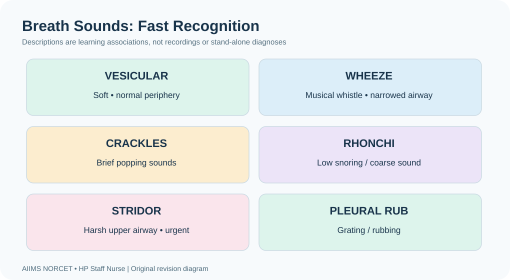
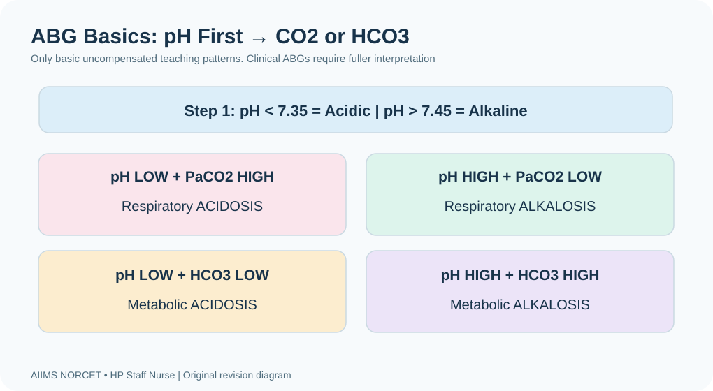
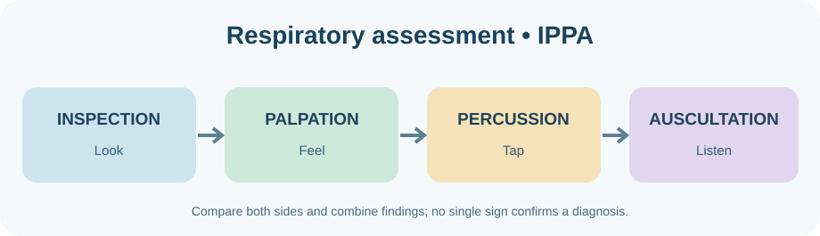

# 📝 Day 2 — Respiratory Assessment & Diagnostics: 59 Practice MCQ slots

[🏠 Chapter](../README.md) · [📖 Day 2 Concepts](../Concepts/Day-02-Complete-Respiratory-Assessment-Diagnostics.md) · [⚡ Revision](../Revision/Day-02-Quick-Revision.md) · [🏥 Previous Year Questions](../Previous-Year-Questions/README.md)

> **Dhyan de:** Sawaal aur A/B/C/D options original English mein hain. Answer ki explanation easy Hinglish mein hai. Ye practice questions hain, actual Previous Year Questions nahi.

## 🎬 YouTube se concept aur MCQ practice

**Dhyan de:** Neeche actual topic-related videos ke links hain. Ye official past paper ki proof nahi hain; video descriptions ke basis par select kiye hain.

- **Concept video:** [Alka Medical Education — IPPA Hindi](https://www.youtube.com/watch?v=PdbeHsh1OPM)
- **MCQ practice:** [Ambition Nursing Classes — ABG MCQs](https://www.youtube.com/watch?v=G_2-0P9EfAg)
- [Day 2 ke subtopic-wise video links](../Concepts/Day-02-Complete-Respiratory-Assessment-Diagnostics.md). [Health Assessment & Physical Examination MCQs — Studyroom31](https://www.youtube.com/watch?v=aTGm3WCiS9w) ka published description IPPA practice cover karta hai (Q1–11). [Respiratory mixed MCQs](https://www.youtube.com/watch?v=_dOjXZ6vCck) ka description ABG practice cover karta hai (Q17–22). Exact question mapping, transcripts aur dedicated auscultation/spirometry MCQ video verification pending. Page mein 59 practice slots hain.

### Kaise solve karna hai?

1. **Pehle apna answer select** karo; explanation tabhi kholo.
2. IPPA mein **look, feel, tap, listen** ka difference samjho.
3. ABG mein pehle **pH**, fir **PaCO₂**, fir **HCO₃⁻** dekho.
4. Spirometry mein **FEV₁ / FVC × 100** formula use karo.

---

## Inspection — patient ko dekhna

[📖 Is topic ka detailed explanation](../Concepts/Day-02-Complete-Respiratory-Assessment-Diagnostics.md#2-inspection--patient-ko-dekhna) · [📚 Previous Year Questions](../Previous-Year-Questions/README.md)

### Q1. The first IPPA step in routine respiratory examination is:

- **A.** Percussion
- **B.** Inspection
- **C.** Auscultation
- **D.** Palpation

**Difficulty:** 🟢 Easy · **Priority:** 🟠 HIGH YIELD · NORCET / Staff Nurse (All India)

✅ Answer aur easy explanation dekho

**Correct answer: B. Inspection**

**Kyun sahi hai?** Routine stable respiratory examination mein pehle inspection hoti hai. Nurse breathing pattern, rate, effort aur chest symmetry observe karti hai. Agar patient unstable hai toh routine sequence se pehle emergency ABC assessment aur help priority hai.

**Baaki options kyun galat hain?**

- **A.** Percussion tapping se underlying sound assess karti hai.
- **C.** Auscultation stethoscope se sounds sunna hai.
- **D.** Palpation touch se tenderness, movement aur vibration assess karti hai.

**Exam trick:** IPPA = Dekho, Feel, Tap, Suno.

[Clinical reference](https://www.ncbi.nlm.nih.gov/books/NBK596716/)

**Related reported exam concept:** NVS Staff Nurse, 8 March 2022, third-party question about percussion technique. [Source](https://testbook.com/question-answer/what-is-called-percussion-in-physical-examination--624d4e073de2bf986ba48f0a). Not an exact match or independently verified official key.

[📖 Concept detail se padho](../Concepts/Day-02-Complete-Respiratory-Assessment-Diagnostics.md) · [📚 Paper-linked questions](../Previous-Year-Questions/README.md)

### Q2. Which finding primarily belongs to inspection?

- **A.** Chest expansion symmetry
- **B.** Tactile fremitus
- **C.** Percussion note
- **D.** Breath sound

**Difficulty:** 🟢 Easy · **Priority:** 🟡 IMPORTANT · NORCET / Staff Nurse (All India)

✅ Answer aur easy explanation dekho

**Correct answer: A. Chest expansion symmetry**

**Kyun sahi hai?** Chest ka visible rise aur fall observe karne se symmetry assess ho sakti hai. Chest expansion ko palpation se bhi compare kiya ja sakta hai. Yahan other options dekhne ke bajay touch, tapping aur listening require karte hain.

**Baaki options kyun galat hain?**

- **B.** Tactile fremitus hand se feel hota hai.
- **C.** Percussion note tapping se assess hota hai.
- **D.** Breath sounds auscultation se assess hote hain.

**Exam trick:** Method ko observation ke verb se match karo.

[Clinical reference](https://www.ncbi.nlm.nih.gov/books/NBK596716/)

[📖 Concept detail se padho](../Concepts/Day-02-Complete-Respiratory-Assessment-Diagnostics.md) · [📚 Paper-linked questions](../Previous-Year-Questions/README.md)

### Q3. A resting adult RR of 26/min is:

- **A.** Within 12–20/min
- **B.** Bradypnea
- **C.** Tachypnea
- **D.** Apnea

**Difficulty:** 🟢 Easy · **Priority:** 🟡 IMPORTANT · NORCET / Staff Nurse (All India)

✅ Answer aur easy explanation dekho

**Correct answer: C. Tachypnea**

**Kyun sahi hai?** Adult resting RR ka common nursing teaching range 12–20/min hai. 26/min fast breathing, yaani tachypnea hai. Nurse rate ke saath depth, work of breathing, oxygenation aur clinical context dekhe.

**Baaki options kyun galat hain?**

- **A.** 26 usual 12–20 range ke bahar hai.
- **B.** Bradypnea abnormally slow breathing hai.
- **D.** Apnea mein breathing temporarily absent hoti hai.

**Exam trick:** RR normal value ke saath clinical context bhi dekhna chahiye.

[Clinical reference](https://www.ncbi.nlm.nih.gov/books/NBK596716/)

[📖 Concept detail se padho](../Concepts/Day-02-Complete-Respiratory-Assessment-Diagnostics.md) · [📚 Paper-linked questions](../Previous-Year-Questions/README.md)

---

## Palpation — haath se feel karna

[📖 Is topic ka detailed explanation](../Concepts/Day-02-Complete-Respiratory-Assessment-Diagnostics.md#3-palpation--haath-se-feel-karna) · [📚 Previous Year Questions](../Previous-Year-Questions/README.md)

### Q4. A nurse places hands on the posterior chest to compare movement during inhalation. What is assessed?

- **A.** Chest expansion
- **B.** Percussion note
- **C.** Bronchial breathing
- **D.** PaCO₂

**Difficulty:** 🟢 Easy · **Priority:** 🟠 HIGH YIELD · NORCET / Staff Nurse (All India)

✅ Answer aur easy explanation dekho

**Correct answer: A. Chest expansion**

**Kyun sahi hai?** Posterior chest par hands rakhkar inspiration ke dauran bilateral movement compare karna palpation se chest expansion assess karna hai. Asymmetry further respiratory assessment ka clue ho sakti hai.

**Baaki options kyun galat hain?**

- **B.** Percussion note tapping se milta hai.
- **C.** Bronchial breathing auscultation finding hai.
- **D.** PaCO₂ arterial blood gas se measure hota hai.

**Exam trick:** Palpation = chest movement feel.

[Clinical reference](https://www.ncbi.nlm.nih.gov/books/NBK596716/)

[📖 Concept detail se padho](../Concepts/Day-02-Complete-Respiratory-Assessment-Diagnostics.md) · [📚 Paper-linked questions](../Previous-Year-Questions/README.md)

### Q5. A vibration felt over chest while patient speaks is called:

- **A.** Resonance
- **B.** Fremitus
- **C.** Wheeze
- **D.** Stridor

**Difficulty:** 🟢 Easy · **Priority:** 🟠 HIGH YIELD · NORCET / Staff Nurse (All India)

✅ Answer aur easy explanation dekho

**Correct answer: B. Fremitus**

**Kyun sahi hai?** Patient ke bolne se chest wall tak transmitted vibration ko tactile fremitus kehte hain. Nurse corresponding areas ko hands se compare karti hai. Underlying tissue aur pleural changes transmission affect kar sakte hain.

**Baaki options kyun galat hain?**

- **A.** Resonance percussion note hai.
- **C.** Wheeze musical breath sound hai.
- **D.** Stridor usually upper airway se aane wali harsh sound hai.

**Exam trick:** Voice vibration feel = tactile fremitus.

[Clinical reference](https://www.msdmanuals.com/professional/pulmonary-disorders/approach-to-the-pulmonary-patient/evaluation-of-the-patient-with-pulmonary-issues)

[📖 Concept detail se padho](../Concepts/Day-02-Complete-Respiratory-Assessment-Diagnostics.md) · [📚 Paper-linked questions](../Previous-Year-Questions/README.md)

### Q6. Tactile fremitus may increase with:

- **A.** Pleural effusion
- **B.** Pneumothorax
- **C.** Lung consolidation with open bronchus
- **D.** Large airway obstruction

**Difficulty:** 🟡 Medium · **Priority:** 🟠 HIGH YIELD · NORCET / Staff Nurse (All India)

✅ Answer aur easy explanation dekho

**Correct answer: C. Lung consolidation with open bronchus**

**Kyun sahi hai?** Consolidated lung tissue voice vibration ko air-filled lung se better conduct kar sakta hai jab bronchus patent ho. Isliye fremitus increase ho sakta hai. Finding alone pneumonia confirm nahi karti.

**Baaki options kyun galat hain?**

- **A.** Pleural fluid vibration transmission reduce kar sakta hai.
- **B.** Pleural air chest wall tak transmission reduce kar sakti hai.
- **D.** Obstructed airway voice transmission reduce kar sakta hai.

**Exam trick:** Increased = consolidation (open airway); decreased = fluid/air around lung.

[Clinical reference](https://www.msdmanuals.com/professional/pulmonary-disorders/approach-to-the-pulmonary-patient/evaluation-of-the-patient-with-pulmonary-issues)

[📖 Concept detail se padho](../Concepts/Day-02-Complete-Respiratory-Assessment-Diagnostics.md) · [📚 Paper-linked questions](../Previous-Year-Questions/README.md)

### Q7. A normally positioned trachea is typically:

- **A.** Deviated right
- **B.** Deviated left
- **C.** Not palpable
- **D.** Midline

**Difficulty:** 🟢 Easy · **Priority:** 🟠 HIGH YIELD · NORCET / Staff Nurse (All India)

✅ Answer aur easy explanation dekho

**Correct answer: D. Midline**

**Kyun sahi hai?** Normal trachea approximately midline hoti hai. Deviation ko clinical context mein assess karo. Acute distress aur hypotension ke saath deviation serious pathology ka clue ho sakti hai, lekin emergency recognition ke liye deviation ka wait nahi karna hai.

**Baaki options kyun galat hain?**

- **A.** Right deviation usual normal position nahi hai.
- **B.** Left deviation usual normal position nahi hai.
- **C.** Palpability examination technique aur anatomy par depend kar sakti hai. Normal location ka best answer midline hai.

**Exam trick:** Trachea position ko isolated diagnosis na banao.

[Clinical reference](https://www.ncbi.nlm.nih.gov/books/NBK596716/)

[📖 Concept detail se padho](../Concepts/Day-02-Complete-Respiratory-Assessment-Diagnostics.md) · [📚 Paper-linked questions](../Previous-Year-Questions/README.md)

---

## Percussion — chest ko tap karna

[📖 Is topic ka detailed explanation](../Concepts/Day-02-Complete-Respiratory-Assessment-Diagnostics.md#4-percussion--chest-tap-karna) · [📚 Previous Year Questions](../Previous-Year-Questions/README.md)

### Q8. Expected percussion sound over normal aerated lung:

- **A.** Dullness
- **B.** Resonance
- **C.** Flatness
- **D.** Tympany

**Difficulty:** 🟢 Easy · **Priority:** 🟠 HIGH YIELD · NORCET / Staff Nurse (All India)

✅ Answer aur easy explanation dekho

**Correct answer: B. Resonance**

**Kyun sahi hai?** Normal air-filled peripheral lung percussion par resonant, hollow note deta hai. Nurse corresponding areas compare karti hai aur finding ko baaki examination ke saath interpret karti hai.

**Baaki options kyun galat hain?**

- **A.** Dullness dense tissue ya fluid se associated ho sakti hai.
- **C.** Flatness dense structures jaise bone par expected ho sakti hai.
- **D.** Tympany drum-like sound hai, normal peripheral lung ka usual note nahi.

**Exam trick:** Normal lung percussion = resonant.

[Clinical reference](https://www.ncbi.nlm.nih.gov/books/NBK596716/)

[📖 Concept detail se padho](../Concepts/Day-02-Complete-Respiratory-Assessment-Diagnostics.md) · [📚 Paper-linked questions](../Previous-Year-Questions/README.md)

### Q9. Percussion over pleural fluid usually gives:

- **A.** Hyperresonance
- **B.** Tympany
- **C.** Dullness
- **D.** Normal resonance

**Difficulty:** 🟢 Easy · **Priority:** 🟠 HIGH YIELD · NORCET / Staff Nurse (All India)

✅ Answer aur easy explanation dekho

**Correct answer: C. Dullness**

**Kyun sahi hai?** Pleural space mein fluid percussion sound ko dampen karta hai. Isse dull ya marked dull note aa sakta hai. Effusion confirm karne ke liye clinical assessment aur imaging ki zaroorat ho sakti hai.

**Baaki options kyun galat hain?**

- **A.** Hyperresonance excess air suggest kar sakti hai.
- **B.** Tympany hollow air-containing structures se related hai.
- **D.** Normal resonance healthy aerated lung mein expected hoti hai.

**Exam trick:** Effusion = dull; pneumothorax = hyperresonant (often).

[Clinical reference](https://www.msdmanuals.com/professional/pulmonary-disorders/approach-to-the-pulmonary-patient/evaluation-of-the-patient-with-pulmonary-issues)

[📖 Concept detail se padho](../Concepts/Day-02-Complete-Respiratory-Assessment-Diagnostics.md) · [📚 Paper-linked questions](../Previous-Year-Questions/README.md)

### Q10. A hyperresonant percussion note suggests:

- **A.** Extra air
- **B.** Lung consolidation
- **C.** Pleural effusion
- **D.** Bone

**Difficulty:** 🟡 Medium · **Priority:** 🟠 HIGH YIELD · NORCET / Staff Nurse (All India)

✅ Answer aur easy explanation dekho

**Correct answer: A. Extra air**

**Kyun sahi hai?** Hyperresonance increased air content ka clue ho sakti hai, jaise pneumothorax ya hyperinflation. Ye single finding definitive diagnosis nahi hai. Sudden distress mein patient ki ABC assessment priority hai.

**Baaki options kyun galat hain?**

- **B.** Consolidation generally percussion dullness se related hai.
- **C.** Pleural fluid dullness produce kar sakta hai.
- **D.** Bone generally flat note deti hai.

**Exam trick:** Extra air vs fluid ko separate rakho.

[Clinical reference](https://www.msdmanuals.com/professional/pulmonary-disorders/approach-to-the-pulmonary-patient/evaluation-of-the-patient-with-pulmonary-issues)

[📖 Concept detail se padho](../Concepts/Day-02-Complete-Respiratory-Assessment-Diagnostics.md) · [📚 Paper-linked questions](../Previous-Year-Questions/README.md)

### Q11. Which method compares percussion notes side to side?

- **A.** Only one apex tested
- **B.** Listen only at sternum
- **C.** Test over clothing
- **D.** Compare corresponding areas

**Difficulty:** 🟢 Easy · **Priority:** 🟡 IMPORTANT · NORCET / Staff Nurse (All India)

✅ Answer aur easy explanation dekho

**Correct answer: D. Compare corresponding areas**

**Kyun sahi hai?** Chest examination mein same level ke right aur left lung fields ko compare karne se asymmetry identify karna aasaan hota hai. Appropriate exposure, privacy aur trained technique follow karo.

**Baaki options kyun galat hain?**

- **A.** Sirf ek apex assess karne se bilateral comparison nahi hota.
- **B.** Sternum par listening percussion comparison nahi hai.
- **C.** Clothing sound quality aur consistent technique interfere kar sakti hai.

**Exam trick:** Percussion symmetric sites pe karo.

[Clinical reference](https://www.ncbi.nlm.nih.gov/books/NBK596716/)

**Related reported exam concept:** NVS Staff Nurse, 8 March 2022, third-party question about percussion technique. [Source](https://testbook.com/question-answer/what-is-called-percussion-in-physical-examination--624d4e073de2bf986ba48f0a). Not an exact match or independently verified official key.

[📖 Concept detail se padho](../Concepts/Day-02-Complete-Respiratory-Assessment-Diagnostics.md) · [📚 Paper-linked questions](../Previous-Year-Questions/README.md)

---

## Auscultation — stethoscope se sunna

[📖 Is topic ka detailed explanation](../Concepts/Day-02-Complete-Respiratory-Assessment-Diagnostics.md#5-auscultation--stethoscope-se-sunna) · [📚 Previous Year Questions](../Previous-Year-Questions/README.md)

### Q12. Normal breath sound over most peripheral lung fields is:

- **A.** Bronchial
- **B.** Vesicular
- **C.** Stridor
- **D.** Pleural rub

**Difficulty:** 🟢 Easy · **Priority:** 🟠 HIGH YIELD · NORCET / Staff Nurse (All India)

✅ Answer aur easy explanation dekho

**Correct answer: B. Vesicular**

**Kyun sahi hai?** Healthy peripheral lung fields mein vesicular breath sounds usually soft aur low-pitched hoti hain. Inspiration expiratory component se relatively prominent hoti hai. Location aur clinical context important hain.

**Baaki options kyun galat hain?**

- **A.** Bronchial sounds central airway par normal ho sakti hain, peripheral lung par unexpected ho sakti hain.
- **C.** Stridor upper airway obstruction ka warning sign hai.
- **D.** Pleural rub inflamed pleural surfaces se associated adventitious sound hai.

**Exam trick:** Sound ka quality ke saath location bhi important.

[Clinical reference](https://www.msdmanuals.com/professional/pulmonary-disorders/approach-to-the-pulmonary-patient/evaluation-of-the-patient-with-pulmonary-issues)

[📖 Concept detail se padho](../Concepts/Day-02-Complete-Respiratory-Assessment-Diagnostics.md) · [📚 Paper-linked questions](../Previous-Year-Questions/README.md)

### Q13. High-pitched musical continuous breath sound is:

- **A.** Wheeze
- **B.** Crackles
- **C.** Friction rub
- **D.** Absent breath sound

**Difficulty:** 🟢 Easy · **Priority:** 🟠 HIGH YIELD · NORCET / Staff Nurse (All India)

✅ Answer aur easy explanation dekho

**Correct answer: A. Wheeze**

**Kyun sahi hai?** Wheeze continuous musical sound hai, often narrowed lower airways mein airflow ke saath sunai deti hai. Asthma ya COPD mein ho sakti hai, lekin wheeze alone specific diagnosis nahi hai.

**Baaki options kyun galat hain?**

- **B.** Crackles short discontinuous popping sounds hain.
- **C.** Friction rub grating sound hoti hai.
- **D.** Absent breath sound mein audible airflow sound markedly reduced ya absent hoti hai.

**Exam trick:** Musical continuous = wheeze.

[Clinical reference](https://www.msdmanuals.com/professional/pulmonary-disorders/approach-to-the-pulmonary-patient/evaluation-of-the-patient-with-pulmonary-issues)

[📖 Concept detail se padho](../Concepts/Day-02-Complete-Respiratory-Assessment-Diagnostics.md) · [📚 Paper-linked questions](../Previous-Year-Questions/README.md)

### Q14. Discontinuous popping on lung auscultation is called:

- **A.** Stridor
- **B.** Rhonchi
- **C.** Crackles
- **D.** Bronchial breathing

**Difficulty:** 🟢 Easy · **Priority:** 🟠 HIGH YIELD · NORCET / Staff Nurse (All India)

✅ Answer aur easy explanation dekho

**Correct answer: C. Crackles**

**Kyun sahi hai?** Crackles short, discontinuous popping sounds hoti hain. Ye small airway reopening ya fluid-associated lung conditions mein sunai de sakti hain. Clinical cause ko history aur assessment se determine karo.

**Baaki options kyun galat hain?**

- **A.** Stridor harsh upper airway sound hai.
- **B.** Rhonchi usually low-pitched continuous sound hoti hain.
- **D.** Bronchial breathing tubular sound hai, popping nahi.

**Exam trick:** Popping = crackles; musical = wheeze.

[Clinical reference](https://www.msdmanuals.com/professional/pulmonary-disorders/approach-to-the-pulmonary-patient/evaluation-of-the-patient-with-pulmonary-issues)

[📖 Concept detail se padho](../Concepts/Day-02-Complete-Respiratory-Assessment-Diagnostics.md) · [📚 Paper-linked questions](../Previous-Year-Questions/README.md)

### Q15. A harsh inspiratory sound at the neck suggesting upper-airway obstruction is:

- **A.** Rhonchi
- **B.** Vesicular
- **C.** Crackles
- **D.** Stridor

**Difficulty:** 🟡 Medium · **Priority:** 🟠 HIGH YIELD · NORCET / Staff Nurse (All India)

✅ Answer aur easy explanation dekho

**Correct answer: D. Stridor**

**Kyun sahi hai?** Neck par loud harsh inspiratory sound stridor suggest karti hai. Ye potentially serious upper airway narrowing ka clue hai. Patient ki airway aur breathing turant assess karo aur distress mein emergency escalation karo.

**Baaki options kyun galat hain?**

- **A.** Rhonchi low-pitched airway sound hoti hain.
- **B.** Vesicular sounds normal peripheral lung sounds hain.
- **C.** Crackles discontinuous popping sounds hain.

**Exam trick:** Stridor + difficulty breathing = urgent clinical assessment.

[Clinical reference](https://www.msdmanuals.com/professional/pulmonary-disorders/approach-to-the-pulmonary-patient/evaluation-of-the-patient-with-pulmonary-issues)

[📖 Concept detail se padho](../Concepts/Day-02-Complete-Respiratory-Assessment-Diagnostics.md) · [📚 Paper-linked questions](../Previous-Year-Questions/README.md)

### Q16. Grating sound associated with inflamed pleural surfaces:

- **A.** Pleural friction rub
- **B.** Wheeze
- **C.** Bronchovesicular
- **D.** Rhonchi

**Difficulty:** 🟢 Easy · **Priority:** 🟡 IMPORTANT · NORCET / Staff Nurse (All India)

✅ Answer aur easy explanation dekho

**Correct answer: A. Pleural friction rub**

**Kyun sahi hai?** Inflamed pleural surfaces respiration ke dauran rub kar sakti hain, jisse grating ya creaking sound aati hai. Pleural rub ko breathing cycle aur other clinical findings ke saath assess karo.

**Baaki options kyun galat hain?**

- **B.** Wheeze narrowed airway ka musical sound hai.
- **C.** Bronchovesicular sound central lung areas mein normal ho sakti hai.
- **D.** Rhonchi low-pitched continuous airway sounds hain.

**Exam trick:** Rub = pleura friction; wheeze = narrowed airway.

[Clinical reference](https://www.msdmanuals.com/professional/pulmonary-disorders/approach-to-the-pulmonary-patient/evaluation-of-the-patient-with-pulmonary-issues)

[📖 Concept detail se padho](../Concepts/Day-02-Complete-Respiratory-Assessment-Diagnostics.md) · [📚 Paper-linked questions](../Previous-Year-Questions/README.md)

---

## ABG basics aur interpretation

[📖 Is topic ka detailed explanation](../Concepts/Day-02-Complete-Respiratory-Assessment-Diagnostics.md#7-abg-interpretation--step-by-step) · [📚 Previous Year Questions](../Previous-Year-Questions/README.md)

### Q17. ABG pH 7.29, PaCO₂ 53 mmHg, HCO₃⁻ 24 mEq/L. Best primary disorder?

- **A.** Respiratory acidosis
- **B.** Respiratory alkalosis
- **C.** Metabolic acidosis
- **D.** Metabolic alkalosis

**Difficulty:** 🟡 Medium · **Priority:** 🟠 HIGH YIELD · NORCET / Staff Nurse (All India)

✅ Answer aur easy explanation dekho

**Correct answer: A. Respiratory acidosis**

**Kyun sahi hai?** pH 7.29 se acidemia aur PaCO₂ 53 mmHg se CO₂ retention dikh rahi hai. HCO₃⁻ 24 usual interval mein hai, isliye given options mein primary respiratory acidosis best hai. Rounded values se exact compensation stage assume mat karo.

**Baaki options kyun galat hain?**

- **B.** Respiratory alkalosis mein primary PaCO₂ decrease hoti hai.
- **C.** Metabolic acidosis mein primary HCO₃⁻ decrease hota hai.
- **D.** Metabolic alkalosis mein primary HCO₃⁻ increase hota hai.

**Exam trick:** ABG sequence: pH → CO₂ → HCO₃⁻.

[Clinical reference](https://www.merckmanuals.com/professional/multimedia/table/primary-changes-and-compensations-in-simple-acid-base-disorders)

**Historical research lead:** NORCET-3 Shift 2 (2022), reported Q139 respiratory acidosis topic, [indexed source](https://nextnurse.in/pyq/norcet/norcet-norcet-3-shift-2). Direct retrieval failed, exact wording and key pending.

[📖 Concept detail se padho](../Concepts/Day-02-Complete-Respiratory-Assessment-Diagnostics.md) · [📚 Paper-linked questions](../Previous-Year-Questions/README.md)

### Q18. ABG pH 7.49, PaCO₂ 31, HCO₃⁻ 24. Best interpretation?

- **A.** Metabolic acidosis
- **B.** Respiratory alkalosis
- **C.** Respiratory acidosis
- **D.** Metabolic alkalosis

**Difficulty:** 🟡 Medium · **Priority:** 🟠 HIGH YIELD · NORCET / Staff Nurse (All India)

✅ Answer aur easy explanation dekho

**Correct answer: B. Respiratory alkalosis**

**Kyun sahi hai?** pH 7.49 alkalemia hai aur PaCO₂ 31 low hai. Isliye primary respiratory alkalosis best answer hai. HCO₃⁻ 24 usual teaching interval mein hai, lekin acute compensation aur rounding ki wajah se values ko simple pattern se aage clinical context mein assess karo.

**Baaki options kyun galat hain?**

- **A.** Metabolic acidosis primary low bicarbonate aur acidemia se associated hai.
- **C.** Respiratory acidosis primary high PaCO₂ se associated hai.
- **D.** Metabolic alkalosis primary bicarbonate elevation se associated hai.

**Exam trick:** CO₂ aur pH opposite direction in primary respiratory disorders.

[Clinical reference](https://www.merckmanuals.com/professional/multimedia/table/primary-changes-and-compensations-in-simple-acid-base-disorders)

[📖 Concept detail se padho](../Concepts/Day-02-Complete-Respiratory-Assessment-Diagnostics.md) · [📚 Paper-linked questions](../Previous-Year-Questions/README.md)

### Q19. ABG pH 7.27, PaCO₂ 40, HCO₃⁻ 17. Primary abnormality?

- **A.** Respiratory alkalosis
- **B.** Respiratory acidosis
- **C.** Metabolic acidosis
- **D.** Metabolic alkalosis

**Difficulty:** 🟡 Medium · **Priority:** 🟠 HIGH YIELD · NORCET / Staff Nurse (All India)

✅ Answer aur easy explanation dekho

**Correct answer: C. Metabolic acidosis**

**Kyun sahi hai?** pH 7.27 acidemia aur HCO₃⁻ 17 low hai, isliye primary metabolic acidosis best answer hai. Important: PaCO₂ 40 reference interval mein hone ke bawajood compensation appropriate nahi ho sakti. Winter formula se expected PaCO₂ 33.5 ±2 mmHg hai. Actual 40 higher hai, jo additional respiratory acidosis suggest karta hai. Given options mein mixed disorder nahi hai, isliye primary answer C preserve hai.

**Baaki options kyun galat hain?**

- **A.** Respiratory alkalosis primary low PaCO₂ se associated hai.
- **B.** Additional respiratory acidosis possible hai, lekin low bicarbonate primary metabolic component bhi dikhata hai.
- **D.** Metabolic alkalosis mein bicarbonate high hota hai.

**Exam trick:** HCO₃⁻ down + pH down = metabolic acidosis.

[Clinical reference](https://www.merckmanuals.com/professional/multimedia/table/primary-changes-and-compensations-in-simple-acid-base-disorders)

[📖 Concept detail se padho](../Concepts/Day-02-Complete-Respiratory-Assessment-Diagnostics.md) · [📚 Paper-linked questions](../Previous-Year-Questions/README.md)

### Q20. Which parameter primarily reflects respiratory acid-base component?

- **A.** HCO₃⁻
- **B.** Hemoglobin
- **C.** PaO₂
- **D.** PaCO₂

**Difficulty:** 🟢 Easy · **Priority:** 🟠 HIGH YIELD · NORCET / Staff Nurse (All India)

✅ Answer aur easy explanation dekho

**Correct answer: D. PaCO₂**

**Kyun sahi hai?** PaCO₂ arterial carbon dioxide pressure hai aur ventilation ke respiratory acid-base component ko reflect karta hai. CO₂ removal kam hone se PaCO₂ badh sakti hai. HCO₃⁻ metabolic component hai.

**Baaki options kyun galat hain?**

- **A.** Bicarbonate primary metabolic component hai.
- **B.** Hemoglobin oxygen carrying capacity mein important hai, primary respiratory acid-base variable nahi.
- **C.** PaO₂ oxygenation ka partial pressure hai, CO₂-related acid-base component nahi.

**Exam trick:** CO₂ = respiratory; HCO₃⁻ = metabolic.

[Clinical reference](https://www.merckmanuals.com/professional/multimedia/table/primary-changes-and-compensations-in-simple-acid-base-disorders)

[📖 Concept detail se padho](../Concepts/Day-02-Complete-Respiratory-Assessment-Diagnostics.md) · [📚 Paper-linked questions](../Previous-Year-Questions/README.md)

### Q21. The usual arterial pH teaching interval is:

- **A.** 7.35–7.45
- **B.** 7.25–7.35
- **C.** 7.45–7.55
- **D.** 7.15–7.25

**Difficulty:** 🟢 Easy · **Priority:** 🟠 HIGH YIELD · NORCET / Staff Nurse (All India)

✅ Answer aur easy explanation dekho

**Correct answer: A. 7.35–7.45**

**Kyun sahi hai?** Usual arterial blood pH teaching interval 7.35–7.45 hai. Patient ka clinical context aur laboratory reference bhi dekho. pH low acidemia aur pH high alkalemia ko indicate karta hai.

**Baaki options kyun galat hain?**

- **B.** 7.25–7.35 ka major portion usual range se low hai.
- **C.** 7.45–7.55 ka major portion usual range se high hai.
- **D.** 7.15–7.25 usual interval se low hai.

**Exam trick:** pH normal 7.35–7.45; PaCO₂ normal 35–45.

[Clinical reference](https://www.merckmanuals.com/professional/multimedia/table/primary-changes-and-compensations-in-simple-acid-base-disorders)

[📖 Concept detail se padho](../Concepts/Day-02-Complete-Respiratory-Assessment-Diagnostics.md) · [📚 Paper-linked questions](../Previous-Year-Questions/README.md)

### Q22. pH 7.48, PaCO₂ 40, HCO₃⁻ 30 suggests:

- **A.** Metabolic acidosis
- **B.** Metabolic alkalosis
- **C.** Respiratory acidosis
- **D.** Respiratory alkalosis

**Difficulty:** 🟡 Medium · **Priority:** 🟠 HIGH YIELD · NORCET / Staff Nurse (All India)

✅ Answer aur easy explanation dekho

**Correct answer: B. Metabolic alkalosis**

**Kyun sahi hai?** pH 7.48 high aur HCO₃⁻ 30 high hai, jo primary metabolic alkalosis support karta hai. PaCO₂ 40 normal range mein hai, lekin metabolic alkalosis mein compensatory CO₂ rise expected ho sakta hai. Isliye absent ya inadequate compensation ya additional respiratory alkalosis possible hai. Given options mein B best primary pattern hai, mixed disorder exclude nahi hua.

**Baaki options kyun galat hain?**

- **A.** Metabolic acidosis mein bicarbonate low hota hai.
- **C.** Respiratory acidosis mein primary PaCO₂ elevation hoti hai.
- **D.** Respiratory alkalosis mein primary PaCO₂ reduction hoti hai.

**Exam trick:** Uncompensated textbook example; actual patient ABG complex ho sakta hai.

[Clinical reference](https://www.merckmanuals.com/professional/multimedia/table/primary-changes-and-compensations-in-simple-acid-base-disorders)

[📖 Concept detail se padho](../Concepts/Day-02-Complete-Respiratory-Assessment-Diagnostics.md) · [📚 Paper-linked questions](../Previous-Year-Questions/README.md)

---

## Spirometry — FEV1, FVC aur ratios

[📖 Is topic ka detailed explanation](../Concepts/Day-02-Complete-Respiratory-Assessment-Diagnostics.md#8-spirometry--fev₁-fvc-aur-ratio) · [📚 Previous Year Questions](../Previous-Year-Questions/README.md)

### Q23. FEV₁ is the volume exhaled during:

- **A.** First 1 second of forced expiration
- **B.** First 3 seconds of normal expiration
- **C.** A normal breath
- **D.** After full expiration

**Difficulty:** Easy | **Exam focus:** NORCET / Staff Nurse (All India)

✅ Answer aur easy explanation dekho

**A.** FEV₁ = forced expiration ke **first 1 second** ka volume.

**Baaki options kyun nahi?** FEV₁ ka '1' exactly **first second of forced exhalation** ko show karta hai. Normal quiet breath, 3 sec ya full expiration FEV₁ ki definition nahi.

**Exam trick:** FEV₁ = forced expiratory volume in ONE second.

[📖 Concept detail se padho](../Concepts/Day-02-Complete-Respiratory-Assessment-Diagnostics.md) · [📚 Paper-linked questions](../Previous-Year-Questions/README.md)

### Q24. FVC refers to:

- **A.** Remaining air after full expiration
- **B.** Total forcibly exhaled air after maximal inspiration
- **C.** Resting tidal volume
- **D.** Peak inspiratory flow

**Difficulty:** Easy | **Exam focus:** NORCET / Staff Nurse (All India)

✅ Answer aur easy explanation dekho

**B.** FVC = maximum inspiration ke baad **total forcefully expired volume**.

**Baaki options kyun nahi?** **FVC** patient maximal inhale ke baad forcefully exhale kar sakti total volume hai. RV remaining air hota hai, TV ordinary breath aur PEF ek flow rate hai—not total forced expired volume.

**Exam trick:** FVC = total exhaled; FEV₁ = first second.

[📖 Concept detail se padho](../Concepts/Day-02-Complete-Respiratory-Assessment-Diagnostics.md) · [📚 Paper-linked questions](../Previous-Year-Questions/README.md)

### Q25. FEV₁ 2.4 L and FVC 3.2 L. FEV₁/FVC?

- **A.** 60%
- **B.** 70%
- **C.** 75%
- **D.** 80%

**Difficulty:** Medium | **Exam focus:** NORCET / Staff Nurse (All India)

✅ Answer aur easy explanation dekho

**C.** (2.4 ÷ 3.2) × 100 = **75%**.

**Baaki options kyun nahi?** Correct numerator **FEV₁=2.4 L**, denominator **FVC=3.2 L**. (2.4/3.2)×100=**75%**. Inverse ratio ya bina 100 multiply wrong ho jayega.

**Exam trick:** FEV₁/FVC = fraction first second; interpret with reference criteria.

[📖 Concept detail se padho](../Concepts/Day-02-Complete-Respiratory-Assessment-Diagnostics.md) · [📚 Paper-linked questions](../Previous-Year-Questions/README.md)

### Q26. Which cannot be measured directly with basic spirometry?

- **A.** FEV₁
- **B.** FVC
- **C.** TV
- **D.** RV

**Difficulty:** Medium | **Exam focus:** NORCET / Staff Nurse (All India)

✅ Answer aur easy explanation dekho

**D.** **RV** lungs mein maximum expiration ke baad bachi air hai, isliye simple spirometry directly measure nahi karti.

**Baaki options kyun nahi?** **RV** maximum forced expiration ke baad lungs mein remain karta hai, isliye routine simple spirometry isko measure nahi karti. FEV₁ aur FVC forced exhalation se milte hain; TV bhi basic breathing maneuver se assess ho sakta hai.

**Exam trick:** Simple spirometry → RV not directly measurable.

[📖 Concept detail se padho](../Concepts/Day-02-Complete-Respiratory-Assessment-Diagnostics.md) · [📚 Paper-linked questions](../Previous-Year-Questions/README.md)

### Q27. A reduced FEV₁/FVC is most suggestive of:

- **A.** Airflow obstruction
- **B.** Purely normal testing
- **C.** Confirmed restrictive disease
- **D.** Pulmonary edema by itself

**Difficulty:** Medium | **Exam focus:** NORCET / Staff Nurse (All India)

✅ Answer aur easy explanation dekho

**A.** Reduced ratio **airflow obstruction** suggest karta hai. Correct interpretation context aur reference values par depend karti hai.

**Baaki options kyun nahi?** Reduced **FEV₁/FVC** airflow obstruction suggest karta hai. Sirf ratio se specific disease ya edema diagnose nahi; restriction confirm karne ke liye TLC chahiye.

**Exam trick:** Fixed 70% universal cutoff mat samajhna; age-dependent reference values important.

[📖 Concept detail se padho](../Concepts/Day-02-Complete-Respiratory-Assessment-Diagnostics.md) · [📚 Paper-linked questions](../Previous-Year-Questions/README.md)

### Q28. A reduced FVC with preserved FEV₁/FVC:

- **A.** Confirms restriction by itself
- **B.** Can suggest restriction, requiring TLC confirmation
- **C.** Proves asthma
- **D.** Always means normal lungs

**Difficulty:** Difficult | **Exam focus:** NORCET / Staff Nurse (All India)

✅ Answer aur easy explanation dekho

**B.** Restriction **suspect** ho sakti hai, lekin **TLC** measure kiye bina confirm nahi hoti.

**Baaki options kyun nahi?** Low FVC se restriction suspect ho sakti hai **par confirm nahi**. TLC low hona confirmatory hai. FVC low obstruction, effort aur other factors se bhi ho sakti hai, isliye baaki options too absolute hain.

**Exam trick:** Low FVC ≠ confirmed restriction.

[📖 Concept detail se padho](../Concepts/Day-02-Complete-Respiratory-Assessment-Diagnostics.md) · [📚 Paper-linked questions](../Previous-Year-Questions/README.md)

---

## Basic diagnostic investigations — introduction only

[📖 Is topic ka detailed explanation](../Concepts/Day-02-Complete-Respiratory-Assessment-Diagnostics.md#9-basic-diagnostic-investigations) · [📚 Previous Year Questions](../Previous-Year-Questions/README.md)

### Q29. Which non-invasive device estimates oxygen saturation?

- **A.** Pulse oximeter
- **B.** Spirometer
- **C.** Percussion hammer
- **D.** Stethoscope

**Difficulty:** Easy | **Exam focus:** NORCET / Staff Nurse (All India)

✅ Answer aur easy explanation dekho

**A.** **Pulse oximeter** SpO₂ percentage estimate karta hai.

**Baaki options kyun nahi?** **Pulse oximeter** finger pe clip se SpO₂ estimate karta hai. Spirometer airflow measure, percussion hammer tapping aur stethoscope sounds sunta hai.

**Exam trick:** SpO₂ = percentage; PaO₂ = pressure.

[📖 Concept detail se padho](../Concepts/Day-02-Complete-Respiratory-Assessment-Diagnostics.md) · [📚 Paper-linked questions](../Previous-Year-Questions/README.md)

### Q30. Which test provides arterial pH and PaCO₂?

- **A.** Chest X-ray
- **B.** ABG
- **C.** Spirometry
- **D.** Routine auscultation

**Difficulty:** Medium | **Exam focus:** NORCET / Staff Nurse (All India)

✅ Answer aur easy explanation dekho

**B.** **ABG (arterial blood gas)** pH, PaCO₂ aur PaO₂ jaise parameters batata hai.

**Baaki options kyun nahi?** **ABG** arterial sample se pH aur PaCO₂ deta hai. CXR image deta, spirometry airflow aur auscultation sounds batata hai. In methods ko interchange mat karna.

**Exam trick:** ABG = oxygenation + acid-base assessment.

[📖 Concept detail se padho](../Concepts/Day-02-Complete-Respiratory-Assessment-Diagnostics.md) · [📚 Paper-linked questions](../Previous-Year-Questions/README.md)

### Q31. Which basic test is designed to measure forced expiratory airflow?

- **A.** Sputum culture
- **B.** Pulse oximetry
- **C.** Spirometry
- **D.** Chest X-ray

**Difficulty:** Easy | **Exam focus:** NORCET / Staff Nurse (All India)

✅ Answer aur easy explanation dekho

**C.** **Spirometry** forced airflow aur expiratory volumes assess karti hai.

**Baaki options kyun nahi?** Forced expiratory flow/volume **spirometry** assess karti hai. Sputum culture microorganisms, pulse oximetry saturation aur CXR chest anatomy image assess karta hai.

**Exam trick:** Spirometry = FEV₁, FVC, ratio.

[📖 Concept detail se padho](../Concepts/Day-02-Complete-Respiratory-Assessment-Diagnostics.md) · [📚 Paper-linked questions](../Previous-Year-Questions/README.md)

---

## Extra 5 practice MCQs — studied concepts

[📖 Is topic ka detailed explanation](../Concepts/Day-02-Complete-Respiratory-Assessment-Diagnostics.md#7-abg-interpretation--step-by-step) · [📚 Previous Year Questions](../Previous-Year-Questions/README.md)

These use only assessment, ABG and spirometry concepts already studied. Each answer remains hidden until you expand it.

### Q32. A nurse asks a patient to say “ninety-nine” and feels increased vibration over one area of the chest. Which examination step is being performed?

- **A.** Inspection
- **B.** Palpation
- **C.** Percussion
- **D.** Auscultation

**Difficulty:** Medium | **Exam focus:** NORCET / Staff Nurse (All India)

💡 Hint (answer-neutral)

Question mein vibration **feel** ho rahi hai, sound sunna nahi.

✅ Answer aur easy explanation dekho

**B.** Ye **palpation** hai: tactile fremitus ko haath se feel kiya jaata hai.

**Baaki options kyun nahi?** Question mein nurse vibration **hands se feel** kar rahi hai—ye tactile **fremitus / palpation** hai. Auscultation mein stethoscope se sound suna jaata hai; percussion tapping hoti hai.

**Exam trick:** 'ninety-nine' + feel = palpation.

[📖 Concept detail se padho](../Concepts/Day-02-Complete-Respiratory-Assessment-Diagnostics.md) · [📚 Paper-linked questions](../Previous-Year-Questions/README.md)

### Q33. A patient has pH 7.50, PaCO₂ 30 mmHg and HCO₃⁻ 24 mEq/L. What is the best basic primary ABG pattern?

- **A.** Respiratory acidosis
- **B.** Metabolic acidosis
- **C.** Respiratory alkalosis
- **D.** Metabolic alkalosis

**Difficulty:** Medium | **Exam focus:** NORCET / Staff Nurse (All India)

💡 Hint (answer-neutral)

pH acidic side hai ya alkaline? Fir CO₂ aur bicarbonate compare karo.

✅ Answer aur easy explanation dekho

**C.** pH high + PaCO₂ low → **respiratory alkalosis** (simple uncompensated example).

**Baaki options kyun nahi?** pH **7.50** above normal hai; PaCO₂ **30** below normal, HCO₃⁻ normal hai. Primary respiratory alkalosis ki pattern banti hai. Acidosis mein pH low hota.

**Exam trick:** pH high + CO₂ low = respiratory alkalosis.

[📖 Concept detail se padho](../Concepts/Day-02-Complete-Respiratory-Assessment-Diagnostics.md) · [📚 Paper-linked questions](../Previous-Year-Questions/README.md)

### Q34. A nurse hears a loud harsh, predominantly inspiratory sound from the upper airway. What is this sound called?

- **A.** Vesicular breathing
- **B.** Stridor
- **C.** Fine crackles
- **D.** Rhonchi

**Difficulty:** Medium | **Exam focus:** NORCET / Staff Nurse (All India)

💡 Hint (answer-neutral)

Harsh **upper airway** inspiratory sound ko musical chest wheeze se confuse mat karo.

✅ Answer aur easy explanation dekho

**B.** **Stridor**. Ye upper-airway obstruction ka possible sign hai, so urgent assessment chahiye.

**Baaki options kyun nahi?** **Stridor** loud harsh upper-airway noise hai, inspiration mein prominent ho sakti hai. Vesicular normal soft, crackles pops, rhonchi low snoring hain. Stridor ko routine wheeze mat samajhna.

**Exam trick:** Upper airway sign, urgent attention needed.

[📖 Concept detail se padho](../Concepts/Day-02-Complete-Respiratory-Assessment-Diagnostics.md) · [📚 Paper-linked questions](../Previous-Year-Questions/README.md)

### Q35. An acceptable forced expiratory manoeuvre gives FEV₁ 1.8 L and FVC 3.0 L. What is FEV₁/FVC × 100?

- **A.** 50%
- **B.** 60%
- **C.** 65%
- **D.** 70%

**Difficulty:** Medium | **Exam focus:** NORCET / Staff Nurse (All India)

💡 Hint (answer-neutral)

FEV₁ numerator aur FVC denominator hoga; phir 100 se multiply karo.

✅ Answer aur easy explanation dekho

**B.** 1.8 ÷ 3.0 × 100 = **60%**. Ye mathematical ratio hai; interpretation ke liye appropriate reference criteria dekhne honge.

**Baaki options kyun nahi?** (1.8/3.0)×100 = **60%**. Agar 3.0/1.8 karoge ratio invalid ho jayega; answer options mein correct 60% B hai. Exact interpretation age/sex/height reference limits se hogi.

**Exam trick:** FEV₁ first second / FVC full forced exhalation.

[📖 Concept detail se padho](../Concepts/Day-02-Complete-Respiratory-Assessment-Diagnostics.md) · [📚 Paper-linked questions](../Previous-Year-Questions/README.md)

### Q36. A student says “A low FVC by itself confirms restrictive lung disease.” What is the best correction?

- **A.** A low FVC alone can suggest restriction, but TLC is needed for confirmation
- **B.** A low FVC always confirms airflow obstruction
- **C.** A low FVC is always a normal spirometry result
- **D.** Spirometry directly measures residual volume

**Difficulty:** Difficult | **Exam focus:** NORCET / Staff Nurse (All India)

💡 Hint (answer-neutral)

Low FVC se restriction **suspect** hoti hai; confirm kis lung capacity se hoti hai?

✅ Answer aur easy explanation dekho

**A.** **Low FVC alone restriction confirm nahi karta**. Restriction confirm karne ke liye **TLC** chahiye.

**Baaki options kyun nahi?** **Low FVC alone restriction prove nahi karti**; TLC measurement se confirm hoti hai. Options 'always normal' aur 'always obstructive' bhi galat hain. Spirometry RV directly measure nahi karti.

**Exam trick:** ATS/ERS interpretation: low FVC may suggest, not prove, restriction.

[📖 Concept detail se padho](../Concepts/Day-02-Complete-Respiratory-Assessment-Diagnostics.md) · [📚 Paper-linked questions](../Previous-Year-Questions/README.md)

---

[📖 Day 2 notes phir se padho](../Concepts/Day-02-Complete-Respiratory-Assessment-Diagnostics.md)

---

**🔗 Aage navigate karo:** [🏠 Chapter](../README.md) · [📖 Day 2 Concepts](../Concepts/Day-02-Complete-Respiratory-Assessment-Diagnostics.md) · [⚡ Revision](../Revision/Day-02-Quick-Revision.md) · [🏥 Previous Year Questions](../Previous-Year-Questions/README.md)

---

## Day 2 — Remaining Diagnostic Investigations (15 unattempted MCQs)

[Day 2 Concepts](https://github.com/priyankaverma12-RN12/aiims-norcet-staff-nurse-resources/blob/main/Chapters/Respiratory-System/Concepts/Day-02-Complete-Respiratory-Assessment-Diagnostics.md) · [Chapter](https://github.com/priyankaverma12-RN12/aiims-norcet-staff-nurse-resources/tree/main/Chapters/Respiratory-System) · [Previous Year Questions](https://github.com/priyankaverma12-RN12/aiims-norcet-staff-nurse-resources/tree/main/Chapters/Respiratory-System/Previous-Year-Questions) · [Revision](https://github.com/priyankaverma12-RN12/aiims-norcet-staff-nurse-resources/tree/main/Chapters/Respiratory-System/Revision)

**15 unattempted original practice MCQs.** English stems/options, Roman Hinglish solutions. Ye official previous-year paper nahi hai. Mock mein concepts revisit hote hain, stems/scenarios naye hain. Pehle solve karo, phir answer dropdown kholo.

[Research and reported Previous Year Question leads](Research-and-Paper-Leads.md)

### Q37. A patient who has undergone bronchoscopy requests water. What should the nurse do first?

**Difficulty:** Medium | **Exam focus:** NORCET / HP Staff Nurse / Nursing Officer (original exam-style)

- **A.** Give water immediately
- **B.** Place the patient in Trendelenburg position
- **C.** Give water through a straw
- **D.** Assess the return of gag reflex and safe swallowing before giving water

✅ Correct answer and detailed explanation

**Correct answer: D. Assess the return of gag reflex and safe swallowing before giving water**

**Kyun sahi hai:** Sedation/local anaesthesia protective swallowing reflex impair kar sakti hai; safe swallowing aur alertness confirm karo.

**Baaki options kyun nahi:** Immediate water aspiration risk hai; Trendelenburg reflex restore nahi karta; straw impaired swallowing safe nahi banata.

**Exam trick:** Safe swallow first, then oral intake.

[Day 2 Concepts](https://github.com/priyankaverma12-RN12/aiims-norcet-staff-nurse-resources/blob/main/Chapters/Respiratory-System/Concepts/Day-02-Complete-Respiratory-Assessment-Diagnostics.md) · [Chapter](https://github.com/priyankaverma12-RN12/aiims-norcet-staff-nurse-resources/tree/main/Chapters/Respiratory-System) · [Previous Year Questions](https://github.com/priyankaverma12-RN12/aiims-norcet-staff-nurse-resources/tree/main/Chapters/Respiratory-System/Previous-Year-Questions) · [Revision](https://github.com/priyankaverma12-RN12/aiims-norcet-staff-nurse-resources/tree/main/Chapters/Respiratory-System/Revision)

### Q38. A sputum culture is ordered. Which specimen is most useful?

**Difficulty:** Medium | **Exam focus:** NORCET / HP Staff Nurse / Nursing Officer (original exam-style)

- **A.** Deeply coughed lower respiratory secretion
- **B.** Saliva
- **C.** Nasal discharge
- **D.** Exhaled air

✅ Correct answer and detailed explanation

**Correct answer: A. Deeply coughed lower respiratory secretion**

**Kyun sahi hai:** Actual lower airway secretion organism identify karne mein useful hai.

**Baaki options kyun nahi:** Saliva oral contamination; nasal discharge upper airway; exhaled air sputum nahi.

**Exam trick:** Sputum = deep cough, not saliva.

[Day 2 Concepts](https://github.com/priyankaverma12-RN12/aiims-norcet-staff-nurse-resources/blob/main/Chapters/Respiratory-System/Concepts/Day-02-Complete-Respiratory-Assessment-Diagnostics.md) · [Chapter](https://github.com/priyankaverma12-RN12/aiims-norcet-staff-nurse-resources/tree/main/Chapters/Respiratory-System) · [Previous Year Questions](https://github.com/priyankaverma12-RN12/aiims-norcet-staff-nurse-resources/tree/main/Chapters/Respiratory-System/Previous-Year-Questions) · [Revision](https://github.com/priyankaverma12-RN12/aiims-norcet-staff-nurse-resources/tree/main/Chapters/Respiratory-System/Revision)

### Q39. A stable patient has suspected pneumothorax. Why may a chest radiograph be ordered?

**Difficulty:** Medium | **Exam focus:** NORCET / HP Staff Nurse / Nursing Officer (original exam-style)

- **A.** Identify pleural air and assess lung expansion
- **B.** Identify bacteria
- **C.** Measure arterial pH
- **D.** Measure FEV1

✅ Correct answer and detailed explanation

**Correct answer: A. Identify pleural air and assess lung expansion**

**Kyun sahi hai:** X-ray pleural air aur lung expansion ka structural clue deta hai.

**Baaki options kyun nahi:** pH ABG se; bacteria culture se; FEV1 spirometry se. Unstable emergency mein imaging ke liye care delay nahi.

**Exam trick:** X-ray structure, ABG gases.

[Day 2 Concepts](https://github.com/priyankaverma12-RN12/aiims-norcet-staff-nurse-resources/blob/main/Chapters/Respiratory-System/Concepts/Day-02-Complete-Respiratory-Assessment-Diagnostics.md) · [Chapter](https://github.com/priyankaverma12-RN12/aiims-norcet-staff-nurse-resources/tree/main/Chapters/Respiratory-System) · [Previous Year Questions](https://github.com/priyankaverma12-RN12/aiims-norcet-staff-nurse-resources/tree/main/Chapters/Respiratory-System/Previous-Year-Questions) · [Revision](https://github.com/priyankaverma12-RN12/aiims-norcet-staff-nurse-resources/tree/main/Chapters/Respiratory-System/Revision)

### Q40. Which test provides cross-sectional images of lung anatomy?

**Difficulty:** Easy | **Exam focus:** NORCET / HP Staff Nurse / Nursing Officer (original exam-style)

- **A.** Pulse oximetry
- **B.** Computed tomography
- **C.** Capnography
- **D.** Sputum culture

✅ Correct answer and detailed explanation

**Correct answer: B. Computed tomography**

**Kyun sahi hai:** CT detailed anatomical slices deta hai.

**Baaki options kyun nahi:** Capnography CO2; culture microbes; oximetry saturation estimate.

**Exam trick:** CT = detailed slices.

[Day 2 Concepts](https://github.com/priyankaverma12-RN12/aiims-norcet-staff-nurse-resources/blob/main/Chapters/Respiratory-System/Concepts/Day-02-Complete-Respiratory-Assessment-Diagnostics.md) · [Chapter](https://github.com/priyankaverma12-RN12/aiims-norcet-staff-nurse-resources/tree/main/Chapters/Respiratory-System) · [Previous Year Questions](https://github.com/priyankaverma12-RN12/aiims-norcet-staff-nurse-resources/tree/main/Chapters/Respiratory-System/Previous-Year-Questions) · [Revision](https://github.com/priyankaverma12-RN12/aiims-norcet-staff-nurse-resources/tree/main/Chapters/Respiratory-System/Revision)

### Q41. Which procedure directly visualizes an abnormality inside the bronchial lumen?

**Difficulty:** Medium | **Exam focus:** NORCET / HP Staff Nurse / Nursing Officer (original exam-style)

- **A.** Bronchoscopy
- **B.** Percussion
- **C.** Thoracentesis
- **D.** ABG analysis

✅ Correct answer and detailed explanation

**Correct answer: A. Bronchoscopy**

**Kyun sahi hai:** Bronchoscope airway lumen ka direct view deta hai.

**Baaki options kyun nahi:** Thoracentesis pleural fluid; percussion external assessment; ABG gases/pH.

**Exam trick:** Bronchoscopy = scope inside bronchus.

[Day 2 Concepts](https://github.com/priyankaverma12-RN12/aiims-norcet-staff-nurse-resources/blob/main/Chapters/Respiratory-System/Concepts/Day-02-Complete-Respiratory-Assessment-Diagnostics.md) · [Chapter](https://github.com/priyankaverma12-RN12/aiims-norcet-staff-nurse-resources/tree/main/Chapters/Respiratory-System) · [Previous Year Questions](https://github.com/priyankaverma12-RN12/aiims-norcet-staff-nurse-resources/tree/main/Chapters/Respiratory-System/Previous-Year-Questions) · [Revision](https://github.com/priyankaverma12-RN12/aiims-norcet-staff-nurse-resources/tree/main/Chapters/Respiratory-System/Revision)

### Q42. A patient has pleural effusion. Which procedure obtains pleural fluid for analysis?

**Difficulty:** Medium | **Exam focus:** NORCET / HP Staff Nurse / Nursing Officer (original exam-style)

- **A.** Thoracentesis
- **B.** Bronchoscopy
- **C.** Spirometry
- **D.** Capnography

✅ Correct answer and detailed explanation

**Correct answer: A. Thoracentesis**

**Kyun sahi hai:** Thoracentesis pleural space se fluid sample leti hai.

**Baaki options kyun nahi:** Spirometry airflow; bronchoscopy lumen; capnography expired CO2.

**Exam trick:** Pleural fluid = thoracentesis.

[Day 2 Concepts](https://github.com/priyankaverma12-RN12/aiims-norcet-staff-nurse-resources/blob/main/Chapters/Respiratory-System/Concepts/Day-02-Complete-Respiratory-Assessment-Diagnostics.md) · [Chapter](https://github.com/priyankaverma12-RN12/aiims-norcet-staff-nurse-resources/tree/main/Chapters/Respiratory-System) · [Previous Year Questions](https://github.com/priyankaverma12-RN12/aiims-norcet-staff-nurse-resources/tree/main/Chapters/Respiratory-System/Previous-Year-Questions) · [Revision](https://github.com/priyankaverma12-RN12/aiims-norcet-staff-nurse-resources/tree/main/Chapters/Respiratory-System/Revision)

### Q43. Which procedure obtains lung tissue for histopathology?

**Difficulty:** Easy | **Exam focus:** NORCET / HP Staff Nurse / Nursing Officer (original exam-style)

- **A.** Lung biopsy
- **B.** Chest radiography
- **C.** Sputum microscopy
- **D.** Pulse oximetry

✅ Correct answer and detailed explanation

**Correct answer: A. Lung biopsy**

**Kyun sahi hai:** Biopsy tissue architecture examine karti hai.

**Baaki options kyun nahi:** Sputum secretions; oximetry saturation; radiograph image, tissue nahi.

**Exam trick:** Biopsy = tissue.

[Day 2 Concepts](https://github.com/priyankaverma12-RN12/aiims-norcet-staff-nurse-resources/blob/main/Chapters/Respiratory-System/Concepts/Day-02-Complete-Respiratory-Assessment-Diagnostics.md) · [Chapter](https://github.com/priyankaverma12-RN12/aiims-norcet-staff-nurse-resources/tree/main/Chapters/Respiratory-System) · [Previous Year Questions](https://github.com/priyankaverma12-RN12/aiims-norcet-staff-nurse-resources/tree/main/Chapters/Respiratory-System/Previous-Year-Questions) · [Revision](https://github.com/priyankaverma12-RN12/aiims-norcet-staff-nurse-resources/tree/main/Chapters/Respiratory-System/Revision)

### Q44. Which investigation compares regional airflow and pulmonary blood flow?

**Difficulty:** Medium | **Exam focus:** NORCET / HP Staff Nurse / Nursing Officer (original exam-style)

- **A.** Bronchoscopy
- **B.** Ventilation-perfusion scan
- **C.** Peak flow
- **D.** Sputum culture

✅ Correct answer and detailed explanation

**Correct answer: B. Ventilation-perfusion scan**

**Kyun sahi hai:** V/Q scan regional ventilation aur perfusion compare karta hai.

**Baaki options kyun nahi:** Peak flow expiratory speed; bronchoscopy lumen; culture organisms.

**Exam trick:** V = air; Q = blood flow.

[Day 2 Concepts](https://github.com/priyankaverma12-RN12/aiims-norcet-staff-nurse-resources/blob/main/Chapters/Respiratory-System/Concepts/Day-02-Complete-Respiratory-Assessment-Diagnostics.md) · [Chapter](https://github.com/priyankaverma12-RN12/aiims-norcet-staff-nurse-resources/tree/main/Chapters/Respiratory-System) · [Previous Year Questions](https://github.com/priyankaverma12-RN12/aiims-norcet-staff-nurse-resources/tree/main/Chapters/Respiratory-System/Previous-Year-Questions) · [Revision](https://github.com/priyankaverma12-RN12/aiims-norcet-staff-nurse-resources/tree/main/Chapters/Respiratory-System/Revision)

### Q45. A monitor displays end-tidal carbon dioxide in mmHg. What does this represent?

**Difficulty:** Medium | **Exam focus:** NORCET / HP Staff Nurse / Nursing Officer (original exam-style)

- **A.** Tidal volume
- **B.** Blood bicarbonate
- **C.** Arterial oxygen saturation
- **D.** CO2 at the end of exhalation

✅ Correct answer and detailed explanation

**Correct answer: D. CO2 at the end of exhalation**

**Kyun sahi hai:** ETCO2 exhalation ke end ka CO2 pressure hai; PaCO2 exactly equal zaroori nahi.

**Baaki options kyun nahi:** Saturation %; volume mL; bicarbonate mEq/L.

**Exam trick:** End tidal = end of breath out.

[Day 2 Concepts](https://github.com/priyankaverma12-RN12/aiims-norcet-staff-nurse-resources/blob/main/Chapters/Respiratory-System/Concepts/Day-02-Complete-Respiratory-Assessment-Diagnostics.md) · [Chapter](https://github.com/priyankaverma12-RN12/aiims-norcet-staff-nurse-resources/tree/main/Chapters/Respiratory-System) · [Previous Year Questions](https://github.com/priyankaverma12-RN12/aiims-norcet-staff-nurse-resources/tree/main/Chapters/Respiratory-System/Previous-Year-Questions) · [Revision](https://github.com/priyankaverma12-RN12/aiims-norcet-staff-nurse-resources/tree/main/Chapters/Respiratory-System/Revision)

### Q46. A drowsy patient has adequate SpO2 but suspected CO2 retention. Which test establishes arterial CO2 and pH?

**Difficulty:** Difficult | **Exam focus:** NORCET / HP Staff Nurse / Nursing Officer (original exam-style)

- **A.** Chest radiograph alone
- **B.** Sputum culture
- **C.** Repeat oximetry alone
- **D.** ABG analysis

✅ Correct answer and detailed explanation

**Correct answer: D. ABG analysis**

**Kyun sahi hai:** SpO2 adequate hone par bhi CO2 retain ho sakti hai; ABG PaCO2 aur pH batata hai.

**Baaki options kyun nahi:** Oximetry CO2 nahi batata; X-ray anatomy; culture infection.

**Exam trick:** Normal SpO2 does not rule out hypercapnia.

[Day 2 Concepts](https://github.com/priyankaverma12-RN12/aiims-norcet-staff-nurse-resources/blob/main/Chapters/Respiratory-System/Concepts/Day-02-Complete-Respiratory-Assessment-Diagnostics.md) · [Chapter](https://github.com/priyankaverma12-RN12/aiims-norcet-staff-nurse-resources/tree/main/Chapters/Respiratory-System) · [Previous Year Questions](https://github.com/priyankaverma12-RN12/aiims-norcet-staff-nurse-resources/tree/main/Chapters/Respiratory-System/Previous-Year-Questions) · [Revision](https://github.com/priyankaverma12-RN12/aiims-norcet-staff-nurse-resources/tree/main/Chapters/Respiratory-System/Revision)

### Q47. SpO2 falls while a patient moves the monitored finger. What is the safest immediate approach?

**Difficulty:** Medium | **Exam focus:** NORCET / HP Staff Nurse / Nursing Officer (original exam-style)

- **A.** Remove monitoring permanently
- **B.** Assess the patient and verify probe signal and placement
- **C.** Record without checking
- **D.** Assume the patient is stable

✅ Correct answer and detailed explanation

**Correct answer: B. Assess the patient and verify probe signal and placement**

**Kyun sahi hai:** Motion artifact possible hai, lekin actual hypoxemia exclude karo.

**Baaki options kyun nahi:** Unverified record unreliable; assuming stability unsafe; monitoring remove karne se deterioration miss hogi.

**Exam trick:** Patient first, probe second.

[Day 2 Concepts](https://github.com/priyankaverma12-RN12/aiims-norcet-staff-nurse-resources/blob/main/Chapters/Respiratory-System/Concepts/Day-02-Complete-Respiratory-Assessment-Diagnostics.md) · [Chapter](https://github.com/priyankaverma12-RN12/aiims-norcet-staff-nurse-resources/tree/main/Chapters/Respiratory-System) · [Previous Year Questions](https://github.com/priyankaverma12-RN12/aiims-norcet-staff-nurse-resources/tree/main/Chapters/Respiratory-System/Previous-Year-Questions) · [Revision](https://github.com/priyankaverma12-RN12/aiims-norcet-staff-nurse-resources/tree/main/Chapters/Respiratory-System/Revision)

### Q48. The identification band does not match the respiratory investigation order. What should the nurse do?

**Difficulty:** Medium | **Exam focus:** NORCET / HP Staff Nurse / Nursing Officer (original exam-style)

- **A.** Proceed using bed number
- **B.** Change the order independently
- **C.** Ask another patient to confirm
- **D.** Pause and resolve the discrepancy

✅ Correct answer and detailed explanation

**Correct answer: D. Pause and resolve the discrepancy**

**Kyun sahi hai:** Wrong-patient procedure prevent karna priority hai.

**Baaki options kyun nahi:** Bed number unique ID nahi; another patient reliable nahi; unauthorized change unsafe.

**Exam trick:** Two identifiers, then procedure.

[Day 2 Concepts](https://github.com/priyankaverma12-RN12/aiims-norcet-staff-nurse-resources/blob/main/Chapters/Respiratory-System/Concepts/Day-02-Complete-Respiratory-Assessment-Diagnostics.md) · [Chapter](https://github.com/priyankaverma12-RN12/aiims-norcet-staff-nurse-resources/tree/main/Chapters/Respiratory-System) · [Previous Year Questions](https://github.com/priyankaverma12-RN12/aiims-norcet-staff-nurse-resources/tree/main/Chapters/Respiratory-System/Previous-Year-Questions) · [Revision](https://github.com/priyankaverma12-RN12/aiims-norcet-staff-nurse-resources/tree/main/Chapters/Respiratory-System/Revision)

### Q49. Which test can show the gross distribution of suspected pleural fluid on an initial chest image?

**Difficulty:** Medium | **Exam focus:** NORCET / HP Staff Nurse / Nursing Officer (original exam-style)

- **A.** Peak flow
- **B.** Chest radiography
- **C.** Capnography
- **D.** Sputum microscopy

✅ Correct answer and detailed explanation

**Correct answer: B. Chest radiography**

**Kyun sahi hai:** Radiograph pleural fluid ka gross clue de sakta hai.

**Baaki options kyun nahi:** Sputum microbes/cells; capnography CO2; peak flow airflow.

**Exam trick:** Fluid location = imaging.

[Day 2 Concepts](https://github.com/priyankaverma12-RN12/aiims-norcet-staff-nurse-resources/blob/main/Chapters/Respiratory-System/Concepts/Day-02-Complete-Respiratory-Assessment-Diagnostics.md) · [Chapter](https://github.com/priyankaverma12-RN12/aiims-norcet-staff-nurse-resources/tree/main/Chapters/Respiratory-System) · [Previous Year Questions](https://github.com/priyankaverma12-RN12/aiims-norcet-staff-nurse-resources/tree/main/Chapters/Respiratory-System/Previous-Year-Questions) · [Revision](https://github.com/priyankaverma12-RN12/aiims-norcet-staff-nurse-resources/tree/main/Chapters/Respiratory-System/Revision)

### Q50. A sputum specimen is requested for suspected pulmonary tuberculosis. Which approach is appropriate?

**Difficulty:** Medium | **Exam focus:** NORCET / HP Staff Nurse / Nursing Officer (original exam-style)

- **A.** Wait until cough resolves
- **B.** Collect the ordered respiratory specimen with appropriate infection precautions
- **C.** Collect urine instead
- **D.** Collect saliva in a crowded room

✅ Correct answer and detailed explanation

**Correct answer: B. Collect the ordered respiratory specimen with appropriate infection precautions**

**Kyun sahi hai:** Respiratory specimen aur airborne precautions protocol follow karo.

**Baaki options kyun nahi:** Saliva poor specimen and exposure risk; urine wrong specimen; delay diagnosis postpone karta hai.

**Exam trick:** Specimen quality plus infection safety.

[Day 2 Concepts](https://github.com/priyankaverma12-RN12/aiims-norcet-staff-nurse-resources/blob/main/Chapters/Respiratory-System/Concepts/Day-02-Complete-Respiratory-Assessment-Diagnostics.md) · [Chapter](https://github.com/priyankaverma12-RN12/aiims-norcet-staff-nurse-resources/tree/main/Chapters/Respiratory-System) · [Previous Year Questions](https://github.com/priyankaverma12-RN12/aiims-norcet-staff-nurse-resources/tree/main/Chapters/Respiratory-System/Previous-Year-Questions) · [Revision](https://github.com/priyankaverma12-RN12/aiims-norcet-staff-nurse-resources/tree/main/Chapters/Respiratory-System/Revision)

### Q51. An abnormal radiograph requires more anatomical detail without immediate tissue sampling. Which test best meets the goal?

**Difficulty:** Difficult | **Exam focus:** NORCET / HP Staff Nurse / Nursing Officer (original exam-style)

- **A.** Thoracentesis
- **B.** Capnography
- **C.** Chest CT
- **D.** Lung biopsy

✅ Correct answer and detailed explanation

**Correct answer: C. Chest CT**

**Kyun sahi hai:** CT detailed imaging deta hai without tissue sampling.

**Baaki options kyun nahi:** Biopsy invasive tissue; capnography CO2; thoracentesis pleural fluid.

**Exam trick:** Need anatomical detail, not tissue: CT.

[Day 2 Concepts](https://github.com/priyankaverma12-RN12/aiims-norcet-staff-nurse-resources/blob/main/Chapters/Respiratory-System/Concepts/Day-02-Complete-Respiratory-Assessment-Diagnostics.md) · [Chapter](https://github.com/priyankaverma12-RN12/aiims-norcet-staff-nurse-resources/tree/main/Chapters/Respiratory-System) · [Previous Year Questions](https://github.com/priyankaverma12-RN12/aiims-norcet-staff-nurse-resources/tree/main/Chapters/Respiratory-System/Previous-Year-Questions) · [Revision](https://github.com/priyankaverma12-RN12/aiims-norcet-staff-nurse-resources/tree/main/Chapters/Respiratory-System/Revision)

**Difficulty breakdown:** Easy: 2, Medium: 11, Difficult: 2

[Day 2 Concepts](https://github.com/priyankaverma12-RN12/aiims-norcet-staff-nurse-resources/blob/main/Chapters/Respiratory-System/Concepts/Day-02-Complete-Respiratory-Assessment-Diagnostics.md) · [Chapter](https://github.com/priyankaverma12-RN12/aiims-norcet-staff-nurse-resources/tree/main/Chapters/Respiratory-System) · [Previous Year Questions](https://github.com/priyankaverma12-RN12/aiims-norcet-staff-nurse-resources/tree/main/Chapters/Respiratory-System/Previous-Year-Questions) · [Revision](https://github.com/priyankaverma12-RN12/aiims-norcet-staff-nurse-resources/tree/main/Chapters/Respiratory-System/Revision)

## Day 4 revisit — four unattempted applied questions

### Q52. A patient with chronic hypoventilation has pH 7.36, PaCO2 60 mmHg and HCO3 33 mEq/L. Which pattern is most consistent?

**Difficulty:** Difficult | **Exam focus:** NORCET / HP Staff Nurse / PGIMER (original)

- **A.** All ABG values normal
- **B.** Uncompensated metabolic acidosis
- **C.** Chronic respiratory acidosis with renal compensation
- **D.** Isolated respiratory alkalosis

✅ Correct answer and detailed explanation

**Correct answer: C. Chronic respiratory acidosis with renal compensation**

**Kyun sahi aur baaki options galat:** CO2 high with HCO3 high and near-normal pH supports renal compensation. CO2/HCO3 abnormal, metabolic acidosis low HCO3, respiratory alkalosis low CO2.

**Exam trick:** CO2 high with HCO3 high and near-normal pH supports renal compensation.

### Q53. In metabolic acidosis, HCO3 is 16 mEq/L. By Winter's formula, which PaCO2 range is expected?

**Difficulty:** Difficult | **Exam focus:** NORCET / HP Staff Nurse / PGIMER (original)

- **A.** 14–18 mmHg
- **B.** 40–44 mmHg
- **C.** 50–54 mmHg
- **D.** 30–34 mmHg

✅ Correct answer and detailed explanation

**Correct answer: D. 30–34 mmHg**

**Kyun sahi aur baaki options galat:** 1.5×16+8=32±2, 30–34. Other ranges calculation wrong; compare actual PaCO2 for mixed disorder.

**Exam trick:** 1.

### Q54. A patient with metabolic acidosis has HCO3 10 mEq/L and PaCO2 37 mmHg. What does Winter's formula suggest?

**Difficulty:** Difficult | **Exam focus:** NORCET / HP Staff Nurse / PGIMER (original)

- **A.** Additional respiratory acidosis
- **B.** Appropriate respiratory compensation
- **C.** Additional respiratory alkalosis
- **D.** Normal acid-base status

✅ Correct answer and detailed explanation

**Correct answer: A. Additional respiratory acidosis**

**Kyun sahi aur baaki options galat:** Expected 1.5×10+8=23±2 (21–25), actual 37 too high → additional respiratory acidosis. Lower actual would suggest alkalosis; compensation not appropriate, values not normal.

**Exam trick:** Expected 1.

### Q55. Before radial arterial sampling, the clinician performs a modified Allen test. What circulation is primarily being assessed?

**Difficulty:** Medium | **Exam focus:** NORCET / HP Staff Nurse / PGIMER (original)

- **A.** Pulmonary arterial perfusion directly
- **B.** Collateral hand perfusion through the ulnar artery
- **C.** Coronary artery patency directly
- **D.** Venous oxygen saturation

✅ Correct answer and detailed explanation

**Correct answer: B. Collateral hand perfusion through the ulnar artery**

**Kyun sahi aur baaki options galat:** Collateral hand blood flow via ulnar artery; pulmonary/coronary unrelated and venous saturation not measured. Test limitations and local protocol matter.

**Exam trick:** Collateral hand blood flow via ulnar artery.

[Concepts](../Concepts/Day-02-Complete-Respiratory-Assessment-Diagnostics.md) · [Reported Previous Year Questions](../Previous-Year-Questions/Day-04-Reported-Exam-Leads.md) · [Chapter](../README.md)

## Bonus original unattempted clinical questions

### Q56. A patient alternates progressively deeper breaths, progressively shallower breaths and periods of apnea. Which pattern is described?

**Difficulty:** Medium | **Exam focus:** NORCET / PGIMER / HP Staff Nurse (original)

- **A.** Kussmaul respiration
- **B.** Cheyne-Stokes respiration
- **C.** Normal eupnea
- **D.** Isolated orthopnea

✅ Correct answer and detailed explanation

**Correct answer: B. Cheyne-Stokes respiration**

**Kyun sahi aur baaki options galat:** Crescendo-decrescendo with apnea Cheyne-Stokes; Kussmaul deep sustained, eupnea normal, orthopnea positional.

**Exam trick:** Crescendo-decrescendo with apnea Cheyne-Stokes.

### Q57. A patient with severe metabolic acidosis develops sustained deep and rapid breathing. Which pattern is classically associated?

**Difficulty:** Medium | **Exam focus:** NORCET / PGIMER / HP Staff Nurse (original)

- **A.** Cheyne-Stokes respiration
- **B.** Normal quiet breathing
- **C.** Kussmaul respiration
- **D.** Isolated apnea

✅ Correct answer and detailed explanation

**Correct answer: C. Kussmaul respiration**

**Kyun sahi aur baaki options galat:** Deep breathing compensates by eliminating CO2; Cheyne-Stokes cyclical with apnea, eupnea normal, apnea absent breathing.

**Exam trick:** Deep breathing compensates by eliminating CO2.

### Q58. A patient reports breathlessness specifically when lying flat that improves after sitting upright. Which term describes it?

**Difficulty:** Medium | **Exam focus:** NORCET / PGIMER / HP Staff Nurse (original)

- **A.** Hemoptysis
- **B.** Bradypnea
- **C.** Anosmia
- **D.** Orthopnea

✅ Correct answer and detailed explanation

**Correct answer: D. Orthopnea**

**Kyun sahi aur baaki options galat:** Orthopnea positional dyspnea; hemoptysis cough blood, bradypnea slow breathing, anosmia loss of smell.

**Exam trick:** Orthopnea positional dyspnea.

### Q59. A patient labelled as having uncomplicated COPD develops new digital clubbing. What is the best nursing interpretation?

**Difficulty:** Medium | **Exam focus:** NORCET / PGIMER / HP Staff Nurse (original)

- **A.** Report and assess for another associated condition such as bronchiectasis or malignancy
- **B.** Clubbing is inevitable in every COPD patient
- **C.** Clubbing proves normal oxygenation
- **D.** No assessment is needed because all smokers have clubbing

✅ Correct answer and detailed explanation

**Correct answer: A. Report and assess for another associated condition such as bronchiectasis or malignancy**

**Kyun sahi aur baaki options galat:** New clubbing not typical uncomplicated COPD, evaluate cause; not inevitable, no proof of oxygenation, smoking alone insufficient.

**Exam trick:** New clubbing not typical uncomplicated COPD, evaluate cause.

[Concepts](../Concepts/Day-02-Complete-Respiratory-Assessment-Diagnostics.md) · [Chapter](../README.md)
