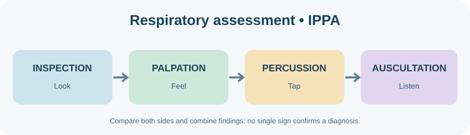

# ⚡ Day 2 — Respiratory Assessment & Diagnostics Quick Revision (Hinglish)

[🏠 Chapter](../README.md) · [📖 Day 2 Concepts](../Concepts/Day-02-Complete-Respiratory-Assessment-Diagnostics.md) · [📝 36 MCQs](../MCQs/Day-02-Complete-Respiratory-Assessment-Diagnostics.md) · [🏥 Previous Year Questions](../Previous-Year-Questions/README.md)

**🎬 YouTube quick revision:** [Respiratory IPPA](https://www.youtube.com/watch?v=PdbeHsh1OPM) / [ABG basics](https://www.youtube.com/watch?v=zDNYqK2epPs) · [ABG MCQ video](https://www.youtube.com/watch?v=G_2-0P9EfAg) · [Saare topic-wise videos](../Concepts/Day-02-Complete-Respiratory-Assessment-Diagnostics.md)

## 1. IPPA ko yaad rakho

1. **Inspection = Dekho:** RR, rhythm, depth, chest symmetry, accessory muscles.
2. **Palpation = Feel karo:** Chest expansion, trachea midline, tenderness, tactile fremitus.
3. **Percussion = Tap karo:** Resonant = normal air; dull = fluid/solid; hyperresonant = extra air.
4. **Auscultation = Suno:** Stethoscope se right/left side compare karo.

**Tactile fremitus** = Patient bolte waqt chest ki vibration **feel** hoti hai. Increased consolidation mein, decreased effusion/pneumothorax mein ho sakti hai.

## 2. Breath sounds

| Sound | Easy yaad karne ka tareeka |
|---|---|
| **Vesicular** | Peripheral lungs mein normal soft sound |
| **Wheeze** | Musical whistle — narrow airway |
| **Crackles** | Popping/crackling |
| **Rhonchi** | Low snoring sound |
| **Stridor** | Harsh upper-airway inspiratory sound — urgent assessment |
| **Pleural friction rub** | Rubbing/grating |

## 3. ABG basics

| Parameter | Common exam range |
|---|---|
| **pH** | **7.35–7.45** |
| **PaCO₂** | **35–45 mmHg** |
| **HCO₃⁻** | **22–26 mEq/L** |
| **PaO₂** | **80–100 mmHg** near sea level |

**Pehle pH dekho**, fir PaCO₂ aur HCO₃⁻ compare karo:

- pH **low** + CO₂ **high** → **Respiratory acidosis**
- pH **high** + CO₂ **low** → **Respiratory alkalosis**
- pH **low** + HCO₃⁻ **low** → **Metabolic acidosis**
- pH **high** + HCO₃⁻ **high** → **Metabolic alkalosis**

Ye uncomplicated teaching patterns hain; clinical ABG interpretation zyada detailed ho sakti hai.

## 4. Spirometry yaad rakho

- **FEV₁:** Forceful expiration ka **first 1 second** volume.
- **FVC:** Full forceful expiration ka total volume.
- **Ratio:** **FEV₁/FVC × 100**.
- **Low ratio:** Airflow obstruction suggest karta hai.
- **Low FVC alone:** Restriction **confirm nahi** karta; **TLC** chahiye.
- **RV:** Simple spirometry se directly measure nahi hota.

## 5. Diagnostic tests ka basic meaning

**Pulse oximetry** = SpO₂ estimate. **ABG** = oxygenation + acid-base. **Chest X-ray** = chest image. **Spirometry** = forced airflow/volume.

**Status:** Investigations ka intro padha; advanced procedures abhi nahi.

[📝 Day 2 practice MCQs](../MCQs/Day-02-Complete-Respiratory-Assessment-Diagnostics.md)

---

**🔗 Aage navigate karo:** [🏠 Chapter](../README.md) · [📖 Day 2 Concepts](../Concepts/Day-02-Complete-Respiratory-Assessment-Diagnostics.md) · [📝 36 MCQs](../MCQs/Day-02-Complete-Respiratory-Assessment-Diagnostics.md) · [🏥 Previous Year Questions](../Previous-Year-Questions/README.md)

[Day 2 diagnostics Q37–51](../MCQs/Day-02-Complete-Respiratory-Assessment-Diagnostics.md) · [25-question final mock](../MCQs/Day-02-Final-Mock-25.md).
