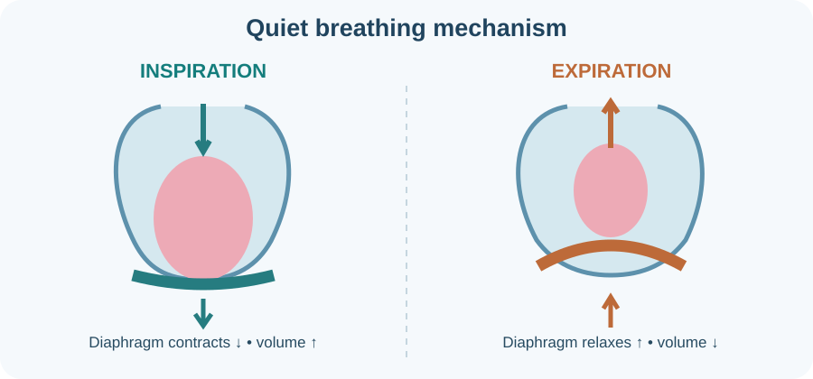

# Pleura, diaphragm & inspiration/expiration

[← Day-01-Anatomy-Physiology index](../../../README.md) · [Respiratory chapter](../../../../README.md)

## Pleura
- **Visceral pleura** directly covers the lung.
- **Parietal pleura** lines the thoracic cavity.
- The **pleural space** is a potential space with a small amount of lubricating fluid; normal pleural space is **not filled with air**.
- Fluid reduces friction (rubbing) while breathing.

## Breathing mechanism
| Quiet inspiration | Quiet expiration |
|---|---|
| Mostly **active** | Usually **passive** |
| Diaphragm **contracts**, moves **down** | Diaphragm **relaxes**, moves **up** |
| Thoracic volume **increases** | Thoracic volume **decreases** |
| Alveolar pressure falls below atmospheric | Alveolar pressure transiently rises above atmospheric |
| Air **enters** | Air **exits** |

**Main inspiratory muscle:** diaphragm; phrenic nerve carries motor supply from **C3–C5**. External intercostals assist with rib elevation.

**Pressure idea (Boyle's law):** When thoracic volume rises, pressure tends to fall, creating inward airflow.

**Memory:** IN → diaphragm DOWN → chest UP (volume); OUT → diaphragm UP → volume DOWN.

---
**Exam note:** This is a learning summary of topics covered; not official AIIMS examination material.
