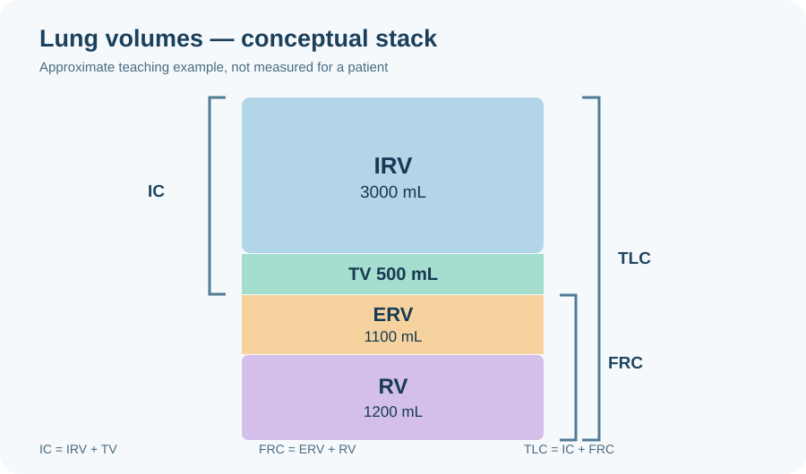

# Lung volumes & capacities

[← Day-01-Anatomy-Physiology index](../../../README.md) · [Respiratory chapter](../../../../README.md)

## Individual volumes
- **TV (Tidal volume):** ordinary quiet breath (~500 mL in a typical adult teaching example).
- **IRV:** extra air breathed **in** after a normal inspiration.
- **ERV:** extra air breathed **out** after a normal expiration.
- **RV:** air **remaining after maximal forced expiration**.

## Capacities (combinations)
| Capacity | Formula | What it means |
|---|---|---|
| **IC** inspiratory capacity | TV + IRV | Air inspired from end of quiet expiration |
| **VC** vital capacity | IRV + TV + ERV | Maximum voluntarily movable air |
| **FRC** functional residual capacity | ERV + RV | Remaining after **normal** expiration |
| **TLC** total lung capacity | TV + IRV + ERV + RV | Total air after maximal inspiration |

**Useful shortcut: TLC = IC + FRC.**

### Two common confusions
1. **RV vs FRC:** RV after **maximum forced** expiration; FRC after **normal quiet** expiration.
2. Capacity given, component missing? **Subtract** known component(s). Example IC 3600, TV 550 → IRV = **3050 mL**.

Approximate volumes vary substantially by age, sex, height and lung health.

---
**Exam note:** This is a learning summary of topics covered; not official AIIMS examination material.
