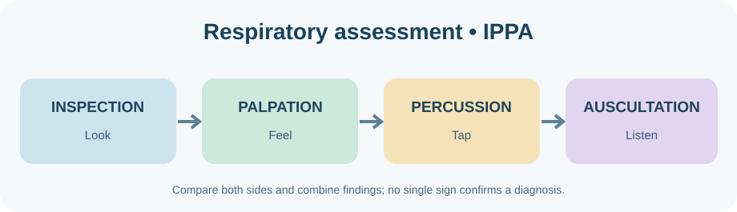

# Day 02 — Respiratory Assessment & Diagnostics

Day 2 topics covered in the learning sessions. Each topic keeps **Concepts** and **MCQs** separate.

| Topic | Concepts | MCQs |
|---|---|---|
| 01. Inspection | [Read](Topics/01-Inspection/Concepts/notes.md) | [Practice](Topics/01-Inspection/MCQs/practice.md) |
| 02. Palpation | [Read](Topics/02-Palpation/Concepts/notes.md) | [Practice](Topics/02-Palpation/MCQs/practice.md) |
| 03. Percussion | [Read](Topics/03-Percussion/Concepts/notes.md) | [Practice](Topics/03-Percussion/MCQs/practice.md) |
| 04. Auscultation | [Read](Topics/04-Auscultation/Concepts/notes.md) | [Practice](Topics/04-Auscultation/MCQs/practice.md) |
| 05. ABG basics & interpretation | [Read](Topics/05-ABG/Concepts/notes.md) | [Practice](Topics/05-ABG/MCQs/practice.md) |
| 06. Spirometry basics | [Read](Topics/06-Spirometry/Concepts/notes.md) | [Practice](Topics/06-Spirometry/MCQs/practice.md) |
| 07. Diagnostic investigations (**introduction only**) | [Read](Topics/07-Diagnostic-Investigations/Concepts/notes.md) | [Practice](Topics/07-Diagnostic-Investigations/MCQs/practice.md) |

**Study status:** Inspection, palpation, percussion, auscultation, ABG and spirometry were practiced. Diagnostic investigations began only at the **basics** level; it is not labeled as fully completed.

**Important:** The MCQs in this chapter are new original practice questions written to match the studied concepts. They should **not** be mistaken for an exact transcript of the previously answered question sets.

- [Day 2 quick revision](Revision/quick-revision.md)
- [Day 1](../Day-01-Anatomy-Physiology/README.md) · [Respiratory chapter](../README.md)
