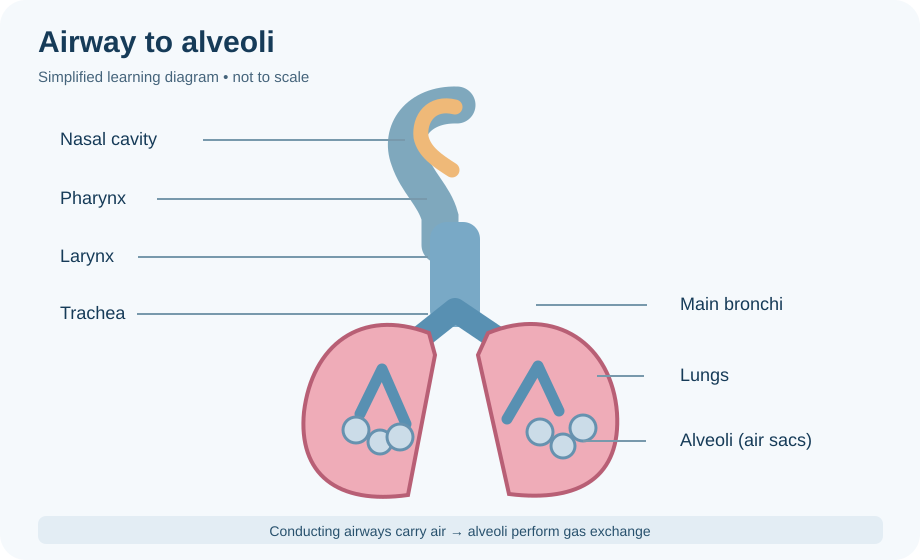

# 🫁 Respiratory System — Chapter 01

> AIIMS NORCET 12 + HP Staff Nurse revision | Simple English with Hindi explanations | Topics actually studied in the sessions

## Learning pathway

| Day | Coverage | Links |
|---|---|---|
| **Day 1** | Respiratory Anatomy & Physiology: airway, lungs, alveoli, surfactant, pleura, breathing, lung volumes and normal values | [Concepts + topic MCQs](Day-01-Anatomy-Physiology/README.md) |
| **Day 2** | Respiratory assessment: inspection, palpation, percussion, auscultation, ABG, spirometry; **basic** diagnostic investigations | [Concepts + topic MCQs](Day-02-Assessment-Diagnostics/README.md) |

## Visuals

- [Airway and lungs — SVG](Assets/respiratory-tract.svg)
- [Breathing mechanism — SVG](Assets/breathing-mechanics.svg)
- [Lung volumes — SVG](Assets/lung-volumes.svg)
- [Respiratory assessment — SVG](Assets/assessment-map.svg)

## Important distinction

**Concept notes** are separated from **MCQs** inside each topic directory. All practice questions supplied here are **original NORCET-style questions**. This repository does not claim that any question appeared in a verified AIIMS NORCET paper. Some are new examples to reinforce the same concepts; exact past-chat selections and all earlier MCQ prompts were not completely recoverable.

[References & fact checking](References.md) · [Back to repository](../README.md)
